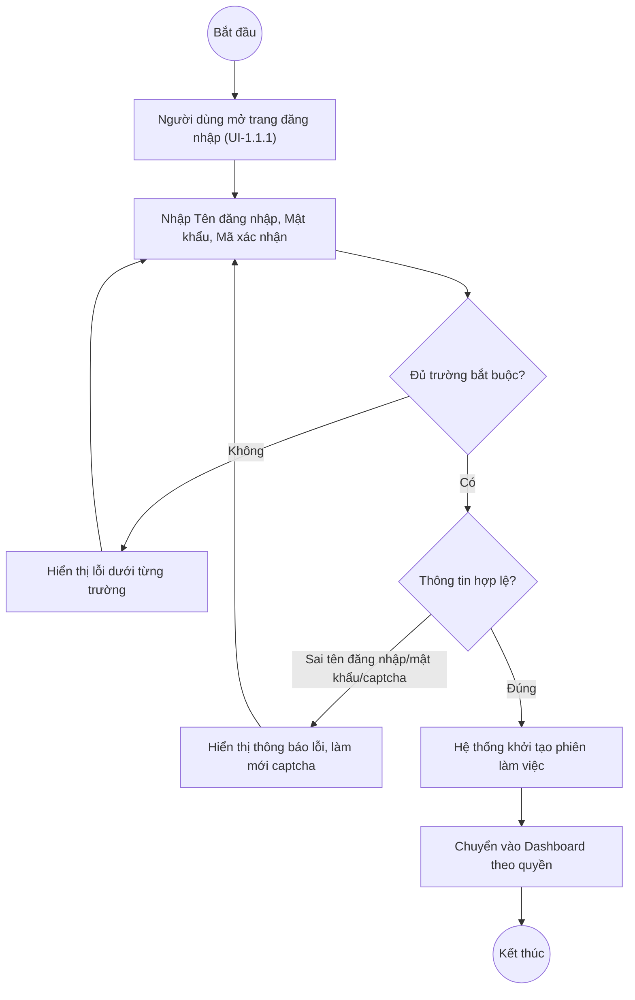

# UC1.1: Đăng nhập hệ thống

## 1. Thông tin chung

| ID | Use case | Description |
| :---- | :---- | :---- |
| UC1.1 | Đăng nhập hệ thống | Người dùng nhập tên đăng nhập, mật khẩu và mã xác nhận (captcha) để đăng nhập vào Web Portal. |

> **Actor:** Người dùng (mọi vai trò: Quản trị hệ thống, Lãnh đạo, Lãnh đạo đơn vị, Cán bộ…)
>
> **Trigger:** Người dùng truy cập trang chủ và nhấn "Đăng nhập hệ thống", hoặc truy cập thẳng địa chỉ đăng nhập
>
> **Điều kiện trước (Pre-condition):** Người dùng đã được Quản trị hệ thống cấp tài khoản (UC2.1) và chưa đăng nhập
>
> **Điều kiện sau (Post-condition):** Người dùng được xác thực, phiên làm việc được khởi tạo và chuyển vào màn hình Dashboard theo quyền tương ứng
>
> **Business rule:**
>
> BR-1: Tên đăng nhập, Mật khẩu, Mã xác nhận (captcha) đều là trường bắt buộc. *(Đã kiểm chứng trực tiếp ngày 10/10/2026: bấm "Đăng nhập" khi để trống cả 3 trường trả về lỗi "Vui lòng nhập tên đăng nhập!", "Vui lòng nhập mật khẩu!", "Vui lòng nhập mã xác nhận!")*
>
> BR-2: Mã xác nhận là ảnh captcha ngẫu nhiên, có nút làm mới (biểu tượng xoay vòng) để đổi mã khác. *(Đã kiểm chứng trực tiếp ngày 10/10/2026)*
>
> BR-3: Người dùng có thể chọn "Ghi nhớ đăng nhập" để duy trì phiên lâu hơn. **[Cần xác nhận]** thời gian duy trì cụ thể.
>
> BR-4: Trang chủ công khai có ghi chú "Hệ thống dành cho cán bộ, lãnh đạo các đơn vị được Trung tâm Chuyển đổi số cấp tài khoản. Chưa có tài khoản hoặc quên mật khẩu? Liên hệ bộ phận hỗ trợ." — hệ thống không có chức năng tự đăng ký tài khoản; tài khoản chỉ được tạo bởi Quản trị hệ thống (UC2.1). *(Đã kiểm chứng trực tiếp ngày 10/10/2026)*
>
> BR-5: Sau một số lần đăng nhập sai liên tiếp, tài khoản bị khóa tạm thời theo cấu hình tại Tham số hệ thống (UC3.2, mục "Đăng nhập & phiên làm việc"). **[Cần xác nhận]** thông báo hiển thị cho người dùng khi bị khóa tạm — chưa thử trực tiếp để tránh khóa nhầm tài khoản QA đang dùng để kiểm thử.
>
> BR-6: **[Cần xác nhận]** thông báo lỗi chính xác khi sai tên đăng nhập/mật khẩu hoặc sai mã xác nhận — chưa thử trực tiếp để tránh rủi ro khóa tạm tài khoản QA (BR-5).

**Truy vết chức năng**

| STT | Chức năng | YC (BCKTKT) | Dòng UC_1409 | Luồng | Màn hình | BR |
| :---- | :---- | :---- | :---- | :---- | :---- | :---- |
| 1 | Đăng nhập hệ thống | **[Cần xác nhận]** | **[Cần xác nhận]** | Basic Flow | UI-1.1.1 | BR-1, BR-2 |
| 2 | Ghi nhớ đăng nhập | **[Cần xác nhận]** | **[Cần xác nhận]** | AF1 | UI-1.1.1 | BR-3 |

> Cột YC (BCKTKT) và Dòng UC_1409 chưa đối chiếu được với bản gốc Google Sheet "Danh sách công việc_CĐS - BCT". Use case nguồn tương ứng: UC-A.I.1 "Đăng nhập hệ thống".

## 2. Mô tả luồng nghiệp vụ

*Hình 1. Luồng nghiệp vụ đăng nhập hệ thống*

**Basic Flow**

1. Người dùng truy cập trang chủ hệ thống, nhấn "Đăng nhập hệ thống".
2. Hệ thống hiển thị màn hình Đăng nhập (UI-1.1.1).
3. Người dùng nhập Tên đăng nhập, Mật khẩu, Mã xác nhận và nhấn "Đăng nhập".
4. Hệ thống kiểm tra các trường bắt buộc (BR-1).
5. Hệ thống xác thực tên đăng nhập/mật khẩu/mã xác nhận.
6. Nếu hợp lệ, hệ thống khởi tạo phiên làm việc và chuyển người dùng vào Dashboard tương ứng với quyền của tài khoản.

**Alternative Flow**

AF1. Ghi nhớ đăng nhập

Tại bước 3, Người dùng tick chọn "Ghi nhớ đăng nhập" trước khi nhấn "Đăng nhập" (BR-3). Luồng tiếp tục như Basic Flow.

AF2. Quên mật khẩu

Tại màn hình đăng nhập, Người dùng nhấn "Quên mật khẩu?" để chuyển sang luồng UC1.4.

**Exception Flow**

EF1. Thiếu trường bắt buộc

Tại bước 4, Hệ thống hiển thị lỗi ngay dưới từng trường: "Vui lòng nhập tên đăng nhập!", "Vui lòng nhập mật khẩu!", "Vui lòng nhập mã xác nhận!". *(Đã kiểm chứng trực tiếp ngày 10/10/2026)*

Quay lại bước 3.

EF2. Sai tên đăng nhập, mật khẩu hoặc mã xác nhận

Tại bước 5, nếu thông tin không hợp lệ, Hệ thống hiển thị thông báo lỗi và làm mới mã xác nhận. **[Cần xác nhận]** nội dung thông báo chính xác, có phân biệt "sai mật khẩu" và "sai captcha" hay dùng chung một thông báo.

Quay lại bước 3.

EF3. Tài khoản bị khóa tạm thời do đăng nhập sai nhiều lần

Theo cấu hình BR-5 (UC3.2). **[Cần xác nhận]** nội dung thông báo và thời gian còn lại hiển thị cho người dùng.

Use case kết thúc.

## 3. Màn hình

| UI Code | Screen | Mô tả |
| :---- | :---- | :---- |
| UI-1.1.1 | Đăng nhập (Web) | Nhập tên đăng nhập, mật khẩu, mã xác nhận; liên kết Quên mật khẩu |

## 4. Mô tả Màn hình (Field Specification)

**UI-1.1.1 — Đăng nhập**

| Field Name | Field type | Data Type | Required | Validation rule/Behaviour |
| :---- | :---- | :---- | :---- | :---- |
| Tên đăng nhập | Textbox | String | Yes | **Behaviour:** Placeholder "Nhập tên đăng nhập" **Validation rule:** Bắt buộc. Lỗi: "Vui lòng nhập tên đăng nhập!" |
| Mật khẩu | Textbox (password) | String | Yes | **Behaviour:** Placeholder "Nhập mật khẩu"; biểu tượng ẩn/hiện mật khẩu **Validation rule:** Bắt buộc. Lỗi: "Vui lòng nhập mật khẩu!" |
| Mã xác nhận | Textbox + ảnh captcha | String | Yes | **Behaviour:** Placeholder "Nhập mã bên cạnh"; ảnh captcha kèm nút làm mới (BR-2) **Validation rule:** Bắt buộc. Lỗi: "Vui lòng nhập mã xác nhận!" |
| Ghi nhớ đăng nhập | Checkbox | Boolean | No | **Behaviour:** Theo BR-3 **Validation rule:** — |
| Quên mật khẩu? | Link | Action | Yes | **Behaviour:** Chuyển sang luồng UC1.4 **Validation rule:** — |
| Nút Đăng nhập | Button | Action | Yes | **Behaviour:** Thực hiện xác thực (bước 4–6) **Validation rule:** — |

## Điểm cần xác nhận

| STT | Vị trí | Giả định đã dùng | Câu hỏi cần xác nhận |
| :---- | :---- | :---- | :---- |
| 1 | BR-5, EF3 | Khóa tạm thời sau N lần sai, theo cấu hình UC3.2 | Nội dung thông báo hiển thị cho người dùng khi bị khóa là gì? |
| 2 | EF2 | Có thông báo lỗi khi sai thông tin | Nội dung chính xác của thông báo — chưa thử trực tiếp để tránh khóa tạm tài khoản QA dùng chung cho việc kiểm thử các UC khác |
| 3 | Truy vết chức năng | Chưa có số YC (BCKTKT) và Dòng UC_1409 | Đề nghị đối chiếu với bản gốc Google Sheet "Danh sách công việc_CĐS - BCT" |
