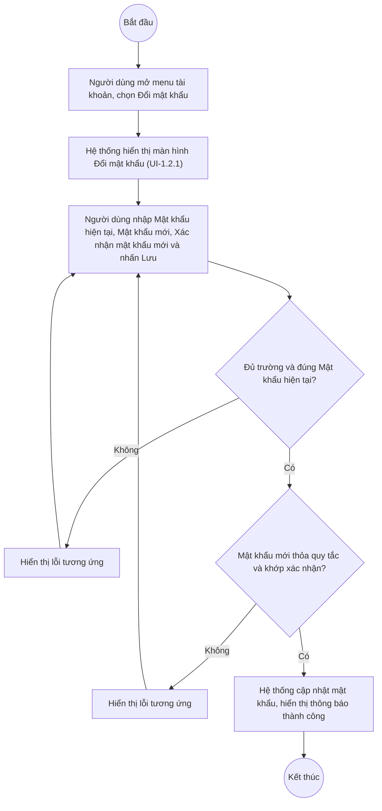

# UC1.2: Đổi mật khẩu

## 1. Thông tin chung

| ID | Use case | Description |
| :---- | :---- | :---- |
| UC1.2 | Đổi mật khẩu | Người dùng tự đổi mật khẩu đăng nhập của chính mình (chủ động hoặc khi bị bắt buộc đổi do hết hạn/lần đầu đăng nhập). |

> **Actor:** Người dùng (mọi vai trò)
>
> **Trigger:** Người dùng mở menu tài khoản (avatar góc dưới sidebar) và chọn "Đổi mật khẩu"; hoặc bị hệ thống bắt buộc đổi mật khẩu khi đăng nhập (theo UC3.2)
>
> **Điều kiện trước (Pre-condition):** Người dùng đã đăng nhập hệ thống (hoặc đang ở bước bắt buộc đổi mật khẩu ngay sau khi xác thực lần đầu)
>
> **Điều kiện sau (Post-condition):** Mật khẩu của tài khoản được cập nhật; các phiên đăng nhập khác **[Cần xác nhận]** có bị buộc đăng xuất hay không
>
> **Business rule:**
>
> BR-1: Mật khẩu hiện tại, Mật khẩu mới, Xác nhận mật khẩu mới đều là trường bắt buộc. *(Đã kiểm chứng cấu trúc form trực tiếp ngày 08/10/2026; chưa thử submit để lấy nội dung lỗi cụ thể vì cần mật khẩu thật của tài khoản QA)*
>
> BR-2: Mật khẩu mới phải thỏa quy tắc mật khẩu đang cấu hình tại Tham số hệ thống (UC3.2, mục "Quy tắc mật khẩu"): độ dài tối thiểu, yêu cầu chữ hoa/thường, chữ số, ký tự đặc biệt, không chứa tên đăng nhập, không trùng N mật khẩu gần nhất. *(Quy tắc đã kiểm chứng trực tiếp ngày 10/10/2026 tại UC3.2; việc áp dụng quy tắc này vào đúng màn Đổi mật khẩu — [Cần xác nhận], chưa thử nhập mật khẩu không hợp lệ tại chính màn hình UC1.2)*
>
> BR-3: Xác nhận mật khẩu mới phải trùng khớp với Mật khẩu mới. **[Cần xác nhận]** thông báo lỗi cụ thể khi không khớp.
>
> BR-4: Mật khẩu hiện tại nhập sai thì không cho đổi. **[Cần xác nhận]** thông báo lỗi cụ thể.

**Truy vết chức năng**

| STT | Chức năng | YC (BCKTKT) | Dòng UC_1409 | Luồng | Màn hình | BR |
| :---- | :---- | :---- | :---- | :---- | :---- | :---- |
| 1 | Đổi mật khẩu (chủ động) | **[Cần xác nhận]** | **[Cần xác nhận]** | Basic Flow | UI-1.2.1 | BR-1, BR-2, BR-3, BR-4 |
| 2 | Bắt buộc đổi mật khẩu lần đầu / khi hết hạn | **[Cần xác nhận]** | **[Cần xác nhận]** | AF1 | UI-1.2.1 | BR-2 |

> Cột YC (BCKTKT) và Dòng UC_1409 chưa đối chiếu được với bản gốc. Use case nguồn tương ứng: UC-A.I.2 "Đổi mật khẩu".

## 2. Mô tả luồng nghiệp vụ

*Hình 1. Luồng nghiệp vụ đổi mật khẩu*

**Basic Flow**

1. Người dùng mở menu tài khoản (avatar), chọn "Đổi mật khẩu".
2. Hệ thống hiển thị màn hình Đổi mật khẩu (UI-1.2.1).
3. Người dùng nhập Mật khẩu hiện tại, Mật khẩu mới, Xác nhận mật khẩu mới và nhấn "Lưu".
4. Hệ thống kiểm tra các trường bắt buộc, tính đúng đắn của Mật khẩu hiện tại (BR-1, BR-4), quy tắc mật khẩu mới (BR-2) và sự trùng khớp giữa Mật khẩu mới và Xác nhận mật khẩu mới (BR-3).
5. Hệ thống cập nhật mật khẩu và hiển thị thông báo thành công.

**Alternative Flow**

AF1. Bắt buộc đổi mật khẩu

Khi đăng nhập lần đầu hoặc khi mật khẩu đã hết hạn theo cấu hình "Bắt buộc đổi ở lần đăng nhập tiếp theo" (UC3.2), Hệ thống tự động chuyển người dùng tới màn hình Đổi mật khẩu trước khi cho vào các chức năng khác. Luồng tiếp tục từ bước 3. **[Cần xác nhận]** người dùng có được phép bỏ qua bước này hay bắt buộc hoàn tất mới dùng được hệ thống.

**Exception Flow**

EF1. Thiếu trường bắt buộc / Mật khẩu hiện tại sai / Mật khẩu mới không thỏa quy tắc / Xác nhận không khớp

Tại bước 4, Hệ thống hiển thị lỗi tương ứng dưới từng trường. **[Cần xác nhận]** nội dung chính xác từng thông báo lỗi.

Quay lại bước 3.

## 3. Màn hình

| UI Code | Screen | Mô tả |
| :---- | :---- | :---- |
| UI-1.2.1 | Đổi mật khẩu (Web) | Nhập Mật khẩu hiện tại, Mật khẩu mới, Xác nhận mật khẩu mới |

## 4. Mô tả Màn hình (Field Specification)

**UI-1.2.1 — Đổi mật khẩu** *(route "Tài khoản > Đổi mật khẩu")*

| Field Name | Field type | Data Type | Required | Validation rule/Behaviour |
| :---- | :---- | :---- | :---- | :---- |
| Mật khẩu hiện tại | Textbox (password) | String | Yes | **Behaviour:** Biểu tượng ẩn/hiện mật khẩu **Validation rule:** Bắt buộc; phải đúng mật khẩu hiện tại (BR-4). **[Cần xác nhận]** nội dung lỗi |
| Mật khẩu mới | Textbox (password) | String | Yes | **Behaviour:** Biểu tượng ẩn/hiện mật khẩu **Validation rule:** Bắt buộc; theo quy tắc mật khẩu đang cấu hình (BR-2, xem UC3.2) |
| Xác nhận mật khẩu mới | Textbox (password) | String | Yes | **Behaviour:** Biểu tượng ẩn/hiện mật khẩu **Validation rule:** Bắt buộc; phải trùng Mật khẩu mới (BR-3) |
| Nút Lưu | Button | Action | Yes | **Behaviour:** Thực hiện đổi mật khẩu (bước 4–5) **Validation rule:** — |

## Điểm cần xác nhận

| STT | Vị trí | Giả định đã dùng | Câu hỏi cần xác nhận |
| :---- | :---- | :---- | :---- |
| 1 | Post-condition | Chưa rõ các phiên đăng nhập khác có bị đăng xuất khi đổi mật khẩu | Cần xác nhận hành vi bảo mật này |
| 2 | BR-1, BR-3, BR-4, EF1 | Nội dung thông báo lỗi chưa xác minh được (chưa thử submit vì cần mật khẩu thật của tài khoản QA, tránh rủi ro khóa tài khoản test) | Đề nghị xác nhận hoặc cho phép thử trên tài khoản phụ không ảnh hưởng |
| 3 | AF1 | Có thể bỏ qua bước bắt buộc đổi mật khẩu hay không | Cần xác nhận |
| 4 | Truy vết chức năng | Chưa có số YC (BCKTKT) và Dòng UC_1409 | Đề nghị đối chiếu với bản gốc Google Sheet |
