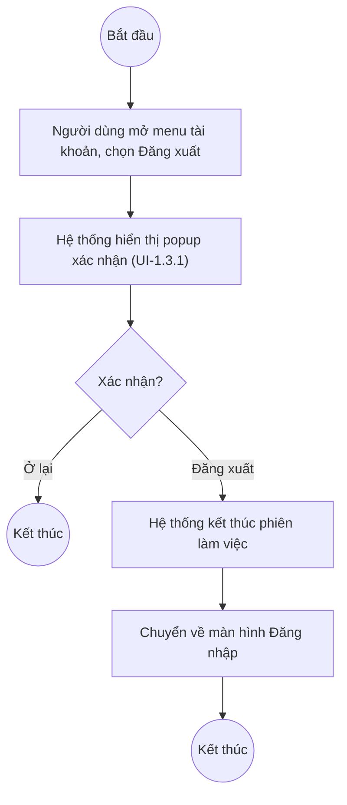

# UC1.3: Đăng xuất hệ thống

## 1. Thông tin chung

| ID | Use case | Description |
| :---- | :---- | :---- |
| UC1.3 | Đăng xuất hệ thống | Người dùng chủ động đăng xuất khỏi Web Portal. |

> **Actor:** Người dùng (mọi vai trò)
>
> **Trigger:** Người dùng mở menu tài khoản (avatar góc dưới sidebar) và chọn "Đăng xuất"
>
> **Điều kiện trước (Pre-condition):** Người dùng đã đăng nhập hệ thống
>
> **Điều kiện sau (Post-condition):** Phiên làm việc kết thúc, người dùng được chuyển về màn hình Đăng nhập (UI-1.1.1)
>
> **Business rule:**
>
> BR-1: Trước khi đăng xuất, Hệ thống hiển thị popup xác nhận với cảnh báo mất dữ liệu chưa lưu. *(Đã kiểm chứng trực tiếp ngày 08/10/2026: nội dung "Phiên làm việc của bạn sẽ kết thúc. Những thay đổi chưa lưu trên phiếu tự đánh giá sẽ không được giữ lại.")*
>
> BR-2: Người dùng có thể hủy thao tác đăng xuất và tiếp tục làm việc.

**Truy vết chức năng**

| STT | Chức năng | YC (BCKTKT) | Dòng UC_1409 | Luồng | Màn hình | BR |
| :---- | :---- | :---- | :---- | :---- | :---- | :---- |
| 1 | Đăng xuất hệ thống | **[Cần xác nhận]** | **[Cần xác nhận]** | Basic Flow | UI-1.3.1 | BR-1 |

> Cột YC (BCKTKT) và Dòng UC_1409 chưa đối chiếu được với bản gốc. Use case nguồn tương ứng: UC-A.I.3 "Đăng xuất hệ thống".

## 2. Mô tả luồng nghiệp vụ

*Hình 1. Luồng nghiệp vụ đăng xuất hệ thống*

**Basic Flow**

1. Người dùng mở menu tài khoản (avatar), chọn "Đăng xuất".
2. Hệ thống hiển thị popup xác nhận "Đăng xuất khỏi hệ thống?" (UI-1.3.1, BR-1).
3. Người dùng nhấn "Đăng xuất".
4. Hệ thống kết thúc phiên làm việc và chuyển về màn hình Đăng nhập (UC1.1).

**Alternative Flow**

AF1. Hủy đăng xuất

Tại bước 2, Người dùng nhấn "Ở lại". Hệ thống đóng popup, giữ nguyên phiên làm việc (BR-2). Use case kết thúc.

## 3. Màn hình

| UI Code | Screen | Mô tả |
| :---- | :---- | :---- |
| UI-1.3.1 | Popup xác nhận đăng xuất (Web) | Xác nhận trước khi kết thúc phiên làm việc |

## 4. Mô tả Màn hình (Field Specification)

**UI-1.3.1 — Popup xác nhận đăng xuất**

| Field Name | Field type | Data Type | Required | Validation rule/Behaviour |
| :---- | :---- | :---- | :---- | :---- |
| Tiêu đề | Label | String | Yes | **Behaviour:** "Đăng xuất khỏi hệ thống?" **Validation rule:** — |
| Nội dung cảnh báo | Label | String | Yes | **Behaviour:** "Phiên làm việc của bạn sẽ kết thúc. Những thay đổi chưa lưu trên phiếu tự đánh giá sẽ không được giữ lại." (BR-1) **Validation rule:** — |
| Nút Ở lại | Button | Action | Yes | **Behaviour:** Đóng popup, không đăng xuất (AF1) **Validation rule:** — |
| Nút Đăng xuất | Button | Action | Yes | **Behaviour:** Kết thúc phiên làm việc (bước 3–4) **Validation rule:** — |

## Điểm cần xác nhận

| STT | Vị trí | Giả định đã dùng | Câu hỏi cần xác nhận |
| :---- | :---- | :---- | :---- |
| 1 | Truy vết chức năng | Chưa có số YC (BCKTKT) và Dòng UC_1409 | Đề nghị đối chiếu với bản gốc Google Sheet |
