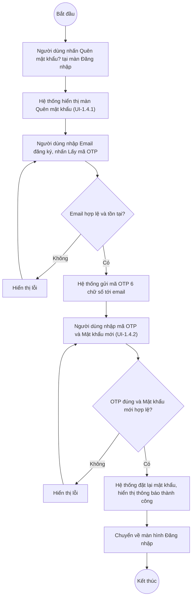

# UC1.4: Lấy lại mật khẩu

## 1. Thông tin chung

| ID | Use case | Description |
| :---- | :---- | :---- |
| UC1.4 | Lấy lại mật khẩu | Người dùng quên mật khẩu có thể tự khôi phục bằng cách xác thực qua email đăng ký (mã OTP) và đặt mật khẩu mới, không cần liên hệ Quản trị hệ thống. |

> **Actor:** Người dùng (mọi vai trò)
>
> **Trigger:** Tại màn hình Đăng nhập (UI-1.1.1), Người dùng nhấn "Quên mật khẩu?"
>
> **Điều kiện trước (Pre-condition):** Người dùng có tài khoản hợp lệ với Email đăng ký còn truy cập được
>
> **Điều kiện sau (Post-condition):** Mật khẩu của tài khoản được đặt lại thành công, người dùng có thể đăng nhập bằng mật khẩu mới
>
> **Business rule:**
>
> BR-1: Email đăng ký là trường bắt buộc duy nhất ở bước đầu. *(Đã kiểm chứng cấu trúc form trực tiếp ngày 10/10/2026; chưa submit thật để tránh gửi email/OTP thật)*
>
> BR-2: Hệ thống gửi mã OTP gồm 6 chữ số tới email đăng ký. *(Nội dung mô tả trên màn hình đã kiểm chứng trực tiếp ngày 10/10/2026: "Nhập email đã đăng ký với tài khoản. Hệ thống sẽ gửi mã OTP gồm 6 chữ số đến email này."; chưa xác nhận được bước nhập OTP và đặt mật khẩu mới do dừng lại trước khi gửi yêu cầu thật)*
>
> BR-3: Nếu không còn truy cập được email đã đăng ký, màn hình hướng dẫn liên hệ Quản trị hệ thống để được cấp lại mật khẩu (tương đương thao tác thủ công, ngoài phạm vi tự phục vụ). *(Đã kiểm chứng trực tiếp ngày 10/10/2026: ghi chú "Không còn truy cập được email đã đăng ký? Liên hệ Quản trị hệ thống để được cấp lại mật khẩu.")*
>
> BR-4: Mật khẩu mới đặt ở bước cuối phải thỏa quy tắc mật khẩu đang cấu hình (UC3.2). **[Cần xác nhận]** — suy luận theo BR-2 của UC1.2, chưa đi hết luồng để xác minh trực tiếp màn đặt mật khẩu mới.
>
> BR-5: **[Cần xác nhận]** mã OTP có thời hạn hiệu lực bao lâu, giới hạn số lần nhập sai, có cho gửi lại mã hay không.

**Truy vết chức năng**

| STT | Chức năng | YC (BCKTKT) | Dòng UC_1409 | Luồng | Màn hình | BR |
| :---- | :---- | :---- | :---- | :---- | :---- | :---- |
| 1 | Gửi yêu cầu lấy lại mật khẩu (nhập email, nhận OTP) | **[Cần xác nhận]** | **[Cần xác nhận]** | Basic Flow bước 1–3 | UI-1.4.1 | BR-1, BR-2 |
| 2 | Xác thực OTP và đặt mật khẩu mới | **[Cần xác nhận]** | **[Cần xác nhận]** | Basic Flow bước 4–6 | UI-1.4.2 | BR-4, BR-5 |

> Cột YC (BCKTKT) và Dòng UC_1409 chưa đối chiếu được với bản gốc. Use case nguồn tương ứng: UC-A.I.4 "Lấy lại mật khẩu". **Lưu ý:** chỉ bước nhập email (UI-1.4.1) được kiểm chứng trực tiếp; bước nhập OTP và đặt mật khẩu mới (UI-1.4.2) chưa thực hiện được vì cần nhận email OTP thật — nội dung mục 4 cho UI-1.4.2 là suy luận hợp lý từ mô tả trên màn hình và từ UC_1409.

## 2. Mô tả luồng nghiệp vụ

*Hình 1. Luồng nghiệp vụ lấy lại mật khẩu*

**Basic Flow**

1. Tại màn hình Đăng nhập, Người dùng nhấn "Quên mật khẩu?".
2. Hệ thống hiển thị màn hình Quên mật khẩu (UI-1.4.1).
3. Người dùng nhập Email đăng ký và nhấn "Lấy mã OTP". Hệ thống kiểm tra email hợp lệ (BR-1) và gửi mã OTP 6 chữ số đến email đó (BR-2).
4. Hệ thống hiển thị màn hình nhập OTP và mật khẩu mới (UI-1.4.2). **[Cần xác nhận]** bố cục chính xác của bước này.
5. Người dùng nhập mã OTP nhận được, nhập Mật khẩu mới và Xác nhận mật khẩu mới.
6. Hệ thống xác thực OTP, kiểm tra quy tắc mật khẩu mới (BR-4), đặt lại mật khẩu và chuyển người dùng về màn hình Đăng nhập (UC1.1) với thông báo thành công.

**Alternative Flow**

AF1. Không còn truy cập được email đã đăng ký

Tại UI-1.4.1, Người dùng đọc ghi chú và liên hệ Quản trị hệ thống để được cấp lại mật khẩu theo cách thủ công (BR-3), ngoài phạm vi tự phục vụ của use case này. Use case kết thúc.

AF2. Quay lại đăng nhập

Tại UI-1.4.1, Người dùng nhấn "Quay lại đăng nhập". Hệ thống chuyển về màn hình Đăng nhập (UC1.1), hủy yêu cầu lấy lại mật khẩu.

**Exception Flow**

EF1. Email không hợp lệ hoặc không tồn tại trong hệ thống

Tại bước 3, Hệ thống hiển thị lỗi tương ứng. **[Cần xác nhận]** nội dung thông báo và liệu hệ thống có tiết lộ email không tồn tại hay dùng thông báo chung chung (để tránh dò quét tài khoản).

Quay lại bước 3.

EF2. Mã OTP sai hoặc hết hạn

Tại bước 6, Hệ thống hiển thị lỗi tương ứng. **[Cần xác nhận]** toàn bộ nội dung và cơ chế (BR-5).

Quay lại bước 5.

## 3. Màn hình

| UI Code | Screen | Mô tả |
| :---- | :---- | :---- |
| UI-1.4.1 | Quên mật khẩu — Nhập email (Web) | Nhập Email đăng ký để nhận mã OTP |
| UI-1.4.2 | Quên mật khẩu — Nhập OTP và mật khẩu mới (Web) | **Suy luận, chưa kiểm chứng trực tiếp** — nhập mã OTP, Mật khẩu mới, Xác nhận mật khẩu mới |

## 4. Mô tả Màn hình (Field Specification)

**UI-1.4.1 — Quên mật khẩu (Nhập email)**

| Field Name | Field type | Data Type | Required | Validation rule/Behaviour |
| :---- | :---- | :---- | :---- | :---- |
| Tiêu đề | Label | String | Yes | **Behaviour:** "Quên mật khẩu" — phụ đề "Nhập email đã đăng ký với tài khoản. Hệ thống sẽ gửi mã OTP gồm 6 chữ số đến email này." **Validation rule:** — |
| Quay lại đăng nhập | Link | Action | Yes | **Behaviour:** Chuyển về UI-1.1.1 (AF2) **Validation rule:** — |
| Email đăng ký | Textbox | String | Yes | **Behaviour:** Placeholder "Nhập email đăng ký" **Validation rule:** Bắt buộc; đúng định dạng email (BR-1). **[Cần xác nhận]** nội dung lỗi |
| Nút Lấy mã OTP | Button | Action | Yes | **Behaviour:** Gửi OTP tới email, chuyển sang UI-1.4.2 (bước 3–4) **Validation rule:** — |
| Ghi chú hỗ trợ | Label | String | Yes | **Behaviour:** "Không còn truy cập được email đã đăng ký? Liên hệ Quản trị hệ thống để được cấp lại mật khẩu." (BR-3) **Validation rule:** — |

**UI-1.4.2 — Quên mật khẩu (Nhập OTP và mật khẩu mới)** *(suy luận từ mô tả UC_1409 và bước 1, chưa kiểm chứng trực tiếp — xem ghi chú mục 1)*

| Field Name | Field type | Data Type | Required | Validation rule/Behaviour |
| :---- | :---- | :---- | :---- | :---- |
| Mã OTP | Textbox | String | Yes | **Behaviour:** 6 chữ số, gửi tới email ở bước trước (BR-2) **Validation rule:** Bắt buộc. **[Cần xác nhận]** toàn bộ |
| Mật khẩu mới | Textbox (password) | String | Yes | **Behaviour:** — **Validation rule:** Bắt buộc; theo quy tắc mật khẩu (BR-4). **[Cần xác nhận]** |
| Xác nhận mật khẩu mới | Textbox (password) | String | Yes | **Behaviour:** — **Validation rule:** Bắt buộc; khớp Mật khẩu mới. **[Cần xác nhận]** |
| Nút xác nhận | Button | Action | Yes | **Behaviour:** Đặt lại mật khẩu (bước 6) **Validation rule:** **[Cần xác nhận]** nhãn nút chính xác |

## Điểm cần xác nhận

| STT | Vị trí | Giả định đã dùng | Câu hỏi cần xác nhận |
| :---- | :---- | :---- | :---- |
| 1 | UI-1.4.2, toàn bộ | Chưa thực hiện được bước nhập OTP vì cần email thật nhận mã — nội dung là suy luận | Đề nghị kiểm thử lại với một email test có thể truy cập được để xác minh chính xác |
| 2 | BR-5 | Thời hạn OTP, số lần nhập sai, có cho gửi lại mã hay không | Cần quy định cụ thể |
| 3 | EF1 | Chưa rõ hệ thống có tiết lộ email không tồn tại hay không | Cần xác nhận để tránh rủi ro bảo mật (dò quét tài khoản) |
| 4 | Truy vết chức năng | Chưa có số YC (BCKTKT) và Dòng UC_1409 | Đề nghị đối chiếu với bản gốc Google Sheet |
