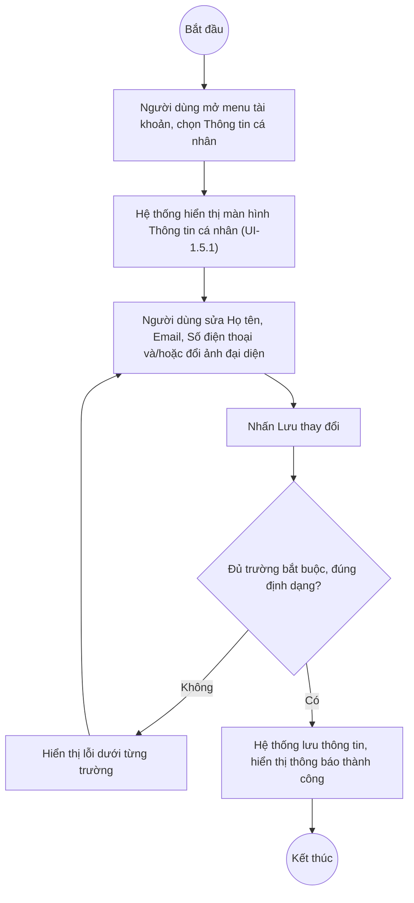

# UC1.5: Thay đổi thông tin cá nhân

## 1. Thông tin chung

| ID | Use case | Description |
| :---- | :---- | :---- |
| UC1.5 | Thay đổi thông tin cá nhân | Người dùng xem và cập nhật hồ sơ cá nhân (họ tên, email, số điện thoại, ảnh đại diện) của chính tài khoản mình. |

> **Actor:** Người dùng (mọi vai trò)
>
> **Trigger:** Người dùng mở menu tài khoản (avatar) và chọn "Thông tin cá nhân"
>
> **Điều kiện trước (Pre-condition):** Người dùng đã đăng nhập hệ thống
>
> **Điều kiện sau (Post-condition):** Thông tin hồ sơ (Họ tên, Email, Số điện thoại, ảnh đại diện) của tài khoản được cập nhật
>
> **Business rule:**
>
> BR-1: Họ tên, Email, Số điện thoại là trường bắt buộc. *(Đã kiểm chứng cấu trúc form trực tiếp ngày 08/10/2026 — các trường này có dấu `*`)*
>
> BR-2: Chức vụ, Tên đăng nhập, Đơn vị hiển thị chỉ đọc tại màn hình này, kèm ghi chú "Tên đăng nhập, chức vụ và đơn vị được quản lý tại màn Người dùng, không chỉnh sửa tại đây" — tức chỉ Quản trị hệ thống mới sửa được 3 trường này, qua UC2.1. *(Đã kiểm chứng trực tiếp ngày 08/10/2026)*
>
> BR-3: Ảnh đại diện định dạng JPG hoặc PNG, tối đa 2 MB, khuyến nghị ảnh vuông 400×400 px. *(Đã kiểm chứng trực tiếp ngày 08/10/2026 — ghi chú hiển thị ngay dưới khung ảnh)*
>
> BR-4: Email dùng để đăng nhập, nhận thông báo và khôi phục mật khẩu (liên quan UC1.4). *(Đã kiểm chứng ghi chú trên màn hình ngày 08/10/2026: "Dùng để đăng nhập, nhận thông báo và khôi phục mật khẩu.")* **[Cần xác nhận]** đổi Email tại đây có ảnh hưởng tới Tên đăng nhập hay không, vì Tên đăng nhập một số tài khoản mẫu quan sát được trùng với địa chỉ email.
>
> BR-5: **[Cần xác nhận]** Email mới có cần xác thực lại (gửi OTP) trước khi áp dụng hay cập nhật ngay.

**Truy vết chức năng**

| STT | Chức năng | YC (BCKTKT) | Dòng UC_1409 | Luồng | Màn hình | BR |
| :---- | :---- | :---- | :---- | :---- | :---- | :---- |
| 1 | Thay đổi thông tin cá nhân (họ tên, email, SĐT) | **[Cần xác nhận]** | **[Cần xác nhận]** | Basic Flow | UI-1.5.1 | BR-1, BR-2, BR-4 |
| 2 | Cập nhật ảnh đại diện | **[Cần xác nhận]** | **[Cần xác nhận]** | AF1 | UI-1.5.1 | BR-3 |

> Cột YC (BCKTKT) và Dòng UC_1409 chưa đối chiếu được với bản gốc. Use case nguồn tương ứng: UC-A.I.5 "Thay đổi thông tin cá nhân".

## 2. Mô tả luồng nghiệp vụ

*Hình 1. Luồng nghiệp vụ thay đổi thông tin cá nhân*

**Basic Flow**

1. Người dùng mở menu tài khoản (avatar), chọn "Thông tin cá nhân".
2. Hệ thống hiển thị màn hình Thông tin cá nhân (UI-1.5.1) với dữ liệu hiện tại.
3. Người dùng sửa Họ tên, Email và/hoặc Số điện thoại, nhấn "Lưu thay đổi".
4. Hệ thống kiểm tra các trường bắt buộc và định dạng (BR-1).
5. Hệ thống lưu thông tin và hiển thị thông báo thành công.

**Alternative Flow**

AF1. Cập nhật ảnh đại diện

Tại UI-1.5.1, Người dùng nhấn "Tải ảnh lên", chọn file ảnh JPG/PNG tối đa 2 MB (BR-3). Hệ thống cập nhật ảnh đại diện. Người dùng có thể nhấn "Gỡ ảnh" để xóa ảnh đại diện hiện tại.

AF2. Hủy thay đổi

Tại UI-1.5.1, Người dùng nhấn "Huỷ". Hệ thống khôi phục lại dữ liệu ban đầu, không lưu thay đổi.

AF3. Chuyển sang Đổi mật khẩu

Tại UI-1.5.1, Người dùng nhấn "Đổi mật khẩu" trong khối "Mật khẩu". Hệ thống chuyển sang luồng UC1.2.

**Exception Flow**

EF1. Thiếu trường bắt buộc hoặc sai định dạng

Tại bước 4, Hệ thống hiển thị lỗi dưới từng trường tương ứng. **[Cần xác nhận]** nội dung chính xác (ví dụ định dạng Email, Số điện thoại).

Quay lại bước 3.

## 3. Màn hình

| UI Code | Screen | Mô tả |
| :---- | :---- | :---- |
| UI-1.5.1 | Thông tin cá nhân (Web) | Quản lý hồ sơ và ảnh đại diện của tài khoản |

## 4. Mô tả Màn hình (Field Specification)

**UI-1.5.1 — Thông tin cá nhân** *(route "Tài khoản > Thông tin cá nhân")*

| Field Name | Field type | Data Type | Required | Validation rule/Behaviour |
| :---- | :---- | :---- | :---- | :---- |
| Ảnh đại diện | Avatar + upload | File | No | **Behaviour:** Nút "Tải ảnh lên", "Gỡ ảnh" (AF1); ghi chú "JPG hoặc PNG, tối đa 2 MB. Khuyến nghị ảnh vuông từ 400×400 px." **Validation rule:** Theo BR-3 |
| Tên đăng nhập, Nhóm người dùng | Label | String | Yes | **Behaviour:** Hiển thị thông tin tài khoản, chỉ đọc **Validation rule:** — |
| Họ tên | Textbox | String | Yes | **Behaviour:** — **Validation rule:** Bắt buộc (BR-1). **[Cần xác nhận]** độ dài tối đa |
| Chức vụ | Textbox | String | — | **Behaviour:** Chỉ đọc, quản lý tại UC2.1 (BR-2) **Validation rule:** — |
| Email | Textbox | String | Yes | **Behaviour:** Ghi chú "Dùng để đăng nhập, nhận thông báo và khôi phục mật khẩu." (BR-4) **Validation rule:** Bắt buộc; đúng định dạng email. **[Cần xác nhận]** có cần xác thực lại qua OTP không (BR-5) |
| Số điện thoại | Textbox | String | Yes | **Behaviour:** — **Validation rule:** Bắt buộc; **[Cần xác nhận]** định dạng hợp lệ |
| Tên đăng nhập | Textbox | String | — | **Behaviour:** Chỉ đọc, quản lý tại UC2.1 (BR-2) **Validation rule:** — |
| Đơn vị | Textbox | String | — | **Behaviour:** Chỉ đọc, quản lý tại UC2.1 (BR-2) **Validation rule:** — |
| Khối Mật khẩu | Section + Button | Action | Yes | **Behaviour:** Ghi chú "Đổi mật khẩu định kỳ để tăng cường bảo mật tài khoản"; nút "Đổi mật khẩu" (AF3) **Validation rule:** — |
| Nút Huỷ | Button | Action | Yes | **Behaviour:** Khôi phục dữ liệu ban đầu (AF2) **Validation rule:** — |
| Nút Lưu thay đổi | Button | Action | Yes | **Behaviour:** Lưu thông tin (bước 4–5) **Validation rule:** — |

## Điểm cần xác nhận

| STT | Vị trí | Giả định đã dùng | Câu hỏi cần xác nhận |
| :---- | :---- | :---- | :---- |
| 1 | BR-4, BR-5 | Chưa rõ quan hệ giữa Email và Tên đăng nhập khi đổi Email | Đổi Email có yêu cầu xác thực OTP không? Có tự đổi theo Tên đăng nhập không? |
| 2 | UI-1.5.1 | Chưa rõ độ dài tối đa Họ tên, định dạng Số điện thoại hợp lệ | Cần quy định cụ thể |
| 3 | Truy vết chức năng | Chưa có số YC (BCKTKT) và Dòng UC_1409 | Đề nghị đối chiếu với bản gốc Google Sheet |
