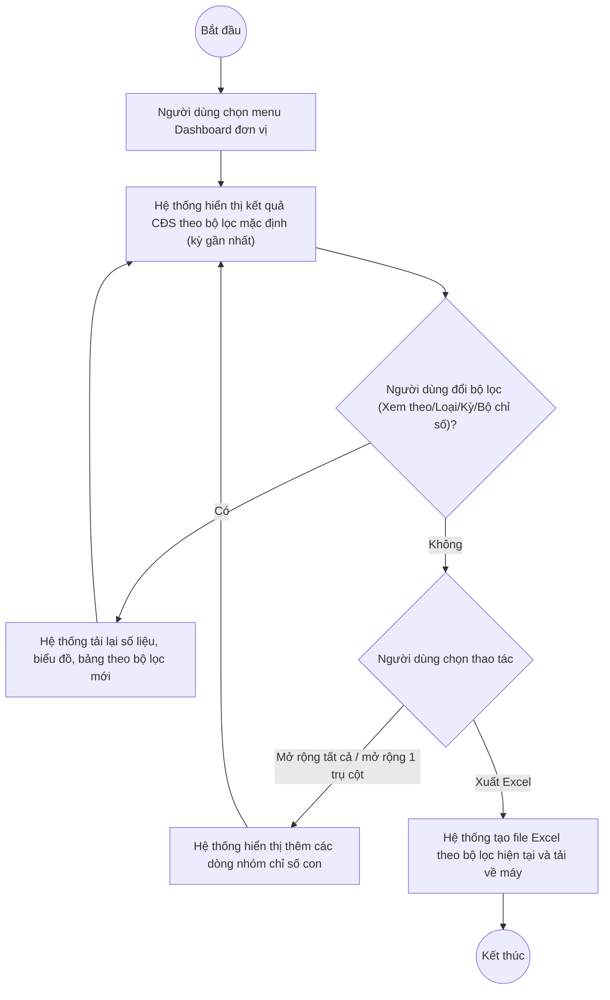

# UC10.1: Dashboard dành cho đơn vị, địa phương

## 1. Thông tin chung

| ID | Use case | Description |
| :---- | :---- | :---- |
| UC10.1 | Dashboard dành cho đơn vị, địa phương | Lãnh đạo đơn vị, Lãnh đạo địa phương xem kết quả chuyển đổi số của đơn vị/địa phương mình theo tháng/quý/năm dưới dạng số liệu tổng quan, biểu đồ cột, biểu đồ tròn và bảng số liệu chi tiết theo trụ cột/nhóm chỉ số; xuất kết quả ra Excel. |

> **Actor:** Lãnh đạo đơn vị, Lãnh đạo địa phương
>
> **Trigger:** Người dùng chọn menu "Dashboard đơn vị" trong nhóm "Báo cáo thống kê"
>
> **Điều kiện trước (Pre-condition):** Người dùng đã đăng nhập; đơn vị/địa phương của người dùng đã có ít nhất một kỳ đánh giá CĐS được tính điểm
>
> **Điều kiện sau (Post-condition):** Màn hình hiển thị kết quả CĐS của đơn vị/địa phương theo bộ lọc đang chọn; không có dữ liệu nào bị thay đổi (màn hình chỉ xem và xuất báo cáo)
>
> **Ghi nhận QC:** Toàn bộ nội dung dưới đây được kiểm thử bằng tài khoản **QA Super Admin** (có `SYSTEM_ROLE_BYPASS`, xem ngoài phạm vi tài liệu này) — tài khoản này vẫn xem được đầy đủ màn hình Dashboard. **[Cần xác nhận]** giao diện/dữ liệu hiển thị có đúng như khi đăng nhập bằng một tài khoản Lãnh đạo đơn vị/địa phương thật (ví dụ: có tự động giới hạn đúng 1 đơn vị của người dùng đó hay không), do chưa có tài khoản loại này để kiểm thử trực tiếp.
>
> **Business rule:**
>
> BR-1: Bộ lọc gồm: "Xem theo" (Tháng/Quý/Năm, dạng nút chọn 1), "Loại" (dropdown, giá trị quan sát được: "Định kỳ" — **[Cần xác nhận]** có giá trị "Đột xuất" hay các giá trị khác), "Kỳ" (dropdown chọn kỳ cụ thể, ví dụ "Quý I/2026", "Quý II/2026"), "Bộ chỉ số" (dropdown, ví dụ "DTI 2026"). *(Đã kiểm chứng trực tiếp ngày 10/10/2026: 4 bộ lọc này hiển thị trên màn hình)*
>
> BR-2: Khối số liệu tổng quan gồm 4 ô: Tổng điểm chuyển đổi số (dạng "742,5 / 1.000"), Xếp hạng toàn quốc (dạng "2 / 34"), Chỉ số đạt mức tối thiểu (dạng "108 / 118"), Mức độ chuyển đổi số (nhãn chữ, ví dụ "Khá"). *(Đã kiểm chứng trực tiếp ngày 10/10/2026)*
>
> BR-3: Biểu đồ cột thể hiện tỷ lệ đạt (% điểm tối đa) của từng trụ cột (ví dụ: Nhận thức số, Thể chế số, Hạ tầng số, Nhân lực số, An toàn thông tin mạng, Hoạt động chính quyền số). *(Đã kiểm chứng trực tiếp ngày 10/10/2026)*
>
> BR-4: Biểu đồ tròn thể hiện đóng góp (điểm và %) của từng trụ cột vào tổng điểm, kèm chú giải màu và tổng điểm ở tâm biểu đồ. *(Đã kiểm chứng trực tiếp ngày 10/10/2026)*
>
> BR-5: Bảng số liệu kết quả liệt kê từng trụ cột với các cột Số chỉ số, Điểm tối đa, Điểm đạt, Tỷ lệ đạt (thanh tiến trình + %), Hạng /34 (kèm mũi tên tăng/giảm hạng so với kỳ trước, ví dụ "3▲1", "2▼1"); dòng "Tổng cộng" ở cuối bảng. Nút "Mở rộng tất cả" mở rộng toàn bộ trụ cột để lộ các nhóm chỉ số con (đã quan sát số dòng tăng từ 7 lên 24 sau khi bấm). *(Đã kiểm chứng trực tiếp ngày 10/10/2026)*
>
> BR-6: Mỗi dòng trụ cột có thể bấm riêng lẻ để mở rộng xem điểm từng nhóm chỉ số con (gợi ý "Bấm vào trụ cột để xem điểm từng nhóm chỉ số"). **[Cần xác nhận]** hành vi chi tiết — thao tác bấm thử vào icon mở rộng của dòng đầu tiên bị timeout trong phiên kiểm thử này, chưa xác nhận được có khác gì với nút "Mở rộng tất cả" hay không.
>
> BR-7: Nút "Xuất Excel" xuất file theo bộ lọc đang áp dụng. *(Đã kiểm chứng trực tiếp ngày 10/10/2026: bấm nút tải về file tên dạng "KetQua_CDS_Dinh_ky_Quy_II_2026.xlsx", tên file phản ánh đúng bộ lọc Loại + Kỳ đang chọn)*. **[Cần xác nhận]** cấu trúc cột chi tiết bên trong file.
>
> BR-8: Đổi giá trị dropdown "Kỳ" làm thay đổi toàn bộ số liệu trên trang (đã quan sát Tổng điểm đổi từ 742,5 sang 732,5 và Xếp hạng từ 2/34 sang 3/34 khi chọn "Quý I/2026"). **[Cần xác nhận]** cơ chế tải dữ liệu — trong phiên kiểm thử, đổi bộ lọc không ghi nhận được lệnh gọi API mới nào rõ ràng, có thể do dữ liệu các kỳ đã được tải sẵn (preload) từ trước.
>
> BR-9: Bấm nút "Tháng"/"Năm" trong khối "Xem theo" (đang mặc định "Quý") — **[Cần xác nhận]** hành vi, do thao tác thử trong phiên này không ghi nhận được phản hồi rõ ràng (không có lệnh gọi API mới nào được ghi nhận sau khi bấm).

**Truy vết chức năng**

| STT | Chức năng | YC (BCKTKT) | Dòng UC_1409 | Luồng | Màn hình | BR |
| :---- | :---- | :---- | :---- | :---- | :---- | :---- |
| 1 | Xem kết quả CĐS theo tháng/quý/năm | **[Cần xác nhận]** | **[Cần xác nhận]** | Basic Flow | UI-10.1.1 | BR-1, BR-2, BR-8, BR-9 |
| 2 | Xem biểu đồ kết quả dạng cột | **[Cần xác nhận]** | **[Cần xác nhận]** | Basic Flow | UI-10.1.1 | BR-3 |
| 3 | Xem biểu đồ kết quả dạng hình tròn | **[Cần xác nhận]** | **[Cần xác nhận]** | Basic Flow | UI-10.1.1 | BR-4 |
| 4 | Xem kết quả dạng số liệu (bảng số liệu kết quả) | **[Cần xác nhận]** | **[Cần xác nhận]** | AF1 | UI-10.1.1 | BR-5, BR-6 |
| 5 | Xuất kết quả ra Excel | **[Cần xác nhận]** | **[Cần xác nhận]** | AF2 | UI-10.1.1 | BR-7 |

> Cột YC (BCKTKT) và Dòng UC_1409 chưa đối chiếu được với bản gốc Google Sheet "Danh sách công việc_CĐS - BCT". Use case nguồn tương ứng: UC-D.I.1 "Dashboard dành cho đơn vị, địa phương".

## 2. Mô tả luồng nghiệp vụ

*Hình 1. Luồng nghiệp vụ xem Dashboard đơn vị, địa phương*

**Basic Flow** (Xem kết quả chuyển đổi số)

1. Người dùng chọn menu "Dashboard đơn vị" trong nhóm "Báo cáo thống kê".
2. Hệ thống hiển thị màn hình Dashboard (UI-10.1.1) với bộ lọc mặc định (BR-1), khối số liệu tổng quan (BR-2), biểu đồ cột (BR-3), biểu đồ tròn (BR-4) và bảng số liệu kết quả (BR-5) theo kỳ gần nhất.
3. Người dùng có thể đổi bộ lọc "Xem theo", "Loại", "Kỳ", "Bộ chỉ số" để xem kết quả của kỳ khác (BR-8, BR-9).
4. Hệ thống cập nhật lại toàn bộ số liệu, biểu đồ và bảng theo bộ lọc mới.

**Alternative Flow**

AF1. Mở rộng bảng số liệu kết quả

Tại màn hình Dashboard (bước 2), người dùng bấm nút "Mở rộng tất cả" hoặc bấm vào một dòng trụ cột cụ thể. Hệ thống hiển thị thêm các dòng nhóm chỉ số con thuộc trụ cột đó (BR-5, BR-6). Use case kết thúc.

AF2. Xuất Excel

Tại màn hình Dashboard (bước 2), người dùng nhấn "Xuất Excel". Hệ thống tạo file Excel theo bộ lọc hiện tại (BR-7) và tải về máy. Use case kết thúc.

**Exception Flow**

EF1. Đơn vị/địa phương chưa có dữ liệu đánh giá cho kỳ đang chọn

**[Cần xác nhận]** nội dung hiển thị khi đơn vị/địa phương của người dùng chưa có kết quả đánh giá CĐS cho kỳ đang chọn — chưa quan sát được trạng thái rỗng của màn hình này trong phiên kiểm thử (tài khoản QA Super Admin luôn có sẵn dữ liệu mẫu).

EF2. Lỗi hệ thống khi tải dữ liệu hoặc xuất Excel

Hệ thống hiển thị thông báo lỗi chung và giữ nguyên dữ liệu đang hiển thị. **[Cần xác nhận]** nội dung thông báo cụ thể.

Use case kết thúc.

## 3. Màn hình

| UI Code | Screen | Mô tả |
| :---- | :---- | :---- |
| UI-10.1.1 | Dashboard đơn vị (Web) | Bộ lọc, khối số liệu tổng quan, biểu đồ cột, biểu đồ tròn, bảng số liệu kết quả theo trụ cột/nhóm chỉ số, nút Xuất Excel |

## 4. Mô tả Màn hình (Field Specification)

**UI-10.1.1 — Dashboard đơn vị**

| Field Name | Field type | Data Type | Required | Validation rule/Behaviour |
| :---- | :---- | :---- | :---- | :---- |
| Xem theo | Button group | Enum | Yes | **Behaviour:** Tháng / Quý (mặc định) / Năm (BR-1, BR-9) **Validation rule:** Chọn đúng 1 |
| Loại | Dropdown | Enum | Yes | **Behaviour:** Giá trị quan sát được: "Định kỳ" (BR-1) **Validation rule:** **[Cần xác nhận]** các giá trị khác ngoài "Định kỳ" |
| Kỳ | Dropdown | Enum | Yes | **Behaviour:** Chọn kỳ cụ thể, ví dụ "Quý I/2026", "Quý II/2026" (BR-1, BR-8) **Validation rule:** — |
| Bộ chỉ số | Dropdown | Enum | Yes | **Behaviour:** Chọn bộ chỉ số áp dụng, ví dụ "DTI 2026" (BR-1) **Validation rule:** — |
| Nút Xuất Excel | Button | Action | Yes | **Behaviour:** Xuất file Excel theo bộ lọc hiện tại (AF2, BR-7) **Validation rule:** — |
| Tổng điểm chuyển đổi số | Label | Decimal | Yes | **Behaviour:** Dạng "742,5 / 1.000" (BR-2) **Validation rule:** — |
| Xếp hạng toàn quốc | Label | Integer | Yes | **Behaviour:** Dạng "2 / 34" (BR-2) **Validation rule:** — |
| Chỉ số đạt mức tối thiểu | Label | Integer | Yes | **Behaviour:** Dạng "108 / 118" (BR-2) **Validation rule:** — |
| Mức độ chuyển đổi số | Label | String | Yes | **Behaviour:** Nhãn xếp loại, ví dụ "Khá" (BR-2) **Validation rule:** **[Cần xác nhận]** các mức xếp loại khác và ngưỡng phân loại |
| Biểu đồ cột | Chart | — | Yes | **Behaviour:** Tỷ lệ đạt (%) từng trụ cột (BR-3) **Validation rule:** — |
| Biểu đồ tròn | Chart | — | Yes | **Behaviour:** Đóng góp điểm và % của từng trụ cột vào tổng điểm, tâm biểu đồ hiển thị tổng điểm (BR-4) **Validation rule:** — |
| Bảng số liệu kết quả | Table | List | Yes | **Behaviour:** Cột: Trụ cột/nhóm chỉ số, Số chỉ số, Điểm tối đa, Điểm đạt, Tỷ lệ đạt, Hạng /34; dòng Tổng cộng ở cuối (BR-5) **Validation rule:** — |
| Nút Mở rộng tất cả | Button | Action | Yes | **Behaviour:** Mở rộng toàn bộ trụ cột để lộ nhóm chỉ số con (AF1, BR-5) **Validation rule:** — |
| Icon mở rộng theo dòng | Icon button | Action | No | **Behaviour:** Mở rộng riêng 1 trụ cột (BR-6) **Validation rule:** **[Cần xác nhận]** — thao tác thử bị timeout trong phiên kiểm thử |

## Điểm cần xác nhận

| STT | Vị trí | Giả định đã dùng | Câu hỏi cần xác nhận |
| :---- | :---- | :---- | :---- |
| 1 | Mục 1 – Ghi nhận QC | Kiểm thử bằng tài khoản QA Super Admin (bypass quyền) | Giao diện/dữ liệu có tự động giới hạn đúng theo đơn vị của tài khoản Lãnh đạo thật không? |
| 2 | BR-1 | Dropdown "Loại" chỉ quan sát được giá trị "Định kỳ" | Có giá trị "Đột xuất" hoặc giá trị khác không? |
| 3 | BR-6 | Có thể mở rộng riêng từng trụ cột ngoài nút "Mở rộng tất cả" | Hành vi chính xác khi bấm vào 1 trụ cột là gì (thao tác thử bị timeout)? |
| 4 | BR-8, BR-9 | Đổi "Kỳ"/"Xem theo" cập nhật lại toàn bộ số liệu | Cơ chế tải dữ liệu là gì (preload hay gọi API theo yêu cầu)? Nút "Tháng"/"Năm" có hoạt động không? |
| 5 | BR-7 | Xuất Excel theo đúng bộ lọc hiện tại | Cấu trúc cột chi tiết trong file Excel xuất ra là gì? |
| 6 | EF1 | Chưa quan sát được trạng thái không có dữ liệu | Màn hình hiển thị gì khi đơn vị chưa có kết quả đánh giá cho kỳ đang chọn? |
| 7 | Truy vết chức năng | Chưa có số YC (BCKTKT) và Dòng UC_1409 | Đề nghị đối chiếu với bản gốc Google Sheet |
