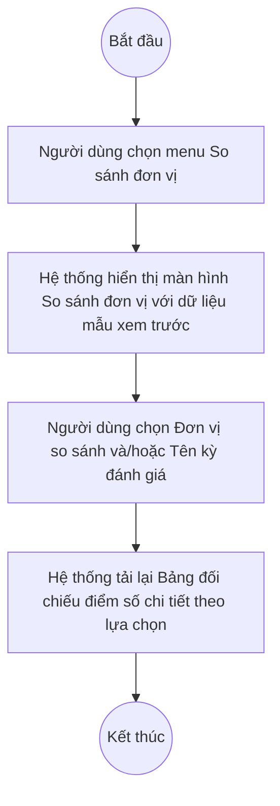

# UC10.2: So sánh kết quả chuyển đổi số của đơn vị, địa phương

## 1. Thông tin chung

| ID | Use case | Description |
| :---- | :---- | :---- |
| UC10.2 | So sánh kết quả chuyển đổi số của đơn vị, địa phương | Lãnh đạo đơn vị, Lãnh đạo địa phương lựa chọn thời gian/kỳ đánh giá để so sánh kết quả chuyển đổi số của đơn vị/địa phương mình qua các kỳ khác nhau, xem dạng bảng đối chiếu điểm số chi tiết; xuất so sánh ra Excel. |

> **Actor:** Lãnh đạo đơn vị, Lãnh đạo địa phương
>
> **Trigger:** Người dùng chọn menu "So sánh đơn vị" trong nhóm "Báo cáo thống kê"
>
> **Điều kiện trước (Pre-condition):** Người dùng đã đăng nhập; có ít nhất 2 kỳ đánh giá (của cùng đơn vị mình hoặc của đơn vị khác) để đối chiếu
>
> **Điều kiện sau (Post-condition):** Màn hình hiển thị bảng đối chiếu điểm số theo lựa chọn; không có dữ liệu nào bị thay đổi (màn hình chỉ xem và xuất báo cáo)
>
> **Ghi nhận QC (10/10/2026) — PHÁT HIỆN QUAN TRỌNG:** Màn hình "So sánh đơn vị" (route `#/vi/reports/compare`) là **CÙNG MỘT màn hình vật lý** phục vụ cả UC10.2 (so sánh kết quả của chính đơn vị mình qua các kỳ) **và** UC11.2 (so sánh kết quả giữa các địa phương/đơn vị khác nhau — xem UC11.2), không có 2 màn hình tách biệt như mô tả yêu cầu nghiệp vụ gốc gợi ý. Ngoài ra, màn hình luôn hiển thị nhãn "Dữ liệu mẫu xem trước" (`stillShowsSampleBadge: true`) kể cả sau khi đã chọn bộ lọc — **[Cần xác nhận]** đây là do dữ liệu thật của đơn vị hiện hành chưa đủ điều kiện so sánh (ví dụ chưa có ≥2 kỳ đã duyệt), hay đây là bảng dữ liệu mẫu tĩnh (hard-coded) chưa được nối với dữ liệu thật.
>
> **Business rule:**
>
> BR-1: Bộ lọc gồm: "Đơn vị so sánh" (dropdown tìm kiếm, chọn 1 đơn vị khác để đối chiếu — ví dụ "BDT-QA01 - Ban Dân tộc tỉnh", "BDT-QA02 - Ban Dân tộc tỉnh B"), "Khoảng thời gian" (date range, "Ngày bắt đầu → Ngày kết thúc"), "Hình thức" (dropdown, mặc định "Tất cả"), "Tên kỳ đánh giá" (dropdown, liệt kê các **chiến dịch đánh giá cụ thể** chứ không phải các kỳ lịch như "Quý I/2026" — ví dụ "Cán bộ - Ban Dân tộc tỉnh", "test đột xuất 10:39", "TEST CNMH"). *(Đã kiểm chứng trực tiếp ngày 10/10/2026)*. **[Cần xác nhận]** vì sao dropdown "Tên kỳ đánh giá" ở màn hình này liệt kê theo tên chiến dịch cụ thể, khác với dropdown "Kỳ" ở Dashboard đơn vị (UC10.1) vốn liệt kê theo kỳ lịch (Quý I/2026, Quý II/2026...) — có thể gây nhầm lẫn cho người dùng.
>
> BR-2: Bảng "Bảng đối chiếu điểm số chi tiết" gồm các cột cố định: Mã chỉ số, Chỉ số, Trọng số, Điểm tối thiểu/Điểm tối đa, và 2 cột động (mỗi cột là 1 vế so sánh đã chọn, tiêu đề cột ghi rõ tên đơn vị + tên kỳ đánh giá, dữ liệu con là cột "Điểm"). *(Đã kiểm chứng trực tiếp ngày 10/10/2026, dữ liệu đang hiển thị gắn nhãn "Dữ liệu mẫu xem trước")*
>
> BR-3: Chọn "Tên kỳ đánh giá" sẽ gọi API lấy kết quả đánh giá theo `campaignId` tương ứng (đã quan sát lệnh gọi `GET /api/v1/dti/assessment-results?filter={"campaignId":"..."}&size=1000`). **[Cần xác nhận]** việc chọn "Đơn vị so sánh" có kích hoạt gọi API tương ứng hay không — trong phiên kiểm thử, mở dropdown và chọn 1 đơn vị không ghi nhận được lệnh gọi API mới nào ngoài API thông báo (notifications) không liên quan.
>
> BR-4: **[Cần xác nhận]** — theo mô tả yêu cầu nghiệp vụ gốc (UC-D.I.2), màn hình phải hỗ trợ "xem so sánh dạng cột" và "xem so sánh dạng hình tròn" ngoài dạng bảng, và phải có nút "Xuất Excel". Qua khảo sát trực tiếp màn hình thật ngày 10/10/2026, **KHÔNG quan sát thấy** nút chuyển đổi sang biểu đồ cột/hình tròn, cũng **KHÔNG quan sát thấy** nút "Xuất Excel" nào trên màn hình này (khác với UC10.1 và UC11.1 đều có nút Xuất Excel). Đây là khoảng trống cần xác nhận với đội phát triển: 3 chức năng này (dạng cột, dạng hình tròn, xuất Excel) có đang được phát triển dở dang hay đã bị bỏ khỏi phạm vi.

**Truy vết chức năng**

| STT | Chức năng | YC (BCKTKT) | Dòng UC_1409 | Luồng | Màn hình | BR |
| :---- | :---- | :---- | :---- | :---- | :---- | :---- |
| 1 | Lựa chọn thời gian/kỳ đánh giá để so sánh | **[Cần xác nhận]** | **[Cần xác nhận]** | Basic Flow | UI-10.2.1 | BR-1, BR-3 |
| 2 | Xem so sánh dạng bảng (điểm chi tiết) | **[Cần xác nhận]** | **[Cần xác nhận]** | Basic Flow | UI-10.2.1 | BR-2 |
| 3 | Xem so sánh dạng cột | **[Cần xác nhận]** | **[Cần xác nhận]** | — | UI-10.2.1 | BR-4 |
| 4 | Xem so sánh dạng hình tròn | **[Cần xác nhận]** | **[Cần xác nhận]** | — | UI-10.2.1 | BR-4 |
| 5 | Xuất so sánh ra Excel | **[Cần xác nhận]** | **[Cần xác nhận]** | — | UI-10.2.1 | BR-4 |

> Cột YC (BCKTKT) và Dòng UC_1409 chưa đối chiếu được với bản gốc Google Sheet "Danh sách công việc_CĐS - BCT". Use case nguồn tương ứng: UC-D.I.2 "So sánh kết quả chuyển đổi số của đơn vị, địa phương". Các dòng 3–5 hiện **chưa tìm thấy** chức năng tương ứng trên màn hình thật — xem BR-4.

## 2. Mô tả luồng nghiệp vụ

*Hình 1. Luồng nghiệp vụ so sánh kết quả CĐS của đơn vị, địa phương*

**Basic Flow** (So sánh kết quả CĐS theo kỳ đánh giá)

1. Người dùng chọn menu "So sánh đơn vị" trong nhóm "Báo cáo thống kê".
2. Hệ thống hiển thị màn hình So sánh đơn vị (UI-10.2.1) với bảng đối chiếu điểm số dữ liệu mẫu xem trước (BR-2).
3. Người dùng chọn "Tên kỳ đánh giá" cần so sánh (BR-1, BR-3).
4. Hệ thống tải lại Bảng đối chiếu điểm số chi tiết theo kỳ đánh giá đã chọn.

**Alternative Flow**

AF1. Chọn đơn vị so sánh

Tại màn hình So sánh đơn vị (bước 2), người dùng mở dropdown "Đơn vị so sánh" và chọn 1 đơn vị trong danh sách (ví dụ các đơn vị cấp Ban Dân tộc tỉnh). **[Cần xác nhận]** hệ thống có cập nhật lại bảng theo đơn vị vừa chọn hay không (chưa quan sát được lệnh gọi API tương ứng). Use case kết thúc.

AF2. Lọc theo khoảng thời gian / hình thức

Tại màn hình So sánh đơn vị (bước 2), người dùng chọn "Khoảng thời gian" và/hoặc "Hình thức". **[Cần xác nhận]** hành vi lọc chi tiết, chưa kiểm thử được trong phiên này.

**Exception Flow**

EF1. Không đủ dữ liệu để so sánh

**[Cần xác nhận]** nội dung hiển thị khi đơn vị của người dùng chưa có đủ 2 kỳ đánh giá để so sánh — chưa quan sát được trạng thái này trong phiên kiểm thử (màn hình luôn hiển thị dữ liệu mẫu xem trước, xem Ghi nhận QC ở mục 1).

EF2. Lỗi hệ thống khi tải dữ liệu so sánh

Hệ thống hiển thị thông báo lỗi chung và giữ nguyên dữ liệu đang hiển thị. **[Cần xác nhận]** nội dung thông báo cụ thể.

Use case kết thúc.

## 3. Màn hình

| UI Code | Screen | Mô tả |
| :---- | :---- | :---- |
| UI-10.2.1 | So sánh đơn vị (Web) | Bộ lọc Đơn vị so sánh/Khoảng thời gian/Hình thức/Tên kỳ đánh giá, bảng đối chiếu điểm số chi tiết giữa 2 vế so sánh. Màn hình dùng chung với UC11.2 (xem Ghi nhận QC mục 1) |

## 4. Mô tả Màn hình (Field Specification)

**UI-10.2.1 — So sánh đơn vị**

| Field Name | Field type | Data Type | Required | Validation rule/Behaviour |
| :---- | :---- | :---- | :---- | :---- |
| Đơn vị so sánh | Dropdown (search) | Enum | No | **Behaviour:** Placeholder "Chọn đơn vị..."; danh sách đơn vị tìm kiếm được (BR-1, AF1) **Validation rule:** **[Cần xác nhận]** có bắt buộc chọn để bảng cập nhật không |
| Khoảng thời gian | Date range picker | Date | No | **Behaviour:** Placeholder "Ngày bắt đầu → Ngày kết thúc" (BR-1, AF2) **Validation rule:** **[Cần xác nhận]** |
| Hình thức | Dropdown | Enum | No | **Behaviour:** Mặc định "Tất cả" (BR-1, AF2) **Validation rule:** **[Cần xác nhận]** các giá trị khác ngoài "Tất cả" |
| Tên kỳ đánh giá | Dropdown (search) | Enum | No | **Behaviour:** Placeholder "Chọn kỳ đánh giá..."; liệt kê theo tên chiến dịch đánh giá cụ thể (BR-1, BR-3) **Validation rule:** — |
| Nhãn "Dữ liệu mẫu xem trước" | Badge | String | — | **Behaviour:** Hiển thị cố định phía trên bảng kể cả sau khi đã chọn bộ lọc (xem Ghi nhận QC mục 1) **Validation rule:** — |
| Bảng đối chiếu điểm số chi tiết | Table | List | Yes | **Behaviour:** Cột: Mã chỉ số, Chỉ số, Trọng số, Điểm tối thiểu/Điểm tối đa, [Tên vế 1] – Điểm, [Tên vế 2] – Điểm (BR-2) **Validation rule:** — |

## Điểm cần xác nhận

| STT | Vị trí | Giả định đã dùng | Câu hỏi cần xác nhận |
| :---- | :---- | :---- | :---- |
| 1 | Mục 1 – Ghi nhận QC | UC10.2 và UC11.2 dùng chung 1 màn hình vật lý | Đây là thiết kế chủ đích (gộp 2 use case vào 1 màn hình) hay 1 trong 2 use case còn thiếu màn hình riêng? |
| 2 | Mục 1 – Ghi nhận QC | Màn hình luôn hiển thị "Dữ liệu mẫu xem trước" | Do dữ liệu thật chưa đủ điều kiện, hay bảng đang là dữ liệu mẫu tĩnh (mock) chưa nối API thật? |
| 3 | BR-1 | Dropdown "Tên kỳ đánh giá" liệt kê theo tên chiến dịch, khác với Dashboard (UC10.1) liệt kê theo kỳ lịch | Có nên thống nhất cách gọi/hiển thị "kỳ" giữa các màn hình báo cáo không? |
| 4 | BR-4 | Không tìm thấy dạng biểu đồ cột/hình tròn và nút Xuất Excel trên màn hình thật | 3 chức năng này có đang phát triển dở dang không, dự kiến bổ sung khi nào? |
| 5 | AF1 | Chọn "Đơn vị so sánh" không ghi nhận được lệnh gọi API tương ứng | Dropdown này có thực sự ảnh hưởng tới bảng kết quả không, hay cần chọn thêm điều kiện khác mới kích hoạt? |
| 6 | Truy vết chức năng | Chưa có số YC (BCKTKT) và Dòng UC_1409 | Đề nghị đối chiếu với bản gốc Google Sheet |
