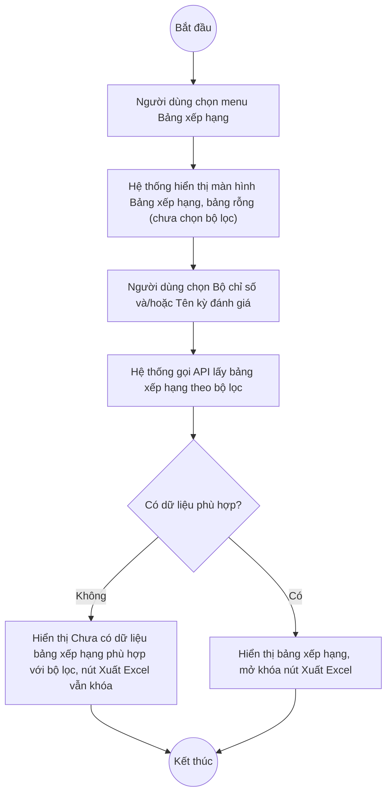

# UC11.1: Bảng xếp hạng CĐS của Bộ Dân tộc và Tôn giáo

## 1. Thông tin chung

| ID | Use case | Description |
| :---- | :---- | :---- |
| UC11.1 | Bảng xếp hạng CĐS của Bộ Dân tộc và Tôn giáo | Người dùng đã đăng nhập xem bảng xếp hạng chuyển đổi số của các đơn vị, địa phương thuộc Bộ Dân tộc và Tôn giáo theo bộ chỉ số/kỳ đánh giá đã chọn, dưới dạng số liệu hoặc biểu đồ cột; xuất bảng xếp hạng ra Excel. |

> **Actor:** Người dùng (bất kỳ tài khoản nào đã đăng nhập, theo mô tả yêu cầu nghiệp vụ gốc — **[Cần xác nhận]** có giới hạn theo nhóm quyền cụ thể nào không)
>
> **Trigger:** Người dùng chọn menu "Bảng xếp hạng" trong nhóm "Báo cáo thống kê"
>
> **Điều kiện trước (Pre-condition):** Người dùng đã đăng nhập
>
> **Điều kiện sau (Post-condition):** Màn hình hiển thị bảng xếp hạng theo bộ lọc đang chọn; không có dữ liệu nào bị thay đổi (màn hình chỉ xem và xuất báo cáo)
>
> **Ghi nhận QC (10/10/2026):** Trong phiên kiểm thử, với mọi tổ hợp bộ lọc đã thử (chọn Bộ chỉ số "T001" + Tên kỳ đánh giá "Cán bộ - Ban Dân tộc tỉnh"), bảng xếp hạng luôn trả về **"Chưa có dữ liệu bảng xếp hạng phù hợp với bộ lọc"** — API `GET /api/v1/dti/reports/ranking?...` có được gọi (status xác nhận qua lệnh gọi mạng) nhưng trả về danh sách rỗng. **[Cần xác nhận]** đây là do chưa có kỳ đánh giá nào đã hoàn tất đủ điều kiện xếp hạng trên môi trường thật, hay API xếp hạng có vấn đề — chưa thể kết luận trong phạm vi khảo sát UI.
>
> **Business rule:**
>
> BR-1: Bộ lọc gồm: "Bộ chỉ số" (dropdown, ví dụ "T001", "Bộ chỉ số 001", "Bộ chỉ tiêu đánh giá kết quả CĐS - Sở, Ban, Ngành địa phương"), "Hình thức" (dropdown, mặc định "Tất cả"), "Tên kỳ đánh giá" (dropdown tìm kiếm, liệt kê theo tên chiến dịch đánh giá cụ thể). *(Đã kiểm chứng trực tiếp ngày 10/10/2026)*
>
> BR-2: Bảng xếp hạng gồm các cột: Hạng, Đơn vị, Tổng điểm, Tình trạng tuân thủ. *(Đã kiểm chứng trực tiếp ngày 10/10/2026 — cấu trúc cột; chưa quan sát được dữ liệu thật do danh sách luôn rỗng trong phiên kiểm thử, xem Ghi nhận QC)*
>
> BR-3: 2 nút chuyển đổi cách xem: "Xem số liệu" (bảng, mặc định) và "Xem dữ liệu cột" (biểu đồ cột). *(Đã kiểm chứng trực tiếp ngày 10/10/2026: 2 nút tồn tại trên thanh công cụ)*. **[Cần xác nhận]** giao diện biểu đồ cột thực tế — thao tác bấm thử nút "Xem dữ liệu cột" bị timeout trong phiên kiểm thử này (có thể do danh sách đang rỗng nên không có gì để vẽ biểu đồ).
>
> BR-4: Nút "Xuất Excel" bị khóa (disabled) khi chưa chọn đủ bộ lọc và/hoặc khi bảng không có dữ liệu. *(Đã kiểm chứng trực tiếp ngày 10/10/2026: nút ở trạng thái disabled cả trước và sau khi chọn Bộ chỉ số + Tên kỳ đánh giá, do danh sách trả về rỗng)*. **[Cần xác nhận]** nút có bật lại khi bảng thật sự có dữ liệu hay không — chưa kiểm chứng được vì không tạo được tổ hợp bộ lọc có dữ liệu trong phiên này.

**Truy vết chức năng**

| STT | Chức năng | YC (BCKTKT) | Dòng UC_1409 | Luồng | Màn hình | BR |
| :---- | :---- | :---- | :---- | :---- | :---- | :---- |
| 1 | Xem bảng xếp hạng CĐS các đơn vị, địa phương | **[Cần xác nhận]** | **[Cần xác nhận]** | Basic Flow | UI-11.1.1 | BR-1, BR-2, BR-3 |
| 2 | Xuất bảng xếp hạng ra Excel | **[Cần xác nhận]** | **[Cần xác nhận]** | AF1 | UI-11.1.1 | BR-4 |

> Cột YC (BCKTKT) và Dòng UC_1409 chưa đối chiếu được với bản gốc Google Sheet "Danh sách công việc_CĐS - BCT". Use case nguồn tương ứng: UC-D.II.1 "Bảng xếp hạng CĐS của Bộ Dân tộc và Tôn giáo".

## 2. Mô tả luồng nghiệp vụ

*Hình 1. Luồng nghiệp vụ xem bảng xếp hạng CĐS*

**Basic Flow** (Xem bảng xếp hạng)

1. Người dùng chọn menu "Bảng xếp hạng" trong nhóm "Báo cáo thống kê".
2. Hệ thống hiển thị màn hình Bảng xếp hạng (UI-11.1.1), bảng rỗng vì chưa chọn bộ lọc.
3. Người dùng chọn "Bộ chỉ số" và/hoặc "Tên kỳ đánh giá" (BR-1).
4. Hệ thống gọi API lấy bảng xếp hạng theo bộ lọc và hiển thị kết quả (BR-2), hoặc thông báo "Chưa có dữ liệu bảng xếp hạng phù hợp với bộ lọc" nếu không có kết quả.

**Alternative Flow**

AF1. Xuất Excel

Tại màn hình Bảng xếp hạng (bước 4), khi bảng có dữ liệu và nút "Xuất Excel" được mở khóa, người dùng nhấn nút. Hệ thống tạo file Excel theo bộ lọc hiện tại và tải về máy (BR-4). **[Cần xác nhận]** chưa kiểm chứng được luồng này do không tạo được dữ liệu xếp hạng trong phiên kiểm thử. Use case kết thúc.

AF2. Chuyển sang xem dữ liệu dạng cột

Tại màn hình Bảng xếp hạng (bước 4), người dùng nhấn "Xem dữ liệu cột". Hệ thống chuyển bảng sang hiển thị dạng biểu đồ cột (BR-3). **[Cần xác nhận]** chưa kiểm chứng được giao diện thực tế.

**Exception Flow**

EF1. Không có dữ liệu xếp hạng phù hợp với bộ lọc

Tại bước 4, nếu không có đơn vị nào đủ điều kiện xếp hạng theo bộ lọc, Hệ thống hiển thị "Chưa có dữ liệu bảng xếp hạng phù hợp với bộ lọc" và giữ nút "Xuất Excel" ở trạng thái khóa (BR-4). *(Đã kiểm chứng trực tiếp ngày 10/10/2026)*. Use case kết thúc.

EF2. Lỗi hệ thống khi tải bảng xếp hạng hoặc xuất Excel

Hệ thống hiển thị thông báo lỗi chung và giữ nguyên dữ liệu đang hiển thị. **[Cần xác nhận]** nội dung thông báo cụ thể.

Use case kết thúc.

## 3. Màn hình

| UI Code | Screen | Mô tả |
| :---- | :---- | :---- |
| UI-11.1.1 | Bảng xếp hạng (Web) | Bộ lọc Bộ chỉ số/Hình thức/Tên kỳ đánh giá, 2 cách xem (số liệu/dữ liệu cột), bảng xếp hạng, nút Xuất Excel |

## 4. Mô tả Màn hình (Field Specification)

**UI-11.1.1 — Bảng xếp hạng**

| Field Name | Field type | Data Type | Required | Validation rule/Behaviour |
| :---- | :---- | :---- | :---- | :---- |
| Nút Xem số liệu / Xem dữ liệu cột | Toggle button | Enum | Yes | **Behaviour:** Chuyển đổi cách hiển thị bảng/biểu đồ cột (BR-3, AF2) **Validation rule:** Chọn đúng 1, mặc định "Xem số liệu" |
| Nút Xuất Excel | Button | Action | Yes | **Behaviour:** Xuất bảng xếp hạng theo bộ lọc hiện tại (AF1, BR-4) **Validation rule:** Disabled khi chưa có dữ liệu phù hợp |
| Bộ chỉ số | Dropdown | Enum | No | **Behaviour:** Placeholder "Chọn bộ chỉ số" (BR-1) **Validation rule:** — |
| Hình thức | Dropdown | Enum | No | **Behaviour:** Mặc định "Tất cả" (BR-1) **Validation rule:** **[Cần xác nhận]** các giá trị khác |
| Tên kỳ đánh giá | Dropdown (search) | Enum | No | **Behaviour:** Placeholder "Chọn kỳ đánh giá..." (BR-1) **Validation rule:** — |
| Bảng xếp hạng | Table | List | Yes | **Behaviour:** Cột: Hạng, Đơn vị, Tổng điểm, Tình trạng tuân thủ (BR-2) **Validation rule:** Không có dữ liệu hiển thị "Chưa có dữ liệu bảng xếp hạng phù hợp với bộ lọc" (EF1) |

## Điểm cần xác nhận

| STT | Vị trí | Giả định đã dùng | Câu hỏi cần xác nhận |
| :---- | :---- | :---- | :---- |
| 1 | Mục 1 – Actor | Theo yêu cầu gốc, actor là "Người dùng" bất kỳ đã đăng nhập | Có giới hạn theo nhóm quyền cụ thể nào không, hay mọi tài khoản đăng nhập đều xem được? |
| 2 | Mục 1 – Ghi nhận QC | Mọi tổ hợp bộ lọc đã thử đều trả về danh sách rỗng | Môi trường thật hiện chưa có kỳ đánh giá nào đủ điều kiện xếp hạng, hay API `GET /api/v1/dti/reports/ranking` có vấn đề? |
| 3 | BR-3 | Nút "Xem dữ liệu cột" tồn tại nhưng chưa xem được giao diện thật | Biểu đồ cột hiển thị dữ liệu gì, có giống cấu trúc biểu đồ ở Dashboard (UC10.1) không? |
| 4 | BR-4, AF1 | Xuất Excel disabled khi không có dữ liệu | Khi có dữ liệu, file Excel xuất ra có cấu trúc cột gì? |
| 5 | Truy vết chức năng | Chưa có số YC (BCKTKT) và Dòng UC_1409 | Đề nghị đối chiếu với bản gốc Google Sheet |
