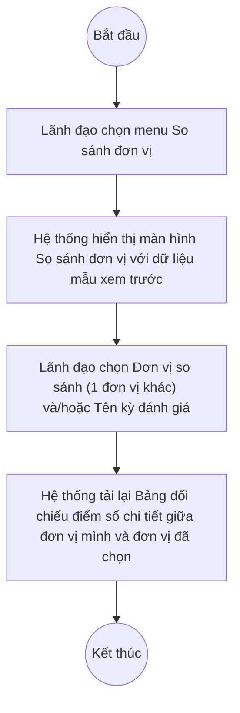

# UC11.2: So sánh kết quả chuyển đổi số các địa phương với nhau

## 1. Thông tin chung

| ID | Use case | Description |
| :---- | :---- | :---- |
| UC11.2 | So sánh kết quả chuyển đổi số các địa phương với nhau | Lãnh đạo lựa chọn đơn vị/địa phương và thời gian/kỳ đánh giá để so sánh kết quả chuyển đổi số giữa các địa phương, đơn vị khác nhau, xem dạng bảng đối chiếu điểm số chi tiết; xuất so sánh ra Excel. |

> **Actor:** Lãnh đạo
>
> **Trigger:** Người dùng chọn menu "So sánh đơn vị" trong nhóm "Báo cáo thống kê"
>
> **Điều kiện trước (Pre-condition):** Người dùng đã đăng nhập; có ít nhất 2 đơn vị/địa phương đã có kỳ đánh giá để đối chiếu
>
> **Điều kiện sau (Post-condition):** Màn hình hiển thị bảng đối chiếu điểm số giữa các đơn vị đã chọn; không có dữ liệu nào bị thay đổi (màn hình chỉ xem và xuất báo cáo)
>
> **Ghi nhận QC (10/10/2026) — PHÁT HIỆN QUAN TRỌNG:** Màn hình "So sánh đơn vị" (route `#/vi/reports/compare`) là **CÙNG MỘT màn hình vật lý** với màn hình phục vụ UC10.2 (Lãnh đạo đơn vị so sánh kết quả của chính mình qua các kỳ) — xem UC10.2 để biết chi tiết đầy đủ về bộ lọc và bảng đối chiếu. File này chỉ mô tả lại nghiệp vụ UC11.2 (so sánh giữa các đơn vị/địa phương khác nhau) trên cùng màn hình đó, và không lặp lại toàn bộ chi tiết field spec đã có ở UC10.2. Trường "Đơn vị so sánh" trên màn hình cho phép chọn một đơn vị KHÁC để đối chiếu — đây chính là điểm khớp với nghiệp vụ UC11.2 (so sánh giữa các đơn vị). Màn hình cũng luôn hiển thị nhãn "Dữ liệu mẫu xem trước" kể cả sau khi đã chọn bộ lọc — xem Điểm cần xác nhận.
>
> **Business rule:**
>
> BR-1 (= BR-1 của UC10.2): Bộ lọc gồm "Đơn vị so sánh" (dropdown tìm kiếm, ví dụ "BDT-QA01 - Ban Dân tộc tỉnh", "BDT-QA02 - Ban Dân tộc tỉnh B", "BDT-QA03 - Ban Dân tộc tỉnh C", "CCDSTK-QA01 - Cục..."), "Khoảng thời gian", "Hình thức" (mặc định "Tất cả"), "Tên kỳ đánh giá" (dropdown theo tên chiến dịch cụ thể). *(Đã kiểm chứng trực tiếp ngày 10/10/2026: mở dropdown "Đơn vị so sánh" liệt kê được ≥4 đơn vị)*
>
> BR-2 (= BR-2 của UC10.2): Bảng "Bảng đối chiếu điểm số chi tiết" gồm Mã chỉ số, Chỉ số, Trọng số, Điểm tối thiểu/Điểm tối đa, và 2 cột "Điểm" — mỗi cột gắn với 1 vế so sánh, tiêu đề cột ghi tên đơn vị + tên kỳ đánh giá tương ứng (ví dụ "Sở Dân tộc và Tôn giáo tỉnh A (Xem trước) (Đánh giá định kỳ Quý I/2026)", "Ban Dân tộc tỉnh B (Xem trước) (Đánh giá định kỳ Quý I/2026)"). *(Đã kiểm chứng trực tiếp ngày 10/10/2026, dữ liệu đang hiển thị gắn nhãn "Dữ liệu mẫu xem trước")*
>
> BR-3: Người dùng chọn 1 đơn vị trong dropdown "Đơn vị so sánh" (danh sách gồm nhiều đơn vị/địa phương khác nhau thuộc Bộ, không giới hạn ở đơn vị của chính người dùng). *(Đã kiểm chứng trực tiếp ngày 10/10/2026: mở được dropdown và thấy danh sách đơn vị)*. **[Cần xác nhận]** sau khi chọn, bảng có cập nhật đúng theo đơn vị vừa chọn hay không — trong phiên kiểm thử, lệnh gọi API không ghi nhận được thay đổi rõ ràng tương ứng với lựa chọn đơn vị.
>
> BR-4 (= BR-4 của UC10.2): Theo mô tả yêu cầu nghiệp vụ gốc (UC-D.II.2), màn hình phải hỗ trợ xem dạng cột, dạng hình tròn, và xuất Excel. Qua khảo sát trực tiếp ngày 10/10/2026, **KHÔNG quan sát thấy** các chức năng này trên màn hình thật — xem UC10.2 mục Ghi nhận QC/BR-4 để biết chi tiết đầy đủ (vì đây là cùng 1 màn hình).

**Truy vết chức năng**

| STT | Chức năng | YC (BCKTKT) | Dòng UC_1409 | Luồng | Màn hình | BR |
| :---- | :---- | :---- | :---- | :---- | :---- | :---- |
| 1 | Lựa chọn đơn vị để so sánh | **[Cần xác nhận]** | **[Cần xác nhận]** | Basic Flow | UI-11.2.1 | BR-1, BR-3 |
| 2 | Lựa chọn thời gian để so sánh | **[Cần xác nhận]** | **[Cần xác nhận]** | AF1 | UI-11.2.1 | BR-1 |
| 3 | Xem so sánh dạng cột | **[Cần xác nhận]** | **[Cần xác nhận]** | — | UI-11.2.1 | BR-4 |
| 4 | Xem so sánh dạng hình tròn | **[Cần xác nhận]** | **[Cần xác nhận]** | — | UI-11.2.1 | BR-4 |
| 5 | Xuất so sánh ra Excel | **[Cần xác nhận]** | **[Cần xác nhận]** | — | UI-11.2.1 | BR-4 |

> Cột YC (BCKTKT) và Dòng UC_1409 chưa đối chiếu được với bản gốc Google Sheet "Danh sách công việc_CĐS - BCT". Use case nguồn tương ứng: UC-D.II.2 "So sánh kết quả chuyển đổi số các địa phương với nhau". Các dòng 3–5 hiện **chưa tìm thấy** chức năng tương ứng trên màn hình thật — xem BR-4.

## 2. Mô tả luồng nghiệp vụ

*Hình 1. Luồng nghiệp vụ so sánh kết quả CĐS giữa các địa phương*

**Basic Flow** (So sánh kết quả CĐS giữa 2 đơn vị)

1. Lãnh đạo chọn menu "So sánh đơn vị" trong nhóm "Báo cáo thống kê".
2. Hệ thống hiển thị màn hình So sánh đơn vị (UI-11.2.1) với bảng đối chiếu điểm số dữ liệu mẫu xem trước (BR-2).
3. Lãnh đạo mở dropdown "Đơn vị so sánh" và chọn 1 đơn vị/địa phương khác (BR-1, BR-3).
4. Hệ thống tải lại Bảng đối chiếu điểm số chi tiết, đối chiếu song song giữa đơn vị của Lãnh đạo và đơn vị vừa chọn.

**Alternative Flow**

AF1. Chọn thời gian/kỳ đánh giá để so sánh

Tại màn hình So sánh đơn vị (bước 2), Lãnh đạo chọn "Khoảng thời gian" và/hoặc "Tên kỳ đánh giá" áp dụng cho cả 2 vế so sánh. Hệ thống tải lại bảng theo điều kiện mới. Use case kết thúc.

**Exception Flow**

EF1. Đơn vị được chọn chưa có kỳ đánh giá nào để so sánh

**[Cần xác nhận]** nội dung hiển thị khi đơn vị được chọn chưa có dữ liệu đánh giá phù hợp — chưa quan sát được trạng thái này trong phiên kiểm thử (màn hình luôn hiển thị dữ liệu mẫu xem trước).

EF2. Lỗi hệ thống khi tải dữ liệu so sánh

Hệ thống hiển thị thông báo lỗi chung và giữ nguyên dữ liệu đang hiển thị. **[Cần xác nhận]** nội dung thông báo cụ thể.

Use case kết thúc.

## 3. Màn hình

| UI Code | Screen | Mô tả |
| :---- | :---- | :---- |
| UI-11.2.1 | So sánh đơn vị (Web) | Màn hình vật lý trùng với UI-10.2.1 (xem UC10.2); dùng dropdown "Đơn vị so sánh" để chọn đơn vị khác đối chiếu — đây là nghiệp vụ UC11.2 |

## 4. Mô tả Màn hình (Field Specification)

**UI-11.2.1 — So sánh đơn vị**

Field spec đầy đủ (toàn bộ các trường của bộ lọc và bảng đối chiếu) đã được mô tả chi tiết tại UC10.2, mục 4 (UI-10.2.1), vì đây là cùng một màn hình vật lý. Dưới đây chỉ nêu lại trường trọng tâm của nghiệp vụ UC11.2:

| Field Name | Field type | Data Type | Required | Validation rule/Behaviour |
| :---- | :---- | :---- | :---- | :---- |
| Đơn vị so sánh | Dropdown (search) | Enum | No | **Behaviour:** Placeholder "Chọn đơn vị..."; danh sách gồm nhiều đơn vị/địa phương khác nhau thuộc Bộ (BR-1, BR-3) — đây là trường trọng tâm phục vụ UC11.2 **Validation rule:** **[Cần xác nhận]** có giới hạn số đơn vị chọn được cùng lúc không (hiện quan sát chỉ chọn được 1 đơn vị đối chiếu) |

## Điểm cần xác nhận

| STT | Vị trí | Giả định đã dùng | Câu hỏi cần xác nhận |
| :---- | :---- | :---- | :---- |
| 1 | Mục 1 – Ghi nhận QC | UC10.2 và UC11.2 dùng chung 1 màn hình vật lý | Đây là thiết kế chủ đích hay 1 trong 2 use case còn thiếu màn hình riêng? (câu hỏi trùng với UC10.2, nêu lại để không bị bỏ sót khi đọc riêng file này) |
| 2 | BR-3 | Chọn "Đơn vị so sánh" không ghi nhận được lệnh gọi API tương ứng | Dropdown này có thực sự cập nhật bảng đối chiếu không? |
| 3 | BR-4 | Không tìm thấy dạng biểu đồ cột/hình tròn và nút Xuất Excel trên màn hình thật | 3 chức năng này có đang phát triển dở dang không? |
| 4 | UI-11.2.1 | Dropdown "Đơn vị so sánh" hiện chỉ cho chọn 1 đơn vị | Có cần hỗ trợ so sánh nhiều hơn 2 đơn vị cùng lúc không? |
| 5 | Truy vết chức năng | Chưa có số YC (BCKTKT) và Dòng UC_1409 | Đề nghị đối chiếu với bản gốc Google Sheet |
