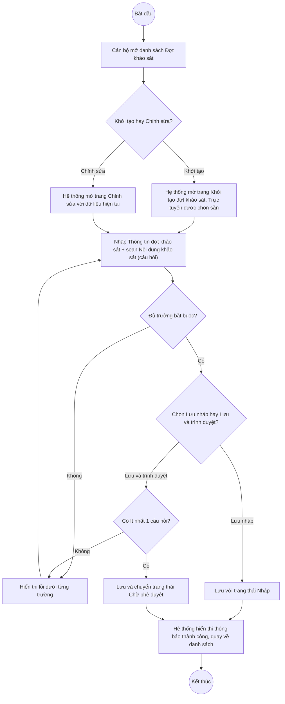

# UC12.1: Quản lý đợt khảo sát

## 1. Thông tin chung

| ID | Use case | Description |
| :---- | :---- | :---- |
| UC12.1 | Quản lý đợt khảo sát | Cán bộ, Cán bộ địa phương xem danh sách, xem chi tiết, khởi tạo, chỉnh sửa, xóa đợt khảo sát mức độ hài lòng của người dân; chọn loại đợt khảo sát (trực tuyến/trực tiếp/gián tiếp qua phiếu); soạn nội dung khảo sát (thêm/sửa/xóa câu hỏi) ngay trên cùng màn hình khởi tạo/chỉnh sửa. |

> **Actor:** Cán bộ, Cán bộ địa phương
>
> **Trigger:** Người dùng chọn menu "Đợt khảo sát" trong nhóm "Khảo sát hài lòng"
>
> **Điều kiện trước (Pre-condition):** Người dùng đã đăng nhập và có quyền quản lý khảo sát hài lòng của đơn vị mình
>
> **Điều kiện sau (Post-condition):** Đợt khảo sát (đúng ra là: bản ghi khảo sát với mã tự sinh dạng "KS-{năm}-{số thứ tự}") được thêm mới, cập nhật hoặc xóa; danh sách hiển thị dữ liệu mới nhất
>
> **Ghi nhận QC (10/10/2026) — LỖI NGHIÊM TRỌNG, CẦN BÁO NGAY CHO ĐỘI PHÁT TRIỂN:** Toàn bộ thao tác Thêm mới/Chỉnh sửa/Xóa trên giao diện "Đợt khảo sát" **KHÔNG được lưu thật trên backend**. Giao diện (frontend) đang gọi các endpoint sai đường dẫn — ví dụ `POST /api/v1/survey/campaigns` — và nhận về **HTTP 404** (endpoint không tồn tại), nhưng vẫn hiển thị toast "Tạo đợt khảo sát thành công" và thêm dòng vào danh sách một cách cục bộ (optimistic update phía client). Dữ liệu này biến mất ngay khi rời khỏi trang hoặc tải lại. Đã kiểm chứng trực tiếp ngày 10/10/2026 bằng kịch bản tạo mới → sửa → xem lại danh sách: dòng test "UC1409-E-6401416" không còn tồn tại sau khi điều hướng. Trong khi đó, bộ API thật của phân hệ này (tiền tố đúng là `/api/v1/survey/surveys`, xem Swagger tag `Survey`) đã được xác nhận hoạt động đúng qua một bộ 279 test case API độc lập (xem `workspace/survey-api-tests/README.md`), với 100% các test case đọc (read-only) và các test case mutation chạy được đều pass trên môi trường thật `cds.geneat.pro`. Kết luận: **backend của phân hệ E đã sẵn sàng, nhưng frontend hiện đang gọi sai endpoint** — đây là lỗi tích hợp FE-BE cần sửa gấp trước khi phân hệ E có thể dùng được trong thực tế. Toàn bộ Business rule và Field spec dưới đây vẫn được ghi nhận đầy đủ theo đúng những gì quan sát được trên giao diện thật, vì mô tả nghiệp vụ/trường dữ liệu là chính xác — chỉ riêng việc LƯU DỮ LIỆU là chưa hoạt động.
>
> **Business rule:**
>
> BR-1: Mỗi đợt khảo sát có mã tự sinh dạng "KS-{năm bắt đầu}-{số thứ tự}" (ví dụ "KS-2026-016"), không trùng lặp, tăng dần theo năm. *(Suy ra từ dữ liệu mẫu quan sát được trên danh sách và từ tài liệu test API `testcases/Survey/02_post_surveys.yaml`)*. **[Cần xác nhận]** quy tắc sinh mã chính xác khi test thật qua UI (do lỗi ở Ghi nhận QC, dòng tạo mới qua UI không lưu thật nên không đối chiếu được).
>
> BR-2: Khi khởi tạo, các trường bắt buộc (đánh dấu *) gồm: Tên đợt khảo sát, Đơn vị được khảo sát, Loại đợt khảo sát (chọn ít nhất 1), Ngày bắt đầu, Ngày kết thúc. "Chỉ tiêu số phiếu" và "Mô tả/Căn cứ" không bắt buộc. *(Đã kiểm chứng trực tiếp ngày 10/10/2026 qua giao diện)*. Theo tài liệu test API, "Đơn vị được khảo sát" (organizationId) tuy không bắt buộc theo schema Swagger nhưng bắt buộc về nghiệp vụ — nếu để trống hoặc không hợp lệ, API trả lỗi 400 "Đơn vị không tồn tại hoặc không được phép sử dụng".
>
> BR-3: "Loại đợt khảo sát" là nhóm thẻ chọn nhiều (không phải dropdown thông thường): Trực tuyến, Trực tiếp, Gián tiếp qua phiếu — có thể chọn 1 hoặc nhiều, mặc định khi khởi tạo đã chọn sẵn "Trực tuyến". *(Đã kiểm chứng trực tiếp ngày 10/10/2026)*. Theo API, phải chọn ít nhất 1 hình thức, nếu để trống trả lỗi 400 "phải chọn ít nhất một hình thức khảo sát".
>
> BR-4: Tên đợt khảo sát tối đa 300 ký tự (theo tài liệu test API, đã xác nhận biên 300 ký tự hợp lệ và 301 ký tự bị từ chối ở tầng API). Ngày kết thúc phải sau Ngày bắt đầu (API trả lỗi 400 nếu sai).
>
> BR-5: Khối "Nội dung khảo sát" cho phép Thêm câu hỏi từng câu hoặc "Nhập nhanh nhiều câu" cùng lúc; mỗi câu hỏi dùng chung 1 thang kết quả cố định cho toàn bộ đợt khảo sát: "Hài lòng" / "Chưa hài lòng" (hiển thị ngay trong khối 2, nhãn "Kết quả đánh giá áp dụng cho mọi câu hỏi"). *(Đã kiểm chứng trực tiếp ngày 10/10/2026)*. Theo API, nếu Lưu và trình duyệt (status = Chờ phê duyệt) mà không có câu hỏi nào, hệ thống từ chối với lỗi 400 "phải có ít nhất một câu hỏi khi gửi duyệt" — lưu nháp (status = Nháp) thì không bắt buộc có câu hỏi.
>
> BR-6: Có 2 nút lưu riêng biệt: "Lưu nháp" (lưu với trạng thái Nháp, không kích hoạt luồng phê duyệt) và "Lưu và trình duyệt" (lưu và tự động chuyển trạng thái sang Chờ phê duyệt, tương đương UC12.2). *(Đã kiểm chứng trực tiếp ngày 10/10/2026 — xác nhận nút tồn tại, KHÔNG bấm "Lưu và trình duyệt" để tránh kích hoạt luồng phê duyệt thật trên dữ liệu test)*
>
> BR-7: Trạng thái đợt khảo sát gồm 6 giá trị theo vòng đời: Nháp → Chờ phê duyệt → Đã phê duyệt → Đang diễn ra → Đã kết thúc, và nhánh Bị từ chối (có thể trình duyệt lại). *(Xác nhận qua tài liệu test API — enum SurveyStatus: 1=Nháp, 2=Chờ phê duyệt, 3=Đã phê duyệt, 4=Bị từ chối, 5=Đang diễn ra, 6=Đã kết thúc)*. **PHÁT HIỆN QUAN TRỌNG (theo README của bộ test API, cần báo cho dev):** đợt khảo sát **không tự động chuyển sang "Đang diễn ra"** ngay cả khi đã quá Ngày bắt đầu — đã kiểm chứng thực nghiệm (tạo + phê duyệt 1 khảo sát với Ngày bắt đầu là 1 giờ trước, truy vấn lại vẫn thấy trạng thái "Đã phê duyệt"). Có thể thiếu một tiến trình nền (scheduled job) để tự động chuyển trạng thái theo thời gian — nếu đúng vậy, khảo sát sẽ không bao giờ vào được trạng thái "Đang diễn ra" để người dân có thể thực hiện (ảnh hưởng trực tiếp UC12.4).
>
> BR-8: Mỗi dòng trong danh sách ở trạng thái Nháp có menu thao tác gồm: Chỉnh sửa, Trình phê duyệt, Xóa. *(Đã kiểm chứng trực tiếp ngày 10/10/2026)*. Không có chức năng Khóa/Mở khóa cho đợt khảo sát.
>
> BR-9: Tìm kiếm theo tên/mã đợt/đơn vị; có thể lọc theo "Tất cả trạng thái" và "Tất cả loại đợt". *(Đã kiểm chứng trực tiếp ngày 10/10/2026: ô tìm kiếm + 2 dropdown lọc tồn tại trên thanh công cụ)*
>
> BR-10 (lỗi backend đã biết — theo README bộ test API, chưa tự kiểm chứng lại trong phiên này): `GET /api/v1/survey/surveys?page=0` (hoặc `page=-1`) trả về lỗi 500 (lộ stack trace Postgres) thay vì tự coi là trang 1 hoặc trả 400; sắp xếp nhiều trường cùng lúc (`sort=status,-startDate`) cũng trả về 500. **[Cần xác nhận]** các lỗi này có còn tồn tại tại thời điểm hiện tại hay đã được sửa.

**Truy vết chức năng**

| STT | Chức năng | YC (BCKTKT) | Dòng UC_1409 | Luồng | Màn hình | BR |
| :---- | :---- | :---- | :---- | :---- | :---- | :---- |
| 1 | Xem danh sách đợt khảo sát | **[Cần xác nhận]** | **[Cần xác nhận]** | Basic Flow bước 1–2 | UI-12.1.1 | BR-9 |
| 2 | Xem chi tiết đợt khảo sát | **[Cần xác nhận]** | **[Cần xác nhận]** | AF1 | UI-12.1.3 | — |
| 3 | Khởi tạo đợt khảo sát | **[Cần xác nhận]** | **[Cần xác nhận]** | Basic Flow bước 3–7 | UI-12.1.2 | BR-1 đến BR-6 |
| 4 | Chỉnh sửa thông tin đợt khảo sát | **[Cần xác nhận]** | **[Cần xác nhận]** | AF2 | UI-12.1.2 | BR-2 đến BR-4 |
| 5 | Lựa chọn loại đợt khảo sát | **[Cần xác nhận]** | **[Cần xác nhận]** | Basic Flow bước 5 | UI-12.1.2 | BR-3 |
| 6 | Thêm/Chỉnh sửa/Xóa nội dung khảo sát | **[Cần xác nhận]** | **[Cần xác nhận]** | Basic Flow bước 5 | UI-12.1.2 | BR-5 |
| 7 | Lựa chọn kết quả nội dung khảo sát (Hài lòng/Chưa hài lòng) | **[Cần xác nhận]** | **[Cần xác nhận]** | Basic Flow bước 5 | UI-12.1.2 | BR-5 |
| 8 | Xóa đợt khảo sát | **[Cần xác nhận]** | **[Cần xác nhận]** | AF3 | UI-12.1.4 | BR-8 |

> Cột YC (BCKTKT) và Dòng UC_1409 chưa đối chiếu được với bản gốc Google Sheet "Danh sách công việc_CĐS - BCT". Use case nguồn tương ứng: UC-E.1 "Quản lý đợt khảo sát".

## 2. Mô tả luồng nghiệp vụ

*Hình 1. Luồng nghiệp vụ khởi tạo / chỉnh sửa đợt khảo sát*

**Basic Flow** (Khởi tạo đợt khảo sát)

1. Cán bộ chọn menu "Đợt khảo sát" trong nhóm "Khảo sát hài lòng".
2. Hệ thống hiển thị màn hình Danh sách đợt khảo sát (UI-12.1.1), mặc định tab "Tất cả đợt", 10 bản ghi/trang.
3. Cán bộ nhấn nút "Thêm mới".
4. Hệ thống chuyển sang trang "Khởi tạo đợt khảo sát" (UI-12.1.2) — đây là 1 route riêng, không phải modal/dialog.
5. Cán bộ nhập Tên đợt khảo sát, chọn Đơn vị được khảo sát, nhập Chỉ tiêu số phiếu, chọn Loại đợt khảo sát (BR-3), nhập Ngày bắt đầu/Ngày kết thúc, nhập Mô tả/Căn cứ; sau đó soạn Nội dung khảo sát bằng cách thêm từng câu hỏi hoặc dùng "Nhập nhanh nhiều câu" (BR-5).
6. Cán bộ nhấn "Lưu nháp" (hoặc "Lưu và trình duyệt" — xem AF4/UC12.2).
7. Hệ thống kiểm tra các trường bắt buộc (BR-2, BR-3, BR-4), lưu bản ghi với trạng thái Nháp, hiển thị thông báo "Tạo đợt khảo sát thành công" và quay về danh sách (BR-1).

**Alternative Flow**

AF1. Xem chi tiết đợt khảo sát

Tại màn hình danh sách (bước 2), Cán bộ nhấn "Xem chi tiết" trên một dòng. Hệ thống hiển thị màn hình Chi tiết đợt khảo sát (UI-12.1.3) gồm khối Thông tin chung, khối Nội dung khảo sát (các câu hỏi, có nhóm theo chủ đề) và khối "Lịch sử xử lý" (dòng thời gian các mốc Tạo đợt khảo sát/Trình phê duyệt/Phê duyệt/Từ chối). *(Đã kiểm chứng trực tiếp ngày 10/10/2026)*. Use case kết thúc.

AF2. Chỉnh sửa đợt khảo sát

Tại màn hình danh sách (bước 2) hoặc màn hình chi tiết (AF1), Cán bộ chọn "Chỉnh sửa". Hệ thống mở trang Khởi tạo/Chỉnh sửa (UI-12.1.2) với dữ liệu hiện tại. Cán bộ sửa các trường và nhấn nút lưu. Hệ thống kiểm tra như bước 7 và lưu. Use case kết thúc.

AF3. Xóa đợt khảo sát

Tại màn hình danh sách (bước 2) hoặc màn hình chi tiết (AF1), Cán bộ chọn "Xóa". Hệ thống hiển thị popup xác nhận (UI-12.1.4). Cán bộ xác nhận xóa. Hệ thống xóa bản ghi, hiển thị thông báo thành công và tải lại danh sách (BR-8). **[Cần xác nhận]** có ràng buộc chặn xóa khi đợt khảo sát đã có kết quả/đang diễn ra hay không (theo tài liệu test API, hành vi này được đánh dấu "CẦN XÁC NHẬN" ngay trong test case gốc). Use case kết thúc.

AF4. Trình phê duyệt (xem chi tiết tại UC12.2)

Tại màn hình khởi tạo/chỉnh sửa (bước 5–6), Cán bộ nhấn "Lưu và trình duyệt" thay vì "Lưu nháp"; hoặc tại danh sách/chi tiết, Cán bộ chọn thao tác "Trình phê duyệt" trên 1 đợt đang Nháp/Bị từ chối. Xem UC12.2.

AF5. Tìm kiếm, lọc danh sách

Tại màn hình danh sách (bước 2), Cán bộ nhập từ khóa và/hoặc chọn bộ lọc Trạng thái/Loại đợt (BR-9). Use case kết thúc.

**Exception Flow**

EF1. Thiếu trường bắt buộc hoặc sai định dạng

Tại bước 7, nếu thiếu Tên đợt khảo sát/Đơn vị được khảo sát/Loại đợt/Ngày bắt đầu/Ngày kết thúc, Hệ thống hiển thị lỗi dưới từng trường tương ứng. Quay lại bước 5.

EF2. Ngày kết thúc không sau Ngày bắt đầu

Tại bước 7, nếu Ngày kết thúc ≤ Ngày bắt đầu, Hệ thống báo lỗi (theo tài liệu test API tầng backend: "ngày kết thúc phải sau ngày bắt đầu"). **[Cần xác nhận]** nội dung thông báo chính xác hiển thị trên giao diện. Quay lại bước 5.

EF3. Lưu và trình duyệt khi chưa có câu hỏi

Tại bước 7 (khi chọn "Lưu và trình duyệt"), nếu chưa thêm câu hỏi nào, Hệ thống báo lỗi "phải có ít nhất một câu hỏi" (BR-5) và không chuyển trạng thái. **[Cần xác nhận]** nội dung thông báo chính xác trên giao diện. Quay lại bước 5.

EF4. Lỗi hệ thống khi lưu hoặc xóa

**ĐÃ XÁC NHẬN LÀ LỖI THẬT (xem Ghi nhận QC mục 1):** hiện tại, do frontend gọi sai endpoint, mọi thao tác Lưu/Xóa đều thất bại ở tầng backend (HTTP 404) nhưng giao diện vẫn báo "thành công" — đây không phải là hành vi mong đợi, cần sửa trước khi đưa vào sử dụng thật.

Use case kết thúc.

## 3. Màn hình

| UI Code | Screen | Mô tả |
| :---- | :---- | :---- |
| UI-12.1.1 | Danh sách Đợt khảo sát (Web) | Tab Tất cả đợt/Đã trình phê duyệt, tìm kiếm, lọc, bảng danh sách, nút Thêm mới, menu thao tác từng dòng |
| UI-12.1.2 | Khởi tạo / Chỉnh sửa đợt khảo sát (Web, route riêng) | Khối 1: Thông tin đợt khảo sát; Khối 2: Nội dung khảo sát (câu hỏi); nút Hủy/Lưu nháp/Lưu và trình duyệt |
| UI-12.1.3 | Chi tiết đợt khảo sát (Web) | Thông tin chung, Nội dung khảo sát, Lịch sử xử lý; nút Xóa/Sửa/Trình duyệt (tùy trạng thái) |
| UI-12.1.4 | Popup xác nhận xóa (Web) | Xác nhận trước khi xóa đợt khảo sát |

## 4. Mô tả Màn hình (Field Specification)

**UI-12.1.1 — Danh sách Đợt khảo sát**

| Field Name | Field type | Data Type | Required | Validation rule/Behaviour |
| :---- | :---- | :---- | :---- | :---- |
| Tab Tất cả đợt / Đã trình phê duyệt | Tab | — | Yes | **Behaviour:** Mỗi tab kèm số đếm (badge), ví dụ "Tất cả đợt 10", "Đã trình phê duyệt 9" **Validation rule:** — |
| Tìm kiếm | Search box | String | No | **Behaviour:** Placeholder "Tìm theo tên, mã đợt, đơn vị..." (BR-9) **Validation rule:** — |
| Tất cả trạng thái | Dropdown | Enum | No | **Behaviour:** Lọc theo 1 trong 6 trạng thái (BR-7, BR-9) **Validation rule:** — |
| Tất cả loại đợt | Dropdown | Enum | No | **Behaviour:** Lọc theo Trực tuyến/Trực tiếp/Gián tiếp qua phiếu (BR-9) **Validation rule:** — |
| Nút Thêm mới | Button | Action | Yes | **Behaviour:** Chuyển sang UI-12.1.2 ở chế độ Khởi tạo **Validation rule:** — |
| Bảng danh sách | Table | List | Yes | **Behaviour:** Cột: STT, Tên đợt khảo sát (kèm mã, có thể kèm ghi chú phản hồi Lãnh đạo), Đơn vị chủ trì khảo sát, Thời gian (Từ-Đến), Loại đợt, Số phiếu (dạng "đã thu/chỉ tiêu"), Trạng thái, Thao tác **Validation rule:** — |
| Menu thao tác | Icon button | Action | Yes | **Behaviour:** Mở menu gồm: Chỉnh sửa (AF2), Trình phê duyệt (AF4, chỉ hiện khi Nháp/Bị từ chối — BR-8), Xóa (AF3) **Validation rule:** — |
| Phân trang | Pagination | Integer | Yes | **Behaviour:** "10 / trang" **Validation rule:** — |

**UI-12.1.2 — Khởi tạo / Chỉnh sửa đợt khảo sát**

| Field Name | Field type | Data Type | Required | Validation rule/Behaviour |
| :---- | :---- | :---- | :---- | :---- |
| Tên đợt khảo sát | Textbox | String | Yes | **Behaviour:** Placeholder "VD: Khảo sát hài lòng về giải quyết PAKN tháng 11/2026" (BR-2) **Validation rule:** Bắt buộc; tối đa 300 ký tự (BR-4) |
| Đơn vị được khảo sát | Dropdown | Enum | Yes | **Behaviour:** Placeholder "-- Chọn đơn vị --"; ghi chú "Người dân đánh giá trực tiếp cho đơn vị này, không phải chọn lại" (BR-2) **Validation rule:** Bắt buộc về nghiệp vụ dù schema API không bắt buộc (xem BR-2) |
| Chỉ tiêu số phiếu | Number input | Integer | No | **Behaviour:** Ghi chú "Dùng để tính tiến độ thu thập" **Validation rule:** **[Cần xác nhận]** giá trị tối thiểu/tối đa — theo API, chấp nhận 0 và giá trị rất lớn (Int32.MaxValue), từ chối số âm |
| Loại đợt khảo sát | Card multi-select | Enum (multi) | Yes | **Behaviour:** 3 thẻ: Trực tuyến ("Người dân tự đánh giá trên cổng", chọn sẵn mặc định), Trực tiếp ("Cán bộ phỏng vấn, nhập kết quả"), Gián tiếp qua phiếu ("Phát phiếu giấy, nhập kết quả") — chọn một hoặc nhiều (BR-3) **Validation rule:** Bắt buộc chọn ≥1 |
| Ngày bắt đầu | Date picker | Date | Yes | **Behaviour:** Định dạng dd/mm/yyyy **Validation rule:** Bắt buộc |
| Ngày kết thúc | Date picker | Date | Yes | **Behaviour:** Định dạng dd/mm/yyyy **Validation rule:** Bắt buộc; phải sau Ngày bắt đầu (BR-4, EF2) |
| Mô tả / Căn cứ | Textarea | String | No | **Behaviour:** — **Validation rule:** — |
| Khối Nội dung khảo sát | Section | — | Yes (≥1 câu khi trình duyệt) | **Behaviour:** Đếm số câu hỏi hiện tại (ví dụ "0 câu"); dòng ghi chú cố định "Kết quả đánh giá áp dụng cho mọi câu hỏi: Hài lòng / Chưa hài lòng" (BR-5) **Validation rule:** Bắt buộc ≥1 câu khi "Lưu và trình duyệt" (EF3) |
| Nút Nhập nhanh nhiều câu | Button | Action | No | **Behaviour:** Thêm nhiều câu hỏi cùng lúc (BR-5) **Validation rule:** **[Cần xác nhận]** định dạng nhập nhanh (ví dụ mỗi dòng 1 câu?) |
| Nút Thêm câu hỏi | Button | Action | No | **Behaviour:** Thêm từng câu hỏi (BR-5) **Validation rule:** **[Cần xác nhận]** các trường của 1 câu hỏi (nội dung, nhóm chủ đề, thứ tự) |
| Nút Hủy | Button | Action | Yes | **Behaviour:** Quay về danh sách, không lưu **Validation rule:** — |
| Nút Lưu nháp | Button | Action | Yes | **Behaviour:** Lưu với trạng thái Nháp (BR-6, bước 6–7) **Validation rule:** — |
| Nút Lưu và trình duyệt | Button | Action | Yes | **Behaviour:** Lưu và chuyển trạng thái Chờ phê duyệt (BR-6, AF4 → UC12.2) **Validation rule:** Yêu cầu ≥1 câu hỏi (EF3) |

**UI-12.1.3 — Chi tiết đợt khảo sát**

| Field Name | Field type | Data Type | Required | Validation rule/Behaviour |
| :---- | :---- | :---- | :---- | :---- |
| Mã đợt + Tên đợt + Trạng thái | Label/Badge | String/Enum | Yes | **Behaviour:** Ví dụ "KS-2026-303  UC1409-E-6401416 • Nháp" **Validation rule:** — |
| Thông tin chung | Section | — | Yes | **Behaviour:** Đơn vị được khảo sát, Loại đợt, Thời gian, Chỉ tiêu số phiếu, Kết quả đánh giá (cố định "Hài lòng / Chưa hài lòng"), Người duyệt (— nếu chưa duyệt) **Validation rule:** — |
| Nội dung khảo sát | List | List | Yes | **Behaviour:** Danh sách câu hỏi, nhóm theo chủ đề (ví dụ "TIẾP NHẬN VÀ XỬ LÝ PHẢN ÁNH, KIẾN NGHỊ", "DỊCH VỤ CÔNG TRỰC TUYẾN"...) **Validation rule:** — |
| Lịch sử xử lý | Timeline | List | Yes | **Behaviour:** Mỗi mốc gồm tên hành động, người thực hiện, thời gian (ví dụ "Tạo đợt khảo sát · Nguyễn Văn Nam · 09:00 2026-10-08") **Validation rule:** — |
| Nút Xóa | Button | Action | Yes | **Behaviour:** Mở popup UI-12.1.4 (AF3) **Validation rule:** Chỉ hiện với trạng thái cho phép xóa — **[Cần xác nhận]** trạng thái nào bị chặn |
| Nút Sửa | Button | Action | Yes | **Behaviour:** Mở UI-12.1.2 ở chế độ Chỉnh sửa (AF2) **Validation rule:** — |
| Nút Trình duyệt | Button | Action | Yes | **Behaviour:** Trình phê duyệt (AF4 → UC12.2) **Validation rule:** Chỉ hiện khi trạng thái Nháp/Bị từ chối |

**UI-12.1.4 — Popup xác nhận xóa**

| Field Name | Field type | Data Type | Required | Validation rule/Behaviour |
| :---- | :---- | :---- | :---- | :---- |
| Nội dung xác nhận | Label | String | Yes | **Behaviour:** **[Cần xác nhận]** nội dung chính xác **Validation rule:** — |
| Nút Hủy | Button | Action | Yes | **Behaviour:** Đóng popup, không xóa **Validation rule:** — |
| Nút Xóa | Button | Action | Yes | **Behaviour:** Thực hiện xóa (AF3) **Validation rule:** — |

## Điểm cần xác nhận

| STT | Vị trí | Giả định đã dùng | Câu hỏi cần xác nhận |
| :---- | :---- | :---- | :---- |
| 1 | Mục 1 – Ghi nhận QC | Frontend gọi sai endpoint `/api/v1/survey/campaigns` (404) thay vì `/api/v1/survey/surveys` (đã xác nhận hoạt động) | Đề nghị đội phát triển sửa gấp để Thêm/Sửa/Xóa đợt khảo sát lưu được thật trên backend |
| 2 | BR-7 | Đợt khảo sát không tự động chuyển sang "Đang diễn ra" dù đã qua Ngày bắt đầu | Có cơ chế tiến trình nền (scheduled job) nào xử lý việc này không, chu kỳ chạy bao lâu? |
| 3 | AF3 | Chưa rõ ràng buộc khi xóa đợt đã có kết quả/đang diễn ra | Có chặn xóa trong các trường hợp này không? |
| 4 | UI-12.1.2 | Chưa rõ các trường chi tiết của 1 câu hỏi và định dạng "Nhập nhanh nhiều câu" | Đề nghị bổ sung khi có thời gian kiểm thử sâu hơn khối soạn câu hỏi |
| 5 | BR-10 | Lỗi 500 khi `page=0`/`page=-1`/sort nhiều trường (theo README bộ test API, chưa tự kiểm chứng lại trong phiên này) | Các lỗi này đã được sửa chưa? |
| 6 | Truy vết chức năng | Chưa có số YC (BCKTKT) và Dòng UC_1409 | Đề nghị đối chiếu với bản gốc Google Sheet |
