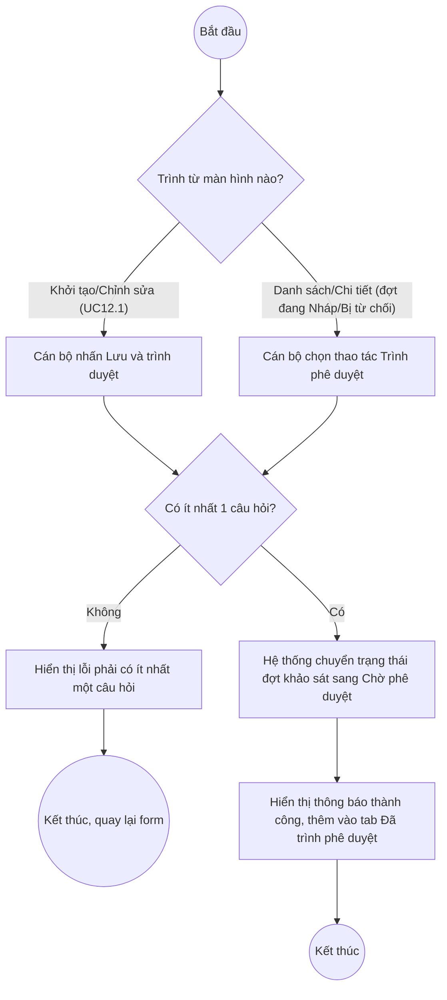

# UC12.2: Trình phê duyệt đợt khảo sát

## 1. Thông tin chung

| ID | Use case | Description |
| :---- | :---- | :---- |
| UC12.2 | Trình phê duyệt đợt khảo sát | Cán bộ, Cán bộ địa phương trình lãnh đạo phê duyệt một đợt khảo sát đang ở trạng thái Nháp (hoặc Bị từ chối); xem danh sách các đợt khảo sát đã trình lãnh đạo phê duyệt. |

> **Actor:** Cán bộ, Cán bộ địa phương
>
> **Trigger:** Tại màn hình Khởi tạo/Chỉnh sửa đợt khảo sát, người dùng nhấn "Lưu và trình duyệt"; hoặc tại danh sách/chi tiết đợt khảo sát, người dùng chọn thao tác "Trình phê duyệt"
>
> **Điều kiện trước (Pre-condition):** Đợt khảo sát đang ở trạng thái Nháp hoặc Bị từ chối, và có ít nhất 1 câu hỏi trong nội dung khảo sát (BR-1)
>
> **Điều kiện sau (Post-condition):** Đợt khảo sát chuyển trạng thái sang "Chờ phê duyệt" và xuất hiện trong danh sách chờ phê duyệt của Lãnh đạo (UC12.3)
>
> **Ghi nhận QC (10/10/2026):** Đây là use case phụ thuộc trực tiếp vào UC12.1 — kế thừa cùng lỗi nghiêm trọng đã ghi nhận ở UC12.1 mục 1 (frontend gọi sai endpoint `/api/v1/survey/campaigns` thay vì `/api/v1/survey/surveys` thật, khiến thao tác không lưu được trên backend). Trong phiên kiểm thử, **đã xác nhận được nút "Lưu và trình duyệt" và mục menu "Trình phê duyệt" tồn tại trên giao diện** (xem UC12.1), nhưng **không bấm thật** 2 thao tác này vì (a) lỗi backend nêu trên khiến kết quả không phản ánh đúng hành vi thật, và (b) tránh kích hoạt luồng phê duyệt thật trên dữ liệu đang có trên môi trường thật nếu vô tình chọn nhầm 1 đợt khảo sát không phải của riêng mình. Phần lớn nội dung dưới đây được suy ra từ tài liệu test API (`testcases/Survey/`) và từ màn hình chi tiết phía Lãnh đạo quan sát được ở UC12.3 (khối "Lịch sử xử lý" có ghi nhận mốc "Trình phê duyệt" kèm ghi chú/lý do).
>
> **Business rule:**
>
> BR-1: Chỉ đợt khảo sát ở trạng thái Nháp hoặc Bị từ chối mới trình phê duyệt được; đợt đã ở trạng thái khác (Chờ phê duyệt/Đã phê duyệt/Đang diễn ra/Đã kết thúc) không hiển thị thao tác "Trình phê duyệt". *(Suy ra từ việc chỉ quan sát thấy mục "Trình phê duyệt" trong menu thao tác của dòng đang ở trạng thái Nháp — xem UC12.1)*
>
> BR-2: Trình phê duyệt yêu cầu đợt khảo sát phải có ít nhất 1 câu hỏi trong Nội dung khảo sát — nếu chưa có câu hỏi, hệ thống từ chối với lỗi "phải có ít nhất một câu hỏi" (xem UC12.1 BR-5, EF3).
>
> BR-3: Khi trình phê duyệt, có thể kèm theo ghi chú/lý do trình (quan sát được tại khối "Lịch sử xử lý" phía Lãnh đạo — UC12.3 — có nội dung ví dụ: *"Đề nghị lãnh đạo phê duyệt để triển khai phát phiếu tại bộ phận một cửa từ 01/10/2026."*). **[Cần xác nhận]** đây có phải là 1 trường bắt buộc nhập khi trình phê duyệt hay là trường tùy chọn — chưa mở được chính form "Trình phê duyệt" thật trong phiên kiểm thử để xác nhận.
>
> BR-4: Đợt khảo sát đã trình phê duyệt (trạng thái Chờ phê duyệt trở về sau) xuất hiện ở tab "Đã trình phê duyệt" trên màn hình danh sách Đợt khảo sát (UC12.1, UI-12.1.1) — đã quan sát số đếm badge "Đã trình phê duyệt: 9" trên 10 đợt khảo sát mẫu. *(Đã kiểm chứng trực tiếp ngày 10/10/2026)*
>
> BR-5: Sau khi bị từ chối (trạng thái Bị từ chối), Cán bộ có thể sửa lại nội dung và trình phê duyệt lại — vòng đời cho phép lặp lại Nháp/Bị từ chối → Chờ phê duyệt nhiều lần (theo tài liệu test API, đã xác nhận qua kịch bản: Nhập → Chờ phê duyệt → Bị từ chối → Chờ phê duyệt → Đã phê duyệt).

**Truy vết chức năng**

| STT | Chức năng | YC (BCKTKT) | Dòng UC_1409 | Luồng | Màn hình | BR |
| :---- | :---- | :---- | :---- | :---- | :---- | :---- |
| 1 | Trình lãnh đạo phê duyệt đợt khảo sát | **[Cần xác nhận]** | **[Cần xác nhận]** | Basic Flow | UI-12.2.2 | BR-1 đến BR-3, BR-5 |
| 2 | Xem danh sách đợt khảo sát đã trình lãnh đạo phê duyệt | **[Cần xác nhận]** | **[Cần xác nhận]** | AF1 | UI-12.2.1 | BR-4 |

> Cột YC (BCKTKT) và Dòng UC_1409 chưa đối chiếu được với bản gốc Google Sheet "Danh sách công việc_CĐS - BCT". Use case nguồn tương ứng: UC-E.2 "Trình phê duyệt đợt khảo sát".

## 2. Mô tả luồng nghiệp vụ

*Hình 1. Luồng nghiệp vụ trình phê duyệt đợt khảo sát*

**Basic Flow** (Trình phê duyệt từ danh sách/chi tiết)

1. Cán bộ mở danh sách Đợt khảo sát (UC12.1, UI-12.1.1), xác định 1 đợt đang ở trạng thái Nháp hoặc Bị từ chối.
2. Cán bộ mở menu thao tác của dòng (hoặc tại màn hình chi tiết) và chọn "Trình phê duyệt" (UI-12.2.2).
3. Hệ thống kiểm tra đợt khảo sát có ít nhất 1 câu hỏi (BR-2).
4. Cán bộ xác nhận trình (có thể kèm ghi chú — BR-3).
5. Hệ thống chuyển trạng thái đợt khảo sát sang "Chờ phê duyệt", hiển thị thông báo thành công, đợt khảo sát xuất hiện ở tab "Đã trình phê duyệt" và trong danh sách chờ phê duyệt của Lãnh đạo (UC12.3).

**Alternative Flow**

AF1. Xem danh sách đợt khảo sát đã trình phê duyệt

Tại màn hình Danh sách đợt khảo sát (UI-12.1.1), Cán bộ chuyển sang tab "Đã trình phê duyệt" (BR-4). Hệ thống hiển thị danh sách các đợt đã từng được trình duyệt (bao gồm cả Chờ phê duyệt/Đã phê duyệt/Bị từ chối). Use case kết thúc.

AF2. Trình phê duyệt ngay khi khởi tạo/chỉnh sửa

Tại màn hình Khởi tạo/Chỉnh sửa đợt khảo sát (UC12.1, UI-12.1.2), Cán bộ nhấn "Lưu và trình duyệt" thay vì "Lưu nháp". Hệ thống thực hiện lưu và trình phê duyệt trong cùng 1 thao tác (gộp bước 1–2 của Basic Flow). Tiếp tục từ bước 3.

**Exception Flow**

EF1. Chưa có câu hỏi nào trong nội dung khảo sát

Tại bước 3, nếu đợt khảo sát chưa có câu hỏi nào, Hệ thống từ chối trình phê duyệt và hiển thị lỗi (BR-2). Use case kết thúc, quay lại màn hình chỉnh sửa để bổ sung câu hỏi.

EF2. Lỗi hệ thống khi trình phê duyệt

**Liên quan lỗi đã ghi nhận ở UC12.1 mục 1** (frontend gọi sai endpoint khiến thao tác ghi dữ liệu không thành công trên backend dù giao diện báo thành công). Use case kết thúc.

## 3. Màn hình

| UI Code | Screen | Mô tả |
| :---- | :---- | :---- |
| UI-12.2.1 | Tab "Đã trình phê duyệt" trong Danh sách đợt khảo sát (Web) | = UI-12.1.1 (UC12.1), lọc sẵn các đợt đã từng trình duyệt |
| UI-12.2.2 | Thao tác "Trình phê duyệt" (Web) | Thao tác trên menu dòng/màn hình chi tiết (UC12.1, UI-12.1.3) hoặc nút "Lưu và trình duyệt" trên màn hình khởi tạo/chỉnh sửa (UC12.1, UI-12.1.2) |

## 4. Mô tả Màn hình (Field Specification)

**UI-12.2.1 — Tab "Đã trình phê duyệt"**

| Field Name | Field type | Data Type | Required | Validation rule/Behaviour |
| :---- | :---- | :---- | :---- | :---- |
| Tab Đã trình phê duyệt | Tab | — | Yes | **Behaviour:** Badge số đếm, ví dụ "9" (BR-4) **Validation rule:** — |
| Bảng danh sách | Table | List | Yes | **Behaviour:** Cùng cấu trúc cột với UI-12.1.1 (STT, Tên đợt, Đơn vị, Thời gian, Loại đợt, Số phiếu, Trạng thái, Thao tác) **Validation rule:** Chỉ liệt kê các đợt có trạng thái ≠ Nháp |

**UI-12.2.2 — Thao tác "Trình phê duyệt"**

| Field Name | Field type | Data Type | Required | Validation rule/Behaviour |
| :---- | :---- | :---- | :---- | :---- |
| Mục menu "Trình phê duyệt" | Menu item | Action | Yes | **Behaviour:** Chỉ hiện khi đợt đang Nháp/Bị từ chối (BR-1) — đã xác nhận tồn tại trong menu thao tác, chưa bấm thật **Validation rule:** — |
| Nút "Lưu và trình duyệt" | Button | Action | Yes | **Behaviour:** Gộp lưu + trình duyệt (AF2) — đã xác nhận tồn tại trên form khởi tạo/chỉnh sửa, chưa bấm thật **Validation rule:** Yêu cầu ≥1 câu hỏi (BR-2) |
| Ghi chú/Lý do trình | Textarea | String | **[Cần xác nhận]** | **Behaviour:** Suy ra từ nội dung hiển thị ở "Lịch sử xử lý" phía Lãnh đạo (BR-3) **Validation rule:** **[Cần xác nhận]** bắt buộc hay tùy chọn, độ dài tối đa |

## Điểm cần xác nhận

| STT | Vị trí | Giả định đã dùng | Câu hỏi cần xác nhận |
| :---- | :---- | :---- | :---- |
| 1 | BR-3, UI-12.2.2 | Form trình phê duyệt có trường ghi chú/lý do, suy ra từ Lịch sử xử lý phía Lãnh đạo | Trường này có thật và có bắt buộc không? Cần mở trực tiếp form "Trình phê duyệt" để xác nhận |
| 2 | Mục 1 – Ghi nhận QC | Thừa hưởng lỗi backend 404 từ UC12.1 | Xem UC12.1 mục 1 — cần sửa trước khi kiểm thử lại toàn bộ luồng này |
| 3 | AF1 | Tab "Đã trình phê duyệt" gồm cả Chờ phê duyệt/Đã phê duyệt/Bị từ chối | Danh sách này có loại trừ trạng thái nào không (ví dụ Đang diễn ra/Đã kết thúc có còn hiển thị ở đây không)? |
| 4 | Truy vết chức năng | Chưa có số YC (BCKTKT) và Dòng UC_1409 | Đề nghị đối chiếu với bản gốc Google Sheet |
