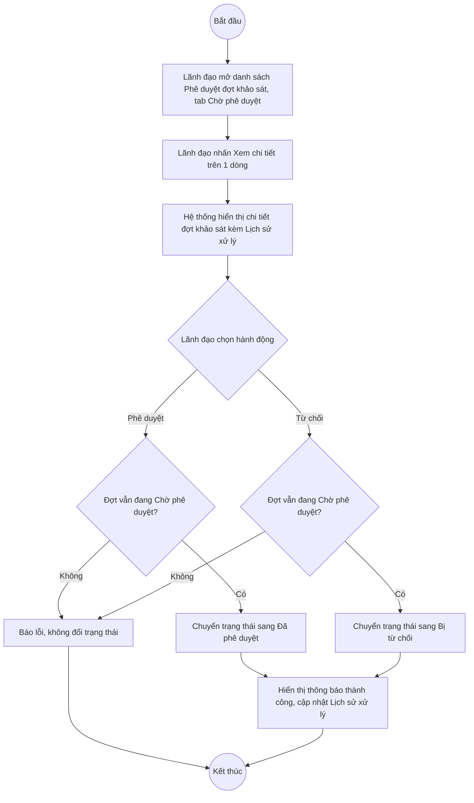

# UC12.3: Phê duyệt đợt khảo sát

## 1. Thông tin chung

| ID | Use case | Description |
| :---- | :---- | :---- |
| UC12.3 | Phê duyệt đợt khảo sát | Lãnh đạo đơn vị, Lãnh đạo địa phương xem danh sách các đợt khảo sát đã được Cán bộ trình phê duyệt; phê duyệt hoặc từ chối phê duyệt từng đợt khảo sát. |

> **Actor:** Lãnh đạo đơn vị, Lãnh đạo địa phương
>
> **Trigger:** Người dùng chọn menu "Phê duyệt đợt khảo sát" (hiển thị khi chuyển tab "Vai trò" sang "Lãnh đạo" — xem Ghi nhận QC)
>
> **Điều kiện trước (Pre-condition):** Người dùng đã đăng nhập và có quyền phê duyệt khảo sát; có ít nhất 1 đợt khảo sát đang ở trạng thái Chờ phê duyệt
>
> **Điều kiện sau (Post-condition):** Đợt khảo sát chuyển trạng thái sang "Đã phê duyệt" hoặc "Bị từ chối"
>
> **Ghi nhận QC (10/10/2026):** Môi trường thật hiện chỉ cấp 1 tài khoản kiểm thử duy nhất (QA Super Admin). Để xem được màn hình phía Lãnh đạo, giao diện cung cấp một bộ chuyển "Vai trò" (3 tab: Cán bộ / Lãnh đạo / Người dân) ngay trong cùng phiên đăng nhập — bấm tab "Lãnh đạo" trên trang "Khảo sát hài lòng" sẽ đổi toàn bộ sidebar lẫn nội dung trang sang góc nhìn Lãnh đạo (mục "Đợt khảo sát"/"Cập nhật kết quả" biến mất, thay bằng "Phê duyệt đợt khảo sát"; mục "Kết quả khảo sát" vẫn còn). **[Cần xác nhận]** đây có phải là công cụ demo/dev dùng tạm trong giai đoạn phát triển hay không, và khi lên môi trường chính thức, việc phân quyền Cán bộ/Lãnh đạo có chắc chắn dựa trên tài khoản đăng nhập thật (không còn tab chuyển vai trò này) hay không — **chưa kiểm chứng được bằng 1 tài khoản Lãnh đạo thật**, nên **KHÔNG bấm thử các nút "Phê duyệt"/"Từ chối"** trong phiên khảo sát này để tránh làm thay đổi trạng thái thật của 2 đợt khảo sát thật đang Chờ phê duyệt trên hệ thống (KS-2026-013, KS-2026-017) một cách không chủ đích/không thể hoàn tác dễ dàng. Toàn bộ Business rule dưới đây được ghi nhận từ quan sát trực tiếp giao diện (danh sách, màn hình chi tiết, các nút hiện diện) kết hợp đối chiếu với tài liệu test API (`testcases/Survey/09_put_surveys_by_id_status.yaml`).
>
> **Business rule:**
>
> BR-1: Danh sách chia 3 tab: "Chờ phê duyệt" (mặc định), "Đã phê duyệt", "Đã từ chối" — mỗi tab có badge số đếm (ví dụ "Chờ phê duyệt 2", "Đã phê duyệt 1", "Đã từ chối 1"). *(Đã kiểm chứng trực tiếp ngày 10/10/2026)*
>
> BR-2: Bảng ở tab "Chờ phê duyệt" gồm các cột: STT, Tên đợt khảo sát, Đơn vị được khảo sát, Thời gian, Người trình (kèm thời điểm trình, ví dụ "Nguyễn Văn Nam · 15:20 27/09/2026"), Câu hỏi (số lượng), Trạng thái, Thao tác. *(Đã kiểm chứng trực tiếp ngày 10/10/2026)*
>
> BR-3: Màn hình chi tiết (mở từ "Xem chi tiết") hiển thị: Thông tin chung (Đơn vị được khảo sát, Loại đợt, Thời gian, Chỉ tiêu số phiếu, Kết quả đánh giá, Người duyệt), toàn bộ Nội dung khảo sát (câu hỏi, nhóm theo chủ đề), khối "Lịch sử xử lý" bên phải (các mốc Tạo đợt khảo sát → Trình phê duyệt, mỗi mốc có thể kèm ghi chú dạng trích dẫn — ví dụ *"Đề nghị lãnh đạo phê duyệt để triển khai phát phiếu tại bộ phận một cửa từ 01/10/2026."*), và 2 nút ở góc trên bên phải: "Từ chối" (viền) và "Phê duyệt" (nút chính, màu đỏ). *(Đã kiểm chứng trực tiếp ngày 10/10/2026 — chỉ xác nhận SỰ TỒN TẠI của 2 nút, KHÔNG bấm thử, xem Ghi nhận QC mục 1)*
>
> BR-4: Theo tài liệu test API, hành động Phê duyệt/Từ chối chỉ áp dụng được khi đợt khảo sát đang ở trạng thái Chờ phê duyệt (status=2); gọi API này khi đợt đang ở trạng thái khác (ví dụ Nháp, hoặc đã Đã phê duyệt) sẽ bị từ chối với mã lỗi 400/409. API tương ứng (`PUT .../status`) chỉ chấp nhận 2 giá trị đích là Đã phê duyệt(3) hoặc Bị từ chối(4), không dùng để gán các trạng thái khác.
>
> BR-5: Theo nguyên tắc phân tách nhiệm vụ (được ghi chú ngay trong tài liệu test API là một quy tắc **cần xác nhận với đội phát triển**, chưa kiểm chứng thực nghiệm vì chỉ có 1 tài khoản test): chỉ tài khoản có vai trò Lãnh đạo mới được phép phê duyệt/từ chối (tài khoản Cán bộ gọi API này dự kiến bị từ chối với mã lỗi 403); người tự trình duyệt khảo sát của chính mình có được tự phê duyệt hay không cũng là điều **cần xác nhận**.
>
> BR-6: Sau khi Từ chối, Cán bộ trình vẫn có thể sửa và trình phê duyệt lại (xem UC12.2 BR-5) — hành động Từ chối không làm mất dữ liệu kết quả đã có của đợt khảo sát (nếu có).

**Truy vết chức năng**

| STT | Chức năng | YC (BCKTKT) | Dòng UC_1409 | Luồng | Màn hình | BR |
| :---- | :---- | :---- | :---- | :---- | :---- | :---- |
| 1 | Xem danh sách đợt khảo sát trình phê duyệt | **[Cần xác nhận]** | **[Cần xác nhận]** | Basic Flow bước 1–2 | UI-12.3.1 | BR-1, BR-2 |
| 2 | Phê duyệt đợt khảo sát | **[Cần xác nhận]** | **[Cần xác nhận]** | AF1 | UI-12.3.2 | BR-3, BR-4, BR-5 |
| 3 | Từ chối phê duyệt đợt khảo sát | **[Cần xác nhận]** | **[Cần xác nhận]** | AF2 | UI-12.3.2 | BR-3, BR-4, BR-5, BR-6 |

> Cột YC (BCKTKT) và Dòng UC_1409 chưa đối chiếu được với bản gốc Google Sheet "Danh sách công việc_CĐS - BCT". Use case nguồn tương ứng: UC-E.3 "Phê duyệt đợt khảo sát".

## 2. Mô tả luồng nghiệp vụ

*Hình 1. Luồng nghiệp vụ phê duyệt / từ chối đợt khảo sát*

**Basic Flow** (Xem danh sách chờ phê duyệt)

1. Lãnh đạo chọn menu "Phê duyệt đợt khảo sát" trong nhóm "Khảo sát hài lòng".
2. Hệ thống hiển thị màn hình Phê duyệt đợt khảo sát (UI-12.3.1), mặc định tab "Chờ phê duyệt" (BR-1, BR-2).
3. Lãnh đạo nhấn "Xem chi tiết" trên 1 dòng.
4. Hệ thống hiển thị màn hình Chi tiết đợt khảo sát (UI-12.3.2) kèm 2 nút "Từ chối"/"Phê duyệt" và khối "Lịch sử xử lý" (BR-3).

**Alternative Flow**

AF1. Phê duyệt đợt khảo sát

Tại màn hình chi tiết (bước 4), Lãnh đạo nhấn "Phê duyệt". **[Cần xác nhận]** hệ thống có hiển thị popup xác nhận hay thực hiện ngay — chưa bấm thử trong phiên kiểm thử này (xem Ghi nhận QC mục 1). Theo kỳ vọng nghiệp vụ: hệ thống kiểm tra đợt vẫn đang Chờ phê duyệt (BR-4), chuyển trạng thái sang "Đã phê duyệt", ghi nhận thêm 1 mốc vào Lịch sử xử lý, hiển thị thông báo thành công. Use case kết thúc.

AF2. Từ chối phê duyệt đợt khảo sát

Tại màn hình chi tiết (bước 4), Lãnh đạo nhấn "Từ chối". **[Cần xác nhận]** hệ thống có yêu cầu nhập lý do từ chối hay không (gợi ý: nên có, để Cán bộ biết cần sửa gì trước khi trình lại — xem ví dụ ghi chú quan sát được ở đợt khác: *"Lãnh đạo: Bổ sung câu hỏi về thời gian phản hồi kiến nghị"*). Theo kỳ vọng nghiệp vụ: hệ thống chuyển trạng thái sang "Bị từ chối" (BR-4, BR-6), ghi nhận vào Lịch sử xử lý, hiển thị thông báo thành công. Use case kết thúc.

AF3. Xem danh sách Đã phê duyệt / Đã từ chối

Tại màn hình danh sách (bước 2), Lãnh đạo chuyển sang tab "Đã phê duyệt" hoặc "Đã từ chối" để xem lại các đợt đã xử lý trước đó. Use case kết thúc.

**Exception Flow**

EF1. Đợt khảo sát không còn ở trạng thái Chờ phê duyệt khi thao tác

Tại AF1/AF2, nếu đợt khảo sát đã được xử lý bởi người khác trước đó (không còn Chờ phê duyệt), Hệ thống từ chối thao tác và báo lỗi (BR-4). **[Cần xác nhận]** nội dung thông báo chính xác.

EF2. Tài khoản không có quyền Lãnh đạo thực hiện phê duyệt

Theo BR-5, nếu tài khoản không có quyền Lãnh đạo gọi được chức năng này, hệ thống phải từ chối (mã lỗi 403 ở tầng API). **[Cần xác nhận]** hành vi giao diện tương ứng — chưa kiểm chứng được vì chỉ có 1 tài khoản test (QA Super Admin, có bypass quyền).

EF3. Lỗi hệ thống khi phê duyệt/từ chối

Hệ thống hiển thị thông báo lỗi chung và giữ nguyên trạng thái đợt khảo sát. **[Cần xác nhận]** nội dung thông báo cụ thể.

Use case kết thúc.

## 3. Màn hình

| UI Code | Screen | Mô tả |
| :---- | :---- | :---- |
| UI-12.3.1 | Danh sách Phê duyệt đợt khảo sát (Web) | 3 tab Chờ phê duyệt/Đã phê duyệt/Đã từ chối, tìm kiếm, bảng danh sách |
| UI-12.3.2 | Chi tiết đợt khảo sát — vai Lãnh đạo (Web) | Thông tin chung, Nội dung khảo sát, Lịch sử xử lý, nút Từ chối/Phê duyệt |

## 4. Mô tả Màn hình (Field Specification)

**UI-12.3.1 — Danh sách Phê duyệt đợt khảo sát**

| Field Name | Field type | Data Type | Required | Validation rule/Behaviour |
| :---- | :---- | :---- | :---- | :---- |
| Tab Chờ phê duyệt / Đã phê duyệt / Đã từ chối | Tab | — | Yes | **Behaviour:** Badge số đếm từng tab (BR-1) **Validation rule:** Mặc định tab "Chờ phê duyệt" |
| Tìm kiếm | Search box | String | No | **Behaviour:** Placeholder "Tìm theo tên, mã đợt..." **Validation rule:** — |
| Bảng danh sách | Table | List | Yes | **Behaviour:** Cột STT, Tên đợt khảo sát, Đơn vị được khảo sát, Thời gian, Người trình, Câu hỏi, Trạng thái, Thao tác (BR-2) **Validation rule:** "Hiển thị 1-2 trong 2 bản ghi" dạng tổng số bản ghi |
| Xem chi tiết | Link | Action | Yes | **Behaviour:** Mở UI-12.3.2 **Validation rule:** — |

**UI-12.3.2 — Chi tiết đợt khảo sát (vai Lãnh đạo)**

| Field Name | Field type | Data Type | Required | Validation rule/Behaviour |
| :---- | :---- | :---- | :---- | :---- |
| Thông tin chung | Section | — | Yes | **Behaviour:** Đơn vị được khảo sát, Loại đợt, Thời gian, Chỉ tiêu số phiếu, Kết quả đánh giá, Người duyệt (BR-3) **Validation rule:** — |
| Nội dung khảo sát | List | List | Yes | **Behaviour:** Toàn bộ câu hỏi, nhóm theo chủ đề (BR-3) **Validation rule:** — |
| Lịch sử xử lý | Timeline | List | Yes | **Behaviour:** Các mốc Tạo đợt khảo sát, Trình phê duyệt (kèm ghi chú/lý do dạng trích dẫn nếu có) (BR-3) **Validation rule:** — |
| Nút Từ chối | Button | Action | Yes | **Behaviour:** Từ chối đợt khảo sát (AF2) — đã xác nhận tồn tại, chưa bấm thật **Validation rule:** Chỉ hoạt động khi đợt đang Chờ phê duyệt (BR-4) |
| Nút Phê duyệt | Button | Action | Yes | **Behaviour:** Phê duyệt đợt khảo sát (AF1) — đã xác nhận tồn tại, chưa bấm thật **Validation rule:** Chỉ hoạt động khi đợt đang Chờ phê duyệt (BR-4) |

## Điểm cần xác nhận

| STT | Vị trí | Giả định đã dùng | Câu hỏi cần xác nhận |
| :---- | :---- | :---- | :---- |
| 1 | Mục 1 – Ghi nhận QC | Tab "Vai trò" (Cán bộ/Lãnh đạo/Người dân) là cách duy nhất hiện có để xem góc nhìn Lãnh đạo | Đây có phải công cụ demo/dev tạm thời không? Khi vận hành thật, phân quyền có dựa hoàn toàn vào tài khoản đăng nhập (ẩn hẳn tab này) không? |
| 2 | AF1, AF2 | Chưa bấm thử nút Phê duyệt/Từ chối để tránh ảnh hưởng dữ liệu thật | Cần một đợt khảo sát test riêng (tạo bởi QA, không phải dữ liệu nghiệp vụ thật) để kiểm thử đầy đủ 2 luồng này trong phiên sau |
| 3 | AF2 | Chưa rõ Từ chối có bắt buộc nhập lý do không | Nếu có, trường lý do nằm ở đâu (popup riêng hay textarea ngay trên trang chi tiết)? |
| 4 | BR-5 | Giả định chỉ Lãnh đạo mới phê duyệt được, Cán bộ bị chặn 403 | Cần tài khoản Cán bộ thật để kiểm chứng trực tiếp |
| 5 | Truy vết chức năng | Chưa có số YC (BCKTKT) và Dòng UC_1409 | Đề nghị đối chiếu với bản gốc Google Sheet |
