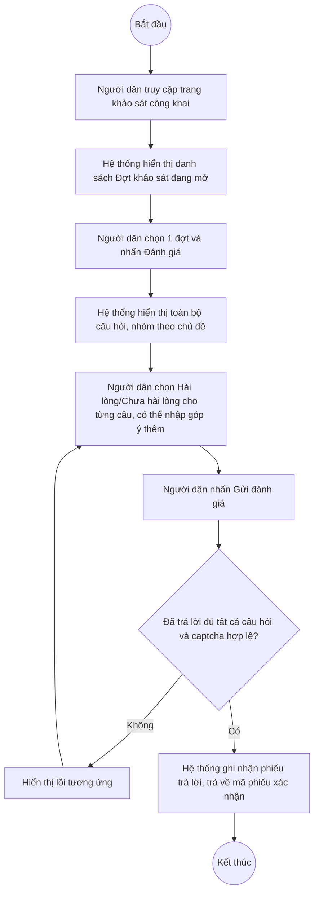

# UC12.4: Thực hiện khảo sát trực tuyến

## 1. Thông tin chung

| ID | Use case | Description |
| :---- | :---- | :---- |
| UC12.4 | Thực hiện khảo sát trực tuyến | Người dân xem chi tiết nội dung khảo sát mức độ hài lòng về kết quả xử lý phản ánh, kiến nghị (PAKN), dịch vụ công trực tuyến và hoạt động chuyển đổi số; lựa chọn đánh giá mức độ hài lòng cho từng câu hỏi và gửi đánh giá. |

> **Actor:** Người dân (công khai, không cần đăng nhập — theo thiết kế nghiệp vụ)
>
> **Trigger:** Người dân truy cập trang khảo sát công khai từ Cổng dịch vụ công / đường link được chia sẻ
>
> **Điều kiện trước (Pre-condition):** Có ít nhất 1 đợt khảo sát đang ở trạng thái "Đang diễn ra", có hình thức Trực tuyến, và còn trong khoảng thời gian hiệu lực (Ngày bắt đầu ≤ hiện tại ≤ Ngày kết thúc)
>
> **Điều kiện sau (Post-condition):** Một phiếu trả lời được ghi nhận vào kết quả của đợt khảo sát, người dân nhận được mã phiếu xác nhận
>
> **Ghi nhận QC (10/10/2026) — PHÁT HIỆN QUAN TRỌNG, CẦN BÁO CHO ĐỘI PHÁT TRIỂN:** Trang trả lời khảo sát hiện tại **CHƯA PHẢI LÀ TRANG CÔNG KHAI THẬT**. Đường dẫn duy nhất quan sát được dẫn tới màn hình này (`#/vi/survey-campaigns/respond`, mục sidebar "Tham gia khảo sát" trong nhóm "Khảo sát hài lòng") nằm **bên trong SPA quản trị đã đăng nhập** — đã kiểm chứng trực tiếp: mở lại đúng URL này (`https://cds.geneat.pro/#/vi/survey-campaigns/respond`) bằng một trình duyệt **KHÔNG mang theo phiên đăng nhập nào** (đúng như một người dân thật truy cập lần đầu) thì hệ thống **điều hướng thẳng về trang Đăng nhập** (`#/vi/auth/login`), không hiển thị được nội dung khảo sát. Trong khi đó, bộ API công khai thật sự dành cho người dân (`GET /api/v1/public/surveys`, `GET /api/v1/public/surveys/{id}`, `POST /api/v1/public/surveys/{id}/responses` — tiền tố `/api/v1/public/...`, tag Swagger `SurveyPublic`) **đã được xác nhận hoạt động đúng, không cần token**, qua một bộ test API riêng (xem `workspace/survey-api-tests/testcases/SurveyPublic/`). Kết luận: **backend công khai đã sẵn sàng, nhưng hiện CHƯA có trang web công khai thật nào trỏ tới các API này** — người dân chưa thể thực sự dùng được tính năng này cho tới khi đội phát triển dựng một trang độc lập, không yêu cầu đăng nhập, gọi tới các API `/api/v1/public/...`. Nội dung mô tả giao diện bên dưới được quan sát từ bản xem trước nằm bên trong SPA đã đăng nhập (dùng tab "Vai trò: Người dân" để giả lập) — dùng để tham khảo cấu trúc/trường dữ liệu, **không phải là xác nhận trang công khai đã hoạt động**.
>
> **Business rule:**
>
> BR-1: Danh sách "Đợt khảo sát đang mở" chỉ liệt kê các đợt thỏa đồng thời: trạng thái Đang diễn ra (status=5), có hình thức Trực tuyến (methods chứa 1), và thời điểm hiện tại nằm trong khoảng Ngày bắt đầu–Ngày kết thúc. *(Theo tài liệu test API `SurveyPublic/01_get_public_surveys.yaml`; quan sát được trên giao diện xem trước 1 thẻ đợt khảo sát "Khảo sát hài lòng về dịch vụ công trực tuyến Quý III/2026 · Đang mở · đến 30/09/2026 · 9 câu hỏi · khoảng 4 phút")*
>
> BR-2: API công khai danh sách/chi tiết khảo sát CHỈ trả về các trường cần thiết cho người dân (id, tên, tên đơn vị, ngày kết thúc, số câu hỏi, thời gian ước tính làm bài), KHÔNG lộ các trường nội bộ như organizationId (uuid), resultCount, lịch sử xử lý, người tạo... *(Theo tài liệu test API, mục Security/Data exposure)*
>
> BR-3: Khi xem chi tiết 1 đợt khảo sát qua kênh công khai, API chỉ cho xem các đợt đang mở hợp lệ theo đúng điều kiện BR-1 — khảo sát chưa duyệt/đang chờ duyệt/bị từ chối/đã kết thúc, hoặc không có hình thức Trực tuyến, đều trả về 404 Not Found (không lộ nội dung ra ngoài). *(Theo tài liệu test API)*
>
> BR-4: Màn hình trả lời hiển thị: tên khảo sát, đơn vị được đánh giá, thời gian, tổng số câu hỏi, tiến độ "Đã trả lời x/9"; câu hỏi được nhóm theo chủ đề (ví dụ "TIẾP NHẬN VÀ XỬ LÝ PHẢN ÁNH, KIẾN NGHỊ", "DỊCH VỤ CÔNG TRỰC TUYẾN", "HOẠT ĐỘNG CHUYỂN ĐỔI SỐ", "ĐÁNH GIÁ CHUNG"); mỗi câu hỏi bắt buộc (*) chọn 1 trong 2 nút "Hài lòng" / "Chưa hài lòng"; có ô góp ý tự do không bắt buộc, tối đa 500 ký tự (bộ đếm "0 / 500"); nút "Gửi đánh giá" ở cuối. *(Đã quan sát trực tiếp trên bản xem trước trong SPA đã đăng nhập ngày 10/10/2026 — xem Ghi nhận QC)*
>
> BR-5: **PHÁT HIỆN:** bản xem trước của màn hình trả lời **không có trường captcha** nào hiển thị. Trong khi đó, API thật `POST /api/v1/public/surveys/{id}/responses` **yêu cầu bắt buộc `captchaToken` hợp lệ** — thiếu hoặc sai captcha đều bị từ chối với mã lỗi 400. *(Theo tài liệu test API)*. Đây là điểm cần làm rõ: nếu trang công khai thật sự sẽ tái sử dụng giao diện này, cần bổ sung ô captcha trước khi phát hành.
>
> BR-6: Mỗi câu hỏi chỉ nhận đúng 1 giá trị kết quả trong 2 giá trị: Hài lòng (1) hoặc Chưa hài lòng (2); phải trả lời đủ tất cả câu hỏi mới gửi được, thiếu bất kỳ câu nào bị từ chối với lỗi 400 "phải trả lời đầy đủ tất cả câu hỏi". *(Theo tài liệu test API)*
>
> BR-7: Sau khi gửi thành công, hệ thống trả về 1 mã phiếu xác nhận (confirmation code); không giới hạn 1 người chỉ được gửi 1 lần (API công khai không yêu cầu đăng nhập nên không thể và không có cơ chế giới hạn theo tài khoản) — **[Cần xác nhận]** có cơ chế chống gửi trùng/chống spam nào khác không (ví dụ theo IP, theo captcha dùng 1 lần) — tài liệu test API đánh dấu đây là mục "CẦN XÁC NHẬN" với đội phát triển, vì ảnh hưởng trực tiếp đến độ chính xác của số liệu khảo sát.
>
> BR-8: Ghi chú/góp ý tự do có thể chứa mã script (XSS) — theo tài liệu test API, hệ thống không bắt buộc từ chối nội dung này ở backend, nhưng khi hiển thị lại trên các trang quản trị (ví dụ UC12.5 — khối "Ý kiến góp ý") phải encode an toàn, không được thực thi script.

**Truy vết chức năng**

| STT | Chức năng | YC (BCKTKT) | Dòng UC_1409 | Luồng | Màn hình | BR |
| :---- | :---- | :---- | :---- | :---- | :---- | :---- |
| 1 | Xem chi tiết nội dung khảo sát mức độ hài lòng | **[Cần xác nhận]** | **[Cần xác nhận]** | Basic Flow bước 1–3 | UI-12.4.1, UI-12.4.2 | BR-1 đến BR-4 |
| 2 | Lựa chọn đánh giá mức độ hài lòng | **[Cần xác nhận]** | **[Cần xác nhận]** | Basic Flow bước 4–6 | UI-12.4.2 | BR-5 đến BR-8 |

> Cột YC (BCKTKT) và Dòng UC_1409 chưa đối chiếu được với bản gốc Google Sheet "Danh sách công việc_CĐS - BCT". Use case nguồn tương ứng: UC-E.4 "Thực hiện khảo sát trực tuyến".

## 2. Mô tả luồng nghiệp vụ

*Hình 1. Luồng nghiệp vụ thực hiện khảo sát trực tuyến*

**Basic Flow** (Xem và trả lời khảo sát trực tuyến)

1. Người dân truy cập trang khảo sát công khai.
2. Hệ thống hiển thị danh sách "Đợt khảo sát đang mở" (UI-12.4.1) theo điều kiện BR-1, kèm hướng dẫn 3 bước "Chọn đợt khảo sát / Trả lời từng câu hỏi / Gửi đánh giá".
3. Người dân chọn 1 đợt khảo sát và nhấn "Đánh giá". Hệ thống hiển thị màn hình trả lời (UI-12.4.2) với toàn bộ câu hỏi của đợt, nhóm theo chủ đề (BR-4).
4. Người dân chọn "Hài lòng" hoặc "Chưa hài lòng" cho từng câu hỏi; có thể nhập thêm góp ý tự do (không bắt buộc).
5. Người dân nhấn "Gửi đánh giá".
6. Hệ thống kiểm tra đã trả lời đủ tất cả câu hỏi (BR-6) và captcha hợp lệ (BR-5), ghi nhận phiếu trả lời và trả về mã phiếu xác nhận (BR-7).

**Alternative Flow**

AF1. Chưa trả lời đủ câu hỏi

Tại bước 6, nếu còn câu hỏi chưa trả lời, Hệ thống không cho gửi và đánh dấu/cuộn tới câu hỏi còn thiếu. Quay lại bước 4.

**Exception Flow**

EF1. Không có đợt khảo sát nào đang mở

Tại bước 2, nếu không có đợt khảo sát nào thỏa điều kiện BR-1, Hệ thống hiển thị danh sách rỗng (theo API, trả về mảng rỗng, không báo lỗi). **[Cần xác nhận]** nội dung/giao diện hiển thị trạng thái rỗng này trên trang công khai thật.

EF2. Captcha không hợp lệ hoặc đã hết hạn

Tại bước 6, nếu captchaToken không hợp lệ/đã hết hạn, Hệ thống từ chối với lỗi 400, không ghi nhận phiếu. **[Cần xác nhận]** nội dung thông báo hiển thị cho người dân.

EF3. Đợt khảo sát vừa đóng/kết thúc trong lúc người dân đang trả lời

Nếu đợt khảo sát chuyển sang Đã kết thúc hoặc hết hạn ngay trước khi người dân nhấn Gửi, Hệ thống từ chối với lỗi 400/404 (theo tài liệu test API). **[Cần xác nhận]** nội dung thông báo hiển thị cho người dân.

Use case kết thúc.

## 3. Màn hình

| UI Code | Screen | Mô tả |
| :---- | :---- | :---- |
| UI-12.4.1 | Danh sách Đợt khảo sát đang mở (Web, công khai — hiện CHƯA có trang độc lập thật, xem Ghi nhận QC mục 1) | Danh sách thẻ đợt khảo sát đang mở, hướng dẫn 3 bước thực hiện |
| UI-12.4.2 | Màn hình trả lời khảo sát (Web, công khai — hiện CHƯA có trang độc lập thật) | Thông tin đợt khảo sát, danh sách câu hỏi theo nhóm chủ đề, ô góp ý, nút Gửi đánh giá |

## 4. Mô tả Màn hình (Field Specification)

**UI-12.4.1 — Danh sách Đợt khảo sát đang mở**

| Field Name | Field type | Data Type | Required | Validation rule/Behaviour |
| :---- | :---- | :---- | :---- | :---- |
| Thẻ đợt khảo sát | Card | — | Yes | **Behaviour:** Hiển thị trạng thái "Đang mở · đến {ngày kết thúc}", tên đợt, tên đơn vị, số câu hỏi, thời gian ước tính (BR-1, BR-4) **Validation rule:** Chỉ hiện đợt thỏa BR-1 |
| Nút Đánh giá | Button | Action | Yes | **Behaviour:** Mở UI-12.4.2 cho đợt tương ứng (bước 3) **Validation rule:** — |
| Khối hướng dẫn 3 bước | Info panel | — | Yes | **Behaviour:** "1. Chọn đợt khảo sát / 2. Trả lời từng câu hỏi / 3. Gửi đánh giá" **Validation rule:** Chỉ mang tính hướng dẫn |

**UI-12.4.2 — Màn hình trả lời khảo sát**

| Field Name | Field type | Data Type | Required | Validation rule/Behaviour |
| :---- | :---- | :---- | :---- | :---- |
| Thông tin đợt khảo sát | Label | — | Yes | **Behaviour:** Mã, tên đợt, đơn vị được đánh giá, thời gian, số câu hỏi, tiến độ "Đã trả lời x/9" (BR-4) **Validation rule:** — |
| Câu hỏi (mỗi câu) | Button group | Enum | Yes | **Behaviour:** 2 lựa chọn "Hài lòng"/"Chưa hài lòng", đánh dấu (*) bắt buộc, nhóm theo chủ đề (BR-4, BR-6) **Validation rule:** Bắt buộc chọn đúng 1 cho mỗi câu; thiếu câu nào báo lỗi khi gửi (AF1) |
| Góp ý thêm | Textarea | String | No | **Behaviour:** Placeholder "Anh/Chị có góp ý gì thêm không? (không bắt buộc)"; bộ đếm ký tự (BR-4, BR-8) **Validation rule:** Tối đa 500 ký tự |
| Captcha | **[Cần xác nhận]** | — | **[Cần xác nhận]** | **Behaviour:** KHÔNG quan sát thấy trên bản xem trước hiện tại dù API yêu cầu bắt buộc (BR-5) **Validation rule:** **[Cần xác nhận]** — cần bổ sung trước khi phát hành trang công khai thật |
| Nút Gửi đánh giá | Button | Action | Yes | **Behaviour:** Gửi phiếu trả lời (bước 5–6) **Validation rule:** Yêu cầu đủ câu trả lời + captcha hợp lệ (BR-5, BR-6) |

## Điểm cần xác nhận

| STT | Vị trí | Giả định đã dùng | Câu hỏi cần xác nhận |
| :---- | :---- | :---- | :---- |
| 1 | Mục 1 – Ghi nhận QC | Đường dẫn `#/vi/survey-campaigns/respond` yêu cầu đăng nhập, không phải trang công khai thật | Đội phát triển có kế hoạch dựng 1 trang công khai độc lập (không cần đăng nhập) gọi tới API `/api/v1/public/...` chưa, dự kiến khi nào? Đây là use case trọng yếu của toàn bộ phân hệ E (không có trang này, người dân không dùng được tính năng khảo sát) |
| 2 | BR-5 | Form xem trước không có captcha dù API bắt buộc | Captcha sẽ dùng dịch vụ nào (ví dụ Google reCAPTCHA), tích hợp ở đâu trên giao diện? |
| 3 | BR-7 | Chưa rõ cơ chế chống gửi trùng/spam ngoài captcha | Có giới hạn theo IP hay cơ chế nào khác không? |
| 4 | EF1, EF2, EF3 | Chưa quan sát được nội dung thông báo lỗi thật trên giao diện (chỉ có ở tầng API) | Cần xác nhận khi trang công khai thật được dựng xong |
| 5 | Truy vết chức năng | Chưa có số YC (BCKTKT) và Dòng UC_1409 | Đề nghị đối chiếu với bản gốc Google Sheet |
