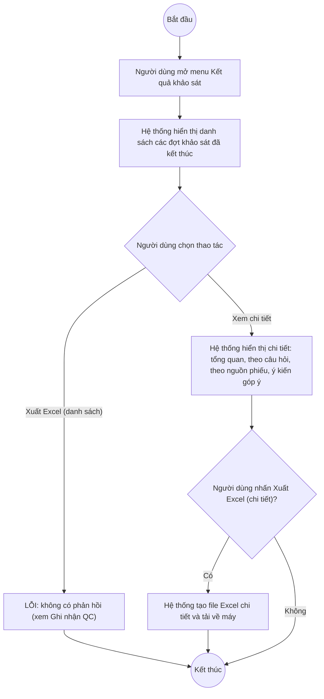

# UC12.5: Tổng kết kết quả khảo sát trực tuyến

## 1. Thông tin chung

| ID | Use case | Description |
| :---- | :---- | :---- |
| UC12.5 | Tổng kết kết quả khảo sát trực tuyến | Lãnh đạo đơn vị, Lãnh đạo địa phương, Cán bộ, Cán bộ địa phương xem danh sách kết quả các đợt khảo sát đã kết thúc; xem chi tiết kết quả (số người tham gia, số người hài lòng, số người chưa hài lòng, theo từng câu hỏi, theo nguồn phiếu, ý kiến góp ý); xuất danh sách và chi tiết kết quả ra Excel. |

> **Actor:** Lãnh đạo đơn vị, Lãnh đạo địa phương, Cán bộ, Cán bộ địa phương
>
> **Trigger:** Người dùng chọn menu "Kết quả khảo sát" trong nhóm "Khảo sát hài lòng"
>
> **Điều kiện trước (Pre-condition):** Người dùng đã đăng nhập; có ít nhất 1 đợt khảo sát đã kết thúc (trạng thái Đã kết thúc)
>
> **Điều kiện sau (Post-condition):** Màn hình hiển thị danh sách/chi tiết kết quả; không có dữ liệu nào bị thay đổi (màn hình chỉ xem và xuất báo cáo)
>
> **Ghi nhận QC (10/10/2026):** Màn hình này là 1 trong số ít mục của phân hệ E mà cả vai Cán bộ lẫn vai Lãnh đạo đều nhìn thấy trong sidebar (không bị ẩn như "Đợt khảo sát"/"Phê duyệt đợt khảo sát"). **PHÁT HIỆN LỖI THẬT:** nút "Xuất Excel" ở màn hình danh sách **không hoạt động** — đã bấm thử trực tiếp nhiều lần ngày 10/10/2026, không có file nào được tải về, không hiển thị toast thông báo, và không ghi nhận được bất kỳ lệnh gọi API nào sau khi bấm. Đây là lỗi thật (nút tồn tại nhưng không phản hồi), cần báo cho đội phát triển.
>
> **Business rule:**
>
> BR-1: Danh sách chỉ liệt kê các đợt khảo sát đã kết thúc (trạng thái Đã kết thúc); có ô tìm kiếm theo tên/mã đợt/đơn vị và bộ lọc thời gian (mặc định "Mọi thời gian"). *(Đã kiểm chứng trực tiếp ngày 10/10/2026)*
>
> BR-2: Bảng danh sách gồm các cột: STT, Tên đợt, Đơn vị, Thời gian, Tham gia (số người), Hài lòng (số người), Chưa hài lòng (số người), Tỷ lệ hài lòng (%, kèm thanh tiến trình), Thao tác. *(Đã kiểm chứng trực tiếp ngày 10/10/2026)*
>
> BR-3: Nút "Xuất Excel" ở đầu trang xuất **toàn bộ danh sách** theo điều kiện tìm kiếm/lọc hiện tại — **LỖI: hiện không hoạt động** (xem Ghi nhận QC).
>
> BR-4: Màn hình chi tiết (mở từ "Xem chi tiết") hiển thị: 3 ô số liệu tổng quan (Số người tham gia + chỉ tiêu, Số người hài lòng + tỷ lệ %, Số người chưa hài lòng + tỷ lệ %); khối "Kết quả theo từng câu hỏi" (mỗi câu có thanh tỷ lệ Hài lòng/Chưa hài lòng màu xanh/đỏ, % và số lượng cụ thể, nhóm theo chủ đề câu hỏi); khối "Theo nguồn phiếu" (số phiếu theo từng hình thức: Trực tuyến, Trực tiếp...); khối "Ý kiến góp ý" (danh sách bình luận tự do kèm nguồn phiếu + ngày gửi); nút "Xuất Excel" riêng ở cấp chi tiết. *(Đã kiểm chứng trực tiếp ngày 10/10/2026)*. **[Cần xác nhận]** nút "Xuất Excel" ở màn hình chi tiết có hoạt động đúng hay cũng gặp lỗi tương tự BR-3 — chưa bấm thử riêng nút này trong phiên kiểm thử.
>
> BR-5: Quy tắc tính "Hài lòng" cấp người trả lời, hiển thị thành ghi chú cuối trang chi tiết: *"Một người được tính 'Hài lòng' khi chọn Hài lòng cho ít nhất một nửa số câu hỏi trong phiếu."* *(Đã kiểm chứng trực tiếp ngày 10/10/2026 — đây là quy tắc nghiệp vụ quan trọng, lấy nguyên văn từ giao diện)*
>
> BR-6: Theo tài liệu test API: satisfied + unsatisfied ≤ participants; satisfiedRate = satisfied/participants × 100 (làm tròn); satisfiedRate + unsatisfiedRate xấp xỉ 100% (sai số do làm tròn); tổng số người tham gia theo từng nguồn phiếu (Trực tuyến + Trực tiếp + Gián tiếp) phải bằng đúng tổng participants ở phần tổng quan.
>
> BR-7: File Excel xuất ra (API `GET /api/v1/survey/surveys/finished/export`) gồm các cột tương ứng với bảng danh sách (tên, mã khảo sát, đơn vị, thời gian, số người tham gia, hài lòng, chưa hài lòng, tỷ lệ hài lòng); không phân trang (xuất toàn bộ bản ghi thỏa điều kiện lọc). *(Theo tài liệu test API — chưa tự kiểm chứng lại do nút Xuất Excel hiện không hoạt động trên giao diện, xem BR-3)*

**Truy vết chức năng**

| STT | Chức năng | YC (BCKTKT) | Dòng UC_1409 | Luồng | Màn hình | BR |
| :---- | :---- | :---- | :---- | :---- | :---- | :---- |
| 1 | Xem danh sách kết quả các đợt khảo sát đã kết thúc | **[Cần xác nhận]** | **[Cần xác nhận]** | Basic Flow bước 1–2 | UI-12.5.1 | BR-1, BR-2 |
| 2 | Export danh sách kết quả ra Excel | **[Cần xác nhận]** | **[Cần xác nhận]** | AF1 | UI-12.5.1 | BR-3, BR-7 |
| 3 | Xem chi tiết kết quả khảo sát | **[Cần xác nhận]** | **[Cần xác nhận]** | AF2 | UI-12.5.2 | BR-4 đến BR-6 |
| 4 | Export thông tin kết quả khảo sát ra Excel | **[Cần xác nhận]** | **[Cần xác nhận]** | AF3 | UI-12.5.2 | BR-4 |

> Cột YC (BCKTKT) và Dòng UC_1409 chưa đối chiếu được với bản gốc Google Sheet "Danh sách công việc_CĐS - BCT". Use case nguồn tương ứng: UC-E.5 "Tổng kết kết quả khảo sát trực tuyến".

## 2. Mô tả luồng nghiệp vụ

*Hình 1. Luồng nghiệp vụ tổng kết kết quả khảo sát trực tuyến*

**Basic Flow** (Xem danh sách và chi tiết kết quả khảo sát)

1. Người dùng chọn menu "Kết quả khảo sát" trong nhóm "Khảo sát hài lòng".
2. Hệ thống hiển thị màn hình Kết quả khảo sát (UI-12.5.1), liệt kê các đợt khảo sát đã kết thúc (BR-1, BR-2).
3. Người dùng nhấn "Xem chi tiết" trên 1 dòng.
4. Hệ thống hiển thị màn hình Chi tiết kết quả khảo sát (UI-12.5.2) với số liệu tổng quan, kết quả theo từng câu hỏi, theo nguồn phiếu và ý kiến góp ý (BR-4, BR-5, BR-6).

**Alternative Flow**

AF1. Xuất Excel danh sách

Tại màn hình danh sách (bước 2), người dùng nhấn "Xuất Excel". **LỖI ĐÃ XÁC NHẬN:** không có phản hồi nào (xem Ghi nhận QC mục 1, BR-3). Use case kết thúc.

AF2. Tìm kiếm, lọc danh sách

Tại màn hình danh sách (bước 2), người dùng nhập từ khóa và/hoặc chọn bộ lọc thời gian (BR-1). Use case kết thúc.

AF3. Xuất Excel chi tiết

Tại màn hình chi tiết (bước 4), người dùng nhấn "Xuất Excel" ở cấp chi tiết. **[Cần xác nhận]** hành vi — chưa kiểm thử riêng nút này. Use case kết thúc.

**Exception Flow**

EF1. Không có đợt khảo sát nào đã kết thúc

Tại bước 2, nếu không có đợt nào thỏa điều kiện BR-1, Hệ thống hiển thị danh sách rỗng. **[Cần xác nhận]** nội dung thông báo cụ thể.

EF2. Lỗi hệ thống khi tải chi tiết hoặc xuất Excel

Hệ thống hiển thị thông báo lỗi chung và giữ nguyên dữ liệu đang hiển thị. **Riêng với nút Xuất Excel ở danh sách, đã xác nhận là LỖI THẬT (không có bất kỳ phản hồi/thông báo nào, kể cả thông báo lỗi) — xem BR-3.**

Use case kết thúc.

## 3. Màn hình

| UI Code | Screen | Mô tả |
| :---- | :---- | :---- |
| UI-12.5.1 | Danh sách Kết quả khảo sát (Web) | Tìm kiếm, lọc thời gian, bảng danh sách kết quả, nút Xuất Excel (hiện không hoạt động) |
| UI-12.5.2 | Chi tiết kết quả khảo sát (Web) | Số liệu tổng quan, kết quả theo câu hỏi, theo nguồn phiếu, ý kiến góp ý, nút Xuất Excel |

## 4. Mô tả Màn hình (Field Specification)

**UI-12.5.1 — Danh sách Kết quả khảo sát**

| Field Name | Field type | Data Type | Required | Validation rule/Behaviour |
| :---- | :---- | :---- | :---- | :---- |
| Tìm kiếm | Search box | String | No | **Behaviour:** Placeholder "Tìm theo tên, mã đợt, đơn vị..." (BR-1) **Validation rule:** — |
| Bộ lọc thời gian | Dropdown | Enum | No | **Behaviour:** Mặc định "Mọi thời gian" (BR-1) **Validation rule:** **[Cần xác nhận]** các giá trị khác |
| Nút Xuất Excel | Button | Action | Yes | **Behaviour:** Dự kiến xuất toàn bộ danh sách theo bộ lọc (BR-3, BR-7) **Validation rule:** **LỖI THẬT (10/10/2026):** bấm không có phản hồi nào — không tải file, không toast, không gọi API |
| Bảng danh sách | Table | List | Yes | **Behaviour:** Cột STT, Tên đợt, Đơn vị, Thời gian, Tham gia, Hài lòng, Chưa hài lòng, Tỷ lệ hài lòng, Thao tác (BR-2) **Validation rule:** — |
| Xem chi tiết | Link | Action | Yes | **Behaviour:** Mở UI-12.5.2 **Validation rule:** — |

**UI-12.5.2 — Chi tiết kết quả khảo sát**

| Field Name | Field type | Data Type | Required | Validation rule/Behaviour |
| :---- | :---- | :---- | :---- | :---- |
| Số người tham gia | Label | Integer | Yes | **Behaviour:** Kèm chỉ tiêu ban đầu (BR-4) **Validation rule:** — |
| Số người hài lòng | Label | Integer | Yes | **Behaviour:** Kèm tỷ lệ % (BR-4, BR-5) **Validation rule:** — |
| Số người chưa hài lòng | Label | Integer | Yes | **Behaviour:** Kèm tỷ lệ % (BR-4, BR-5) **Validation rule:** — |
| Kết quả theo từng câu hỏi | List + chart | List | Yes | **Behaviour:** Mỗi câu: thanh tỷ lệ Hài lòng/Chưa hài lòng, %, số lượng, nhóm theo chủ đề (BR-4, BR-6) **Validation rule:** — |
| Theo nguồn phiếu | Chart | List | Yes | **Behaviour:** Số phiếu theo từng hình thức (Trực tuyến/Trực tiếp/Gián tiếp qua phiếu) (BR-4, BR-6) **Validation rule:** — |
| Ý kiến góp ý | List | List | No | **Behaviour:** Danh sách bình luận tự do, kèm nguồn phiếu + ngày gửi (BR-4) **Validation rule:** Nội dung phải được encode an toàn khi hiển thị (chống XSS — xem UC12.4 BR-8) |
| Nút Xuất Excel | Button | Action | Yes | **Behaviour:** Xuất chi tiết kết quả của riêng đợt khảo sát này (AF3) **Validation rule:** **[Cần xác nhận]** có hoạt động đúng hay gặp lỗi tương tự UI-12.5.1 |

## Điểm cần xác nhận

| STT | Vị trí | Giả định đã dùng | Câu hỏi cần xác nhận |
| :---- | :---- | :---- | :---- |
| 1 | Mục 1 – Ghi nhận QC, BR-3 | Nút Xuất Excel ở danh sách không hoạt động | Đề nghị đội phát triển kiểm tra và sửa (đã tái hiện lỗi nhiều lần, không phải lỗi ngẫu nhiên) |
| 2 | UI-12.5.2 – Nút Xuất Excel | Chưa kiểm thử riêng nút xuất Excel ở cấp chi tiết | Nút này có hoạt động đúng không? |
| 3 | BR-1 | Bộ lọc thời gian chỉ quan sát được giá trị "Mọi thời gian" | Có các lựa chọn khác (theo quý/năm) không? |
| 4 | EF1 | Chưa quan sát được trạng thái danh sách rỗng | Nội dung hiển thị khi chưa có đợt khảo sát nào kết thúc là gì? |
| 5 | Truy vết chức năng | Chưa có số YC (BCKTKT) và Dòng UC_1409 | Đề nghị đối chiếu với bản gốc Google Sheet |
