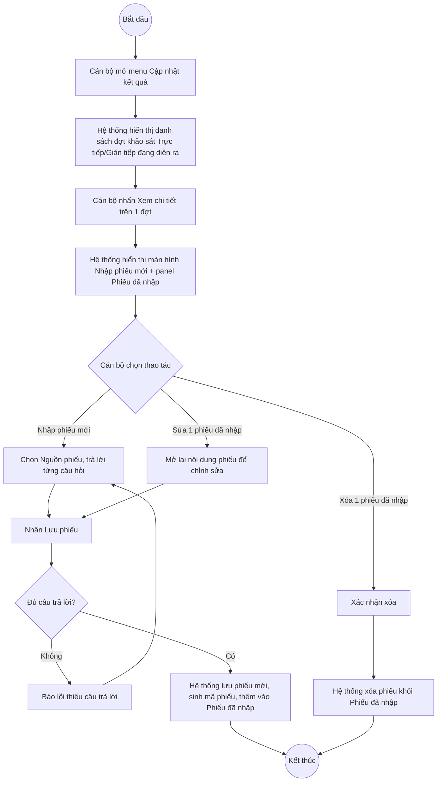

# UC12.6: Cập nhật kết quả khảo sát (không phải khảo sát trực tuyến)

## 1. Thông tin chung

| ID | Use case | Description |
| :---- | :---- | :---- |
| UC12.6 | Cập nhật kết quả khảo sát (không phải khảo sát trực tuyến) | Cán bộ, Cán bộ địa phương xem danh sách các đợt khảo sát hình thức Trực tiếp/Gián tiếp qua phiếu đang diễn ra; nhập mới, chỉnh sửa, xóa từng phiếu kết quả đã thu thập được (ví dụ qua phỏng vấn trực tiếp hoặc phiếu giấy) cho đợt khảo sát đó. |

> **Actor:** Cán bộ, Cán bộ địa phương
>
> **Trigger:** Người dùng chọn menu "Cập nhật kết quả" trong nhóm "Khảo sát hài lòng"
>
> **Điều kiện trước (Pre-condition):** Người dùng đã đăng nhập; có ít nhất 1 đợt khảo sát hình thức Trực tiếp hoặc Gián tiếp qua phiếu đang ở trạng thái "Đang diễn ra"
>
> **Điều kiện sau (Post-condition):** Phiếu kết quả (nguồn phiếu, đơn vị được đánh giá, câu trả lời từng câu hỏi) được thêm mới, chỉnh sửa hoặc xóa; "Phiếu đã nhập" của đợt khảo sát cập nhật theo
>
> **Ghi nhận QC (10/10/2026):** Màn hình này kế thừa cùng lỗi tích hợp FE-BE đã ghi nhận ở UC12.1 mục 1 (frontend phân hệ "Khảo sát hài lòng" nói chung đang gọi sai nhóm endpoint `/api/v1/survey/campaigns` thay vì `/api/v1/survey/surveys` thật) — **[Cần xác nhận]** liệu lỗi này có áp dụng cho riêng nhóm "nhập/sửa/xóa phiếu kết quả" (API thật tương ứng là `/api/v1/survey/surveys/{surveyId}/results`, đã xác nhận hoạt động đúng qua bộ test API riêng) hay không, vì phiên kiểm thử này **chỉ xem** màn hình (list + mở màn hình Nhập phiếu mới), **không bấm thử Lưu phiếu/Sửa/Xóa thật** để tránh ghi đè lên 86/64 phiếu dữ liệu thật đã có sẵn trên 2 đợt khảo sát đang diễn ra trên môi trường thật.
>
> **Business rule:**
>
> BR-1: Danh sách chỉ liệt kê các đợt khảo sát hình thức Trực tiếp hoặc Gián tiếp qua phiếu (loại trừ Trực tuyến) và đang ở trạng thái "Đang diễn ra" — không có khảo sát Trực tuyến thuần túy nào xuất hiện ở đây. *(Đã kiểm chứng trực tiếp ngày 10/10/2026 — mô tả trang ghi rõ "Các đợt khảo sát trực tiếp hoặc gián tiếp qua phiếu đang diễn ra. Cán bộ nhập, sửa, xóa phiếu đã thu thập.")*
>
> BR-2: Bảng danh sách gồm các cột: STT, Tên đợt khảo sát, Đơn vị, Thời gian, Hình thức, Phiếu đã nhập (số lượng), Trạng thái, Thao tác. *(Đã kiểm chứng trực tiếp ngày 10/10/2026)*
>
> BR-3: Không có nút "Thêm mới" ở cấp danh sách — việc thêm phiếu kết quả mới thực hiện ngay trên màn hình "Chi tiết" (nhập phiếu) của từng đợt khảo sát, không phải qua modal riêng từ danh sách. *(Quan sát trực tiếp ngày 10/10/2026: mô tả trang không đề cập thao tác thêm mới ở cấp danh sách)*. **[Cần xác nhận]** có tồn tại nút "Thêm mới" ẩn nào khác không — một lần dò quét DOM trong phiên trước đó ghi nhận có 1 phần tử khớp văn bản "Thêm mới" trên trang, nhưng nhiều khả năng là phần tử còn sót lại từ trang trước đó trong single-page-app, chưa xác nhận chắc chắn.
>
> BR-4: Màn hình "Nhập phiếu mới" (mở từ "Xem chi tiết" của 1 đợt) gồm: dropdown "Nguồn phiếu" (giá trị tùy theo hình thức đợt khảo sát hỗ trợ — ví dụ "Trực tiếp"), trường "Đơn vị được đánh giá" (hiển thị sẵn, dạng chỉ đọc/placeholder theo đơn vị của đợt khảo sát), danh sách câu hỏi với 2 nút "Hài lòng"/"Chưa hài lòng" mỗi câu, nút nhanh "Chọn tất cả 'Hài lòng'", nút "Làm mới" (xóa nhập liệu đang nhập dở) và nút "Lưu phiếu". *(Đã kiểm chứng trực tiếp ngày 10/10/2026)*
>
> BR-5: Panel bên phải "Phiếu đã nhập · N" liệt kê các phiếu đã nhập trước đó của đợt khảo sát, mỗi dòng gồm mã phiếu tự sinh (dạng "P{3 số đầu mã đợt}-{số thứ tự}", ví dụ "P011-0164"), nguồn phiếu, ngày nhập, và 2 icon thao tác: sửa (bút chì) và xóa (thùng rác). *(Đã kiểm chứng trực tiếp ngày 10/10/2026)*
>
> BR-6: Theo tài liệu test API (nhóm SurveyResult): chỉ cho phép nhập phiếu với hình thức Trực tiếp (method=2) hoặc Gián tiếp qua phiếu (method=3), và chỉ với hình thức mà đợt khảo sát thực sự hỗ trợ (ví dụ đợt chỉ có Trực tiếp thì không nhập được phiếu Gián tiếp qua phiếu); **tuyệt đối không cho nhập phiếu Trực tuyến (method=1) qua màn hình này** — nhằm tránh giả mạo nguồn phiếu (phiếu Trực tuyến chỉ được tạo qua kênh công khai UC12.4).
>
> BR-7: Phải trả lời đủ tất cả câu hỏi của đợt khảo sát mới lưu được phiếu; thiếu câu nào bị từ chối (API trả lỗi 400 "phải trả lời đầy đủ tất cả câu hỏi").
>
> BR-8: Nhập/Sửa/Xóa phiếu chỉ thực hiện được khi đợt khảo sát đang ở trạng thái "Đang diễn ra" — khi đợt đã chuyển "Đã kết thúc", các thao tác này bị từ chối (API trả lỗi 400/409). Theo README của bộ test API, đã ghi nhận **hiện tượng đợt khảo sát không tự động chuyển sang "Đang diễn ra"** dù đã qua Ngày bắt đầu (xem UC12.1 BR-7) — nếu đúng là thiếu tiến trình nền, một số đợt khảo sát có thể không bao giờ xuất hiện ở màn hình này để nhập phiếu được.
>
> BR-9: Ghi chú tự do của mỗi phiếu (nếu có) có thể chứa mã script — áp dụng cùng nguyên tắc hiển thị an toàn (encode) như đã nêu ở UC12.4 BR-8 và UC12.5 (khối Ý kiến góp ý).

**Truy vết chức năng**

| STT | Chức năng | YC (BCKTKT) | Dòng UC_1409 | Luồng | Màn hình | BR |
| :---- | :---- | :---- | :---- | :---- | :---- | :---- |
| 1 | Xem danh sách đợt khảo sát (trực tiếp/gián tiếp qua phiếu) đang diễn ra | **[Cần xác nhận]** | **[Cần xác nhận]** | Basic Flow bước 1–2 | UI-12.6.1 | BR-1, BR-2 |
| 2 | Lựa chọn đợt khảo sát để thêm mới kết quả | **[Cần xác nhận]** | **[Cần xác nhận]** | Basic Flow bước 3–6 | UI-12.6.2 | BR-3 đến BR-8 |
| 3 | Lựa chọn đợt khảo sát để chỉnh sửa kết quả | **[Cần xác nhận]** | **[Cần xác nhận]** | AF1 | UI-12.6.2 | BR-5, BR-7, BR-8 |
| 4 | Lựa chọn đợt khảo sát để xóa kết quả | **[Cần xác nhận]** | **[Cần xác nhận]** | AF2 | UI-12.6.2 | BR-5, BR-6, BR-8 |

> Cột YC (BCKTKT) và Dòng UC_1409 chưa đối chiếu được với bản gốc Google Sheet "Danh sách công việc_CĐS - BCT". Use case nguồn tương ứng: UC-E.6 "Cập nhật kết quả khảo sát (không phải khảo sát trực tuyến)".

## 2. Mô tả luồng nghiệp vụ

*Hình 1. Luồng nghiệp vụ cập nhật kết quả khảo sát không trực tuyến*

**Basic Flow** (Nhập phiếu kết quả mới)

1. Cán bộ chọn menu "Cập nhật kết quả" trong nhóm "Khảo sát hài lòng".
2. Hệ thống hiển thị màn hình Danh sách Cập nhật kết quả (UI-12.6.1), chỉ liệt kê các đợt khảo sát Trực tiếp/Gián tiếp qua phiếu đang diễn ra (BR-1, BR-2).
3. Cán bộ nhấn "Xem chi tiết" trên 1 đợt khảo sát.
4. Hệ thống hiển thị màn hình Nhập phiếu mới (UI-12.6.2) với panel "Phiếu đã nhập" liệt kê các phiếu hiện có bên cạnh (BR-4, BR-5).
5. Cán bộ chọn "Nguồn phiếu" (BR-6), chọn "Hài lòng"/"Chưa hài lòng" cho từng câu hỏi (hoặc dùng "Chọn tất cả 'Hài lòng'" rồi sửa lại các câu khác biệt), rồi nhấn "Lưu phiếu".
6. Hệ thống kiểm tra đã trả lời đủ tất cả câu hỏi (BR-7) và đợt khảo sát vẫn đang "Đang diễn ra" (BR-8), lưu phiếu mới với mã tự sinh, cập nhật panel "Phiếu đã nhập".

**Alternative Flow**

AF1. Chỉnh sửa phiếu đã nhập

Tại màn hình Nhập phiếu mới (bước 4), Cán bộ bấm icon sửa (bút chì) trên 1 dòng ở panel "Phiếu đã nhập". Hệ thống nạp lại nội dung phiếu đó vào khu vực nhập liệu để chỉnh sửa. Cán bộ sửa Nguồn phiếu và/hoặc các câu trả lời rồi nhấn "Lưu phiếu". Hệ thống kiểm tra như bước 6 và cập nhật phiếu. **[Cần xác nhận]** chưa kiểm thử trực tiếp luồng này (chỉ xác nhận icon sửa tồn tại trên giao diện). Use case kết thúc.

AF2. Xóa phiếu đã nhập

Tại màn hình Nhập phiếu mới (bước 4), Cán bộ bấm icon xóa (thùng rác) trên 1 dòng ở panel "Phiếu đã nhập". **[Cần xác nhận]** hệ thống có hiển thị popup xác nhận hay xóa ngay — chưa kiểm thử trực tiếp (chỉ xác nhận icon xóa tồn tại trên giao diện, không bấm thử để tránh xóa nhầm 1 trong 86/64 phiếu dữ liệu thật). Use case kết thúc.

AF3. Dùng "Chọn tất cả 'Hài lòng'"

Tại màn hình Nhập phiếu mới (bước 5), Cán bộ bấm "Chọn tất cả 'Hài lòng'" để đặt nhanh toàn bộ câu hỏi về "Hài lòng", sau đó có thể sửa lại riêng từng câu khác biệt trước khi lưu. Tiếp tục từ bước 5.

AF4. Làm mới nhập liệu

Tại màn hình Nhập phiếu mới (bước 5), Cán bộ bấm "Làm mới" để xóa toàn bộ lựa chọn đang nhập dở, bắt đầu nhập lại từ đầu. Quay lại bước 5.

**Exception Flow**

EF1. Thiếu câu trả lời khi lưu phiếu

Tại bước 6, nếu còn câu hỏi chưa chọn Hài lòng/Chưa hài lòng, Hệ thống báo lỗi và không lưu (BR-7). **[Cần xác nhận]** nội dung thông báo chính xác trên giao diện. Quay lại bước 5.

EF2. Đợt khảo sát không còn "Đang diễn ra" khi lưu/sửa/xóa phiếu

Tại bước 6/AF1/AF2, nếu đợt khảo sát đã chuyển sang "Đã kết thúc" (ví dụ do vừa hết hạn), Hệ thống từ chối thao tác (BR-8). **[Cần xác nhận]** nội dung thông báo chính xác trên giao diện.

EF3. Nguồn phiếu không hợp lệ với hình thức đợt khảo sát

Tại bước 6, nếu chọn Nguồn phiếu không thuộc danh sách hình thức mà đợt khảo sát hỗ trợ (BR-6), Hệ thống từ chối lưu. **[Cần xác nhận]** nội dung thông báo chính xác trên giao diện.

Use case kết thúc.

## 3. Màn hình

| UI Code | Screen | Mô tả |
| :---- | :---- | :---- |
| UI-12.6.1 | Danh sách Cập nhật kết quả khảo sát (Web) | Chỉ liệt kê đợt Trực tiếp/Gián tiếp qua phiếu đang diễn ra; tìm kiếm, bảng danh sách |
| UI-12.6.2 | Nhập/Sửa phiếu kết quả khảo sát (Web) | Form nhập phiếu mới (Nguồn phiếu + từng câu hỏi) và panel "Phiếu đã nhập" với thao tác sửa/xóa |

## 4. Mô tả Màn hình (Field Specification)

**UI-12.6.1 — Danh sách Cập nhật kết quả khảo sát**

| Field Name | Field type | Data Type | Required | Validation rule/Behaviour |
| :---- | :---- | :---- | :---- | :---- |
| Tìm kiếm | Search box | String | No | **Behaviour:** Placeholder "Tìm theo tên, mã đợt..." **Validation rule:** — |
| Bảng danh sách | Table | List | Yes | **Behaviour:** Cột STT, Tên đợt khảo sát, Đơn vị, Thời gian, Hình thức, Phiếu đã nhập, Trạng thái, Thao tác (BR-1, BR-2) **Validation rule:** Chỉ hiện đợt Trực tiếp/Gián tiếp qua phiếu, trạng thái Đang diễn ra |
| Xem chi tiết | Link | Action | Yes | **Behaviour:** Mở UI-12.6.2 **Validation rule:** — |

**UI-12.6.2 — Nhập/Sửa phiếu kết quả khảo sát**

| Field Name | Field type | Data Type | Required | Validation rule/Behaviour |
| :---- | :---- | :---- | :---- | :---- |
| Nguồn phiếu | Dropdown | Enum | Yes | **Behaviour:** Giá trị theo hình thức đợt khảo sát hỗ trợ (Trực tiếp/Gián tiếp qua phiếu) (BR-4, BR-6) **Validation rule:** Bắt buộc; chỉ chấp nhận hình thức đợt khảo sát có hỗ trợ (EF3) |
| Đơn vị được đánh giá | Textbox (readonly) | String | — | **Behaviour:** Hiển thị sẵn theo đơn vị của đợt khảo sát (BR-4) **Validation rule:** **[Cần xác nhận]** có cho sửa được không |
| Câu hỏi (mỗi câu) | Button group | Enum | Yes | **Behaviour:** 2 lựa chọn "Hài lòng"/"Chưa hài lòng" (BR-4, BR-7) **Validation rule:** Bắt buộc chọn đủ tất cả câu hỏi (EF1) |
| Nút Chọn tất cả "Hài lòng" | Button | Action | No | **Behaviour:** Đặt nhanh toàn bộ câu hỏi về Hài lòng (AF3) **Validation rule:** — |
| Nút Làm mới | Button | Action | Yes | **Behaviour:** Xóa toàn bộ lựa chọn đang nhập dở (AF4) **Validation rule:** — |
| Nút Lưu phiếu | Button | Action | Yes | **Behaviour:** Lưu phiếu mới hoặc phiếu đang sửa (bước 6, AF1) **Validation rule:** Yêu cầu đủ câu trả lời (EF1) và đợt đang Đang diễn ra (EF2) |
| Panel Phiếu đã nhập | List | List | Yes | **Behaviour:** Mỗi dòng: mã phiếu tự sinh, nguồn phiếu, ngày nhập, icon Sửa (AF1), icon Xóa (AF2) (BR-5) **Validation rule:** — |

## Điểm cần xác nhận

| STT | Vị trí | Giả định đã dùng | Câu hỏi cần xác nhận |
| :---- | :---- | :---- | :---- |
| 1 | Mục 1 – Ghi nhận QC | Chưa bấm thử Lưu/Sửa/Xóa phiếu thật để tránh ảnh hưởng 86/64 phiếu dữ liệu thật đang có | Cần tạo riêng 1 đợt khảo sát test (và phiếu test) để kiểm thử đầy đủ luồng Lưu/Sửa/Xóa trong phiên sau, có dọn dẹp sau khi test |
| 2 | BR-3 | Không có nút "Thêm mới" cấp danh sách | Một lần dò quét trước đó ghi nhận có phần tử khớp văn bản "Thêm mới" trên trang — cần xác nhận lại đây có đúng là không tồn tại chức năng này ở cấp danh sách không |
| 3 | AF1, AF2 | Chưa rõ hành vi chính xác khi Sửa/Xóa (có popup xác nhận khi xóa không, form sửa có khác form thêm mới không) | Cần kiểm thử trực tiếp bằng dữ liệu test riêng |
| 4 | BR-8 | Phụ thuộc vào việc đợt khảo sát có tự chuyển "Đang diễn ra" đúng hạn không (xem UC12.1 BR-7) | Nếu thiếu tiến trình nền, một số đợt có thể không bao giờ xuất hiện ở màn hình này |
| 5 | UI-12.6.2 – Đơn vị được đánh giá | Giả định là trường chỉ đọc | Có cho sửa lại đơn vị khi nhập phiếu không, hay luôn cố định theo đợt khảo sát? |
| 6 | Truy vết chức năng | Chưa có số YC (BCKTKT) và Dòng UC_1409 | Đề nghị đối chiếu với bản gốc Google Sheet |
