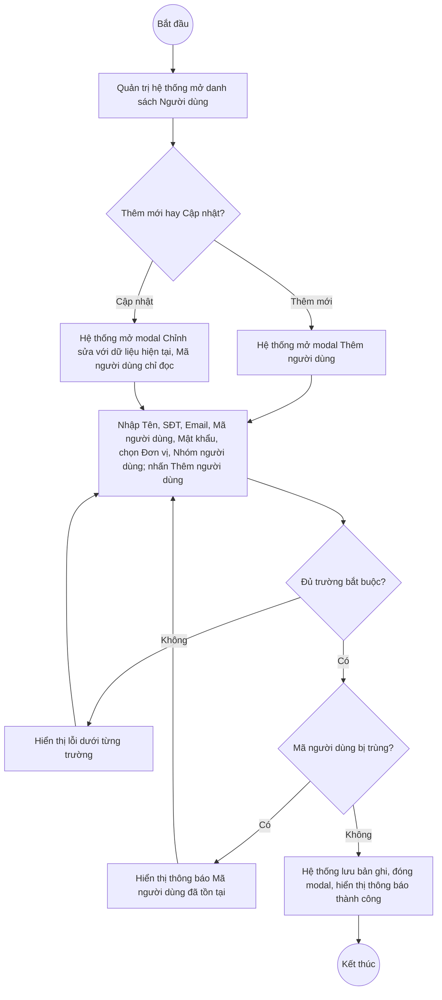

# UC2.1: Quản lý người dùng

## 1. Thông tin chung

| ID | Use case | Description |
| :---- | :---- | :---- |
| UC2.1 | Quản lý người dùng | Quản trị hệ thống xem danh sách, tìm kiếm, thêm mới, cập nhật, xem chi tiết, khóa/mở khóa, xóa và xuất Excel tài khoản người dùng trên Web Portal; mỗi người dùng gắn với một Đơn vị (UC4.3) và **tối đa một** Nhóm người dùng (UC2.2, không bắt buộc) quyết định quyền truy cập (UC2.3). Người dùng chưa được phân nhóm vẫn đăng nhập được nhưng không thực hiện được chức năng nào cho tới khi được gán nhóm. |

> **Actor:** Quản trị hệ thống
>
> **Trigger:** Quản trị hệ thống chọn menu "Người dùng" trong phân hệ Quản trị hệ thống
>
> **Điều kiện trước (Pre-condition):** Quản trị hệ thống đã đăng nhập và có quyền quản lý người dùng
>
> **Điều kiện sau (Post-condition):** Tài khoản người dùng (Mã người dùng, Tên, SĐT, Email, Đơn vị, Nhóm người dùng, Trạng thái) được thêm mới, cập nhật, khóa/mở khóa hoặc xóa; danh sách hiển thị dữ liệu mới nhất
>
> **Business rule:**
>
> BR-1: Mã người dùng là duy nhất trong toàn hệ thống, dùng làm tên đăng nhập, quy tắc "chữ thường, không dấu", và không cho sửa sau khi tạo. *(Đã kiểm chứng trực tiếp ngày 10/10/2026: ở chế độ Chỉnh sửa, trường Mã người dùng hiển thị chỉ đọc; gợi ý trên form "Dùng làm tên đăng nhập - chữ thường, không dấu, khi lọc")*. **[Cần xác nhận]** nội dung thông báo khi trùng Mã người dùng — suy luận theo mẫu "Code {giá trị} đã tồn tại" quan sát được ở UC2.2, chưa kiểm chứng trực tiếp tại chính màn hình này.
>
> BR-2: Tên, Số điện thoại, Email, Mã người dùng, Mật khẩu, Đơn vị, Nhóm người dùng đều là trường bắt buộc khi thêm mới. *(Đã kiểm chứng trực tiếp ngày 10/10/2026, xem EF1)*. Đây là thay đổi so với ghi nhận ngày 08/10/2026 khi Đơn vị và Nhóm người dùng còn là trường tùy chọn — **cần xác nhận với đội phát triển đây là thay đổi chủ đích hay phát sinh ngoài ý muốn.**
>
> BR-3: Mật khẩu tối thiểu 8 ký tự (theo placeholder "Tối thiểu 8 ký tự"); đồng thời phải thỏa quy tắc mật khẩu đang cấu hình tại Tham số hệ thống (UC3.2). **[Cần xác nhận]** mối quan hệ chính xác giữa 2 ràng buộc này.
>
> BR-4: Khi thêm mới, mặc định bật sẵn 2 tùy chọn: "Bắt buộc đổi mật khẩu ở lần đăng nhập đầu" và "Gửi thông tin đăng nhập qua email" — Quản trị hệ thống có thể bỏ chọn. *(Đã kiểm chứng trực tiếp ngày 10/10/2026)*
>
> BR-5: Trạng thái gồm Đang hoạt động / Khóa; không xuất hiện như một trường trên form Thêm mới — tài khoản mới luôn ở trạng thái Đang hoạt động, chuyển trạng thái chỉ qua thao tác Khóa/Mở khóa riêng trên menu thao tác.
>
> BR-6: Tìm kiếm theo các trường hiển thị trên danh sách (Mã người dùng, Tên, SĐT, Email…), có thể kết hợp lọc. **[Cần xác nhận]** phạm vi tìm kiếm chính xác và các bộ lọc sẵn có (chưa quan sát được dropdown lọc trên danh sách, chỉ thấy ô tìm kiếm).
>
> BR-7: Xuất Excel toàn bộ bản ghi theo điều kiện tìm kiếm/lọc hiện tại. **[Cần xác nhận]** danh sách cột và tên file xuất — chưa thử trực tiếp trong phiên làm việc này.

**Ghi nhận QC (10/10/2026):** Nút "Xem chi tiết" trên danh sách Người dùng hiện **không mở được** (cùng lỗi hồi quy đã ghi nhận ở UC4.2, UC4.3, UC2.2) — chưa kiểm chứng trực tiếp được màn hình chi tiết người dùng.

**Truy vết chức năng**

| STT | Chức năng | YC (BCKTKT) | Dòng UC_1409 | Luồng | Màn hình | BR |
| :---- | :---- | :---- | :---- | :---- | :---- | :---- |
| 1 | Xem danh sách người dùng | **[Cần xác nhận]** | **[Cần xác nhận]** | Basic Flow bước 1–2 | UI-2.1.1 | — |
| 2 | Tìm kiếm người dùng | **[Cần xác nhận]** | **[Cần xác nhận]** | AF1 | UI-2.1.1 | BR-6 |
| 3 | Xuất Excel danh sách người dùng | **[Cần xác nhận]** | **[Cần xác nhận]** | AF6 | UI-2.1.1 | BR-7 |
| 4 | Xem thông tin người dùng | **[Cần xác nhận]** | **[Cần xác nhận]** | AF3 | UI-2.1.3 | — |
| 5 | Thêm mới người dùng | **[Cần xác nhận]** | **[Cần xác nhận]** | Basic Flow bước 3–7; EF1, EF2 | UI-2.1.2 | BR-1, BR-2, BR-3, BR-4 |
| 6 | Chỉnh sửa thông tin người dùng | **[Cần xác nhận]** | **[Cần xác nhận]** | AF2; EF1 | UI-2.1.2 | BR-1, BR-2 |
| 7 | Khóa / Mở khóa người dùng | **[Cần xác nhận]** | **[Cần xác nhận]** | AF4 | UI-2.1.4 | BR-5 |
| 8 | Xóa người dùng | **[Cần xác nhận]** | **[Cần xác nhận]** | AF5 | UI-2.1.5 | — |

> Cột YC (BCKTKT) và Dòng UC_1409 chưa đối chiếu được với bản gốc. Use case nguồn tương ứng: UC-A.II.1 "Quản lý người dùng".

## 2. Mô tả luồng nghiệp vụ

**Luồng nghiệp vụ thêm mới / cập nhật Người dùng**

*Hình 1. Luồng nghiệp vụ thêm mới / cập nhật Người dùng*

**Basic Flow** (Thêm mới Người dùng)

1. Quản trị hệ thống chọn menu "Người dùng".
2. Hệ thống hiển thị màn hình Danh sách Người dùng (UI-2.1.1), 10 bản ghi/trang.
3. Quản trị hệ thống nhấn nút "Thêm người dùng".
4. Hệ thống hiển thị modal Thêm người dùng (UI-2.1.2), gồm 3 khối: Thông tin người dùng, Tài khoản đăng nhập, Đơn vị và phân quyền.
5. Quản trị hệ thống nhập Tên, Số điện thoại, Email, Mã người dùng, Mật khẩu; chọn Đơn vị và Nhóm người dùng; giữ/bỏ chọn 2 tùy chọn mặc định (BR-4); nhấn "Thêm người dùng".
6. Hệ thống kiểm tra các trường bắt buộc và tính duy nhất của Mã người dùng (BR-1, BR-2).
7. Hệ thống lưu bản ghi với Trạng thái mặc định Đang hoạt động (BR-5), đóng modal, hiển thị thông báo "Tạo tài khoản thành công" và tải lại danh sách.

**Alternative Flow**

AF1. Tìm kiếm danh sách

Tại màn hình danh sách (bước 2), Quản trị hệ thống nhập từ khóa vào ô tìm kiếm (BR-6). Use case kết thúc.

AF2. Cập nhật Người dùng

Tại màn hình danh sách (bước 2), Quản trị hệ thống mở menu thao tác của dòng và chọn "Cập nhật". Hệ thống hiển thị modal Chỉnh sửa người dùng (UI-2.1.2) với dữ liệu hiện tại, Mã người dùng ở chế độ chỉ đọc (BR-1), không có trường Mật khẩu. Quản trị hệ thống sửa các trường còn lại rồi nhấn "Lưu thay đổi". Hệ thống kiểm tra như bước 6, lưu và hiển thị thông báo "Chỉnh sửa thành công". Use case kết thúc.

AF3. Xem thông tin người dùng

Tại màn hình danh sách (bước 2), Quản trị hệ thống nhấn "Xem chi tiết" trên một dòng. Theo thiết kế dự kiến, Hệ thống hiển thị màn hình/panel Chi tiết người dùng (UI-2.1.3). **Hiện không hoạt động — xem Ghi nhận QC ở mục 1.** Use case kết thúc.

AF4. Khóa / Mở khóa người dùng

Tại màn hình danh sách (bước 2), Quản trị hệ thống mở menu thao tác của dòng và chọn "Khoá" hoặc "Mở khoá". Hệ thống hiển thị popup xác nhận (UI-2.1.4), cập nhật Trạng thái, hiển thị thông báo "Đóng tài khoản thành công" / "Mở tài khoản thành công" (BR-5). Use case kết thúc.

AF5. Xóa người dùng

Tại màn hình danh sách (bước 2), Quản trị hệ thống mở menu thao tác của dòng và chọn "Xóa". Hệ thống hiển thị popup xác nhận (UI-2.1.5). Quản trị hệ thống nhấn "Xóa". Hệ thống xóa bản ghi, hiển thị thông báo "Xóa thành công" và tải lại danh sách. **[Cần xác nhận]** có ràng buộc nào chặn xóa người dùng đang có dữ liệu liên quan (ví dụ đã từng chấm điểm tự đánh giá) hay không. Use case kết thúc.

AF6. Xuất Excel

Tại màn hình danh sách (bước 2), Quản trị hệ thống nhấn "Xuất Excel". Hệ thống tạo file Excel theo BR-7 và tải về máy. Use case kết thúc.

AF7. Hủy thao tác

Khi đang ở modal hoặc popup (bước 5, AF2, AF4, AF5), Quản trị hệ thống nhấn "Huỷ" hoặc biểu tượng đóng. Hệ thống đóng modal/popup, không lưu thay đổi. Quay lại bước 2.

**Exception Flow**

EF1. Thiếu trường bắt buộc

Tại bước 6, Hệ thống hiển thị lỗi ngay dưới từng trường: "Vui lòng nhập họ và tên", "Vui lòng nhập số điện thoại", "Vui lòng nhập địa chỉ email", "Vui lòng nhập mã người dùng", "Vui lòng nhập mật khẩu", "Vui lòng chọn đơn vị phân công", "Vui lòng chọn nhóm người dùng". *(Thông điệp đã kiểm chứng trực tiếp ngày 10/10/2026)*

Quay lại bước 5.

EF2. Mã người dùng đã tồn tại

Tại bước 6 hoặc AF2, nếu Mã người dùng đã tồn tại, Hệ thống báo lỗi tương tự mẫu "Code {giá trị} đã tồn tại" quan sát được ở các màn hình cùng kiểu (UC2.2). **[Cần xác nhận]** nội dung chính xác tại chính màn hình này — chưa kiểm chứng trực tiếp do 2 lần thử đều bị chặn sớm hơn bởi EF1 (thiếu Đơn vị/Nhóm người dùng).

Quay lại bước 5.

EF3. Lỗi hệ thống khi lưu, khóa/mở khóa, xóa hoặc xuất Excel

Hệ thống hiển thị thông báo lỗi chung và giữ nguyên dữ liệu trước thao tác. **[Cần xác nhận]** nội dung thông báo cụ thể.

Use case kết thúc.

## 3. Màn hình

| UI Code | Screen | Mô tả |
| :---- | :---- | :---- |
| UI-2.1.1 | Danh sách Người dùng (Web) | Tìm kiếm, bảng danh sách, nút Thêm người dùng, Xuất Excel, menu thao tác từng dòng |
| UI-2.1.2 | Modal Thêm mới / Cập nhật Người dùng (Web) | 3 khối: Thông tin người dùng, Tài khoản đăng nhập, Đơn vị và phân quyền |
| UI-2.1.3 | Chi tiết Người dùng (Web) | **Hiện không mở được (QC, 10/10/2026)** — chưa xác minh được nội dung |
| UI-2.1.4 | Popup xác nhận Khóa / Mở khóa (Web) | Xác nhận trước khi khóa hoặc mở khóa tài khoản |
| UI-2.1.5 | Popup xác nhận xóa (Web) | Xác nhận trước khi xóa tài khoản |

## 4. Mô tả Màn hình (Field Specification)

**UI-2.1.1 — Danh sách Người dùng**

| Field Name | Field type | Data Type | Required | Validation rule/Behaviour |
| :---- | :---- | :---- | :---- | :---- |
| Tìm kiếm | Search box | String | No | **Behaviour:** Tìm theo BR-6 **Validation rule:** **[Cần xác nhận]** placeholder và độ dài tối đa |
| Nút Xuất Excel | Button | Action | Yes | **Behaviour:** Xuất danh sách theo BR-7 (AF6) **Validation rule:** Luôn hiển thị |
| Nút Thêm người dùng | Button | Action | Yes | **Behaviour:** Mở modal UI-2.1.2 ở chế độ Thêm mới **Validation rule:** Luôn hiển thị với Quản trị hệ thống |
| STT | Label | Integer | Yes | **Behaviour:** Số thứ tự liên tục theo trang **Validation rule:** Tự sinh |
| Mã người dùng | Label | String | Yes | **Behaviour:** Hiển thị mã người dùng (tên đăng nhập) **Validation rule:** — |
| Tên | Label | String | Yes | **Behaviour:** Hiển thị họ tên **Validation rule:** — |
| Số điện thoại | Label | String | Yes | **Behaviour:** — **Validation rule:** — |
| Email | Label | String | Yes | **Behaviour:** — **Validation rule:** — |
| Đơn vị | Label | String | No | **Behaviour:** Tên đơn vị đã gắn (UC4.3); có thể để trống ở một số bản ghi cũ **Validation rule:** — |
| Nhóm người dùng | Label | String | No | **Behaviour:** Tên nhóm đã gắn (UC2.2) **Validation rule:** — |
| Trạng thái | Badge/Tag | Enum | Yes | **Behaviour:** Đang hoạt động (xanh) / Khóa (đỏ) (BR-5) **Validation rule:** — |
| Xem chi tiết | Link | Action | Yes | **Behaviour:** Mở màn hình UI-2.1.3 (AF3). **Hiện không phản hồi khi bấm (QC, 10/10/2026)** **Validation rule:** — |
| Menu thao tác | Icon button | Action | Yes | **Behaviour:** Mở menu gồm: Khoá/Mở khoá (AF4), Cập nhật (AF2), Xoá (AF5) **Validation rule:** — |
| Phân trang | Pagination | Integer | Yes | **Behaviour:** "10 / trang", nhiều trang **Validation rule:** — |

**UI-2.1.2 — Modal Thêm mới / Cập nhật Người dùng**

| Field Name | Field type | Data Type | Required | Validation rule/Behaviour |
| :---- | :---- | :---- | :---- | :---- |
| Tiêu đề modal | Label | String | Yes | **Behaviour:** "Thêm người dùng" (phụ đề "Tạo tài khoản đăng nhập cho nhân viên mới, lãnh đạo đơn vị") hoặc "Chỉnh sửa người dùng" **Validation rule:** — |
| *Khối Thông tin người dùng* | Section | — | — | — | — |
| Tên | Textbox | String | Yes | **Behaviour:** Placeholder "Ví dụ: Nguyễn Thị Lan" **Validation rule:** Bắt buộc. Lỗi: "Vui lòng nhập họ và tên" |
| Số điện thoại | Textbox | String | Yes | **Behaviour:** Placeholder "0912345678" **Validation rule:** Bắt buộc. Lỗi: "Vui lòng nhập số điện thoại". **[Cần xác nhận]** kiểm tra định dạng |
| Email | Textbox | String | Yes | **Behaviour:** Placeholder "ten.dv@cds.gov.vn"; ghi chú "Dùng để nhận thông tin đăng nhập và khôi phục mật khẩu" **Validation rule:** Bắt buộc. Lỗi: "Vui lòng nhập địa chỉ email" |
| *Khối Tài khoản đăng nhập* | Section | — | — | — | — |
| Mã người dùng | Textbox | String | Yes | **Behaviour:** Placeholder dạng "voi.lan.nt"; ghi chú "Dùng làm tên đăng nhập - chữ thường, không dấu, khi lọc"; chỉ đọc ở chế độ Cập nhật (BR-1) **Validation rule:** Bắt buộc; duy nhất (BR-1). Lỗi: "Vui lòng nhập mã người dùng" |
| Mật khẩu | Textbox (password) | String | Yes (chỉ khi Thêm mới) | **Behaviour:** Placeholder "Tối thiểu 8 ký tự"; biểu tượng ẩn/hiện; không xuất hiện ở chế độ Cập nhật **Validation rule:** Bắt buộc khi thêm mới (BR-3). Lỗi: "Vui lòng nhập mật khẩu" |
| Bắt buộc đổi mật khẩu ở lần đăng nhập đầu | Checkbox | Boolean | No | **Behaviour:** Mặc định được chọn (BR-4) **Validation rule:** — |
| Gửi thông tin đăng nhập qua email | Checkbox | Boolean | No | **Behaviour:** Mặc định được chọn (BR-4) **Validation rule:** — |
| *Khối Đơn vị và phân quyền* | Section | — | — | — | — |
| Đơn vị | Dropdown | Enum | Yes | **Behaviour:** Placeholder "Chọn đơn vị..."; danh mục Đơn vị (UC4.3) **Validation rule:** Bắt buộc (BR-2). Lỗi: "Vui lòng chọn đơn vị phân công" |
| Nhóm người dùng | Dropdown | Enum | Yes | **Behaviour:** Placeholder "Chọn nhóm người dùng"; có liên kết "Xem ma trận phân quyền" (→ UC2.3) **Validation rule:** Bắt buộc (BR-2). Lỗi: "Vui lòng chọn nhóm người dùng" |
| Nút Huỷ | Button | Action | Yes | **Behaviour:** Đóng modal, không lưu (AF7) **Validation rule:** — |
| Nút Thêm người dùng / Lưu thay đổi | Button | Action | Yes | **Behaviour:** Kiểm tra và lưu bản ghi (bước 6–7, AF2) **Validation rule:** Footer modal có ghi chú "* Trường bắt buộc" |

**UI-2.1.3 — Chi tiết Người dùng** *(chưa xác minh được — xem Ghi nhận QC mục 1)*

| Field Name | Field type | Data Type | Required | Validation rule/Behaviour |
| :---- | :---- | :---- | :---- | :---- |
| Toàn bộ nội dung | — | — | — | **[Cần xác nhận]** toàn bộ, chưa mở được màn hình này |

**UI-2.1.4 — Popup xác nhận Khóa / Mở khóa**

| Field Name | Field type | Data Type | Required | Validation rule/Behaviour |
| :---- | :---- | :---- | :---- | :---- |
| Nội dung xác nhận | Label | String | Yes | **Behaviour:** **[Cần xác nhận]** nội dung chính xác **Validation rule:** — |
| Nút Hủy | Button | Action | Yes | **Behaviour:** Đóng popup, không đổi trạng thái (AF7) **Validation rule:** — |
| Nút Đồng ý/Khoá/Mở khoá | Button | Action | Yes | **Behaviour:** Thực hiện đổi Trạng thái (AF4) **Validation rule:** — |

**UI-2.1.5 — Popup xác nhận xóa**

| Field Name | Field type | Data Type | Required | Validation rule/Behaviour |
| :---- | :---- | :---- | :---- | :---- |
| Nội dung xác nhận | Label | String | Yes | **Behaviour:** **[Cần xác nhận]** nội dung chính xác **Validation rule:** — |
| Nút Hủy | Button | Action | Yes | **Behaviour:** Đóng popup, không xóa (AF7) **Validation rule:** — |
| Nút Xóa | Button | Action | Yes | **Behaviour:** Xóa bản ghi (AF5) **Validation rule:** — |

## Điểm cần xác nhận

| STT | Vị trí | Giả định đã dùng | Câu hỏi cần xác nhận |
| :---- | :---- | :---- | :---- |
| 1 | BR-2 | Đơn vị và Nhóm người dùng nay là trường bắt buộc (thay đổi so với 08/10/2026) | Xác nhận đây là thay đổi chủ đích, không phải lỗi |
| 2 | Mục 1 – Ghi nhận QC | Nút "Xem chi tiết" không phản hồi khi bấm | Cần dev xác nhận và khắc phục (ảnh hưởng chung nhiều màn hình) |
| 3 | EF2 | Mã người dùng trùng → suy luận thông báo theo mẫu của UC2.2, chưa xác minh trực tiếp tại UI-2.1.2 | Đề nghị xác minh lại khi có thời gian (cần điền đủ Đơn vị/Nhóm người dùng mới submit được tới bước kiểm tra trùng) |
| 4 | BR-3 | Mật khẩu tối thiểu 8 ký tự theo placeholder, đồng thời chịu quy tắc mật khẩu hệ thống (UC3.2) | Hai ràng buộc có luôn đồng bộ không (ví dụ quy tắc hệ thống yêu cầu 10 ký tự thì placeholder "Tối thiểu 8" có còn đúng)? |
| 5 | AF5 | Chưa rõ ràng buộc khi xóa người dùng đã có dữ liệu nghiệp vụ liên quan | Cần xác nhận có chặn xóa hay không |
| 6 | Truy vết chức năng | Chưa có số YC (BCKTKT) và Dòng UC_1409 | Đề nghị đối chiếu với bản gốc Google Sheet |
