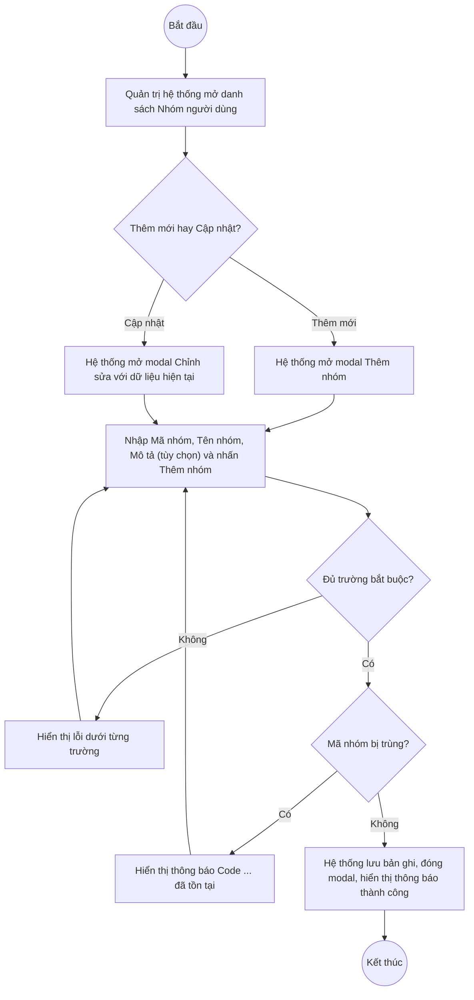

# UC2.2: Quản lý nhóm người dùng

## 1. Thông tin chung

| ID | Use case | Description |
| :---- | :---- | :---- |
| UC2.2 | Quản lý nhóm người dùng | Quản trị hệ thống xem danh sách, tìm kiếm, thêm mới, cập nhật, xem chi tiết, xóa nhóm người dùng (nhóm quyền) trên Web Portal. Mỗi Nhóm người dùng gắn với một tập quyền được cấu hình tại Ma trận phân quyền (UC2.3) và được gán cho người dùng khi thêm/cập nhật tài khoản (UC2.1). |

> **Actor:** Quản trị hệ thống
>
> **Trigger:** Quản trị hệ thống chọn menu "Nhóm người dùng" trong phân hệ Quản trị hệ thống
>
> **Điều kiện trước (Pre-condition):** Quản trị hệ thống đã đăng nhập và có quyền quản lý nhóm người dùng
>
> **Điều kiện sau (Post-condition):** Bản ghi Nhóm người dùng (Mã nhóm, Tên nhóm, Mô tả) được thêm mới, cập nhật hoặc xóa; danh sách hiển thị dữ liệu mới nhất
>
> **Business rule:**
>
> BR-1: Mã nhóm là duy nhất trong toàn hệ thống, chỉ gồm chữ không dấu, số, dấu "_", "-", không chứa khoảng trắng, và không cho sửa sau khi tạo. *(Đã kiểm chứng trực tiếp ngày 10/10/2026: tạo trùng Mã nhóm trả về lỗi "Code {giá trị} đã tồn tại"; quy tắc ký tự hiển thị ngay dưới trường "Chữ không dấu, số, dấu _ - : không khoảng trắng")*. **[Cần xác nhận]** trường Mã nhóm có hiển thị chỉ đọc ở chế độ Cập nhật hay không — suy luận theo đúng mẫu BR-1 của các danh mục khác (UC4.1, UC4.2, UC4.3, UC2.1), chưa chụp màn hình Cập nhật để xác minh trực tiếp.
>
> BR-2: Tên nhóm là bắt buộc. Mô tả là tùy chọn. *(Đã kiểm chứng trực tiếp ngày 10/10/2026)*. **[Cần xác nhận]** có cho phép trùng Tên nhóm không.
>
> BR-3: Hệ thống có sẵn một số nhóm người dùng mặc định ứng với các vai trò nghiệp vụ mô tả xuyên suốt UC_1409: SUPER_ADMIN (Super Admin, Quản lý hệ thống), "lanhdaobo" (Lãnh đạo, Người dùng là Lãnh đạo Bộ Dân tộc và Tôn giáo), LEADER (Lãnh đạo đơn vị, Phê duyệt kết quả tự đánh giá của đơn vị), STAFF (Cán bộ, Chấm điểm và trình phê duyệt kết quả tự đánh giá của đơn vị). *(Đã kiểm chứng trực tiếp ngày 10/10/2026, dữ liệu thật trên hệ thống)*. **[Cần xác nhận]** các nhóm mặc định này có cho phép xóa/sửa hay được hệ thống bảo vệ.
>
> BR-4: Tìm kiếm theo Mã nhóm hoặc Tên nhóm. **[Cần xác nhận]** có bộ lọc nào khác không — chỉ quan sát thấy ô tìm kiếm trên danh sách.
>
> BR-5: Nhóm người dùng không có thao tác Khóa/Mở khóa. *(Đã kiểm chứng trực tiếp ngày 10/10/2026: menu thao tác chỉ gồm Cập nhật, Xoá)*
>
> BR-6: **[Cần xác nhận]** có chặn xóa Nhóm người dùng đang được gán cho ≥ 1 người dùng hay không (tương tự cơ chế ẩn nút Xóa của UC4.2 với Loại đơn vị) — chưa thử trực tiếp để tránh ảnh hưởng dữ liệu người dùng thật.

**Ghi nhận QC (10/10/2026):** Nút "Xem chi tiết" trên danh sách hiện **không mở được** — cùng lỗi hồi quy đã ghi nhận ở các danh mục khác. Do đó các nội dung UC_1409 mô tả gắn với màn chi tiết nhóm — xem/thêm/xóa người dùng trong nhóm — **chưa thể kiểm chứng trực tiếp**.

**Truy vết chức năng**

| STT | Chức năng | YC (BCKTKT) | Dòng UC_1409 | Luồng | Màn hình | BR |
| :---- | :---- | :---- | :---- | :---- | :---- | :---- |
| 1 | Xem danh sách nhóm người dùng | **[Cần xác nhận]** | **[Cần xác nhận]** | Basic Flow bước 1–2 | UI-2.2.1 | — |
| 2 | Tìm kiếm nhóm người dùng | **[Cần xác nhận]** | **[Cần xác nhận]** | AF1 | UI-2.2.1 | BR-4 |
| 3 | Xuất Excel danh sách nhóm người dùng | **[Cần xác nhận]** | **[Cần xác nhận]** | AF5 | UI-2.2.1 | — |
| 4 | Xem thông tin nhóm người dùng | **[Cần xác nhận]** | **[Cần xác nhận]** | AF3 | UI-2.2.3 | — |
| 5 | Thêm mới nhóm người dùng | **[Cần xác nhận]** | **[Cần xác nhận]** | Basic Flow bước 3–7; EF1, EF2 | UI-2.2.2 | BR-1, BR-2 |
| 6 | Chỉnh sửa thông tin nhóm người dùng | **[Cần xác nhận]** | **[Cần xác nhận]** | AF2; EF1 | UI-2.2.2 | BR-1, BR-2 |
| 7 | Xóa nhóm người dùng | **[Cần xác nhận]** | **[Cần xác nhận]** | AF4 | UI-2.2.4 | BR-6 |
| 8 | Xem người dùng trong nhóm | **[Cần xác nhận]** | **[Cần xác nhận]** | AF3 | UI-2.2.3 | — |
| 9 | Thêm / xóa người dùng khỏi nhóm | **[Cần xác nhận]** | **[Cần xác nhận]** | AF3 | UI-2.2.3 | — |

> Cột YC (BCKTKT) và Dòng UC_1409 chưa đối chiếu được với bản gốc. Use case nguồn tương ứng: UC-A.II.2 "Quản lý nhóm người dùng" (gồm cả các dòng mô tả quản lý người dùng trong nhóm — chức năng 8–9 chưa kiểm chứng được, xem Ghi nhận QC).

## 2. Mô tả luồng nghiệp vụ

*Hình 1. Luồng nghiệp vụ thêm mới / cập nhật Nhóm người dùng*

**Basic Flow** (Thêm mới Nhóm người dùng)

1. Quản trị hệ thống chọn menu "Nhóm người dùng".
2. Hệ thống hiển thị màn hình Danh sách Nhóm người dùng (UI-2.2.1).
3. Quản trị hệ thống nhấn nút "Thêm nhóm".
4. Hệ thống hiển thị modal Thêm nhóm (UI-2.2.2), phụ đề "Tạo nhóm quyền mới để gắn cho người dùng".
5. Quản trị hệ thống nhập Mã nhóm, Tên nhóm, Mô tả (tùy chọn) và nhấn "Thêm nhóm".
6. Hệ thống kiểm tra các trường bắt buộc, định dạng và tính duy nhất của Mã nhóm (BR-1, BR-2).
7. Hệ thống lưu bản ghi, đóng modal, hiển thị thông báo "Thêm mới thành công" và tải lại danh sách.

**Alternative Flow**

AF1. Tìm kiếm danh sách

Tại màn hình danh sách (bước 2), Quản trị hệ thống nhập từ khóa vào ô tìm kiếm (BR-4). Use case kết thúc.

AF2. Cập nhật Nhóm người dùng

Tại màn hình danh sách (bước 2), Quản trị hệ thống mở menu thao tác của dòng và chọn "Cập nhật". Hệ thống hiển thị modal Chỉnh sửa (UI-2.2.2) với dữ liệu hiện tại. Quản trị hệ thống sửa Tên nhóm và/hoặc Mô tả rồi nhấn "Lưu". Hệ thống kiểm tra như bước 6, lưu và hiển thị thông báo "Chỉnh sửa thành công". Use case kết thúc.

AF3. Xem chi tiết và quản lý người dùng trong nhóm

Tại màn hình danh sách (bước 2), Quản trị hệ thống nhấn "Xem chi tiết" trên một dòng. Theo thiết kế dự kiến, Hệ thống hiển thị màn hình/panel Chi tiết nhóm người dùng (UI-2.2.3) gồm thông tin chung và danh sách người dùng trong nhóm, cho phép thêm/xóa người dùng khỏi nhóm. **Hiện không hoạt động — xem Ghi nhận QC ở mục 1.** Use case kết thúc.

AF4. Xóa Nhóm người dùng

Tại màn hình danh sách (bước 2), Quản trị hệ thống mở menu thao tác của dòng và chọn "Xóa". Hệ thống hiển thị popup xác nhận (UI-2.2.4). Quản trị hệ thống nhấn "Xóa". Hệ thống xóa bản ghi, hiển thị thông báo thành công. **[Cần xác nhận]** ràng buộc BR-6. Use case kết thúc.

AF5. Xuất Excel

Tại màn hình danh sách (bước 2), Quản trị hệ thống nhấn "Xuất Excel" (nếu có). **[Cần xác nhận]** nút này có tồn tại trên màn hình Nhóm người dùng hay không — chưa quan sát được trực tiếp.

AF6. Hủy thao tác

Khi đang ở modal hoặc popup (bước 5, AF2, AF4), Quản trị hệ thống nhấn "Huỷ" hoặc biểu tượng đóng. Hệ thống đóng modal/popup, không lưu thay đổi. Quay lại bước 2.

**Exception Flow**

EF1. Thiếu trường bắt buộc

Tại bước 6, Hệ thống hiển thị lỗi ngay dưới từng trường: "Vui lòng nhập mã nhóm", "Vui lòng nhập tên nhóm". *(Thông điệp đã kiểm chứng trực tiếp ngày 10/10/2026)*

Quay lại bước 5.

EF2. Mã nhóm đã tồn tại

Tại bước 6 hoặc AF2, nếu Mã nhóm đã tồn tại, Hệ thống trả về lỗi "Code {giá trị} đã tồn tại" (HTTP 400). *(Đã kiểm chứng trực tiếp ngày 10/10/2026 qua API; **[Cần xác nhận]** vị trí hiển thị cụ thể trên giao diện — toast không bắt được trong lần thử)*

Quay lại bước 5.

EF3. Lỗi hệ thống khi lưu hoặc xóa

Hệ thống hiển thị thông báo lỗi chung và giữ nguyên dữ liệu trước thao tác. **[Cần xác nhận]** nội dung thông báo cụ thể.

Use case kết thúc.

## 3. Màn hình

| UI Code | Screen | Mô tả |
| :---- | :---- | :---- |
| UI-2.2.1 | Danh sách Nhóm người dùng (Web) | Tìm kiếm, bảng danh sách, nút Thêm nhóm, menu thao tác từng dòng |
| UI-2.2.2 | Modal Thêm mới / Cập nhật Nhóm người dùng (Web) | Nhập Mã nhóm, Tên nhóm, Mô tả |
| UI-2.2.3 | Chi tiết Nhóm người dùng (Web) | Thông tin chung và danh sách người dùng trong nhóm. **Hiện không mở được (QC, 10/10/2026)** |
| UI-2.2.4 | Popup xác nhận xóa (Web) | Xác nhận trước khi xóa nhóm người dùng |

## 4. Mô tả Màn hình (Field Specification)

**UI-2.2.1 — Danh sách Nhóm người dùng**

| Field Name | Field type | Data Type | Required | Validation rule/Behaviour |
| :---- | :---- | :---- | :---- | :---- |
| Tìm kiếm | Search box | String | No | **Behaviour:** Tìm theo BR-4 **Validation rule:** **[Cần xác nhận]** placeholder chính xác |
| Nút Thêm nhóm | Button | Action | Yes | **Behaviour:** Mở modal UI-2.2.2 ở chế độ Thêm mới **Validation rule:** Luôn hiển thị với Quản trị hệ thống |
| STT | Label | Integer | Yes | **Behaviour:** Số thứ tự liên tục theo trang **Validation rule:** Tự sinh |
| Mã nhóm người dùng | Label | String | Yes | **Behaviour:** Hiển thị mã nhóm **Validation rule:** — |
| Tên nhóm người dùng | Label | String | Yes | **Behaviour:** Hiển thị tên nhóm **Validation rule:** — |
| Mô tả | Label | String | No | **Behaviour:** Hiển thị mô tả nhóm, có thể rỗng **Validation rule:** — |
| Xem chi tiết | Link | Action | Yes | **Behaviour:** Mở màn hình UI-2.2.3 (AF3). **Hiện không phản hồi khi bấm (QC, 10/10/2026)** **Validation rule:** — |
| Menu thao tác | Icon button | Action | Yes | **Behaviour:** Mở menu gồm: Cập nhật (AF2), Xoá (AF4) — không có Khoá (BR-5) **Validation rule:** — |
| Phân trang | Pagination | Integer | Yes | **Behaviour:** "10 / trang" **Validation rule:** — |

**UI-2.2.2 — Modal Thêm mới / Cập nhật Nhóm người dùng**

| Field Name | Field type | Data Type | Required | Validation rule/Behaviour |
| :---- | :---- | :---- | :---- | :---- |
| Tiêu đề modal | Label | String | Yes | **Behaviour:** "Thêm nhóm" (phụ đề "Tạo nhóm quyền mới để gắn cho người dùng") hoặc "Chỉnh sửa nhóm" **Validation rule:** — |
| Mã nhóm | Textbox | String | Yes | **Behaviour:** Placeholder "vd: LEADER"; ghi chú "Chữ không dấu, số, dấu _ - : không khoảng trắng" (BR-1) **Validation rule:** Bắt buộc; đúng định dạng; duy nhất. Lỗi: "Vui lòng nhập mã nhóm", "Code {giá trị} đã tồn tại" |
| Tên nhóm | Textbox | String | Yes | **Behaviour:** Placeholder "vd: Cán bộ địa phương" **Validation rule:** Bắt buộc. Lỗi: "Vui lòng nhập tên nhóm" |
| Mô tả | Textarea | String | No | **Behaviour:** Nhãn "Mô tả (không bắt buộc)"; placeholder "Mô tả ngắn vai trò, phạm vi công việc của nhóm" **Validation rule:** Không bắt buộc |
| Nút Huỷ | Button | Action | Yes | **Behaviour:** Đóng modal, không lưu (AF6) **Validation rule:** — |
| Nút Thêm nhóm / Lưu | Button | Action | Yes | **Behaviour:** Kiểm tra và lưu bản ghi (bước 6–7, AF2) **Validation rule:** Footer modal có ghi chú "* Trường bắt buộc" |

**UI-2.2.3 — Chi tiết Nhóm người dùng** *(chưa xác minh được — xem Ghi nhận QC mục 1)*

| Field Name | Field type | Data Type | Required | Validation rule/Behaviour |
| :---- | :---- | :---- | :---- | :---- |
| Thông tin chung (Mã, Tên, Mô tả) | Label | String | Yes | **Behaviour:** **[Cần xác nhận]** bố cục thực tế |
| Danh sách Người dùng trong nhóm | List | List | Yes | **Behaviour:** Theo UC-A.II.2: xem danh sách, thêm người dùng vào nhóm, xóa người dùng khỏi nhóm **[Cần xác nhận]** toàn bộ |

**UI-2.2.4 — Popup xác nhận xóa**

| Field Name | Field type | Data Type | Required | Validation rule/Behaviour |
| :---- | :---- | :---- | :---- | :---- |
| Nội dung xác nhận | Label | String | Yes | **Behaviour:** **[Cần xác nhận]** nội dung chính xác (chưa thực hiện thao tác xóa thật để tránh ảnh hưởng dữ liệu người dùng đang gắn nhóm) **Validation rule:** — |
| Nút Hủy | Button | Action | Yes | **Behaviour:** Đóng popup, không xóa (AF6) **Validation rule:** — |
| Nút Xóa | Button | Action | Yes | **Behaviour:** Xóa bản ghi (AF4) **Validation rule:** — |

## Điểm cần xác nhận

| STT | Vị trí | Giả định đã dùng | Câu hỏi cần xác nhận |
| :---- | :---- | :---- | :---- |
| 1 | Mục 1 – Ghi nhận QC | Nút "Xem chi tiết" không phản hồi khi bấm | Toàn bộ nghiệp vụ quản lý người dùng trong nhóm phụ thuộc màn hình này, cần dev xác nhận và khắc phục |
| 2 | BR-1 | Mã nhóm chỉ đọc khi Cập nhật (suy luận theo mẫu chung) | Xác minh trực tiếp bằng ảnh chụp màn hình Cập nhật |
| 3 | BR-3 | 4 nhóm mặc định (SUPER_ADMIN, lanhdaobo, LEADER, STAFF) | Các nhóm này có được bảo vệ khỏi sửa/xóa không? |
| 4 | BR-6 | Chưa rõ ràng buộc xóa nhóm đang có người dùng | Cần xác nhận cơ chế chặn (ẩn nút như UC4.2 hay chặn sau xác nhận như UC4.3) |
| 5 | AF5 | Chưa rõ màn hình có nút Xuất Excel hay không | Cần xác nhận |
| 6 | Truy vết chức năng | Chưa có số YC (BCKTKT) và Dòng UC_1409 | Đề nghị đối chiếu với bản gốc Google Sheet |
