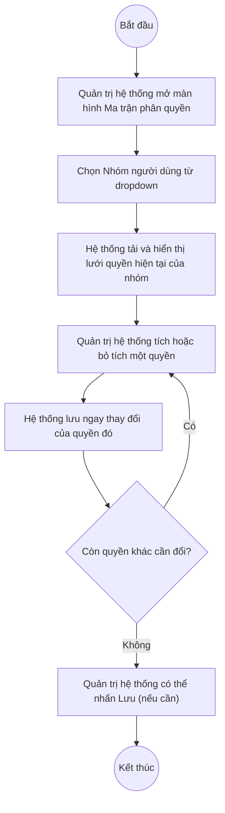

# UC2.3: Phân quyền cho nhóm người dùng

## 1. Thông tin chung

| ID | Use case | Description |
| :---- | :---- | :---- |
| UC2.3 | Phân quyền cho nhóm người dùng | Quản trị hệ thống chọn một Nhóm người dùng (UC2.2) và thiết lập các quyền chức năng được phép thực hiện, thông qua màn hình Ma trận phân quyền (bật/tắt từng quyền theo từng nhóm chức năng nghiệp vụ). |

> **Actor:** Quản trị hệ thống
>
> **Trigger:** Quản trị hệ thống chọn menu "Ma trận phân quyền" trong phân hệ Quản trị hệ thống
>
> **Điều kiện trước (Pre-condition):** Quản trị hệ thống đã đăng nhập, có quyền quản lý phân quyền; đã tồn tại ít nhất 1 Nhóm người dùng (UC2.2)
>
> **Điều kiện sau (Post-condition):** Tập quyền (phải/không phải) của Nhóm người dùng được chọn được cập nhật; các tài khoản thuộc nhóm đó áp dụng quyền mới. **[Cần xác nhận]** áp dụng ngay lập tức hay chỉ từ phiên đăng nhập kế tiếp của người dùng đang hoạt động.
>
> **Business rule:**
>
> BR-1: Phải chọn một Nhóm người dùng trước khi lưới quyền hiển thị; chưa chọn thì hiển thị ghi chú "Chọn nhóm người dùng". *(Đã kiểm chứng trực tiếp ngày 08–10/10/2026)*
>
> BR-2: Lưới quyền được tổ chức theo từng nhóm chức năng nghiệp vụ (ví dụ: Đánh giá CĐS, Nhóm chỉ số, Kỳ tự đánh giá, Bộ chỉ số, Chỉ số, Trụ cột, Khảo sát, Kết quả khảo sát, Loại đơn vị, Đơn vị…), mỗi quyền là một checkbox độc lập, tổng cộng quan sát được 49 quyền. *(Đã kiểm chứng trực tiếp ngày 08/10/2026)*. **[Cần xác nhận]** danh sách đầy đủ tất cả nhóm chức năng (màn hình còn tiếp tục cuộn xuống dưới so với phần đã chụp được).
>
> BR-3: "Phạm vi áp dụng của từng quyền; quyền mới mặc định là Đơn vị và đơn vị con." — mỗi quyền có phạm vi áp dụng riêng, mặc định giới hạn trong đơn vị của người dùng và các đơn vị con. *(Ghi chú trên màn hình, đã kiểm chứng trực tiếp ngày 08/10/2026)*. **[Cần xác nhận]** có cho tùy chỉnh phạm vi (ví dụ mở rộng toàn hệ thống) từ màn hình này hay không — chưa thấy điều khiển tương ứng.
>
> BR-4: Tích/bỏ tích một checkbox quyền phát sinh ngay một lệnh lưu (PUT `/api/v1/idm/right-map-role/config/{mã nhóm chức năng}`) — không cần chờ nhấn nút "Lưu" ở góc trên. *(Đã kiểm chứng trực tiếp ngày 08/10/2026: toggle quyền "Chấm điểm" của nhóm "Lãnh đạo" phát sinh PUT thành công ngay khi tích)*. **[Cần xác nhận]** vậy nút "Lưu" dùng để làm gì — có thể là lưu hàng loạt cho các thay đổi chưa kịp autosave, hoặc một cơ chế dự phòng.
>
> BR-5: **[Cần xác nhận]** thay đổi quyền của Super Admin / nhóm đang đăng nhập có bị chặn để tránh tự khóa quyền của chính mình hay không.

**Truy vết chức năng**

| STT | Chức năng | YC (BCKTKT) | Dòng UC_1409 | Luồng | Màn hình | BR |
| :---- | :---- | :---- | :---- | :---- | :---- | :---- |
| 1 | Chọn nhóm người dùng để xem danh sách quyền đã phân | **[Cần xác nhận]** | **[Cần xác nhận]** | Basic Flow bước 1–3 | UI-2.3.1 | BR-1, BR-2 |
| 2 | Phân quyền chức năng cho nhóm người dùng | **[Cần xác nhận]** | **[Cần xác nhận]** | Basic Flow bước 4–5 | UI-2.3.1 | BR-3, BR-4 |
| 3 | Hủy phân quyền chức năng của nhóm người dùng | **[Cần xác nhận]** | **[Cần xác nhận]** | AF1 | UI-2.3.1 | BR-4 |

> Cột YC (BCKTKT) và Dòng UC_1409 chưa đối chiếu được với bản gốc. Use case nguồn tương ứng: UC-A.II.3 "Phân quyền cho nhóm người dùng".

## 2. Mô tả luồng nghiệp vụ

*Hình 1. Luồng nghiệp vụ phân quyền cho nhóm người dùng*

**Basic Flow**

1. Quản trị hệ thống chọn menu "Ma trận phân quyền".
2. Hệ thống hiển thị màn hình Ma trận phân quyền (UI-2.3.1) với dropdown "Chọn nhóm người dùng" trống, phần lưới hiển thị ghi chú "Chọn nhóm người dùng" (BR-1).
3. Quản trị hệ thống chọn một Nhóm người dùng từ dropdown. Hệ thống tải và hiển thị lưới quyền hiện tại của nhóm, nhóm theo từng nhóm chức năng (BR-2).
4. Quản trị hệ thống tích chọn hoặc bỏ tích một hoặc nhiều quyền tương ứng với các chức năng muốn cấp cho nhóm.
5. Hệ thống lưu ngay thay đổi của quyền vừa tích/bỏ tích (BR-4).

**Alternative Flow**

AF1. Hủy phân quyền

Tại bước 4, Quản trị hệ thống bỏ tích một quyền đã được cấp trước đó. Hệ thống lưu ngay thay đổi, quyền đó không còn hiệu lực với nhóm (BR-4). Use case kết thúc.

AF2. Chuyển sang xem/đổi nhóm khác

Tại UI-2.3.1, Quản trị hệ thống chọn một Nhóm người dùng khác từ dropdown. Hệ thống tải lại lưới quyền tương ứng với nhóm mới chọn, không giữ lại trạng thái chưa lưu của nhóm trước đó (do mỗi thay đổi đã tự lưu ngay theo BR-4).

**Exception Flow**

EF1. Lỗi hệ thống khi lưu thay đổi quyền

Nếu lệnh lưu thất bại, Hệ thống hiển thị thông báo lỗi và giữ nguyên trạng thái quyền trước đó. **[Cần xác nhận]** nội dung thông báo, và giao diện có tự khôi phục trạng thái checkbox về đúng với server hay không.

Use case kết thúc.

## 3. Màn hình

| UI Code | Screen | Mô tả |
| :---- | :---- | :---- |
| UI-2.3.1 | Ma trận phân quyền (Web) | Chọn nhóm người dùng, lưới quyền theo từng nhóm chức năng nghiệp vụ |

## 4. Mô tả Màn hình (Field Specification)

**UI-2.3.1 — Ma trận phân quyền**

| Field Name | Field type | Data Type | Required | Validation rule/Behaviour |
| :---- | :---- | :---- | :---- | :---- |
| Chọn nhóm người dùng | Dropdown | Enum | Yes | **Behaviour:** Danh mục Nhóm người dùng (UC2.2); bắt buộc để hiển thị lưới quyền (BR-1) **Validation rule:** — |
| Nút Lưu | Button | Action | Yes | **Behaviour:** **[Cần xác nhận]** vai trò chính xác khi mỗi quyền đã tự lưu ngay (BR-4) **Validation rule:** — |
| Ghi chú phạm vi áp dụng | Label | String | Yes | **Behaviour:** "Phạm vi áp dụng của từng quyền; quyền mới mặc định là Đơn vị và đơn vị con." (BR-3) **Validation rule:** — |
| Nhóm chức năng (tiêu đề nhóm) | Label | String | Yes | **Behaviour:** Ví dụ: "Đánh giá CĐS", "Nhóm chỉ số", "Kỳ tự đánh giá", "Bộ chỉ số", "Chỉ số", "Trụ cột", "Khảo sát", "Kết quả khảo sát", "Loại đơn vị", "Đơn vị"… (BR-2) **Validation rule:** **[Cần xác nhận]** danh sách đầy đủ |
| Checkbox quyền | Checkbox | Boolean | No | **Behaviour:** Mỗi quyền ứng với một hành động nghiệp vụ cụ thể (ví dụ: Chấm điểm, Mở khoá, Trình phê duyệt, Phê duyệt, Yêu cầu thực hiện, Thêm/Sửa/Xoá/Khoá/Mở khoá từng đối tượng…); tích/bỏ tích lưu ngay (BR-4) **Validation rule:** — |

## Điểm cần xác nhận

| STT | Vị trí | Giả định đã dùng | Câu hỏi cần xác nhận |
| :---- | :---- | :---- | :---- |
| 1 | BR-4 | Mỗi checkbox tự lưu ngay khi tích/bỏ tích | Vậy nút "Lưu" ở góc trên dùng để làm gì? Có batch thay đổi nào không qua autosave không? |
| 2 | BR-3 | Mặc định phạm vi là "Đơn vị và đơn vị con", chưa thấy cách tùy chỉnh | Có cho đổi phạm vi áp dụng từng quyền tại màn hình này không, hay cố định? |
| 3 | BR-5 | Chưa rõ có chặn tự khóa quyền của chính nhóm/tài khoản đang đăng nhập | Cần xác nhận để tránh rủi ro vận hành |
| 4 | BR-2 | Chưa liệt kê hết toàn bộ nhóm chức năng (màn hình dài, mới chụp được phần đầu) | Đề nghị chụp đầy đủ toàn bộ lưới quyền để liệt kê chính xác |
| 5 | Truy vết chức năng | Chưa có số YC (BCKTKT) và Dòng UC_1409 | Đề nghị đối chiếu với bản gốc Google Sheet |
