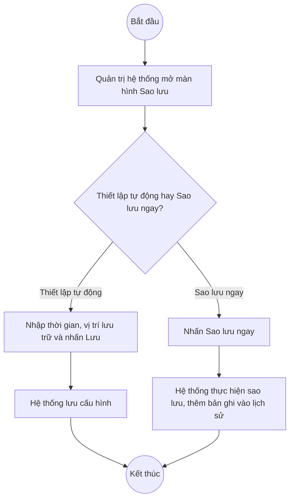

# UC3.1: Quản lý sao lưu

## 1. Thông tin chung

| ID | Use case | Description |
| :---- | :---- | :---- |
| UC3.1 | Quản lý sao lưu | Quản trị hệ thống thiết lập thông số sao lưu tự động, thực hiện sao lưu ngay lập tức, xem lịch sử và chi tiết các lần sao lưu dữ liệu, và xóa lần sao lưu không cần thiết. |

> **⚠️ Chưa tìm thấy màn hình tương ứng trên hệ thống thật.** Đã kiểm tra trực tiếp ngày 10/10/2026: menu "Quản trị hệ thống" hiện KHÔNG có mục "Sao lưu"; màn hình Tham số hệ thống (UC3.2) có ghi chú "Lịch sao lưu được thiết lập tại Sao lưu > Cấu hình" kèm liên kết, nhưng bấm vào liên kết này **không chuyển tới trang nào** (URL không đổi, không có nội dung nào được tải thêm) — cho thấy đây là một liên kết placeholder cho một module chưa triển khai hoặc chưa được bật quyền truy cập, chứ không phải lỗi thao tác. Toàn bộ nội dung dưới đây được soạn **hoàn toàn dựa trên mô tả nghiệp vụ trong `UC_1409_Requirement.md` (UC-A.III.1)**, chưa có bất kỳ phần nào được đối chiếu với giao diện thật — khác với các tài liệu UC khác trong bộ này.

> **Actor:** Quản trị hệ thống
>
> **Trigger:** Quản trị hệ thống chọn menu "Sao lưu" trong phân hệ Quản trị hệ thống **(menu này chưa tồn tại trên hệ thống thật tính đến 10/10/2026)**
>
> **Điều kiện trước (Pre-condition):** Quản trị hệ thống đã đăng nhập và có quyền quản lý sao lưu
>
> **Điều kiện sau (Post-condition):** Thông số sao lưu tự động được thiết lập, hoặc một bản sao lưu mới được tạo, hoặc một lần sao lưu trong lịch sử bị xóa
>
> **Business rule:**
>
> BR-1: **[Cần xác nhận]** Thông số sao lưu tự động gồm những gì cụ thể — UC_1409 chỉ nêu chung "thời gian, vị trí lưu trữ…".
>
> BR-2: **[Cần xác nhận]** Có giới hạn số lượng/dung lượng bản sao lưu được giữ lại hay không, cơ chế tự xóa bản cũ (retention policy).
>
> BR-3: **[Cần xác nhận]** Định dạng, nội dung của một bản sao lưu (toàn bộ CSDL hay chọn lọc theo phân hệ).
>
> BR-4: **[Cần xác nhận]** Quyền xóa lịch sử sao lưu có ràng buộc gì (ví dụ không cho xóa bản sao lưu gần nhất).

**Truy vết chức năng**

| STT | Chức năng | YC (BCKTKT) | Dòng UC_1409 | Luồng | Màn hình | BR |
| :---- | :---- | :---- | :---- | :---- | :---- | :---- |
| 1 | Thiết lập thông số sao lưu tự động | **[Cần xác nhận]** | **[Cần xác nhận]** | Basic Flow | UI-3.1.1 | BR-1 |
| 2 | Sao lưu ngay lập tức | **[Cần xác nhận]** | **[Cần xác nhận]** | AF1 | UI-3.1.1 | BR-3 |
| 3 | Xem danh sách lịch sử sao lưu | **[Cần xác nhận]** | **[Cần xác nhận]** | AF2 | UI-3.1.2 | — |
| 4 | Xem chi tiết một lần sao lưu | **[Cần xác nhận]** | **[Cần xác nhận]** | AF3 | UI-3.1.3 | — |
| 5 | Xóa lần sao lưu | **[Cần xác nhận]** | **[Cần xác nhận]** | AF4 | UI-3.1.4 | BR-4 |

> Cột YC (BCKTKT) và Dòng UC_1409 chưa đối chiếu được với bản gốc. Use case nguồn tương ứng: UC-A.III.1 "Quản lý sao lưu".

## 2. Mô tả luồng nghiệp vụ

*Hình 1. Luồng nghiệp vụ quản lý sao lưu — suy luận từ UC_1409, chưa kiểm chứng trên hệ thống thật*

**Basic Flow** (Thiết lập thông số sao lưu tự động) — *suy luận từ UC_1409, chưa kiểm chứng*

1. Quản trị hệ thống chọn menu "Sao lưu".
2. Hệ thống hiển thị màn hình Sao lưu (UI-3.1.1).
3. Quản trị hệ thống thiết lập thông số (thời gian, vị trí lưu trữ…) để sao lưu tự động.
4. Hệ thống lưu thông số và hiển thị thông báo thành công.

**Alternative Flow**

AF1. Sao lưu ngay lập tức

Tại UI-3.1.1, Quản trị hệ thống nhấn "Sao lưu ngay". Hệ thống thực hiện sao lưu dữ liệu ngay lập tức và thêm bản ghi mới vào lịch sử (UI-3.1.2).

AF2. Xem danh sách lịch sử sao lưu dữ liệu

Quản trị hệ thống xem danh sách lịch sử sao lưu (UI-3.1.2).

AF3. Xem chi tiết thông tin sao lưu dữ liệu

Tại UI-3.1.2, Quản trị hệ thống chọn một lần sao lưu để xem chi tiết (UI-3.1.3).

AF4. Xóa lần sao lưu

Tại UI-3.1.2, Quản trị hệ thống chọn một lần sao lưu để xóa (UI-3.1.4, BR-4).

**Exception Flow**

EF1. Sao lưu thất bại

Hệ thống hiển thị thông báo lỗi. **[Cần xác nhận]** toàn bộ.

## 3. Màn hình

| UI Code | Screen | Mô tả |
| :---- | :---- | :---- |
| UI-3.1.1 | Cấu hình sao lưu (Web) | **[Cần xác nhận]** toàn bộ — chưa có trên hệ thống thật |
| UI-3.1.2 | Danh sách lịch sử sao lưu (Web) | **[Cần xác nhận]** toàn bộ |
| UI-3.1.3 | Chi tiết lần sao lưu (Web) | **[Cần xác nhận]** toàn bộ |
| UI-3.1.4 | Popup xác nhận xóa lần sao lưu (Web) | **[Cần xác nhận]** toàn bộ |

## 4. Mô tả Màn hình (Field Specification)

**Toàn bộ mục 4 chưa thể lập được** vì chưa có màn hình thật để đối chiếu field/validation. Đề nghị bổ sung tài liệu này ngay sau khi module Sao lưu được triển khai trên môi trường có thể kiểm thử.

## Điểm cần xác nhận

| STT | Vị trí | Giả định đã dùng | Câu hỏi cần xác nhận |
| :---- | :---- | :---- | :---- |
| 1 | Toàn bộ tài liệu | Module Sao lưu chưa có trên hệ thống thật (kiểm tra ngày 10/10/2026); nội dung hoàn toàn suy luận từ UC_1409 | Module này có đang được phát triển không? Dự kiến thời gian hoàn thành để đội kiểm thử có thể xác minh và hoàn thiện tài liệu? |
| 2 | BR-1, BR-2, BR-3, BR-4 | Chưa rõ chi tiết nghiệp vụ | Cần làm rõ cùng đội phát triển/BA khi module được xây dựng |
| 3 | Truy vết chức năng | Chưa có số YC (BCKTKT) và Dòng UC_1409 | Đề nghị đối chiếu với bản gốc Google Sheet |
