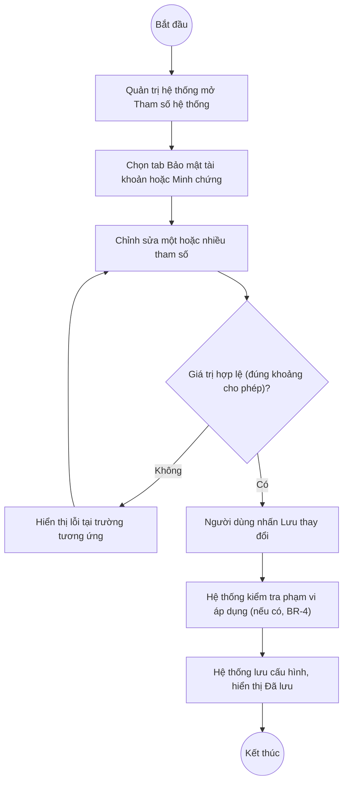

# UC3.2: Quản lý tham số hệ thống

## 1. Thông tin chung

| ID | Use case | Description |
| :---- | :---- | :---- |
| UC3.2 | Quản lý tham số hệ thống | Quản trị hệ thống cấu hình các tham số chung của hệ thống: quy tắc mật khẩu, hiệu lực/đổi mật khẩu, đăng nhập và phiên làm việc, và cấu hình file minh chứng đính kèm cho tự đánh giá. |

> **Actor:** Quản trị hệ thống
>
> **Trigger:** Quản trị hệ thống chọn menu "Tham số hệ thống" trong phân hệ Quản trị hệ thống
>
> **Điều kiện trước (Pre-condition):** Quản trị hệ thống đã đăng nhập và có quyền quản lý tham số hệ thống
>
> **Điều kiện sau (Post-condition):** Cấu hình tham số hệ thống được cập nhật và áp dụng theo phạm vi đã chọn (xem BR-6)
>
> **Lưu ý:** Đây là trang **mới xuất hiện trong menu kể từ sau ngày 08/10/2026** (không có trong lần khảo sát trước) — toàn bộ nội dung dưới đây được kiểm chứng trực tiếp trên hệ thống thật ngày 10/10/2026.
>
> **Business rule:**
>
> BR-1 (Quy tắc mật khẩu — áp dụng khi tạo, đổi và đặt lại mật khẩu, liên quan UC1.2, UC1.4, UC2.1): Độ dài tối thiểu (số, từ 6 đến 32 ký tự); có thể bật/tắt độc lập: Yêu cầu chữ hoa và chữ thường, Yêu cầu chữ số, Yêu cầu ký tự đặc biệt, Không chứa tên đăng nhập, Không dùng lại N mật khẩu cũ (N nhập được khi bật). *(Đã kiểm chứng trực tiếp ngày 10/10/2026, giá trị mặc định quan sát được: 8 ký tự, cả 4 yêu cầu bật, không dùng lại 3 mật khẩu gần nhất)*
>
> BR-2: Có công cụ "Xem trước với người dùng" để thử một mật khẩu mẫu và xem kết quả đối chiếu trực tiếp với quy tắc đang thiết lập (đạt/không đạt từng tiêu chí), không gửi đi đâu khác. *(Đã kiểm chứng trực tiếp ngày 10/10/2026)*
>
> BR-3 (Hiệu lực & đổi mật khẩu — áp dụng cho tất cả tài khoản): Thời hạn hiệu lực mật khẩu (ngày, nhập 0 = không hết hạn); Yêu cầu đổi mật khẩu trước khi hết hạn (số ngày nhắc trước); khi hết hạn chọn 1 trong 2: "Bắt buộc đổi ở lần đăng nhập tiếp theo" hoặc "Khóa tài khoản, Quản trị cấp lại mật khẩu"; có thể bật "Bắt buộc đổi mật khẩu ở lần đăng nhập đầu tiên". *(Đã kiểm chứng trực tiếp ngày 10/10/2026, giá trị mặc định: 90 ngày hiệu lực, nhắc trước 7 ngày, chọn "Bắt buộc đổi ở lần đăng nhập tiếp theo", bật bắt buộc đổi lần đầu)*
>
> BR-4: Khi thay đổi thời hạn hiệu lực mật khẩu, chọn 1 trong 3 phạm vi áp dụng: "Tất cả tài khoản hiện có" (tính hạn theo ngày đổi mật khẩu gần nhất của từng tài khoản), "Chỉ mật khẩu đặt mới" (mật khẩu hiện có giữ nguyên hạn cũ), hoặc "Không có tài khoản nào bị ảnh hưởng ngay khi lưu". *(Đã kiểm chứng trực tiếp ngày 10/10/2026)*
>
> BR-5 (Đăng nhập & phiên làm việc — liên quan UC1.1): Số lần đăng nhập sai tối đa (lần, đếm số lần sai liên tiếp); Thời gian khóa tạm thời (phút, tài khoản tự mở khóa sau thời gian này); Thời gian hết phiên khi không thao tác (phút, tự động đăng xuất); có thể bật "Cảnh báo 2 phút trước khi hết phiên". Có khối "Tóm tắt" diễn giải lại cấu hình bằng câu văn tự nhiên. *(Đã kiểm chứng trực tiếp ngày 10/10/2026, giá trị mặc định: 5 lần sai tối đa, khóa tạm 15 phút, hết phiên sau 30 phút không thao tác, bật cảnh báo)*
>
> BR-6 (Cấu hình Minh chứng, tab riêng "Minh chứng"): Dung lượng file tối đa cho mỗi file minh chứng đính kèm đánh giá CĐS (MB); bật/tắt "Bắt buộc ký số file minh chứng" áp dụng cho các báo cáo tự đánh giá chính thức. *(Đã kiểm chứng trực tiếp ngày 10/10/2026, giá trị mặc định: 25 MB, bắt buộc ký số đang bật)*
>
> BR-7: Màn hình có ghi chú "Lịch sao lưu được thiết lập tại Sao lưu > Cấu hình" với một liên kết, nhưng liên kết **hiện chưa trỏ tới trang nào** (đã thử bấm, URL không đổi, không có trang/route backup nào tải lên) — xem thêm UC3.1. *(Đã kiểm chứng trực tiếp ngày 10/10/2026)*
>
> BR-8: Các thay đổi chỉ được ghi nhận khi nhấn "Lưu thay đổi"; có nút "Hủy thay đổi" để khôi phục; trạng thái "Đã lưu" hiển thị ở góc phải khi không có thay đổi chưa lưu. **[Cần xác nhận]** hành vi chính xác khi rời trang mà chưa lưu (có cảnh báo không).

**Truy vết chức năng**

| STT | Chức năng | YC (BCKTKT) | Dòng UC_1409 | Luồng | Màn hình | BR |
| :---- | :---- | :---- | :---- | :---- | :---- | :---- |
| 1 | Thiết lập quy tắc mật khẩu | **[Cần xác nhận]** | **[Cần xác nhận]** | Basic Flow | UI-3.2.1 | BR-1, BR-2 |
| 2 | Thiết lập thời hạn hiệu lực và hành vi khi hết hạn mật khẩu | **[Cần xác nhận]** | **[Cần xác nhận]** | AF1 | UI-3.2.1 | BR-3, BR-4 |
| 3 | Thiết lập số lần đăng nhập sai, thời gian khóa tạm, timeout phiên | **[Cần xác nhận]** | **[Cần xác nhận]** | AF2 | UI-3.2.1 | BR-5 |
| 4 | Thiết lập cấu hình file minh chứng | **[Cần xác nhận]** | **[Cần xác nhận]** | AF3 | UI-3.2.2 | BR-6 |

> Cột YC (BCKTKT) và Dòng UC_1409 chưa đối chiếu được với bản gốc. Use case nguồn tương ứng: UC-A.III.2 "Quản lý tham số hệ thống". UC_1409 mô tả các tham số ở mức khái quát hơn (quy tắc mật khẩu, số lần đăng nhập sai, timeout phiên, thời hạn/thời gian yêu cầu đổi mật khẩu, thời gian khóa tạm) — toàn bộ các mục này đã được tìm thấy đúng trên màn hình thật, cộng thêm phần "Minh chứng" (BR-6) mà UC_1409 không đề cập.

## 2. Mô tả luồng nghiệp vụ

*Hình 1. Luồng nghiệp vụ cấu hình tham số hệ thống*

**Basic Flow** (Thiết lập quy tắc mật khẩu)

1. Quản trị hệ thống chọn menu "Tham số hệ thống".
2. Hệ thống hiển thị màn hình Tham số hệ thống (UI-3.2.1), mặc định ở tab "Bảo mật tài khoản".
3. Quản trị hệ thống chỉnh sửa Độ dài tối thiểu và/hoặc bật tắt các yêu cầu trong khối "Quy tắc mật khẩu" (BR-1); có thể dùng khối "Xem trước với người dùng" để kiểm tra (BR-2).
4. Quản trị hệ thống nhấn "Lưu thay đổi".
5. Hệ thống kiểm tra giá trị hợp lệ (ví dụ độ dài trong khoảng 6–32).
6. Hệ thống lưu cấu hình, hiển thị trạng thái "Đã lưu".

**Alternative Flow**

AF1. Thiết lập hiệu lực & đổi mật khẩu

Tại UI-3.2.1 (khối "Hiệu lực & đổi mật khẩu"), Quản trị hệ thống sửa Thời hạn hiệu lực, Số ngày nhắc trước, chọn hành vi khi hết hạn, bật/tắt bắt buộc đổi lần đầu, và chọn Phạm vi áp dụng (BR-3, BR-4). Tiếp tục từ bước 4.

AF2. Thiết lập đăng nhập & phiên làm việc

Tại UI-3.2.1 (khối "Đăng nhập & phiên làm việc"), Quản trị hệ thống sửa Số lần đăng nhập sai tối đa, Thời gian khóa tạm thời, Thời gian hết phiên, bật/tắt cảnh báo trước khi hết phiên (BR-5). Tiếp tục từ bước 4.

AF3. Thiết lập cấu hình Minh chứng

Tại UI-3.2.1, Quản trị hệ thống chuyển sang tab "Minh chứng" (UI-3.2.2), sửa Dung lượng file tối đa và/hoặc bật tắt "Bắt buộc ký số file minh chứng" (BR-6). Tiếp tục từ bước 4.

AF4. Hủy thay đổi

Tại UI-3.2.1/UI-3.2.2, trước khi lưu, Quản trị hệ thống nhấn "Hủy thay đổi". Hệ thống khôi phục toàn bộ tham số về giá trị đã lưu gần nhất.

**Exception Flow**

EF1. Giá trị ngoài khoảng cho phép

Tại bước 5, nếu giá trị nhập không hợp lệ (ví dụ Độ dài tối thiểu < 6 hoặc > 32), Hệ thống hiển thị lỗi tại trường tương ứng và không cho lưu. **[Cần xác nhận]** nội dung thông báo lỗi chính xác — chưa thử nhập giá trị sai để tránh làm hỏng cấu hình đang áp dụng cho toàn hệ thống thật.

Quay lại bước 3.

EF2. Lỗi hệ thống khi lưu

Hệ thống hiển thị thông báo lỗi chung và giữ nguyên cấu hình trước đó. **[Cần xác nhận]** nội dung thông báo cụ thể.

Use case kết thúc.

## 3. Màn hình

| UI Code | Screen | Mô tả |
| :---- | :---- | :---- |
| UI-3.2.1 | Tham số hệ thống — tab Bảo mật tài khoản (Web) | Quy tắc mật khẩu, Hiệu lực & đổi mật khẩu, Đăng nhập & phiên làm việc |
| UI-3.2.2 | Tham số hệ thống — tab Minh chứng (Web) | Cấu hình dung lượng và yêu cầu ký số file minh chứng |

## 4. Mô tả Màn hình (Field Specification)

**UI-3.2.1 — Tham số hệ thống (tab Bảo mật tài khoản)**

| Field Name | Field type | Data Type | Required | Validation rule/Behaviour |
| :---- | :---- | :---- | :---- | :---- |
| Độ dài tối thiểu | Number input | Integer | Yes | **Behaviour:** Đơn vị "ký tự"; ghi chú "Từ 6 đến 32 ký tự." **Validation rule:** 6 ≤ giá trị ≤ 32 |
| Yêu cầu chữ hoa và chữ thường / Yêu cầu chữ số / Yêu cầu ký tự đặc biệt / Không chứa tên đăng nhập | Toggle | Boolean | No | **Behaviour:** Áp dụng khi tạo/đổi/đặt lại mật khẩu (BR-1) **Validation rule:** — |
| Không dùng lại N mật khẩu cũ | Toggle + Number | Boolean + Integer | No | **Behaviour:** Khi bật, nhập số N mật khẩu gần nhất không được dùng lại (mặc định 3); ghi chú "Không trùng N mật khẩu gần nhất — kiểm tra khi người dùng lưu." **Validation rule:** — |
| Xem trước với người dùng | Test box | String | No | **Behaviour:** Nhập thử 1 mật khẩu, hiển thị kết quả Đạt/Không đạt theo từng tiêu chí (BR-2) **Validation rule:** Chỉ để thử, không lưu |
| Thời hạn hiệu lực mật khẩu | Number input | Integer | Yes | **Behaviour:** Đơn vị "ngày"; ghi chú "Nhập 0 nếu mật khẩu không hết hạn." **Validation rule:** ≥ 0 |
| Yêu cầu đổi mật khẩu trước khi hết hạn | Number input | Integer | Yes | **Behaviour:** Đơn vị "ngày"; ghi chú "Người dùng được nhắc đổi mỗi lần đăng nhập trong khoảng này." **Validation rule:** **[Cần xác nhận]** ràng buộc so với Thời hạn hiệu lực |
| Khi mật khẩu hết hạn | Radio group | Enum | Yes | **Behaviour:** "Bắt buộc đổi ở lần đăng nhập tiếp theo" / "Khóa tài khoản, Quản trị cấp lại mật khẩu" (BR-3) **Validation rule:** Chọn đúng 1 |
| Bắt buộc đổi mật khẩu ở lần đăng nhập đầu tiên | Toggle | Boolean | No | **Behaviour:** — **Validation rule:** — |
| Phạm vi áp dụng khi thay đổi thời hạn | Radio group | Enum | Yes | **Behaviour:** "Tất cả tài khoản hiện có" / "Chỉ mật khẩu đặt mới" / "Không có tài khoản nào bị ảnh hưởng ngay khi lưu" (BR-4) **Validation rule:** Chọn đúng 1 |
| Số lần đăng nhập sai tối đa | Number input | Integer | Yes | **Behaviour:** Đơn vị "lần"; đếm số lần sai liên tiếp **Validation rule:** ≥ 1 |
| Thời gian khóa tạm thời | Number input | Integer | Yes | **Behaviour:** Đơn vị "phút"; tài khoản tự mở khóa sau thời gian này **Validation rule:** ≥ 0 |
| Thời gian hết phiên khi không thao tác | Number input | Integer | Yes | **Behaviour:** Đơn vị "phút" **Validation rule:** ≥ 0 |
| Cảnh báo 2 phút trước khi hết phiên | Toggle | Boolean | No | **Behaviour:** — **Validation rule:** — |
| Khối Tóm tắt | Label | String | Yes | **Behaviour:** Diễn giải cấu hình hiện tại bằng câu văn, ví dụ "Sau 5 lần nhập sai liên tiếp, tài khoản bị khóa tạm 15 phút. Phiên tự đăng xuất sau 30 phút không thao tác." **Validation rule:** Chỉ hiển thị, tự cập nhật theo giá trị đang nhập |
| Nút Hủy thay đổi | Button | Action | Yes | **Behaviour:** Khôi phục cấu hình đã lưu gần nhất (AF4) **Validation rule:** — |
| Nút Lưu thay đổi | Button | Action | Yes | **Behaviour:** Lưu toàn bộ cấu hình trên cả 2 tab (bước 4–6) **Validation rule:** — |

**UI-3.2.2 — Tham số hệ thống (tab Minh chứng)**

| Field Name | Field type | Data Type | Required | Validation rule/Behaviour |
| :---- | :---- | :---- | :---- | :---- |
| Dung lượng file tối đa | Number input | Integer | Yes | **Behaviour:** Đơn vị "MB"; ghi chú "Mỗi đính kèm không vượt quá kích thước này" (BR-6) **Validation rule:** **[Cần xác nhận]** giá trị tối thiểu/tối đa cho phép |
| Bắt buộc ký số file minh chứng | Toggle | Boolean | No | **Behaviour:** Ghi chú "Áp dụng cho các báo cáo tự đánh giá chính thức" (BR-6) **Validation rule:** — |

## Điểm cần xác nhận

| STT | Vị trí | Giả định đã dùng | Câu hỏi cần xác nhận |
| :---- | :---- | :---- | :---- |
| 1 | BR-7 | Liên kết "Sao lưu > Cấu hình" chưa trỏ tới trang nào | Module Sao lưu (UC3.1) có đang được phát triển không, dự kiến khi nào hoàn thành? |
| 2 | Post-condition | Chưa rõ thời điểm áp dụng cấu hình mới (ngay lập tức hay từ phiên sau) | Cần xác nhận cho từng nhóm tham số |
| 3 | EF1 | Chưa thử nhập giá trị sai để tránh ảnh hưởng cấu hình thật đang áp dụng toàn hệ thống | Đề nghị xác minh trên môi trường staging riêng nếu có |
| 4 | UI-3.2.1 | Chưa rõ ràng buộc giữa "Thời hạn hiệu lực" và "Yêu cầu đổi trước khi hết hạn" | Ví dụ: số ngày nhắc trước có bắt buộc nhỏ hơn thời hạn hiệu lực không? |
| 5 | Truy vết chức năng | Chưa có số YC (BCKTKT) và Dòng UC_1409 | Đề nghị đối chiếu với bản gốc Google Sheet |
