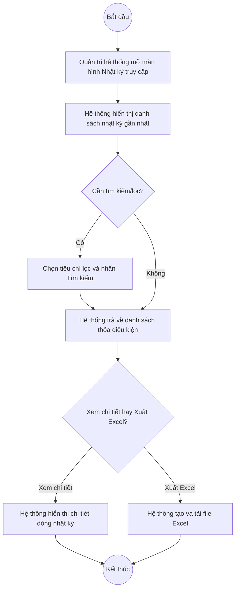

# UC3.3: Nhật ký truy cập hệ thống

## 1. Thông tin chung

| ID | Use case | Description |
| :---- | :---- | :---- |
| UC3.3 | Nhật ký truy cập hệ thống | Quản trị hệ thống tìm kiếm, xem chi tiết và xuất Excel nhật ký truy cập/kiểm tra quyền của người dùng trong hệ thống. |

> **⚠️ Chưa xác định chắc chắn màn hình tương ứng trên hệ thống thật.** Kiểm tra trực tiếp ngày 10/10/2026: menu "Quản trị hệ thống" hiện KHÔNG còn mục nào tên "Nhật ký truy cập". Tuy nhiên, lần khảo sát trước đó (08/10/2026) có ghi nhận một trang "Nhật ký phân quyền" (route `#/vi/authorization-audits`, subtitle "Lịch sử kiểm tra quyền truy cập của người dùng") — nội dung gần nhất với UC-A.III.3 trong toàn bộ hệ thống, nhưng:
> - Trang này **cũng không còn xuất hiện trong menu hiện tại** (đã biến mất cùng lúc với mục "Chính sách phân quyền" — xem ghi chú dưới), nên không kiểm chứng lại được ngày 10/10/2026.
> - Nội dung trang này (log quyết định cho phép/từ chối của từng lời gọi API, kèm chính sách áp dụng, mã phiên dạng GUID, địa chỉ IP) mang tính kỹ thuật/chi tiết hơn nhiều so với mô tả của UC-A.III.3 trong UC_1409 (chỉ nói "tìm kiếm nhật ký truy cập hệ thống", "xuất Excel", "xem chi tiết thông tin truy cập") — **có thể đây là một tính năng khác, không phải UC-A.III.3**, hoặc là phiên bản mở rộng của nó.
>
> Tài liệu này mô tả use case theo UC_1409, đối chiếu tham khảo với trang "Nhật ký phân quyền" đã quan sát được ngày 08/10/2026 ở những điểm hợp lý, nhưng **toàn bộ cần được xác nhận lại** khi tính năng xuất hiện trở lại trên môi trường kiểm thử.
>
> **Ghi chú liên quan:** Hai mục menu "Chính sách phân quyền" và "Nhật ký phân quyền" từng tồn tại ngày 08/10/2026 nhưng không còn trong menu ngày 10/10/2026. Đây là các màn hình nâng cao về kiểm soát truy cập (policy-based) **không có use case tương ứng nào trong UC_1409** — nằm ngoài phạm vi 49 UC của tài liệu yêu cầu, nên không lập tài liệu riêng cho chúng trong bộ tài liệu này; chỉ ghi nhận ở đây để đội dự án biết và xác nhận việc 2 mục này biến mất khỏi menu là chủ đích (tạm ẩn) hay sự cố.

> **Actor:** Quản trị hệ thống
>
> **Trigger:** Quản trị hệ thống chọn menu "Nhật ký truy cập hệ thống" **(tên mục menu chính xác và sự tồn tại hiện tại — chưa xác nhận được, xem ghi chú trên)**
>
> **Điều kiện trước (Pre-condition):** Quản trị hệ thống đã đăng nhập và có quyền xem nhật ký hệ thống
>
> **Điều kiện sau (Post-condition):** Không thay đổi dữ liệu — đây là chức năng chỉ đọc (read-only)
>
> **Business rule:**
>
> BR-1: Màn hình chỉ đọc, không có nút Thêm mới. *(Đã kiểm chứng trực tiếp ngày 08/10/2026 trên trang "Nhật ký phân quyền")*
>
> BR-2: Có thể tìm kiếm/lọc theo nhiều tiêu chí kết hợp: nhóm quyền, hành động, quyết định (cho phép/từ chối), người dùng, khoảng thời gian (ngày bắt đầu → ngày kết thúc). *(Đã kiểm chứng trực tiếp ngày 08/10/2026: 4 dropdown lọc + 1 bộ chọn khoảng ngày + nút Tìm kiếm)*
>
> BR-3: Mỗi dòng nhật ký gồm: Thời gian, Quyết định (Cho phép/Từ chối), Nhóm quyền.Hành động (ví dụ "DTI_PILLAR.DELETE"), Lý do/chính sách áp dụng, Người dùng (quan sát được hiển thị dạng mã định danh/GUID, không phải tên hoặc email), Địa chỉ IP, và một cột bổ sung bị cắt khi chụp màn hình. *(Đã kiểm chứng trực tiếp ngày 08/10/2026)*. **[Cần xác nhận]** cột "Người dùng" hiển thị GUID có đúng là thiết kế cuối cùng không, hay cần hiển thị tên/email người dùng cho dễ tra cứu — UC_1409 mô tả đơn giản là "nhật ký truy cập hệ thống" nên kỳ vọng hiển thị thân thiện hơn.
>
> BR-4: Xuất Excel theo điều kiện tìm kiếm/lọc hiện tại. **[Cần xác nhận]** — UC_1409 có nêu chức năng này nhưng chưa quan sát trực tiếp nút Xuất Excel trên trang đã khảo sát.
>
> BR-5: **[Cần xác nhận]** "Xem chi tiết thông tin truy cập hệ thống" (theo UC_1409) — có phải là mở rộng từng dòng để xem đầy đủ thông tin, hay một màn hình chi tiết riêng.

**Truy vết chức năng**

| STT | Chức năng | YC (BCKTKT) | Dòng UC_1409 | Luồng | Màn hình | BR |
| :---- | :---- | :---- | :---- | :---- | :---- | :---- |
| 1 | Tìm kiếm nhật ký truy cập hệ thống | **[Cần xác nhận]** | **[Cần xác nhận]** | Basic Flow | UI-3.3.1 | BR-2 |
| 2 | Xuất Excel nhật ký truy cập | **[Cần xác nhận]** | **[Cần xác nhận]** | AF1 | UI-3.3.1 | BR-4 |
| 3 | Xem chi tiết thông tin truy cập | **[Cần xác nhận]** | **[Cần xác nhận]** | AF2 | UI-3.3.1 | BR-5 |

> Cột YC (BCKTKT) và Dòng UC_1409 chưa đối chiếu được với bản gốc. Use case nguồn tương ứng: UC-A.III.3 "Nhật ký truy cập hệ thống".

## 2. Mô tả luồng nghiệp vụ

*Hình 1. Luồng nghiệp vụ nhật ký truy cập hệ thống — tham khảo trang "Nhật ký phân quyền" quan sát ngày 08/10/2026*

**Basic Flow**

1. Quản trị hệ thống chọn menu nhật ký truy cập hệ thống.
2. Hệ thống hiển thị màn hình Nhật ký (UI-3.3.1) với danh sách gần nhất, phân trang.
3. Quản trị hệ thống (tùy chọn) nhập/chọn tiêu chí lọc: nhóm quyền, hành động, quyết định, người dùng, khoảng thời gian, rồi nhấn "Tìm kiếm" (BR-2).
4. Hệ thống trả về danh sách thỏa điều kiện.

**Alternative Flow**

AF1. Xuất Excel

Tại UI-3.3.1, Quản trị hệ thống nhấn "Xuất Excel" (nếu có, BR-4). Hệ thống tạo file Excel theo điều kiện lọc hiện tại và tải về máy.

AF2. Xem chi tiết thông tin truy cập

Tại UI-3.3.1, Quản trị hệ thống chọn một dòng để xem chi tiết (BR-5). **[Cần xác nhận]** cơ chế hiển thị.

**Exception Flow**

EF1. Không có kết quả

Tại bước 4, nếu không có dòng nào thỏa điều kiện lọc, bảng hiển thị "Không có dữ liệu" hoặc tương đương. **[Cần xác nhận]** nội dung chính xác.

## 3. Màn hình

| UI Code | Screen | Mô tả |
| :---- | :---- | :---- |
| UI-3.3.1 | Nhật ký truy cập hệ thống (Web) | Tìm kiếm/lọc, bảng nhật ký, (có thể có) xuất Excel. **Tên và sự tồn tại hiện tại của màn hình chưa xác nhận — xem ghi chú mục 1** |

## 4. Mô tả Màn hình (Field Specification)

**UI-3.3.1 — Nhật ký truy cập hệ thống** *(dựng lại tham khảo từ trang "Nhật ký phân quyền" quan sát ngày 08/10/2026 — xem cảnh báo mục 1, cần xác nhận lại toàn bộ)*

| Field Name | Field type | Data Type | Required | Validation rule/Behaviour |
| :---- | :---- | :---- | :---- | :---- |
| Bộ lọc Nhóm quyền | Dropdown | Enum | No | **Behaviour:** Lọc theo nhóm quyền/chức năng **Validation rule:** — |
| Bộ lọc Hành động | Dropdown | Enum | No | **Behaviour:** Lọc theo loại hành động (tạo/sửa/xóa/khóa…) **Validation rule:** — |
| Bộ lọc Quyết định | Dropdown | Enum | No | **Behaviour:** Cho phép / Từ chối **Validation rule:** — |
| Bộ lọc Người dùng | Textbox/Dropdown | String | No | **Behaviour:** Lọc theo người thực hiện **Validation rule:** — |
| Khoảng thời gian | Date range picker | Date | No | **Behaviour:** Ngày bắt đầu → Ngày kết thúc **Validation rule:** — |
| Nút Tìm kiếm | Button | Action | Yes | **Behaviour:** Áp dụng bộ lọc (bước 3–4) **Validation rule:** — |
| Thời gian | Label | Datetime | Yes | **Behaviour:** Thời điểm ghi nhận **Validation rule:** — |
| Quyết định | Badge | Enum | Yes | **Behaviour:** Cho phép (xanh) / Từ chối **Validation rule:** — |
| Hành động | Label | String | Yes | **Behaviour:** Mã nhóm quyền.hành động **Validation rule:** — |
| Lý do / Chính sách | Label | String | No | **Behaviour:** Căn cứ áp dụng quyết định **Validation rule:** — |
| Người dùng | Label | String | Yes | **Behaviour:** **[Cần xác nhận]** hiển thị GUID hay tên/email — bản quan sát 08/10/2026 là GUID **Validation rule:** — |
| Địa chỉ IP | Label | String | Yes | **Behaviour:** — **Validation rule:** — |
| Phân trang | Pagination | Integer | Yes | **Behaviour:** "10 / trang", nhiều trang (quan sát 102 trang ngày 08/10/2026) **Validation rule:** — |

## Điểm cần xác nhận

| STT | Vị trí | Giả định đã dùng | Câu hỏi cần xác nhận |
| :---- | :---- | :---- | :---- |
| 1 | Toàn bộ tài liệu | Trang "Nhật ký phân quyền" (08/10/2026) được dùng làm tham khảo gần nhất, nhưng có thể không phải đúng là UC-A.III.3; trang này hiện cũng không còn trong menu | Đề nghị xác nhận: (a) đây có đúng là UC-A.III.3 không; (b) vì sao trang biến mất khỏi menu — tạm ẩn hay gỡ bỏ |
| 2 | BR-3 | Cột "Người dùng" hiển thị mã GUID thay vì tên | Có cần đổi sang hiển thị tên/email để dễ tra cứu theo đúng tinh thần UC_1409 không? |
| 3 | BR-4 | Chưa quan sát trực tiếp nút Xuất Excel trên trang tham khảo | Xác nhận tính năng này có tồn tại không |
| 4 | Truy vết chức năng | Chưa có số YC (BCKTKT) và Dòng UC_1409 | Đề nghị đối chiếu với bản gốc Google Sheet |
