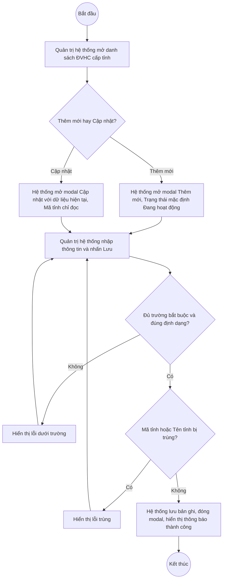
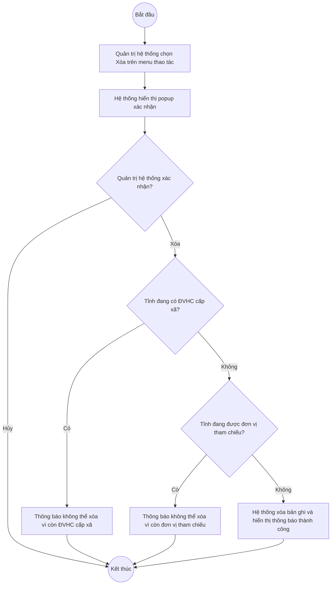

# UC4.1: Quản lý đơn vị hành chính cấp tỉnh

## 1. Thông tin chung

| ID | Use case | Description |
| :---- | :---- | :---- |
| UC4.1 | Quản lý đơn vị hành chính cấp tỉnh | Quản trị hệ thống xem danh sách, tìm kiếm, thêm mới, cập nhật, xem chi tiết, xóa và xuất Excel danh mục ĐVHC cấp tỉnh trên Web Portal. Danh mục này là nguồn để khai báo ĐVHC cấp xã và để tham chiếu đơn vị tới địa bàn tỉnh. |

> **Actor:** Quản trị hệ thống
>
> **Trigger:** Quản trị hệ thống chọn menu "Đơn vị hành chính cấp tỉnh" trong phân hệ Quản trị hệ thống
>
> **Điều kiện trước (Pre-condition):** Quản trị hệ thống đã đăng nhập và có quyền quản lý danh mục ĐVHC cấp tỉnh
>
> **Điều kiện sau (Post-condition):** Bản ghi ĐVHC cấp tỉnh (Mã tỉnh, Tên tỉnh, Trạng thái) được thêm mới, cập nhật hoặc xóa; danh sách hiển thị dữ liệu mới nhất
>
> **Business rule:**
>
> BR-1: Mã tỉnh là duy nhất trong toàn hệ thống, không phân biệt hoa thường, và không cho sửa sau khi tạo. **[Cần xác nhận]**
>
> BR-2: Tên tỉnh là duy nhất trong toàn hệ thống, không phân biệt hoa thường. **[Cần xác nhận]**
>
> BR-3: Trạng thái gồm 2 giá trị: Đang hoạt động, Ngừng hoạt động. Khi thêm mới, mặc định là Đang hoạt động.
>
> BR-4: Chỉ tỉnh Đang hoạt động mới hiển thị trong danh sách chọn tỉnh khi thêm/cập nhật đơn vị và khi thêm/cập nhật ĐVHC cấp xã. Chuyển tỉnh sang Ngừng hoạt động không gỡ tham chiếu của các đơn vị và ĐVHC cấp xã đang gắn với tỉnh đó. **[Cần xác nhận]**
>
> BR-5: Không cho xóa tỉnh đang có từ 1 ĐVHC cấp xã trở lên. *(Chốt ngày 09/10/2026)*
>
> BR-6: Không cho xóa tỉnh đang được từ 1 đơn vị trở lên tham chiếu. **[Cần xác nhận]**
>
> BR-7: Tìm kiếm theo Mã tỉnh hoặc Tên tỉnh, tìm gần đúng, không phân biệt hoa thường; có thể kết hợp với bộ lọc Trạng thái.
>
> BR-8: Xuất Excel gồm toàn bộ bản ghi thỏa điều kiện tìm kiếm/lọc đang áp dụng (không giới hạn theo trang), các cột: STT, Mã tỉnh, Tên tỉnh, Số đơn vị tham chiếu, Số ĐVHC cấp xã, Trạng thái.

**Truy vết chức năng**

| STT | Chức năng | YC (BCKTKT) | Dòng UC_1409 | Luồng | Màn hình | BR |
| :---- | :---- | :---- | :---- | :---- | :---- | :---- |
| 1 | Xem danh sách ĐVHC cấp tỉnh | YC 42 | 60 | Basic Flow bước 1–2 | UI-4.1.1 | — |
| 2 | Thêm mới ĐVHC cấp tỉnh | YC 43 | 61 | Basic Flow bước 3–7; EF1, EF2, EF3 | UI-4.1.2 | BR-1, BR-2, BR-3 |
| 3 | Chỉnh sửa thông tin ĐVHC cấp tỉnh | YC 44 | 62 | AF2; EF1, EF3 | UI-4.1.2 | BR-1, BR-2, BR-4 |
| 4 | Xóa ĐVHC cấp tỉnh | YC 45 | 63 | AF4; EF4, EF5 | UI-4.1.4 | BR-5, BR-6 |
| 5 | Xem thông tin và danh sách đơn vị, ĐVHC cấp xã thuộc tỉnh | — (UC bổ sung) | 64 | AF3 | UI-4.1.3 | — |
| 6 | Tìm kiếm ĐVHC cấp tỉnh | YC 46 | 65 | AF1 | UI-4.1.1 | BR-7 |
| 7 | Xuất Excel danh sách ĐVHC cấp tỉnh | YC 47 | 66 | AF5 | UI-4.1.1 | BR-8 |

## 2. Mô tả luồng nghiệp vụ

**Luồng nghiệp vụ thêm mới / cập nhật ĐVHC cấp tỉnh**

*Hình 1. Luồng nghiệp vụ thêm mới / cập nhật ĐVHC cấp tỉnh*

**Luồng nghiệp vụ xóa ĐVHC cấp tỉnh**

*Hình 2. Luồng nghiệp vụ xóa ĐVHC cấp tỉnh*

**Basic Flow** (Thêm mới ĐVHC cấp tỉnh)

1. Quản trị hệ thống chọn menu "Đơn vị hành chính cấp tỉnh".
2. Hệ thống hiển thị màn hình Danh sách ĐVHC cấp tỉnh (UI-4.1.1), sắp xếp theo Mã tỉnh tăng dần, 10 bản ghi/trang. **[Cần xác nhận]**
3. Quản trị hệ thống nhấn nút "Thêm mới".
4. Hệ thống hiển thị modal Thêm mới ĐVHC cấp tỉnh (UI-4.1.2), Trạng thái mặc định là Đang hoạt động (BR-3).
5. Quản trị hệ thống nhập Mã tỉnh, Tên tỉnh, chọn Trạng thái và nhấn "Lưu".
6. Hệ thống kiểm tra các trường bắt buộc, định dạng và tính duy nhất của Mã tỉnh, Tên tỉnh (BR-1, BR-2).
7. Hệ thống lưu bản ghi, đóng modal, hiển thị thông báo "Thêm mới đơn vị hành chính cấp tỉnh thành công" và tải lại danh sách.

**Alternative Flow**

AF1. Tìm kiếm, lọc danh sách

Tại màn hình danh sách (bước 2), Quản trị hệ thống nhập từ khóa vào ô tìm kiếm và/hoặc chọn bộ lọc Trạng thái. Hệ thống trả về danh sách thỏa điều kiện (BR-7) và đưa phân trang về trang 1. Không có kết quả thì bảng hiển thị "Không có dữ liệu". Use case kết thúc.

AF2. Cập nhật ĐVHC cấp tỉnh

Tại màn hình danh sách (bước 2), Quản trị hệ thống mở menu thao tác của một dòng (hoặc nhấn "Cập nhật" tại màn hình chi tiết UI-4.1.3) và chọn "Cập nhật". Hệ thống hiển thị modal Cập nhật (UI-4.1.2) với dữ liệu hiện tại, Mã tỉnh ở chế độ chỉ đọc (BR-1). Quản trị hệ thống sửa Tên tỉnh và/hoặc Trạng thái rồi nhấn "Lưu". Hệ thống kiểm tra như bước 6, lưu và hiển thị thông báo "Cập nhật đơn vị hành chính cấp tỉnh thành công". Nếu Trạng thái chuyển sang Ngừng hoạt động, áp dụng BR-4. Use case kết thúc.

AF3. Xem chi tiết ĐVHC cấp tỉnh

Tại màn hình danh sách (bước 2), Quản trị hệ thống nhấn "Xem chi tiết" trên một dòng. Hệ thống hiển thị màn hình Chi tiết ĐVHC cấp tỉnh (UI-4.1.3), gồm thông tin chung của tỉnh, tab "Đơn vị tham chiếu" và tab "ĐVHC cấp xã". Use case kết thúc.

AF4. Xóa ĐVHC cấp tỉnh

Tại màn hình danh sách (bước 2), Quản trị hệ thống mở menu thao tác của một dòng và chọn "Xóa". Hệ thống hiển thị popup xác nhận (UI-4.1.4). Quản trị hệ thống nhấn "Xóa". Hệ thống kiểm tra BR-5, BR-6; nếu hợp lệ thì xóa bản ghi, hiển thị thông báo "Xóa đơn vị hành chính cấp tỉnh thành công" và tải lại danh sách. Use case kết thúc.

AF5. Xuất Excel

Tại màn hình danh sách (bước 2), Quản trị hệ thống nhấn "Xuất Excel". Hệ thống tạo file Excel theo BR-8 và tải về máy. Use case kết thúc.

AF6. Hủy thao tác

Khi đang ở modal hoặc popup (bước 5, AF2, AF4), Quản trị hệ thống nhấn "Hủy" hoặc biểu tượng đóng. Hệ thống đóng modal/popup, không lưu thay đổi. Quay lại bước 2.

**Exception Flow**

EF1. Thiếu trường bắt buộc hoặc sai định dạng

Tại bước 6, nếu thiếu trường bắt buộc hoặc sai định dạng, Hệ thống hiển thị lỗi ngay dưới trường tương ứng, ví dụ "Vui lòng nhập Mã tỉnh", "Vui lòng nhập Tên tỉnh".

Quay lại bước 5.

EF2. Mã tỉnh đã tồn tại

Tại bước 6, nếu Mã tỉnh đã tồn tại, Hệ thống hiển thị thông báo "Mã tỉnh đã tồn tại" dưới trường Mã tỉnh.

Quay lại bước 5.

EF3. Tên tỉnh đã tồn tại

Tại bước 6 hoặc AF2, nếu Tên tỉnh đã tồn tại, Hệ thống hiển thị thông báo "Tên tỉnh đã tồn tại" dưới trường Tên tỉnh.

Quay lại bước 5.

EF4. Xóa tỉnh đang có ĐVHC cấp xã

Khi xóa (AF4), nếu tỉnh đang có ĐVHC cấp xã, Hệ thống hiển thị thông báo "Không thể xóa vì tỉnh đang có đơn vị hành chính cấp xã. Vui lòng xóa hoặc chuyển các ĐVHC cấp xã trước." (BR-5).

Hệ thống không xóa bản ghi. Use case kết thúc.

EF5. Xóa tỉnh đang được đơn vị tham chiếu

Khi xóa (AF4), nếu tỉnh đang được đơn vị tham chiếu, Hệ thống hiển thị thông báo "Không thể xóa vì tỉnh đang được đơn vị tham chiếu. Vui lòng bỏ tham chiếu của các đơn vị trước." (BR-6).

Hệ thống không xóa bản ghi. Use case kết thúc.

EF6. Lỗi hệ thống khi lưu, xóa hoặc xuất Excel

Hệ thống hiển thị thông báo "Đã có lỗi xảy ra, vui lòng thử lại sau." và giữ nguyên dữ liệu trước thao tác.

Use case kết thúc.

## 3. Màn hình

| UI Code | Screen | Mô tả |
| :---- | :---- | :---- |
| UI-4.1.1 | Danh sách ĐVHC cấp tỉnh (Web) | Tìm kiếm, lọc, bảng danh sách tỉnh, nút Thêm mới, Xuất Excel, menu thao tác từng dòng |
| UI-4.1.2 | Modal Thêm mới / Cập nhật ĐVHC cấp tỉnh (Web) | Nhập Mã tỉnh, Tên tỉnh, Trạng thái |
| UI-4.1.3 | Chi tiết ĐVHC cấp tỉnh (Web) | Thông tin chung của tỉnh, danh sách đơn vị tham chiếu và danh sách ĐVHC cấp xã thuộc tỉnh |
| UI-4.1.4 | Popup xác nhận xóa (Web) | Xác nhận trước khi xóa tỉnh |

## 4. Mô tả Màn hình (Field Specification)

**UI-4.1.1 — Danh sách ĐVHC cấp tỉnh**

| Field Name | Field type | Data Type | Required | Validation rule/Behaviour |
| :---- | :---- | :---- | :---- | :---- |
| Tìm kiếm | Search box | String | No | **Behaviour:** Placeholder "Tìm theo mã, tên tỉnh…". Tìm theo BR-7 **Validation rule:** Tối đa 255 ký tự; tự bỏ khoảng trắng đầu/cuối |
| Trạng thái | Dropdown | Enum | No | **Behaviour:** Giá trị: Tất cả trạng thái (mặc định), Đang hoạt động, Ngừng hoạt động **Validation rule:** Chọn 1 giá trị |
| Nút Xuất Excel | Button | Action | Yes | **Behaviour:** Xuất danh sách theo BR-8 (AF5) **Validation rule:** Luôn hiển thị; nếu danh sách rỗng vẫn xuất file chỉ có dòng tiêu đề **[Cần xác nhận]** |
| Nút Thêm mới | Button | Action | Yes | **Behaviour:** Mở modal UI-4.1.2 ở chế độ Thêm mới **Validation rule:** Luôn hiển thị với Quản trị hệ thống |
| STT | Label | Integer | Yes | **Behaviour:** Số thứ tự liên tục theo trang **Validation rule:** Tự sinh |
| Mã tỉnh | Label | String | Yes | **Behaviour:** Hiển thị mã tỉnh **Validation rule:** — |
| Tên tỉnh | Label | String | Yes | **Behaviour:** Hiển thị tên tỉnh **Validation rule:** — |
| Số đơn vị tham chiếu | Label | Integer | Yes | **Behaviour:** Số đơn vị đang tham chiếu tới tỉnh **[Cần xác nhận]** **Validation rule:** ≥ 0 |
| Số ĐVHC cấp xã | Label | Integer | Yes | **Behaviour:** Số ĐVHC cấp xã thuộc tỉnh **[Cần xác nhận]** **Validation rule:** ≥ 0 |
| Trạng thái | Badge/Tag | Enum | Yes | **Behaviour:** Đang hoạt động (xanh lá), Ngừng hoạt động (xám) **Validation rule:** Theo BR-3 |
| Xem chi tiết | Link | Action | Yes | **Behaviour:** Mở màn hình UI-4.1.3 (AF3) **Validation rule:** — |
| Menu thao tác | Icon button | Action | Yes | **Behaviour:** Mở menu gồm: Cập nhật (AF2), Xóa (AF4) **Validation rule:** — |
| Phân trang | Pagination | Integer | Yes | **Behaviour:** Theo mục 3.0 Chuẩn UI/UX **Validation rule:** — |

**UI-4.1.2 — Modal Thêm mới / Cập nhật ĐVHC cấp tỉnh**

| Field Name | Field type | Data Type | Required | Validation rule/Behaviour |
| :---- | :---- | :---- | :---- | :---- |
| Tiêu đề modal | Label | String | Yes | **Behaviour:** "Thêm mới đơn vị hành chính cấp tỉnh" hoặc "Cập nhật đơn vị hành chính cấp tỉnh" **Validation rule:** — |
| Mã tỉnh | Textbox | String | Yes | **Behaviour:** Placeholder "Ví dụ: 01". Ở chế độ Cập nhật hiển thị chỉ đọc (BR-1) **Validation rule:** Bắt buộc; tối đa 20 ký tự; chỉ gồm chữ không dấu, số, "-", "_"; duy nhất (BR-1). **[Cần xác nhận]** Lỗi: "Vui lòng nhập Mã tỉnh", "Mã tỉnh đã tồn tại" |
| Tên tỉnh | Textbox | String | Yes | **Behaviour:** Placeholder "Ví dụ: Thành phố Hà Nội" **Validation rule:** Bắt buộc; tối đa 255 ký tự; tự bỏ khoảng trắng đầu/cuối; duy nhất (BR-2). Lỗi: "Vui lòng nhập Tên tỉnh", "Tên tỉnh đã tồn tại" |
| Trạng thái | Dropdown | Enum | Yes | **Behaviour:** Giá trị: Đang hoạt động, Ngừng hoạt động; mặc định Đang hoạt động khi thêm mới (BR-3) **Validation rule:** Bắt buộc. *Trường này hiện đang thiếu trên form (QC Fail – UC_1409 dòng 61–62)* |
| Nút Hủy | Button | Action | Yes | **Behaviour:** Đóng modal, không lưu (AF6) **Validation rule:** — |
| Nút Lưu | Button | Action | Yes | **Behaviour:** Kiểm tra và lưu bản ghi (bước 6–7, AF2) **Validation rule:** Chặn nhấn lặp trong khi đang xử lý |

**UI-4.1.3 — Chi tiết ĐVHC cấp tỉnh**

| Field Name | Field type | Data Type | Required | Validation rule/Behaviour |
| :---- | :---- | :---- | :---- | :---- |
| Mã tỉnh | Label | String | Yes | **Behaviour:** Hiển thị mã tỉnh **Validation rule:** — |
| Tên tỉnh | Label | String | Yes | **Behaviour:** Hiển thị tên tỉnh **Validation rule:** — |
| Trạng thái | Badge/Tag | Enum | Yes | **Behaviour:** Như UI-4.1.1 **Validation rule:** — |
| Tab Đơn vị tham chiếu | Tab | List | Yes | **Behaviour:** Bảng các đơn vị đang tham chiếu tới tỉnh, cột: STT, Mã đơn vị, Tên đơn vị, Loại đơn vị, ĐVHC cấp xã, Trạng thái. Đơn vị chưa chọn xã hiển thị "Chưa tham chiếu" ở cột ĐVHC cấp xã **Validation rule:** Không có dữ liệu thì hiển thị "Không có dữ liệu"; phân trang theo mục 3.0 |
| Tab ĐVHC cấp xã | Tab | List | Yes | **Behaviour:** Bảng các ĐVHC cấp xã thuộc tỉnh, cột: STT, Mã xã, Tên xã, Trạng thái *(Chốt ngày 09/10/2026)* **Validation rule:** Không có dữ liệu thì hiển thị "Không có dữ liệu"; phân trang theo mục 3.0 |
| Nút Cập nhật | Button | Action | Yes | **Behaviour:** Mở modal UI-4.1.2 ở chế độ Cập nhật (AF2) **Validation rule:** — |
| Nút Quay lại | Button | Action | Yes | **Behaviour:** Quay về UI-4.1.1, giữ nguyên điều kiện tìm kiếm/lọc trước đó **Validation rule:** — |

**UI-4.1.4 — Popup xác nhận xóa**

| Field Name | Field type | Data Type | Required | Validation rule/Behaviour |
| :---- | :---- | :---- | :---- | :---- |
| Nội dung xác nhận | Label | String | Yes | **Behaviour:** "Bạn có chắc chắn muốn xóa đơn vị hành chính cấp tỉnh <Tên tỉnh>?" **Validation rule:** — |
| Nút Hủy | Button | Action | Yes | **Behaviour:** Đóng popup, không xóa (AF6) **Validation rule:** — |
| Nút Xóa | Button | Action | Yes | **Behaviour:** Kiểm tra BR-5, BR-6 rồi xóa (AF4) **Validation rule:** Vi phạm BR-5/BR-6 thì hiển thị EF4/EF5 |

## Điểm cần xác nhận

| STT | Vị trí | Giả định đã dùng | Câu hỏi cần xác nhận |
| :---- | :---- | :---- | :---- |
| 1 | BR-1 | Mã tỉnh duy nhất, không sửa sau khi tạo | Có cho sửa Mã tỉnh không? Nếu có thì xử lý dữ liệu đang tham chiếu thế nào? |
| 2 | BR-2 | Tên tỉnh duy nhất | Có cho trùng tên tỉnh không? (Gợi ý: không cho trùng) |
| 3 | BR-4 | Tỉnh Ngừng hoạt động bị ẩn khỏi danh sách chọn, tham chiếu cũ vẫn giữ | Đồng ý? Hay khi ngừng hoạt động phải chặn nếu còn đơn vị/xã đang gắn? |
| 4 | BR-6 | Không cho xóa tỉnh đang được đơn vị tham chiếu | Đồng ý chặn xóa? Phương án khác: cho xóa và tự gỡ tham chiếu của đơn vị |
| 5 | Basic Flow bước 2 | Sắp xếp theo Mã tỉnh tăng dần | Thứ tự hiển thị mặc định là theo Mã hay theo Tên? |
| 6 | UI-4.1.1 – cột Số đơn vị tham chiếu, Số ĐVHC cấp xã | Thêm 2 cột số lượng để Quản trị biết trước tỉnh nào không xóa được | Có cần 2 cột này không? |
| 7 | UI-4.1.1 – Nút Xuất Excel | Danh sách rỗng vẫn xuất file chỉ có tiêu đề | Hay ẩn/disable nút khi không có dữ liệu? |
| 8 | UI-4.1.2 – Mã tỉnh | Tối đa 20 ký tự, chữ không dấu, số, "-", "_" | Mã tỉnh có theo mã ĐVHC chuẩn của Nhà nước (2 chữ số) không? |
