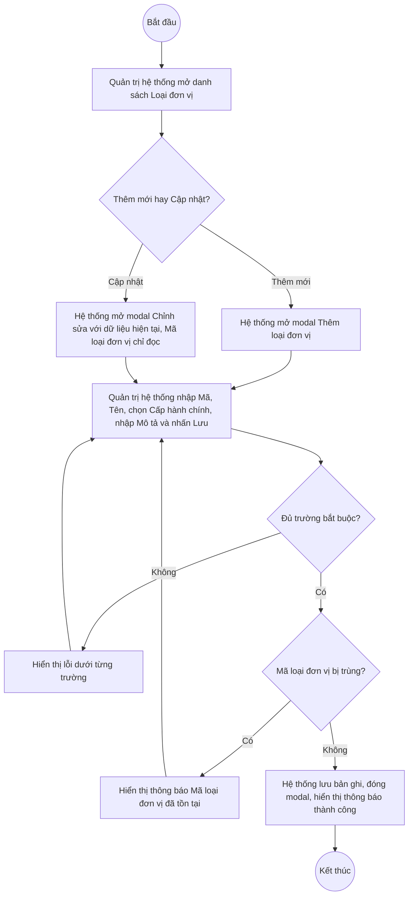
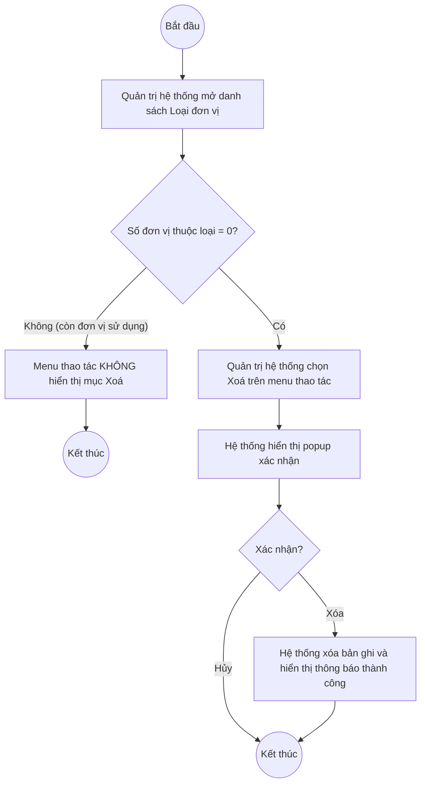

# UC4.2: Quản lý loại đơn vị

## 1. Thông tin chung

| ID | Use case | Description |
| :---- | :---- | :---- |
| UC4.2 | Quản lý loại đơn vị | Quản trị hệ thống xem danh sách, tìm kiếm, thêm mới, cập nhật, xem chi tiết, xóa và xuất Excel danh mục Loại đơn vị (phân loại đơn vị theo cấp hành chính) trên Web Portal. Danh mục này là nguồn để khai báo Loại đơn vị khi thêm/cập nhật Đơn vị (UC4.3). |

> **Actor:** Quản trị hệ thống
>
> **Trigger:** Quản trị hệ thống chọn menu "Loại đơn vị" trong phân hệ Quản trị hệ thống
>
> **Điều kiện trước (Pre-condition):** Quản trị hệ thống đã đăng nhập và có quyền quản lý danh mục Loại đơn vị
>
> **Điều kiện sau (Post-condition):** Bản ghi Loại đơn vị (Mã loại đơn vị, Tên loại đơn vị, Cấp hành chính, Mô tả) được thêm mới, cập nhật hoặc xóa; danh sách hiển thị dữ liệu mới nhất
>
> **Business rule:**
>
> BR-1: Mã loại đơn vị là duy nhất trong toàn hệ thống và không cho sửa sau khi tạo. *(Đã kiểm chứng trực tiếp trên hệ thống ngày 10/10/2026: tạo trùng "Mã loại đơn vị" trả về lỗi "Mã loại đơn vị đã tồn tại"; ở chế độ Cập nhật, trường Mã loại đơn vị hiển thị chỉ đọc)*
>
> BR-2: Tên loại đơn vị là bắt buộc. **[Cần xác nhận]** có cho phép trùng Tên loại đơn vị giữa các bản ghi khác Mã hay không — chưa thử nghiệm được tình huống này.
>
> BR-3: Cấp hành chính là trường bắt buộc khi thêm mới/cập nhật, gồm các giá trị quan sát được trong dữ liệu mẫu: Trung ương, Cấp tỉnh, Cấp xã. **[Cần xác nhận]** danh sách đầy đủ và nhãn hiển thị chính xác của các giá trị Cấp hành chính (chưa mở được dropdown lọc để liệt kê hết).
>
> BR-4: Không cho xóa loại đơn vị đang có từ 1 đơn vị trở lên đang sử dụng (cột "SỐ ĐƠN VỊ" > 0). *(Đã kiểm chứng trực tiếp ngày 10/10/2026: với loại đơn vị có Số đơn vị = 2, menu thao tác của dòng chỉ còn "Cập nhật", mục "Xoá" không xuất hiện; với loại đơn vị có Số đơn vị = 0, menu thao tác có cả "Cập nhật" và "Xoá")* — đây là chặn ở tầng giao diện (ẩn nút), khác với UC4.1 (chặn sau khi xác nhận xóa).
>
> BR-5: Tìm kiếm theo Mã loại đơn vị hoặc Tên loại đơn vị, tìm gần đúng, không phân biệt hoa thường; có thể kết hợp với bộ lọc Cấp hành chính.
>
> BR-6: Xuất Excel gồm toàn bộ bản ghi thỏa điều kiện tìm kiếm/lọc đang áp dụng (không giới hạn theo trang). *(Đã kiểm chứng xuất file thành công ngày 08/10/2026, tên file dạng "loai-don-vi-YYYYMMDD.xlsx")*. **[Cần xác nhận]** danh sách cột chính xác trong file xuất.
>
> BR-7: Loại đơn vị không có thao tác Khóa/Mở khóa. *(Đã kiểm chứng: menu thao tác chỉ gồm Cập nhật, Xoá — không có mục Khóa)*

**Ghi nhận QC (10/10/2026):** Nút "Xem chi tiết" trên danh sách hiện **không mở được** panel chi tiết (không có phản hồi khi bấm, không phát sinh lỗi console) — khác với ghi nhận trước đó ngày 08/10/2026 khi panel chi tiết còn hoạt động bình thường (xem mô tả UI-4.2.3 bên dưới, dựng lại từ ảnh chụp màn hình ngày 08/10/2026). Nghi vấn lỗi hồi quy (regression), **cần dev xác nhận và sửa lại** trước khi đưa tài liệu này vào kiểm thử chấp nhận.

**Truy vết chức năng**

| STT | Chức năng | YC (BCKTKT) | Dòng UC_1409 | Luồng | Màn hình | BR |
| :---- | :---- | :---- | :---- | :---- | :---- | :---- |
| 1 | Xem danh sách Loại đơn vị | **[Cần xác nhận]** | **[Cần xác nhận]** | Basic Flow bước 1–2 | UI-4.2.1 | — |
| 2 | Thêm mới Loại đơn vị | **[Cần xác nhận]** | **[Cần xác nhận]** | Basic Flow bước 3–7; EF1, EF2 | UI-4.2.2 | BR-1, BR-2, BR-3 |
| 3 | Chỉnh sửa thông tin Loại đơn vị | **[Cần xác nhận]** | **[Cần xác nhận]** | AF2; EF1, EF2 | UI-4.2.2 | BR-1, BR-2, BR-3 |
| 4 | Xóa Loại đơn vị | **[Cần xác nhận]** | **[Cần xác nhận]** | AF4 | UI-4.2.4 | BR-4 |
| 5 | Xem chi tiết và danh sách đơn vị thuộc loại | **[Cần xác nhận]** | **[Cần xác nhận]** | AF3 | UI-4.2.3 | — |
| 6 | Tìm kiếm Loại đơn vị | **[Cần xác nhận]** | **[Cần xác nhận]** | AF1 | UI-4.2.1 | BR-5 |
| 7 | Xuất Excel danh sách Loại đơn vị | **[Cần xác nhận]** | **[Cần xác nhận]** | AF5 | UI-4.2.1 | BR-6 |

> Cột YC (BCKTKT) và Dòng UC_1409 chưa đối chiếu được với bản gốc (Google Sheet "Danh sách công việc_CĐS - BCT") — tài liệu làm việc hiện có (`UC_1409_Requirement.md`) không giữ số dòng gốc. Use case nguồn tương ứng: UC-A.IV.2 "Quản lý loại đơn vị".

## 2. Mô tả luồng nghiệp vụ

**Luồng nghiệp vụ thêm mới / cập nhật Loại đơn vị**

*Hình 1. Luồng nghiệp vụ thêm mới / cập nhật Loại đơn vị*

**Luồng nghiệp vụ xóa Loại đơn vị**

*Hình 2. Luồng nghiệp vụ xóa Loại đơn vị*

**Basic Flow** (Thêm mới Loại đơn vị)

1. Quản trị hệ thống chọn menu "Loại đơn vị".
2. Hệ thống hiển thị màn hình Danh sách Loại đơn vị (UI-4.2.1), 10 bản ghi/trang. **[Cần xác nhận]** thứ tự sắp xếp mặc định.
3. Quản trị hệ thống nhấn nút "Thêm loại đơn vị".
4. Hệ thống hiển thị modal Thêm loại đơn vị (UI-4.2.2).
5. Quản trị hệ thống nhập Mã loại đơn vị, Tên loại đơn vị, chọn Cấp hành chính, nhập Mô tả (tùy chọn) và nhấn "Thêm loại đơn vị".
6. Hệ thống kiểm tra các trường bắt buộc và tính duy nhất của Mã loại đơn vị (BR-1, BR-3).
7. Hệ thống lưu bản ghi, đóng modal, hiển thị thông báo "Thêm loại đơn vị thành công" và tải lại danh sách.

**Alternative Flow**

AF1. Tìm kiếm, lọc danh sách

Tại màn hình danh sách (bước 2), Quản trị hệ thống nhập từ khóa vào ô tìm kiếm và/hoặc chọn bộ lọc Cấp hành chính. Hệ thống trả về danh sách thỏa điều kiện (BR-5). Use case kết thúc.

AF2. Cập nhật Loại đơn vị

Tại màn hình danh sách (bước 2), Quản trị hệ thống mở menu thao tác của một dòng và chọn "Cập nhật". Hệ thống hiển thị modal Chỉnh sửa loại đơn vị (UI-4.2.2) với dữ liệu hiện tại, Mã loại đơn vị ở chế độ chỉ đọc (BR-1). Quản trị hệ thống sửa Tên loại đơn vị, Cấp hành chính và/hoặc Mô tả rồi nhấn "Lưu thay đổi". Hệ thống kiểm tra như bước 6, lưu và hiển thị thông báo "Cập nhật loại đơn vị thành công". Use case kết thúc.

AF3. Xem chi tiết Loại đơn vị

Tại màn hình danh sách (bước 2), Quản trị hệ thống nhấn "Xem chi tiết" trên một dòng. Hệ thống hiển thị panel Chi tiết Loại đơn vị (UI-4.2.3), gồm thông tin chung và danh sách đơn vị thuộc loại. **Hiện không hoạt động — xem Ghi nhận QC ở mục 1.** Use case kết thúc.

AF4. Xóa Loại đơn vị

Tại màn hình danh sách (bước 2), nếu Số đơn vị thuộc loại = 0 (BR-4), Quản trị hệ thống mở menu thao tác của dòng và chọn "Xóa". Hệ thống hiển thị popup xác nhận (UI-4.2.4). Quản trị hệ thống nhấn "Xóa". Hệ thống xóa bản ghi, hiển thị thông báo "Xóa loại đơn vị thành công" và tải lại danh sách. Use case kết thúc.

AF5. Xuất Excel

Tại màn hình danh sách (bước 2), Quản trị hệ thống nhấn "Xuất Excel". Hệ thống tạo file Excel theo BR-6 và tải về máy. Use case kết thúc.

AF6. Hủy thao tác

Khi đang ở modal hoặc popup (bước 5, AF2, AF4), Quản trị hệ thống nhấn "Huỷ" hoặc biểu tượng đóng. Hệ thống đóng modal/popup, không lưu thay đổi. Quay lại bước 2.

**Exception Flow**

EF1. Thiếu trường bắt buộc

Tại bước 6, nếu thiếu trường bắt buộc, Hệ thống hiển thị lỗi ngay dưới trường tương ứng: "Vui lòng nhập mã loại đơn vị", "Vui lòng nhập tên loại đơn vị", "Vui lòng chọn cấp hành chính". *(Thông điệp đã kiểm chứng trực tiếp ngày 10/10/2026)*

Quay lại bước 5.

EF2. Mã loại đơn vị đã tồn tại

Tại bước 6 hoặc AF2, nếu Mã loại đơn vị đã tồn tại, Hệ thống trả về lỗi "Mã loại đơn vị đã tồn tại" (HTTP 400). *(Đã kiểm chứng trực tiếp ngày 10/10/2026 qua API; **[Cần xác nhận]** vị trí hiển thị cụ thể trên giao diện — toast hay lỗi dưới trường, chưa quan sát được do thời gian hiển thị quá nhanh)*

Quay lại bước 5.

EF3. Lỗi hệ thống khi lưu hoặc xóa

Hệ thống hiển thị thông báo lỗi chung và giữ nguyên dữ liệu trước thao tác. **[Cần xác nhận]** nội dung thông báo cụ thể.

Use case kết thúc.

## 3. Màn hình

| UI Code | Screen | Mô tả |
| :---- | :---- | :---- |
| UI-4.2.1 | Danh sách Loại đơn vị (Web) | Tìm kiếm, lọc theo Cấp hành chính, bảng danh sách, nút Thêm loại đơn vị, Xuất Excel, menu thao tác từng dòng |
| UI-4.2.2 | Modal Thêm mới / Cập nhật Loại đơn vị (Web) | Nhập Mã loại đơn vị, Tên loại đơn vị, Cấp hành chính, Mô tả |
| UI-4.2.3 | Chi tiết Loại đơn vị (Web, panel) | Thông tin chung của loại đơn vị và danh sách đơn vị thuộc loại. **Hiện không mở được (QC, 10/10/2026)** — nội dung dựng lại từ ảnh chụp màn hình ngày 08/10/2026 |
| UI-4.2.4 | Popup xác nhận xóa (Web) | Xác nhận trước khi xóa loại đơn vị |

## 4. Mô tả Màn hình (Field Specification)

**UI-4.2.1 — Danh sách Loại đơn vị**

| Field Name | Field type | Data Type | Required | Validation rule/Behaviour |
| :---- | :---- | :---- | :---- | :---- |
| Tìm kiếm | Search box | String | No | **Behaviour:** Placeholder "Tìm theo mã, tên loại đơn vị…". Tìm theo BR-5 **Validation rule:** **[Cần xác nhận]** độ dài tối đa |
| Cấp hành chính | Dropdown | Enum | No | **Behaviour:** Placeholder "Tất cả cấp"; lọc theo BR-3 **Validation rule:** Chọn 1 giá trị |
| Nút Xuất Excel | Button | Action | Yes | **Behaviour:** Xuất danh sách theo BR-6 (AF5) **Validation rule:** Luôn hiển thị |
| Nút Thêm loại đơn vị | Button | Action | Yes | **Behaviour:** Mở modal UI-4.2.2 ở chế độ Thêm mới **Validation rule:** Luôn hiển thị với Quản trị hệ thống |
| STT | Label | Integer | Yes | **Behaviour:** Số thứ tự liên tục theo trang **Validation rule:** Tự sinh |
| Mã loại đơn vị | Label | String | Yes | **Behaviour:** Hiển thị mã loại đơn vị **Validation rule:** — |
| Tên loại đơn vị | Label | String | Yes | **Behaviour:** Hiển thị tên loại đơn vị **Validation rule:** — |
| Cấp (Cấp hành chính) | Label | Enum | Yes | **Behaviour:** Trung ương / Cấp tỉnh / Cấp xã (BR-3) **Validation rule:** — |
| Số đơn vị | Label | Integer | Yes | **Behaviour:** Số đơn vị (Đơn vị, UC4.3) đang gắn loại này; quyết định việc hiển thị nút Xóa (BR-4) **Validation rule:** ≥ 0 |
| Xem chi tiết | Link | Action | Yes | **Behaviour:** Mở panel UI-4.2.3 (AF3) **Validation rule:** — |
| Menu thao tác | Icon button | Action | Yes | **Behaviour:** Mở menu gồm: Cập nhật (AF2); mục Xóa (AF4) chỉ xuất hiện khi Số đơn vị = 0 (BR-4) **Validation rule:** — |
| Phân trang | Pagination | Integer | Yes | **Behaviour:** "10 / trang" **[Cần xác nhận]** các tùy chọn khác **Validation rule:** — |

**UI-4.2.2 — Modal Thêm mới / Cập nhật Loại đơn vị**

| Field Name | Field type | Data Type | Required | Validation rule/Behaviour |
| :---- | :---- | :---- | :---- | :---- |
| Tiêu đề modal | Label | String | Yes | **Behaviour:** "Thêm loại đơn vị" hoặc "Chỉnh sửa loại đơn vị", phụ đề "Phân loại đơn vị theo cấp hành chính" **Validation rule:** — |
| Mã loại đơn vị | Textbox | String | Yes | **Behaviour:** Ở chế độ Cập nhật hiển thị chỉ đọc (BR-1) **Validation rule:** Bắt buộc; duy nhất (BR-1). Lỗi: "Vui lòng nhập mã loại đơn vị", "Mã loại đơn vị đã tồn tại". **[Cần xác nhận]** độ dài tối đa, định dạng ký tự cho phép |
| Tên loại đơn vị | Textbox | String | Yes | **Behaviour:** — **Validation rule:** Bắt buộc. Lỗi: "Vui lòng nhập tên loại đơn vị". **[Cần xác nhận]** độ dài tối đa, tính duy nhất (BR-2) |
| Cấp hành chính | Dropdown | Enum | Yes | **Behaviour:** Giá trị: Trung ương, Cấp tỉnh, Cấp xã (BR-3); không có lựa chọn mặc định **Validation rule:** Bắt buộc. Lỗi: "Vui lòng chọn cấp hành chính" |
| Mô tả | Textarea | String | No | **Behaviour:** Placeholder "Mô tả chi tiết loại đơn vị…" **Validation rule:** **[Cần xác nhận]** độ dài tối đa |
| Nút Huỷ | Button | Action | Yes | **Behaviour:** Đóng modal, không lưu (AF6) **Validation rule:** — |
| Nút Thêm loại đơn vị / Lưu thay đổi | Button | Action | Yes | **Behaviour:** Kiểm tra và lưu bản ghi (bước 6–7, AF2) **Validation rule:** Footer modal có ghi chú "* Trường bắt buộc" |

**UI-4.2.3 — Chi tiết Loại đơn vị** *(dựng lại từ ảnh chụp màn hình ngày 08/10/2026 — hiện không mở được, xem Ghi nhận QC mục 1)*

| Field Name | Field type | Data Type | Required | Validation rule/Behaviour |
| :---- | :---- | :---- | :---- | :---- |
| Mã loại / Cấp hành chính | Label/Badge | String | Yes | **Behaviour:** Hiển thị ở đầu panel cùng Tên loại đơn vị **Validation rule:** — |
| Mô tả, Ngày tạo, Người tạo, Cập nhật lần cuối, Số đơn vị | Label | String/Date/Integer | Yes | **Behaviour:** Thông tin chung của loại đơn vị **Validation rule:** — |
| Tìm đơn vị trong loại này | Search box | String | No | **Behaviour:** Lọc danh sách đơn vị thuộc loại ngay trong panel **Validation rule:** — |
| Danh sách Đơn vị thuộc loại | List | List | Yes | **Behaviour:** "Chưa có đơn vị nào thuộc loại này" khi rỗng; có liên kết "Xem tất cả tại màn Đơn vị" **Validation rule:** — |
| Nút Cập nhật | Button | Action | Yes | **Behaviour:** Mở modal UI-4.2.2 ở chế độ Cập nhật **Validation rule:** — |
| Nút Đóng | Button | Action | Yes | **Behaviour:** Đóng panel, quay về UI-4.2.1 **Validation rule:** — |

**UI-4.2.4 — Popup xác nhận xóa**

| Field Name | Field type | Data Type | Required | Validation rule/Behaviour |
| :---- | :---- | :---- | :---- | :---- |
| Nội dung xác nhận | Label | String | Yes | **Behaviour:** **[Cần xác nhận]** nội dung chính xác (chưa thực hiện thao tác xóa thật để tránh ảnh hưởng dữ liệu) **Validation rule:** — |
| Nút Hủy | Button | Action | Yes | **Behaviour:** Đóng popup, không xóa (AF6) **Validation rule:** — |
| Nút Xóa | Button | Action | Yes | **Behaviour:** Xóa bản ghi (AF4); chỉ khả dụng khi Số đơn vị = 0 (BR-4) **Validation rule:** — |

## Điểm cần xác nhận

| STT | Vị trí | Giả định đã dùng | Câu hỏi cần xác nhận |
| :---- | :---- | :---- | :---- |
| 1 | Mục 1 – Ghi nhận QC | Nút "Xem chi tiết" không phản hồi khi bấm (kiểm chứng ngày 10/10/2026) | Đây có phải lỗi hồi quy mới phát sinh so với 08/10/2026 không? Cần dev xác nhận và khắc phục |
| 2 | BR-2 | Tên loại đơn vị không bắt buộc duy nhất | Có cho phép 2 loại đơn vị trùng tên không? |
| 3 | BR-3 | Cấp hành chính gồm 3 giá trị: Trung ương, Cấp tỉnh, Cấp xã | Danh sách này đã đầy đủ chưa, có cấp nào khác không (ví dụ cấp huyện)? |
| 4 | Truy vết chức năng | Chưa có số YC (BCKTKT) và Dòng UC_1409 | Đề nghị đối chiếu với bản gốc Google Sheet "Danh sách công việc_CĐS - BCT" để điền số liệu chính xác |
| 5 | UI-4.2.2 – Mã loại đơn vị, Tên loại đơn vị, Mô tả | Chưa rõ độ dài tối đa và định dạng ký tự cho phép | Cần quy định cụ thể để ràng buộc validation phía client |
| 6 | UI-4.2.4 | Chưa xác minh nội dung thông báo xác nhận xóa | Đề nghị xác nhận nội dung chính xác khi có môi trường test an toàn (không ảnh hưởng dữ liệu thật) |
