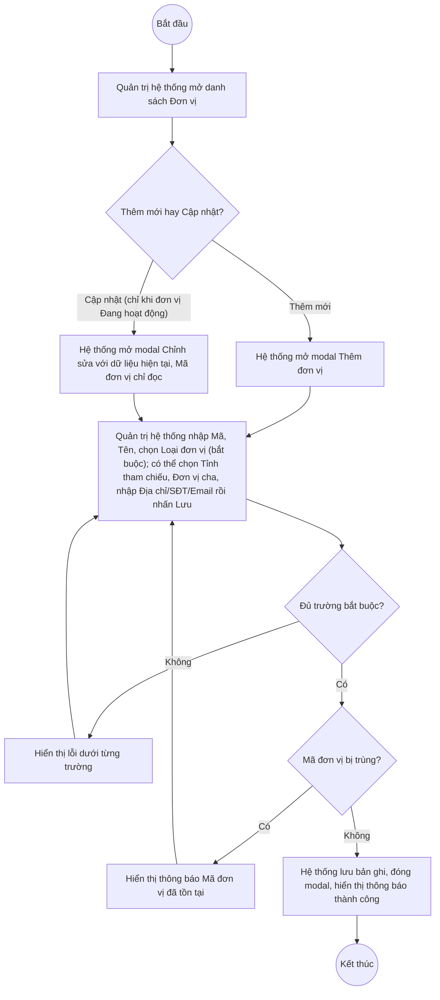
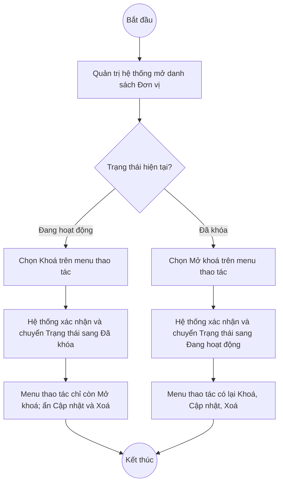

# UC4.3: Quản lý đơn vị

## 1. Thông tin chung

| ID | Use case | Description |
| :---- | :---- | :---- |
| UC4.3 | Quản lý đơn vị | Quản trị hệ thống xem danh sách, tìm kiếm, thêm mới, cập nhật, xem chi tiết, khóa/mở khóa, xóa và xuất Excel danh mục Đơn vị hành chính tham gia đánh giá CĐS trên Web Portal; mỗi đơn vị gắn với một Loại đơn vị (UC4.2) và có thể tham chiếu tới một ĐVHC cấp tỉnh (UC4.1) và một đơn vị cha. |

> **Actor:** Quản trị hệ thống
>
> **Trigger:** Quản trị hệ thống chọn menu "Đơn vị" trong phân hệ Quản trị hệ thống
>
> **Điều kiện trước (Pre-condition):** Quản trị hệ thống đã đăng nhập và có quyền quản lý danh mục Đơn vị
>
> **Điều kiện sau (Post-condition):** Bản ghi Đơn vị (Mã đơn vị, Tên đơn vị, Loại đơn vị, Tỉnh/thành tham chiếu, Đơn vị cha, Địa chỉ, SĐT, Email, Trạng thái) được thêm mới, cập nhật, khóa/mở khóa hoặc xóa; danh sách hiển thị dữ liệu mới nhất
>
> **Business rule:**
>
> BR-1: Mã đơn vị là duy nhất trong toàn hệ thống và không cho sửa sau khi tạo. *(Đã kiểm chứng trực tiếp ngày 10/10/2026: tạo trùng "Mã đơn vị" trả về lỗi "Mã đơn vị đã tồn tại"; ở chế độ Cập nhật, trường Mã đơn vị hiển thị chỉ đọc)*
>
> BR-2: Tên đơn vị, Loại đơn vị là bắt buộc. *(Đã kiểm chứng ngày 10/10/2026: bỏ trống báo lỗi "Vui lòng nhập tên đơn vị", "Vui lòng chọn loại đơn vị")*. Đơn vị hành chính cấp tỉnh, Đơn vị cha, Địa chỉ, Số điện thoại, Email là tùy chọn. **[Cần xác nhận]** có cho phép trùng Tên đơn vị không.
>
> BR-3: "Đơn vị hành chính cấp tỉnh" chính là quan hệ tham chiếu của Đơn vị tới ĐVHC cấp tỉnh được mô tả trong UC4.1 (tab "Đơn vị tham chiếu" ở UI-4.1.3, BR-6 của UC4.1). Chỉ tỉnh ở trạng thái Đang hoạt động mới hiển thị trong danh sách chọn (theo BR-4 của UC4.1). **[Cần xác nhận]**
>
> BR-4: "Đơn vị cha" cho phép tổ chức đơn vị theo mô hình phân cấp (cha–con); danh sách chọn lấy từ các Đơn vị đã có trong hệ thống. **[Cần xác nhận]** có chặn chọn chính nó hoặc đơn vị con của nó làm đơn vị cha (tránh vòng lặp phân cấp) hay không — chưa kiểm thử được vì cần dữ liệu phân cấp sẵn có.
>
> BR-5: Trạng thái gồm 2 giá trị: Đang hoạt động, Đã khóa. Trạng thái không xuất hiện như một trường trên form Thêm mới — đơn vị mới tạo luôn ở trạng thái Đang hoạt động; việc chuyển trạng thái chỉ thực hiện qua thao tác Khóa/Mở khóa riêng (BR-6). *(Đã kiểm chứng ngày 10/10/2026: modal Thêm đơn vị không có trường Trạng thái)*
>
> BR-6: Menu thao tác của một dòng phụ thuộc Trạng thái hiện tại: khi Đang hoạt động, menu gồm Khoá, Cập nhật, Xoá; khi Đã khóa, menu chỉ còn Mở khoá — không thể Cập nhật hoặc Xóa một đơn vị đang bị khóa cho tới khi mở khóa lại. *(Đã kiểm chứng trực tiếp ngày 10/10/2026 trên 1 đơn vị Đang hoạt động và 1 đơn vị Đã khóa có sẵn trong hệ thống)*
>
> BR-7: Với đơn vị Đang hoạt động, nút Xóa luôn hiển thị trên menu thao tác kể cả khi đơn vị đang có thành viên (cột "Số lượng thành viên" > 0) hoặc đang được tham chiếu bởi đơn vị con — khác với cơ chế ẩn nút của UC4.2. **[Cần xác nhận]** điều kiện chặn xóa cụ thể (có bị chặn sau khi xác nhận hay không) — chưa xác minh trực tiếp thao tác Xóa trên dữ liệu thật để tránh xóa nhầm.
>
> BR-8: Tìm kiếm theo Mã đơn vị hoặc Tên đơn vị, tìm gần đúng, không phân biệt hoa thường; có thể kết hợp bộ lọc Loại đơn vị và Tỉnh/thành.
>
> BR-9: Xuất Excel gồm toàn bộ bản ghi thỏa điều kiện tìm kiếm/lọc đang áp dụng. **[Cần xác nhận]** danh sách cột chính xác và tên file xuất — lần kiểm thử ngày 08/10/2026 không ghi nhận được sự kiện tải file (có thể do thời gian chờ chưa đủ, không hẳn là lỗi).

**Ghi nhận QC (10/10/2026):** Nút "Xem chi tiết" trên danh sách hiện **không mở được** panel/màn hình chi tiết (không có phản hồi khi bấm bằng click chương trình lẫn mô phỏng thao tác chuột thật, không phát sinh lỗi console) — thử trên cả đơn vị tự tạo lẫn đơn vị có sẵn, cả trạng thái Đang hoạt động và Đã khóa. Lần kiểm thử 08/10/2026 cũng từng ghi nhận "ok": false cho thao tác này. Do đó các nội dung UC_1409 mô tả gắn với màn chi tiết đơn vị — xem/thêm/xóa người dùng trong đơn vị, xem chi tiết tham chiếu tỉnh — **chưa thể kiểm chứng trực tiếp** và được mô tả dưới dạng suy luận hợp lý ở UI-4.3.3, cần dev xác nhận tính năng rồi kiểm thử lại.

**Truy vết chức năng**

| STT | Chức năng | YC (BCKTKT) | Dòng UC_1409 | Luồng | Màn hình | BR |
| :---- | :---- | :---- | :---- | :---- | :---- | :---- |
| 1 | Xem danh sách Đơn vị | **[Cần xác nhận]** | **[Cần xác nhận]** | Basic Flow bước 1–2 | UI-4.3.1 | — |
| 2 | Thêm mới Đơn vị | **[Cần xác nhận]** | **[Cần xác nhận]** | Basic Flow bước 3–7; EF1, EF2 | UI-4.3.2 | BR-1, BR-2 |
| 3 | Chỉnh sửa thông tin Đơn vị | **[Cần xác nhận]** | **[Cần xác nhận]** | AF2; EF1, EF2 | UI-4.3.2 | BR-1, BR-2, BR-6 |
| 4 | Khóa / Mở khóa Đơn vị | **[Cần xác nhận]** | **[Cần xác nhận]** | AF4 | UI-4.3.4 | BR-5, BR-6 |
| 5 | Xóa Đơn vị | **[Cần xác nhận]** | **[Cần xác nhận]** | AF5 | UI-4.3.5 | BR-6, BR-7 |
| 6 | Xem chi tiết Đơn vị (gồm người dùng trong đơn vị) | **[Cần xác nhận]** | **[Cần xác nhận]** | AF3 | UI-4.3.3 | — |
| 7 | Tìm kiếm, lọc Đơn vị | **[Cần xác nhận]** | **[Cần xác nhận]** | AF1 | UI-4.3.1 | BR-8 |
| 8 | Xuất Excel danh sách Đơn vị | **[Cần xác nhận]** | **[Cần xác nhận]** | AF6 | UI-4.3.1 | BR-9 |

> Cột YC (BCKTKT) và Dòng UC_1409 chưa đối chiếu được với bản gốc (Google Sheet "Danh sách công việc_CĐS - BCT") — tài liệu làm việc hiện có (`UC_1409_Requirement.md`) không giữ số dòng gốc. Use case nguồn tương ứng: UC-A.IV.3 "Quản lý đơn vị" (bao gồm cả các dòng mô tả quản lý người dùng trong đơn vị).

## 2. Mô tả luồng nghiệp vụ

**Luồng nghiệp vụ thêm mới / cập nhật Đơn vị**

*Hình 1. Luồng nghiệp vụ thêm mới / cập nhật Đơn vị*

**Luồng nghiệp vụ khóa / mở khóa Đơn vị**

*Hình 2. Luồng nghiệp vụ khóa / mở khóa Đơn vị*

**Basic Flow** (Thêm mới Đơn vị)

1. Quản trị hệ thống chọn menu "Đơn vị".
2. Hệ thống hiển thị màn hình Danh sách Đơn vị (UI-4.3.1), 10 bản ghi/trang. **[Cần xác nhận]** thứ tự sắp xếp mặc định.
3. Quản trị hệ thống nhấn nút "Thêm đơn vị".
4. Hệ thống hiển thị modal Thêm đơn vị (UI-4.3.2).
5. Quản trị hệ thống nhập Mã đơn vị, Tên đơn vị, chọn Loại đơn vị (bắt buộc); có thể chọn Đơn vị hành chính cấp tỉnh, Đơn vị cha, nhập Địa chỉ, Số điện thoại, Email (tùy chọn) và nhấn "Thêm đơn vị".
6. Hệ thống kiểm tra các trường bắt buộc và tính duy nhất của Mã đơn vị (BR-1, BR-2).
7. Hệ thống lưu bản ghi với Trạng thái mặc định Đang hoạt động (BR-5), đóng modal, hiển thị thông báo "Thêm đơn vị thành công" và tải lại danh sách.

**Alternative Flow**

AF1. Tìm kiếm, lọc danh sách

Tại màn hình danh sách (bước 2), Quản trị hệ thống nhập từ khóa vào ô tìm kiếm và/hoặc chọn bộ lọc Loại đơn vị, Tỉnh/thành. Hệ thống trả về danh sách thỏa điều kiện (BR-8). Use case kết thúc.

AF2. Cập nhật Đơn vị

Tại màn hình danh sách (bước 2), với đơn vị đang ở trạng thái Đang hoạt động (BR-6), Quản trị hệ thống mở menu thao tác của dòng và chọn "Cập nhật". Hệ thống hiển thị modal Chỉnh sửa đơn vị (UI-4.3.2) với dữ liệu hiện tại, Mã đơn vị ở chế độ chỉ đọc (BR-1). Quản trị hệ thống sửa các trường còn lại rồi nhấn "Lưu thay đổi". Hệ thống kiểm tra như bước 6, lưu và hiển thị thông báo "Cập nhật đơn vị thành công". Use case kết thúc.

AF3. Xem chi tiết Đơn vị

Tại màn hình danh sách (bước 2), Quản trị hệ thống nhấn "Xem chi tiết" trên một dòng. Theo thiết kế dự kiến, Hệ thống hiển thị màn hình/panel Chi tiết Đơn vị (UI-4.3.3) gồm thông tin chung, thông tin tham chiếu Tỉnh (BR-3), Đơn vị cha/đơn vị con, và danh sách người dùng thuộc đơn vị. **Hiện không hoạt động — xem Ghi nhận QC ở mục 1.** Use case kết thúc.

AF4. Khóa / Mở khóa Đơn vị

Tại màn hình danh sách (bước 2), Quản trị hệ thống mở menu thao tác của dòng và chọn "Khoá" (nếu đang Đang hoạt động) hoặc "Mở khoá" (nếu đang Đã khóa). Hệ thống cập nhật Trạng thái (BR-5, BR-6), hiển thị thông báo thành công và tải lại danh sách. Use case kết thúc.

AF5. Xóa Đơn vị

Tại màn hình danh sách (bước 2), với đơn vị đang ở trạng thái Đang hoạt động (BR-6), Quản trị hệ thống mở menu thao tác của dòng và chọn "Xóa". Hệ thống hiển thị popup xác nhận (UI-4.3.5). Quản trị hệ thống nhấn "Xóa". Hệ thống kiểm tra ràng buộc liên quan (BR-7); nếu hợp lệ thì xóa bản ghi, hiển thị thông báo "Xóa đơn vị thành công" và tải lại danh sách. Use case kết thúc.

AF6. Xuất Excel

Tại màn hình danh sách (bước 2), Quản trị hệ thống nhấn "Xuất Excel". Hệ thống tạo file Excel theo BR-9 và tải về máy. Use case kết thúc.

AF7. Hủy thao tác

Khi đang ở modal hoặc popup (bước 5, AF2, AF5), Quản trị hệ thống nhấn "Huỷ" hoặc biểu tượng đóng. Hệ thống đóng modal/popup, không lưu thay đổi. Quay lại bước 2.

**Exception Flow**

EF1. Thiếu trường bắt buộc

Tại bước 6, nếu thiếu trường bắt buộc, Hệ thống hiển thị lỗi ngay dưới trường tương ứng: "Vui lòng nhập mã đơn vị", "Vui lòng nhập tên đơn vị", "Vui lòng chọn loại đơn vị". *(Thông điệp đã kiểm chứng trực tiếp ngày 10/10/2026)*

Quay lại bước 5.

EF2. Mã đơn vị đã tồn tại

Tại bước 6 hoặc AF2, nếu Mã đơn vị đã tồn tại, Hệ thống trả về lỗi "Mã đơn vị đã tồn tại" (HTTP 400). *(Đã kiểm chứng trực tiếp ngày 10/10/2026 qua API; **[Cần xác nhận]** vị trí hiển thị cụ thể trên giao diện)*

Quay lại bước 5.

EF3. Xóa đơn vị đang bị ràng buộc

Khi xóa (AF5), nếu đơn vị đang có ràng buộc không cho xóa (ví dụ còn thành viên hoặc đơn vị con tham chiếu), Hệ thống hiển thị thông báo không thể xóa. **[Cần xác nhận]** điều kiện và nội dung thông báo chính xác (BR-7) — chưa kiểm thử trực tiếp để tránh xóa nhầm dữ liệu thật.

Hệ thống không xóa bản ghi. Use case kết thúc.

EF4. Lỗi hệ thống khi lưu, khóa/mở khóa, xóa hoặc xuất Excel

Hệ thống hiển thị thông báo lỗi chung và giữ nguyên dữ liệu trước thao tác. **[Cần xác nhận]** nội dung thông báo cụ thể.

Use case kết thúc.

## 3. Màn hình

| UI Code | Screen | Mô tả |
| :---- | :---- | :---- |
| UI-4.3.1 | Danh sách Đơn vị (Web) | Tìm kiếm, lọc theo Loại đơn vị và Tỉnh/thành, bảng danh sách, nút Thêm đơn vị, Xuất Excel, menu thao tác từng dòng |
| UI-4.3.2 | Modal Thêm mới / Cập nhật Đơn vị (Web) | Nhập Mã đơn vị, Tên đơn vị, Loại đơn vị, Đơn vị hành chính cấp tỉnh, Đơn vị cha, Địa chỉ, Số điện thoại, Email |
| UI-4.3.3 | Chi tiết Đơn vị (Web) | Thông tin chung, tham chiếu Tỉnh, quan hệ cha/con, danh sách người dùng trong đơn vị. **Hiện không mở được (QC, 10/10/2026)** — nội dung ở mục 4 là suy luận từ mô tả UC_1409 và dữ liệu API, chưa xác minh trực tiếp giao diện |
| UI-4.3.4 | Popup xác nhận Khóa / Mở khóa (Web) | Xác nhận trước khi khóa hoặc mở khóa đơn vị |
| UI-4.3.5 | Popup xác nhận xóa (Web) | Xác nhận trước khi xóa đơn vị |

## 4. Mô tả Màn hình (Field Specification)

**UI-4.3.1 — Danh sách Đơn vị**

| Field Name | Field type | Data Type | Required | Validation rule/Behaviour |
| :---- | :---- | :---- | :---- | :---- |
| Tìm kiếm | Search box | String | No | **Behaviour:** Placeholder "Tìm theo tên, mã đơn vị…". Tìm theo BR-8 **Validation rule:** **[Cần xác nhận]** độ dài tối đa |
| Loại đơn vị | Dropdown | Enum | No | **Behaviour:** Placeholder "Tất cả loại đơn vị"; lọc theo Loại đơn vị (UC4.2) **Validation rule:** Chọn 1 giá trị |
| Tỉnh/thành | Dropdown | Enum | No | **Behaviour:** Placeholder "Tất cả tỉnh/thành"; lọc theo ĐVHC cấp tỉnh tham chiếu (UC4.1) **Validation rule:** Chọn 1 giá trị |
| Nút Xuất Excel | Button | Action | Yes | **Behaviour:** Xuất danh sách theo BR-9 (AF6) **Validation rule:** Luôn hiển thị |
| Nút Thêm đơn vị | Button | Action | Yes | **Behaviour:** Mở modal UI-4.3.2 ở chế độ Thêm mới **Validation rule:** Luôn hiển thị với Quản trị hệ thống |
| Mã đơn vị | Label | String | Yes | **Behaviour:** Hiển thị mã đơn vị **Validation rule:** — |
| Tên đơn vị | Label | String | Yes | **Behaviour:** Hiển thị tên đơn vị **Validation rule:** — |
| Loại đơn vị | Label | String | Yes | **Behaviour:** Hiển thị tên Loại đơn vị đã gắn **Validation rule:** — |
| Tỉnh/thành tham chiếu | Label/Badge | String | Yes | **Behaviour:** Hiển thị tên tỉnh đã chọn; badge "Chưa tham chiếu" nếu chưa gắn tỉnh nào (BR-3) **Validation rule:** — |
| Số lượng thành viên | Label | Integer | Yes | **Behaviour:** Số người dùng thuộc đơn vị **[Cần xác nhận]** (suy luận từ tên cột, chưa xác minh được màn hình quản lý thành viên do UI-4.3.3 chưa mở được) **Validation rule:** ≥ 0 |
| Trạng thái | Badge/Tag | Enum | Yes | **Behaviour:** Đang hoạt động / Đã khóa (BR-5) **Validation rule:** — |
| Xem chi tiết | Link | Action | Yes | **Behaviour:** Mở màn hình UI-4.3.3 (AF3). **Hiện không phản hồi khi bấm (QC, 10/10/2026)** **Validation rule:** — |
| Menu thao tác | Icon button | Action | Yes | **Behaviour:** Đang hoạt động → Khoá, Cập nhật, Xoá; Đã khóa → chỉ Mở khoá (BR-6) **Validation rule:** — |
| Phân trang | Pagination | Integer | Yes | **Behaviour:** "10 / trang" **[Cần xác nhận]** các tùy chọn khác **Validation rule:** — |

**UI-4.3.2 — Modal Thêm mới / Cập nhật Đơn vị**

| Field Name | Field type | Data Type | Required | Validation rule/Behaviour |
| :---- | :---- | :---- | :---- | :---- |
| Tiêu đề modal | Label | String | Yes | **Behaviour:** "Thêm đơn vị" hoặc "Chỉnh sửa đơn vị" **Validation rule:** — |
| Mã đơn vị | Textbox | String | Yes | **Behaviour:** Ở chế độ Cập nhật hiển thị chỉ đọc (BR-1) **Validation rule:** Bắt buộc; duy nhất (BR-1). Lỗi: "Vui lòng nhập mã đơn vị", "Mã đơn vị đã tồn tại". **[Cần xác nhận]** độ dài tối đa, định dạng ký tự cho phép |
| Tên đơn vị | Textbox | String | Yes | **Behaviour:** — **Validation rule:** Bắt buộc. Lỗi: "Vui lòng nhập tên đơn vị". **[Cần xác nhận]** độ dài tối đa, tính duy nhất (BR-2) |
| Loại đơn vị | Dropdown | Enum | Yes | **Behaviour:** Danh mục Loại đơn vị (UC4.2); không có lựa chọn mặc định **Validation rule:** Bắt buộc. Lỗi: "Vui lòng chọn loại đơn vị" |
| Đơn vị hành chính cấp tỉnh | Dropdown | Enum | No | **Behaviour:** Danh mục ĐVHC cấp tỉnh Đang hoạt động (UC4.1, BR-3). Chính là quan hệ tham chiếu ở BR-3 **Validation rule:** Không bắt buộc |
| Đơn vị cha | Dropdown | Enum | No | **Behaviour:** Danh mục Đơn vị hiện có, dùng để tổ chức phân cấp (BR-4) **Validation rule:** Không bắt buộc. **[Cần xác nhận]** có loại trừ chính đơn vị đang sửa / đơn vị con khỏi danh sách chọn hay không |
| Địa chỉ | Textbox | String | No | **Behaviour:** — **Validation rule:** Không bắt buộc. **[Cần xác nhận]** độ dài tối đa |
| Số điện thoại | Textbox | String | No | **Behaviour:** — **Validation rule:** Không bắt buộc. **[Cần xác nhận]** định dạng số điện thoại hợp lệ |
| Email | Textbox | String | No | **Behaviour:** — **Validation rule:** Không bắt buộc. **[Cần xác nhận]** có kiểm tra định dạng email hay không |
| Nút Huỷ | Button | Action | Yes | **Behaviour:** Đóng modal, không lưu (AF7) **Validation rule:** — |
| Nút Thêm đơn vị / Lưu thay đổi | Button | Action | Yes | **Behaviour:** Kiểm tra và lưu bản ghi (bước 6–7, AF2) **Validation rule:** Footer modal có ghi chú "* Trường bắt buộc" |

**UI-4.3.3 — Chi tiết Đơn vị** *(suy luận từ mô tả UC_1409 (UC-A.IV.3) và dữ liệu API — chưa xác minh trực tiếp giao diện, xem Ghi nhận QC mục 1)*

| Field Name | Field type | Data Type | Required | Validation rule/Behaviour |
| :---- | :---- | :---- | :---- | :---- |
| Thông tin chung (Mã, Tên, Loại đơn vị, Tỉnh tham chiếu, Đơn vị cha, Địa chỉ, SĐT, Email, Trạng thái) | Label | String | Yes | **Behaviour:** Hiển thị dữ liệu hiện tại của đơn vị **Validation rule:** — **[Cần xác nhận]** bố cục thực tế |
| Tab/Danh sách Người dùng trong đơn vị | Tab/List | List | Yes | **Behaviour:** Theo UC-A.IV.3: xem danh sách, thêm người dùng vào đơn vị, xóa người dùng khỏi đơn vị **[Cần xác nhận]** toàn bộ — chưa kiểm chứng được do UI-4.3.3 chưa mở |
| Danh sách Đơn vị con | List | List | No | **Behaviour:** Các đơn vị có Đơn vị cha = đơn vị đang xem (suy luận từ BR-4) **[Cần xác nhận]** |
| Nút Cập nhật | Button | Action | Yes | **Behaviour:** Mở modal UI-4.3.2 ở chế độ Cập nhật (chỉ khi Đang hoạt động, BR-6) **Validation rule:** — **[Cần xác nhận]** |
| Nút Đóng/Quay lại | Button | Action | Yes | **Behaviour:** Quay về UI-4.3.1 **Validation rule:** — **[Cần xác nhận]** |

**UI-4.3.4 — Popup xác nhận Khóa / Mở khóa**

| Field Name | Field type | Data Type | Required | Validation rule/Behaviour |
| :---- | :---- | :---- | :---- | :---- |
| Nội dung xác nhận | Label | String | Yes | **Behaviour:** **[Cần xác nhận]** nội dung chính xác **Validation rule:** — |
| Nút Hủy | Button | Action | Yes | **Behaviour:** Đóng popup, không thay đổi trạng thái (AF7) **Validation rule:** — |
| Nút Đồng ý/Khoá/Mở khoá | Button | Action | Yes | **Behaviour:** Thực hiện đổi Trạng thái (AF4, BR-6) **Validation rule:** — |

**UI-4.3.5 — Popup xác nhận xóa**

| Field Name | Field type | Data Type | Required | Validation rule/Behaviour |
| :---- | :---- | :---- | :---- | :---- |
| Nội dung xác nhận | Label | String | Yes | **Behaviour:** **[Cần xác nhận]** nội dung chính xác (chưa thực hiện thao tác xóa thật để tránh ảnh hưởng dữ liệu) **Validation rule:** — |
| Nút Hủy | Button | Action | Yes | **Behaviour:** Đóng popup, không xóa (AF7) **Validation rule:** — |
| Nút Xóa | Button | Action | Yes | **Behaviour:** Kiểm tra ràng buộc rồi xóa (AF5); nếu vi phạm hiển thị EF3 (BR-7) **Validation rule:** — |

## Điểm cần xác nhận

| STT | Vị trí | Giả định đã dùng | Câu hỏi cần xác nhận |
| :---- | :---- | :---- | :---- |
| 1 | Mục 1 – Ghi nhận QC | Nút "Xem chi tiết" không phản hồi khi bấm (kiểm chứng ngày 10/10/2026, cả 2 lần thử trong 2 ngày khác nhau) | Đây có phải lỗi hồi quy cần sửa gấp không? Toàn bộ nghiệp vụ quản lý người dùng trong đơn vị phụ thuộc vào màn hình này |
| 2 | BR-2 | Tên đơn vị không bắt buộc duy nhất | Có cho phép 2 đơn vị trùng tên không? |
| 3 | BR-3 | Đơn vị hành chính cấp tỉnh = quan hệ "tham chiếu" nói tới ở UC4.1 | Xác nhận đây đúng là cùng một quan hệ dữ liệu, không phải 2 khái niệm khác nhau |
| 4 | BR-4 | Đơn vị cha dùng để phân cấp | Có chặn chọn vòng lặp (đơn vị cha = chính nó hoặc con cháu của nó) không? |
| 5 | BR-7 / EF3 | Nút Xóa luôn hiển thị với đơn vị Đang hoạt động, kể cả có thành viên/đơn vị con | Điều kiện chặn xóa cụ thể là gì (giống BR-5/BR-6 của UC4.1 hay khác)? Nội dung thông báo lỗi? |
| 6 | Truy vết chức năng | Chưa có số YC (BCKTKT) và Dòng UC_1409 | Đề nghị đối chiếu với bản gốc Google Sheet "Danh sách công việc_CĐS - BCT" để điền số liệu chính xác |
| 7 | UI-4.3.2 | Chưa rõ độ dài tối đa Mã/Tên/Địa chỉ, định dạng SĐT và Email | Cần quy định cụ thể để ràng buộc validation phía client |
| 8 | UI-4.3.3 | Toàn bộ nội dung màn hình chi tiết (kể cả quản lý người dùng trong đơn vị) | Cần kiểm thử lại sau khi mục 1 (nút Xem chi tiết) được khắc phục |
