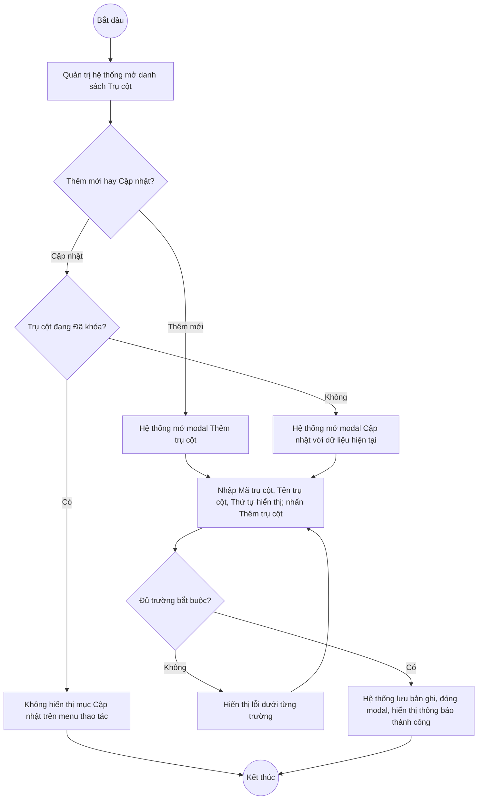
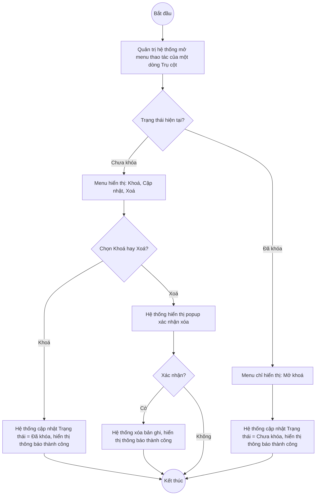

# UC5.1: Quản lý trụ cột

## 1. Thông tin chung

| ID | Use case | Description |
| :---- | :---- | :---- |
| UC5.1 | Quản lý trụ cột | Quản trị hệ thống xem danh sách, thêm mới, cập nhật, khóa/mở khóa và xóa Trụ cột — đơn vị cấu trúc cao nhất của Bộ chỉ số DTI (mỗi Trụ cột chứa nhiều Nhóm chỉ số, mỗi Nhóm chỉ số chứa nhiều Chỉ số). |

> **Actor:** Quản trị hệ thống. **[Cần xác nhận]** UC_1409 (UC-B.I.1) còn liệt kê thêm actor "Cán bộ" — chưa xác minh được vì phiên làm việc chỉ đăng nhập bằng tài khoản Quản trị hệ thống (QA Super Admin).
>
> **Trigger:** Quản trị hệ thống chọn "Trụ cột" trong nhóm menu "Bộ chỉ số DTI"
>
> **Điều kiện trước (Pre-condition):** Quản trị hệ thống đã đăng nhập và có quyền quản lý Bộ chỉ số DTI
>
> **Điều kiện sau (Post-condition):** Bản ghi Trụ cột (Mã trụ cột, Tên trụ cột, Thứ tự hiển thị, Trạng thái) được thêm mới, cập nhật, khóa/mở khóa hoặc xóa; danh sách hiển thị dữ liệu mới nhất
>
> **Business rule:**
>
> BR-1: Mã trụ cột và Tên trụ cột là trường bắt buộc khi thêm mới; Thứ tự hiển thị không bắt buộc. *(Đã kiểm chứng trực tiếp ngày 10/10/2026: dấu `*` ở 2 trường đầu trên modal "Thêm trụ cột")*. **[Cần xác nhận]** tính duy nhất của Mã trụ cột, độ dài tối đa, và quy tắc ký tự cho phép — chưa thử nhập trùng/sai định dạng để tránh ảnh hưởng dữ liệu thật.
>
> BR-2: Khi thêm mới, Trạng thái mặc định là "Chưa khóa". *(Theo dữ liệu API ngày 08/10/2026: bản ghi tạo mới có `isActive:true`; **[Cần xác nhận]** lại trực tiếp hôm nay vì không tạo bản ghi test mới trong phiên này)*.
>
> BR-3: Trụ cột ở trạng thái "Đã khóa" thì menu thao tác trên dòng chỉ còn "Mở khoá" (ẩn "Cập nhật" và "Xoá"), tức là không cho sửa/xóa Trụ cột đang khóa. *(Đã kiểm chứng trực tiếp ngày 10/10/2026, dòng "TC01 — Nhóm chỉ số nền tảng chung")*.
>
> BR-4: Trụ cột ở trạng thái "Chưa khóa" thì menu thao tác gồm Khoá, Cập nhật, Xoá (theo mẫu quan sát thống nhất ở Nhóm chỉ số/Chỉ số/Bộ chỉ số). **[Cần xác nhận]** lại — ngày 10/10/2026 việc đọc menu của một dòng "Chưa khóa" cụ thể bị trục trặc kỹ thuật khi tự động hóa (menu dropdown của bước trước chưa đóng hẳn trước khi mở dòng tiếp theo); dữ liệu ngày 08/10/2026 (test CRUD đầy đủ qua API) cho thấy đúng 3 hành động Khoá/Cập nhật/Xoá tồn tại cho trụ cột chưa khóa.
>
> BR-5: Màn hình danh sách Trụ cột **không có ô tìm kiếm hoặc bộ lọc**. *(Đã kiểm chứng trực tiếp ngày 10/10/2026)* — khác với hầu hết các danh mục khác trong hệ thống (vd Nhóm chỉ số, Chỉ số, Bộ chỉ số đều có tìm kiếm).
>
> BR-6: Cột "Nhóm chỉ số" trên danh sách hiển thị số lượng Nhóm chỉ số đang thuộc Trụ cột đó (vd Trụ cột "TC01" có 5 Nhóm chỉ số). **[Cần xác nhận]** Trụ cột đang có Nhóm chỉ số có bị chặn xóa hay không — không thử xóa trên dữ liệu thật để tránh ảnh hưởng dữ liệu đang được các Nhóm chỉ số/Chỉ số khác tham chiếu.
>
> BR-7: Phân trang 10 bản ghi/trang. *(Đã kiểm chứng trực tiếp ngày 10/10/2026: "Hiển thị 1-10 trong 13 bản ghi", 2 trang)*.

**Ghi nhận QC (10/10/2026):** Nút "Xem chi tiết" trên danh sách Trụ cột **không mở được bất kỳ màn hình/modal nào** — đã bấm trực tiếp, kiểm tra cả URL hash (không đổi: vẫn `#/vi/pillars`) lẫn có modal/drawer xuất hiện hay không (không có). Đây là cùng dạng lỗi hồi quy đã ghi nhận ở phân hệ A (UC2.1, UC4.2, UC4.3) — và theo kiểm tra hôm nay, lỗi này xảy ra **đồng loạt trên toàn bộ các màn hình chính của phân hệ B** (xem UC5.3, UC6.1, UC7.1). Do đó UI-5.1.5 "Chi tiết Trụ cột" trong tài liệu này được mô tả **dựa trên suy luận nghiệp vụ, chưa xác minh được nội dung thực tế**.

**Truy vết chức năng**

| STT | Chức năng | YC (BCKTKT) | Dòng UC_1409 | Luồng | Màn hình | BR |
| :---- | :---- | :---- | :---- | :---- | :---- | :---- |
| 1 | Xem danh sách trụ cột | **[Cần xác nhận]** | **[Cần xác nhận]** | Basic Flow bước 1–2 | UI-5.1.1 | BR-5, BR-7 |
| 2 | Thêm mới trụ cột | **[Cần xác nhận]** | **[Cần xác nhận]** | Basic Flow bước 3–7; EF1 | UI-5.1.2 | BR-1, BR-2 |
| 3 | Cập nhật trụ cột | **[Cần xác nhận]** | **[Cần xác nhận]** | AF1; EF1 | UI-5.1.2 | BR-1, BR-4 |
| 4 | Khóa / Mở khóa trụ cột | **[Cần xác nhận]** | **[Cần xác nhận]** | AF2 | UI-5.1.3 | BR-3, BR-4 |
| 5 | Xóa trụ cột | **[Cần xác nhận]** | **[Cần xác nhận]** | AF3 | UI-5.1.4 | BR-4, BR-6 |
| 6 | Xem chi tiết trụ cột | **[Cần xác nhận]** | **[Cần xác nhận]** | AF4 | UI-5.1.5 | — |

> Cột YC (BCKTKT) và Dòng UC_1409 chưa đối chiếu được với bản gốc Google Sheet "Danh sách công việc_CĐS - BCT". Use case nguồn tương ứng: UC-B.I.1 "Quản lý trụ cột".

## 2. Mô tả luồng nghiệp vụ

*Hình 1. Luồng nghiệp vụ thêm mới / cập nhật Trụ cột*

*Hình 2. Luồng nghiệp vụ khóa / mở khóa / xóa Trụ cột*

**Basic Flow** (Thêm mới Trụ cột)

1. Quản trị hệ thống chọn "Trụ cột" trong nhóm menu "Bộ chỉ số DTI".
2. Hệ thống hiển thị màn hình Danh sách Trụ cột (UI-5.1.1), cột STT, Mã trụ cột, Tên trụ cột, Nhóm chỉ số, Trạng thái, Thao tác; 10 bản ghi/trang (BR-7), không có ô tìm kiếm (BR-5).
3. Quản trị hệ thống nhấn nút "+ Thêm trụ cột".
4. Hệ thống hiển thị modal "Thêm trụ cột" (UI-5.1.2).
5. Quản trị hệ thống nhập Mã trụ cột, Tên trụ cột, Thứ tự hiển thị (tùy chọn) và nhấn "Thêm trụ cột".
6. Hệ thống kiểm tra các trường bắt buộc (BR-1).
7. Hệ thống lưu bản ghi với Trạng thái mặc định "Chưa khóa" (BR-2), đóng modal, hiển thị thông báo thành công và tải lại danh sách.

**Alternative Flow**

AF1. Cập nhật Trụ cột

Tại màn hình danh sách (bước 2), với dòng đang "Chưa khóa", Quản trị hệ thống mở menu thao tác và chọn "Cập nhật" (BR-4). Hệ thống hiển thị modal Cập nhật (UI-5.1.2) với dữ liệu hiện tại. Quản trị hệ thống sửa thông tin rồi nhấn "Lưu thay đổi". Hệ thống kiểm tra như bước 6, lưu và hiển thị thông báo thành công. Use case kết thúc.

AF2. Khóa / Mở khóa Trụ cột

Tại màn hình danh sách (bước 2), Quản trị hệ thống mở menu thao tác của một dòng và chọn "Khoá" (nếu đang Chưa khóa) hoặc "Mở khoá" (nếu đang Đã khóa, BR-3). Hệ thống hiển thị popup xác nhận (UI-5.1.3), cập nhật Trạng thái và hiển thị thông báo thành công. Use case kết thúc.

AF3. Xóa Trụ cột

Tại màn hình danh sách (bước 2), với dòng đang "Chưa khóa", Quản trị hệ thống mở menu thao tác và chọn "Xoá" (BR-4). Hệ thống hiển thị popup xác nhận (UI-5.1.4). Quản trị hệ thống nhấn "Xoá". Hệ thống xóa bản ghi, hiển thị thông báo thành công và tải lại danh sách. **[Cần xác nhận]** ràng buộc khi Trụ cột đang có Nhóm chỉ số bên trong (BR-6). Use case kết thúc.

AF4. Xem chi tiết Trụ cột

Tại màn hình danh sách (bước 2), Quản trị hệ thống nhấn "Xem chi tiết" trên một dòng. Theo thiết kế dự kiến, Hệ thống hiển thị màn hình Chi tiết Trụ cột (UI-5.1.5). **Hiện không hoạt động — xem Ghi nhận QC ở mục 1.** Use case kết thúc.

AF5. Hủy thao tác

Khi đang ở modal hoặc popup (bước 5, AF1, AF2, AF3), Quản trị hệ thống nhấn "Huỷ" hoặc biểu tượng đóng. Hệ thống đóng modal/popup, không lưu thay đổi. Quay lại bước 2.

**Exception Flow**

EF1. Thiếu trường bắt buộc

Tại bước 6, nếu thiếu Mã trụ cột hoặc Tên trụ cột, Hệ thống hiển thị lỗi ngay dưới trường tương ứng (placeholder cũng là nội dung nhắc, vd "Vui lòng nhập mã trụ cột"). **[Cần xác nhận]** nội dung thông báo lỗi chính xác khi submit rỗng — chưa thử bấm "Thêm trụ cột" khi để trống để tránh thao tác thừa trên dữ liệu thật; nội dung trên đây suy luận từ placeholder quan sát được.

Quay lại bước 5.

EF2. Mã trụ cột đã tồn tại

**[Cần xác nhận]** toàn bộ — chưa thử tạo trùng Mã trụ cột trong phiên làm việc này.

EF3. Lỗi hệ thống khi lưu, khóa/mở khóa hoặc xóa

Hệ thống hiển thị thông báo lỗi chung và giữ nguyên dữ liệu trước thao tác. **[Cần xác nhận]** nội dung thông báo cụ thể.

Use case kết thúc.

## 3. Màn hình

| UI Code | Screen | Mô tả |
| :---- | :---- | :---- |
| UI-5.1.1 | Danh sách Trụ cột (Web) | Bảng danh sách trụ cột, nút Thêm trụ cột, menu thao tác từng dòng; không có ô tìm kiếm |
| UI-5.1.2 | Modal Thêm mới / Cập nhật Trụ cột (Web) | Nhập Mã trụ cột, Tên trụ cột, Thứ tự hiển thị |
| UI-5.1.3 | Popup xác nhận Khóa / Mở khóa (Web) | Xác nhận trước khi khóa hoặc mở khóa trụ cột |
| UI-5.1.4 | Popup xác nhận xóa (Web) | Xác nhận trước khi xóa trụ cột |
| UI-5.1.5 | Chi tiết Trụ cột (Web) | **Hiện không mở được (QC, 10/10/2026)** — chưa xác minh được nội dung |

## 4. Mô tả Màn hình (Field Specification)

**UI-5.1.1 — Danh sách Trụ cột**

| Field Name | Field type | Data Type | Required | Validation rule/Behaviour |
| :---- | :---- | :---- | :---- | :---- |
| Nút "+ Thêm trụ cột" | Button | Action | Yes | **Behaviour:** Mở modal UI-5.1.2 ở chế độ Thêm mới **Validation rule:** Luôn hiển thị |
| STT | Label | Integer | Yes | **Behaviour:** Số thứ tự liên tục theo trang **Validation rule:** Tự sinh |
| Mã trụ cột | Label | String | Yes | **Behaviour:** Hiển thị mã trụ cột **Validation rule:** — |
| Tên trụ cột | Label | String | Yes | **Behaviour:** Hiển thị tên trụ cột **Validation rule:** — |
| Nhóm chỉ số | Label | Integer | Yes | **Behaviour:** Số lượng Nhóm chỉ số thuộc trụ cột (BR-6) **Validation rule:** ≥ 0 |
| Trạng thái | Badge/Tag | Enum | Yes | **Behaviour:** "Chưa khóa" (xám) / "Đã khóa" (vàng) **Validation rule:** — |
| Xem chi tiết | Link | Action | Yes | **Behaviour:** Dự kiến mở UI-5.1.5 (AF4). **Hiện không phản hồi khi bấm (QC, 10/10/2026)** **Validation rule:** — |
| Menu thao tác (chevron) | Icon button | Action | Yes | **Behaviour:** "Chưa khóa" → Khoá, Cập nhật, Xoá; "Đã khóa" → chỉ Mở khoá (BR-3, BR-4) **Validation rule:** — |
| Phân trang | Pagination | Integer | Yes | **Behaviour:** "10 / trang" (BR-7) **Validation rule:** — |

**UI-5.1.2 — Modal Thêm mới / Cập nhật Trụ cột**

| Field Name | Field type | Data Type | Required | Validation rule/Behaviour |
| :---- | :---- | :---- | :---- | :---- |
| Tiêu đề modal | Label | String | Yes | **Behaviour:** "Thêm trụ cột" (phụ đề "Trụ cột cấu trúc bộ chỉ số DTI") hoặc tiêu đề Cập nhật tương ứng. **[Cần xác nhận]** tiêu đề chính xác ở chế độ Cập nhật — chưa mở được modal Cập nhật trong phiên hôm nay **Validation rule:** — |
| Mã trụ cột | Textbox | String | Yes | **Behaviour:** Placeholder "Vui lòng nhập mã trụ cột" **Validation rule:** Bắt buộc (BR-1). **[Cần xác nhận]** tính duy nhất, độ dài tối đa |
| Tên trụ cột | Textbox | String | Yes | **Behaviour:** Placeholder "Vui lòng nhập tên trụ cột" **Validation rule:** Bắt buộc (BR-1) |
| Thứ tự hiển thị | Number input | Integer | No | **Behaviour:** Placeholder "Vui lòng nhập thứ tự hiển thị" **Validation rule:** **[Cần xác nhận]** khoảng giá trị cho phép, mặc định khi bỏ trống |
| Nút Huỷ | Button | Action | Yes | **Behaviour:** Đóng modal, không lưu (AF5) **Validation rule:** — |
| Nút Thêm trụ cột / Lưu thay đổi | Button | Action | Yes | **Behaviour:** Kiểm tra và lưu bản ghi (bước 6–7, AF1) **Validation rule:** Footer có ghi chú "* Trường bắt buộc" |

**UI-5.1.3 — Popup xác nhận Khóa / Mở khóa**

| Field Name | Field type | Data Type | Required | Validation rule/Behaviour |
| :---- | :---- | :---- | :---- | :---- |
| Nội dung xác nhận | Label | String | Yes | **Behaviour:** **[Cần xác nhận]** nội dung chính xác — chưa mở popup này trong phiên hôm nay **Validation rule:** — |
| Nút Hủy | Button | Action | Yes | **Behaviour:** Đóng popup, không đổi trạng thái (AF5) **Validation rule:** — |
| Nút xác nhận | Button | Action | Yes | **Behaviour:** Thực hiện đổi Trạng thái (AF2) **Validation rule:** — |

**UI-5.1.4 — Popup xác nhận xóa**

| Field Name | Field type | Data Type | Required | Validation rule/Behaviour |
| :---- | :---- | :---- | :---- | :---- |
| Nội dung xác nhận | Label | String | Yes | **Behaviour:** **[Cần xác nhận]** nội dung chính xác **Validation rule:** — |
| Nút Hủy | Button | Action | Yes | **Behaviour:** Đóng popup, không xóa (AF5) **Validation rule:** — |
| Nút Xóa | Button | Action | Yes | **Behaviour:** Xóa bản ghi (AF3); nếu vi phạm ràng buộc dữ liệu thì báo lỗi (EF3) **Validation rule:** — |

**UI-5.1.5 — Chi tiết Trụ cột** *(chưa xác minh được — xem Ghi nhận QC mục 1)*

| Field Name | Field type | Data Type | Required | Validation rule/Behaviour |
| :---- | :---- | :---- | :---- | :---- |
| Toàn bộ nội dung | — | — | — | **[Cần xác nhận]** toàn bộ, chưa mở được màn hình này |

## Điểm cần xác nhận

| STT | Vị trí | Giả định đã dùng | Câu hỏi cần xác nhận |
| :---- | :---- | :---- | :---- |
| 1 | Mục 1 – Ghi nhận QC | "Xem chi tiết" không phản hồi khi bấm, kiểm chứng trên 4 màn hình phân hệ B hôm nay | Đây có phải lỗi chung toàn hệ thống (frontend chưa nối route chi tiết) hay chỉ phân hệ B? Cần dev xác nhận và khắc phục |
| 2 | BR-5 | Danh sách Trụ cột không có ô tìm kiếm/lọc | Có chủ đích (vì số lượng trụ cột thường ít) hay là thiếu sót cần bổ sung? |
| 3 | BR-3, BR-4 | Trụ cột khóa thì ẩn Cập nhật/Xoá trên menu, chỉ còn Mở khoá | Xác nhận đúng hành vi; đồng thời xác nhận trụ cột "Chưa khóa" có đủ cả 3 mục Khoá/Cập nhật/Xoá (dữ liệu 08/10 cho thấy có, nhưng chưa chụp lại ảnh sạch hôm nay) |
| 4 | BR-6 | Chưa rõ ràng buộc xóa Trụ cột đang có Nhóm chỉ số | Cần xác nhận có chặn xóa hay không, và thông báo lỗi tương ứng |
| 5 | EF1, EF2 | Chưa thử nhập rỗng / trùng Mã trụ cột trên dữ liệu thật | Đề nghị xác minh trên môi trường staging nếu có, tránh thao tác thử trên dữ liệu production |
| 6 | Mục 1 – Actor | UC_1409 liệt kê actor "Cán bộ" ngoài Quản trị hệ thống | Cán bộ có quyền gì trên màn hình Trụ cột (chỉ xem hay có quyền sửa)? |
| 7 | Truy vết chức năng | Chưa có số YC (BCKTKT) và Dòng UC_1409 | Đề nghị đối chiếu với bản gốc Google Sheet |
