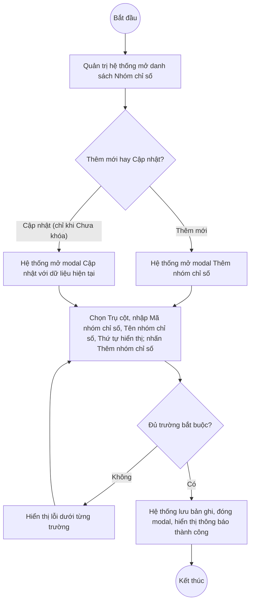

# UC5.2: Quản lý nhóm chỉ số

## 1. Thông tin chung

| ID | Use case | Description |
| :---- | :---- | :---- |
| UC5.2 | Quản lý nhóm chỉ số | Quản trị hệ thống xem danh sách, thêm mới, cập nhật, khóa/mở khóa và xóa Nhóm chỉ số — mỗi Nhóm chỉ số thuộc một Trụ cột (UC5.1) và chứa nhiều Chỉ số (UC5.3). |

> **Actor:** Quản trị hệ thống. **[Cần xác nhận]** UC_1409 (UC-B.I.2) có thể còn áp dụng cho actor "Cán bộ" — chưa xác minh được.
>
> **Trigger:** Quản trị hệ thống chọn "Nhóm chỉ số" trong nhóm menu "Bộ chỉ số DTI"
>
> **Điều kiện trước (Pre-condition):** Quản trị hệ thống đã đăng nhập và có quyền quản lý Bộ chỉ số DTI
>
> **Điều kiện sau (Post-condition):** Bản ghi Nhóm chỉ số (Trụ cột, Mã nhóm chỉ số, Tên nhóm chỉ số, Thứ tự hiển thị, Trạng thái) được thêm mới, cập nhật, khóa/mở khóa hoặc xóa; danh sách hiển thị dữ liệu mới nhất
>
> **Business rule:**
>
> BR-1: Trụ cột, Mã nhóm chỉ số, Tên nhóm chỉ số là trường bắt buộc khi thêm mới; Thứ tự hiển thị không bắt buộc. *(Đã kiểm chứng trực tiếp ngày 10/10/2026: dấu `*` trên modal "Thêm nhóm chỉ số")*.
>
> BR-2: Mỗi Nhóm chỉ số thuộc đúng 1 Trụ cột, chọn qua dropdown "Trụ cột" trên form. *(Đã kiểm chứng trực tiếp ngày 10/10/2026: trường "Trụ cột" là dropdown bắt buộc đầu tiên trên modal)*. **[Cần xác nhận]** có cho đổi Trụ cột của Nhóm chỉ số khi Cập nhật hay không, và ảnh hưởng tới các Chỉ số đang thuộc nhóm đó.
>
> BR-3: Khi thêm mới, Trạng thái mặc định "Chưa khóa". *(Theo dữ liệu API ngày 08/10/2026: `isActive:true, isLocked:false` khi tạo mới — **[Cần xác nhận]** lại trực tiếp hôm nay)*.
>
> BR-4: Nhóm chỉ số "Đã khóa" thì menu thao tác chỉ còn "Mở khoá" (ẩn Cập nhật/Xoá), theo đúng mẫu đã thấy ở Trụ cột (UC5.1). *(Đã kiểm chứng trực tiếp ngày 10/10/2026, một dòng "Đã khóa" trong danh sách)*.
>
> BR-5: Nhóm chỉ số "Chưa khóa" thì menu thao tác gồm Khoá, Cập nhật, Xoá. **[Cần xác nhận]** lại bằng ảnh chụp sạch — phiên làm việc hôm nay gặp trục trặc kỹ thuật khi đọc menu của dòng chưa khóa (dropdown trước chưa đóng hẳn); dữ liệu API ngày 08/10/2026 (test CRUD đầy đủ, dùng 2 API riêng `/lock` và `/unlock`) xác nhận đủ cả 3 hành động.
>
> BR-6: Có thể lọc danh sách theo Trụ cột qua dropdown "Tất cả trụ cột" phía trên bảng. *(Theo dữ liệu khảo sát ngày 08/10/2026 — **[Cần xác nhận]** lại trực tiếp, hôm nay chưa thao tác thử bộ lọc này)*.
>
> BR-7: Phân trang 10 bản ghi/trang. *(Đã kiểm chứng trực tiếp ngày 10/10/2026)*.

**Ghi nhận QC (10/10/2026):** Theo mẫu hình quan sát được ở các màn hình khác của phân hệ B (Trụ cột, Chỉ số, Bộ chỉ số, Quản lý tự đánh giá — đã kiểm chứng trực tiếp hôm nay), nút "Xem chi tiết" trên danh sách Nhóm chỉ số **nhiều khả năng cũng không mở được**, nhưng bản thân màn hình Nhóm chỉ số **chưa được bấm thử trực tiếp trong phiên hôm nay** do giới hạn thời gian — xem UI-5.2.5. Dữ liệu khảo sát ngày 08/10/2026 (`indicator-groups.json`) cũng ghi nhận "Xem chi tiết": không mở được, khớp với suy đoán trên.

**Truy vết chức năng**

| STT | Chức năng | YC (BCKTKT) | Dòng UC_1409 | Luồng | Màn hình | BR |
| :---- | :---- | :---- | :---- | :---- | :---- | :---- |
| 1 | Xem danh sách nhóm chỉ số | **[Cần xác nhận]** | **[Cần xác nhận]** | Basic Flow bước 1–2 | UI-5.2.1 | BR-6, BR-7 |
| 2 | Lọc theo Trụ cột | **[Cần xác nhận]** | **[Cần xác nhận]** | AF1 | UI-5.2.1 | BR-6 |
| 3 | Thêm mới nhóm chỉ số | **[Cần xác nhận]** | **[Cần xác nhận]** | Basic Flow bước 3–7; EF1 | UI-5.2.2 | BR-1, BR-2, BR-3 |
| 4 | Cập nhật nhóm chỉ số | **[Cần xác nhận]** | **[Cần xác nhận]** | AF2; EF1 | UI-5.2.2 | BR-1, BR-2, BR-5 |
| 5 | Khóa / Mở khóa nhóm chỉ số | **[Cần xác nhận]** | **[Cần xác nhận]** | AF3 | UI-5.2.3 | BR-4, BR-5 |
| 6 | Xóa nhóm chỉ số | **[Cần xác nhận]** | **[Cần xác nhận]** | AF4 | UI-5.2.4 | BR-5 |

> Cột YC (BCKTKT) và Dòng UC_1409 chưa đối chiếu được với bản gốc Google Sheet "Danh sách công việc_CĐS - BCT". Use case nguồn tương ứng: UC-B.I.2 "Quản lý nhóm chỉ số".

## 2. Mô tả luồng nghiệp vụ

*Hình 1. Luồng nghiệp vụ thêm mới / cập nhật Nhóm chỉ số*

**Basic Flow** (Thêm mới Nhóm chỉ số)

1. Quản trị hệ thống chọn "Nhóm chỉ số" trong nhóm menu "Bộ chỉ số DTI".
2. Hệ thống hiển thị màn hình Danh sách Nhóm chỉ số (UI-5.2.1): cột STT, Mã nhóm chỉ số, Tên nhóm chỉ số, Trụ cột, Thứ tự hiển thị, Trạng thái, Thao tác; có bộ lọc "Tất cả trụ cột" (BR-6); 10 bản ghi/trang (BR-7).
3. Quản trị hệ thống nhấn "Thêm nhóm chỉ số".
4. Hệ thống hiển thị modal Thêm nhóm chỉ số (UI-5.2.2).
5. Quản trị hệ thống chọn Trụ cột, nhập Mã nhóm chỉ số, Tên nhóm chỉ số, Thứ tự hiển thị (tùy chọn) và nhấn "Thêm nhóm chỉ số".
6. Hệ thống kiểm tra các trường bắt buộc (BR-1, BR-2).
7. Hệ thống lưu bản ghi với Trạng thái mặc định "Chưa khóa" (BR-3), đóng modal, hiển thị thông báo thành công và tải lại danh sách.

**Alternative Flow**

AF1. Lọc theo Trụ cột

Tại màn hình danh sách (bước 2), Quản trị hệ thống chọn 1 Trụ cột trong dropdown lọc (BR-6). Hệ thống trả về danh sách Nhóm chỉ số thuộc Trụ cột đó. Use case kết thúc.

AF2. Cập nhật Nhóm chỉ số

Tại màn hình danh sách (bước 2), với dòng đang "Chưa khóa", Quản trị hệ thống mở menu thao tác và chọn "Cập nhật" (BR-5). Hệ thống hiển thị modal Cập nhật (UI-5.2.2) với dữ liệu hiện tại. Quản trị hệ thống sửa thông tin rồi nhấn "Lưu thay đổi". Hệ thống kiểm tra như bước 6, lưu và hiển thị thông báo thành công. Use case kết thúc.

AF3. Khóa / Mở khóa Nhóm chỉ số

Tại màn hình danh sách (bước 2), Quản trị hệ thống mở menu thao tác và chọn "Khoá" hoặc "Mở khoá" tùy trạng thái hiện tại (BR-4). Hệ thống hiển thị popup xác nhận (UI-5.2.3), cập nhật Trạng thái và hiển thị thông báo thành công. Use case kết thúc.

AF4. Xóa Nhóm chỉ số

Tại màn hình danh sách (bước 2), với dòng đang "Chưa khóa", Quản trị hệ thống mở menu thao tác và chọn "Xoá" (BR-5). Hệ thống hiển thị popup xác nhận (UI-5.2.4). Quản trị hệ thống nhấn "Xoá". Hệ thống xóa bản ghi, hiển thị thông báo thành công. **[Cần xác nhận]** ràng buộc khi Nhóm chỉ số đang có Chỉ số bên trong. Use case kết thúc.

AF5. Xem chi tiết Nhóm chỉ số

Tại màn hình danh sách (bước 2), Quản trị hệ thống nhấn "Xem chi tiết" trên một dòng. Theo thiết kế dự kiến, Hệ thống hiển thị màn hình Chi tiết Nhóm chỉ số (UI-5.2.5). **Nhiều khả năng không hoạt động — xem Ghi nhận QC ở mục 1.** Use case kết thúc.

AF6. Hủy thao tác

Khi đang ở modal hoặc popup, Quản trị hệ thống nhấn "Huỷ" hoặc biểu tượng đóng. Hệ thống đóng modal/popup, không lưu thay đổi. Quay lại bước 2.

**Exception Flow**

EF1. Thiếu trường bắt buộc

Tại bước 6, nếu thiếu Trụ cột, Mã nhóm chỉ số hoặc Tên nhóm chỉ số, Hệ thống hiển thị lỗi dưới trường tương ứng. **[Cần xác nhận]** nội dung thông báo chính xác — chưa thử submit rỗng trong phiên hôm nay.

Quay lại bước 5.

EF2. Mã nhóm chỉ số đã tồn tại

**[Cần xác nhận]** toàn bộ — chưa thử tạo trùng Mã nhóm chỉ số.

EF3. Lỗi hệ thống khi lưu, khóa/mở khóa hoặc xóa

Hệ thống hiển thị thông báo lỗi chung, giữ nguyên dữ liệu trước thao tác. **[Cần xác nhận]** nội dung cụ thể.

Use case kết thúc.

## 3. Màn hình

| UI Code | Screen | Mô tả |
| :---- | :---- | :---- |
| UI-5.2.1 | Danh sách Nhóm chỉ số (Web) | Lọc theo Trụ cột, bảng danh sách, nút Thêm nhóm chỉ số, menu thao tác từng dòng |
| UI-5.2.2 | Modal Thêm mới / Cập nhật Nhóm chỉ số (Web) | Chọn Trụ cột, nhập Mã nhóm chỉ số, Tên nhóm chỉ số, Thứ tự hiển thị |
| UI-5.2.3 | Popup xác nhận Khóa / Mở khóa (Web) | Xác nhận trước khi khóa hoặc mở khóa nhóm chỉ số |
| UI-5.2.4 | Popup xác nhận xóa (Web) | Xác nhận trước khi xóa nhóm chỉ số |
| UI-5.2.5 | Chi tiết Nhóm chỉ số (Web) | **Chưa xác minh được (nhiều khả năng cùng lỗi QC như các màn hình khác)** |

## 4. Mô tả Màn hình (Field Specification)

**UI-5.2.1 — Danh sách Nhóm chỉ số**

| Field Name | Field type | Data Type | Required | Validation rule/Behaviour |
| :---- | :---- | :---- | :---- | :---- |
| Lọc "Tất cả trụ cột" | Dropdown | Enum | No | **Behaviour:** Lọc theo Trụ cột (BR-6, AF1) **Validation rule:** **[Cần xác nhận]** giá trị mặc định, đa chọn hay đơn chọn |
| Nút Thêm nhóm chỉ số | Button | Action | Yes | **Behaviour:** Mở modal UI-5.2.2 ở chế độ Thêm mới **Validation rule:** Luôn hiển thị |
| STT | Label | Integer | Yes | **Behaviour:** Số thứ tự liên tục theo trang **Validation rule:** Tự sinh |
| Mã nhóm chỉ số | Label | String | Yes | **Behaviour:** — **Validation rule:** — |
| Tên nhóm chỉ số | Label | String | Yes | **Behaviour:** — **Validation rule:** — |
| Trụ cột | Label | String | Yes | **Behaviour:** Tên Trụ cột cha (UC5.1) **Validation rule:** — |
| Thứ tự hiển thị | Label | Integer | No | **Behaviour:** — **Validation rule:** — |
| Trạng thái | Badge/Tag | Enum | Yes | **Behaviour:** "Chưa khóa" / "Đã khóa" **Validation rule:** — |
| Xem chi tiết | Link | Action | Yes | **Behaviour:** Dự kiến mở UI-5.2.5 (AF5). **[Cần xác nhận]** có hoạt động hay không **Validation rule:** — |
| Menu thao tác (chevron) | Icon button | Action | Yes | **Behaviour:** "Chưa khóa" → Khoá, Cập nhật, Xoá; "Đã khóa" → chỉ Mở khoá (BR-4, BR-5) **Validation rule:** — |
| Phân trang | Pagination | Integer | Yes | **Behaviour:** "10 / trang" (BR-7) **Validation rule:** — |

**UI-5.2.2 — Modal Thêm mới / Cập nhật Nhóm chỉ số**

| Field Name | Field type | Data Type | Required | Validation rule/Behaviour |
| :---- | :---- | :---- | :---- | :---- |
| Trụ cột | Dropdown | Enum | Yes | **Behaviour:** Danh mục Trụ cột (UC5.1) (BR-2) **Validation rule:** Bắt buộc |
| Mã nhóm chỉ số | Textbox | String | Yes | **Behaviour:** — **Validation rule:** Bắt buộc (BR-1). **[Cần xác nhận]** tính duy nhất |
| Tên nhóm chỉ số | Textbox | String | Yes | **Behaviour:** — **Validation rule:** Bắt buộc (BR-1) |
| Thứ tự hiển thị | Number input | Integer | No | **Behaviour:** — **Validation rule:** **[Cần xác nhận]** khoảng giá trị cho phép |
| Nút Huỷ | Button | Action | Yes | **Behaviour:** Đóng modal, không lưu (AF6) **Validation rule:** — |
| Nút Thêm nhóm chỉ số / Lưu thay đổi | Button | Action | Yes | **Behaviour:** Kiểm tra và lưu bản ghi (bước 6–7, AF2) **Validation rule:** — |

**UI-5.2.3 — Popup xác nhận Khóa / Mở khóa**

| Field Name | Field type | Data Type | Required | Validation rule/Behaviour |
| :---- | :---- | :---- | :---- | :---- |
| Nội dung xác nhận | Label | String | Yes | **Behaviour:** **[Cần xác nhận]** nội dung chính xác **Validation rule:** — |
| Nút Hủy | Button | Action | Yes | **Behaviour:** Đóng popup, không đổi trạng thái (AF6) **Validation rule:** — |
| Nút xác nhận | Button | Action | Yes | **Behaviour:** Thực hiện đổi Trạng thái (AF3) **Validation rule:** — |

**UI-5.2.4 — Popup xác nhận xóa**

| Field Name | Field type | Data Type | Required | Validation rule/Behaviour |
| :---- | :---- | :---- | :---- | :---- |
| Nội dung xác nhận | Label | String | Yes | **Behaviour:** **[Cần xác nhận]** nội dung chính xác **Validation rule:** — |
| Nút Hủy | Button | Action | Yes | **Behaviour:** Đóng popup, không xóa (AF6) **Validation rule:** — |
| Nút Xóa | Button | Action | Yes | **Behaviour:** Xóa bản ghi (AF4) **Validation rule:** — |

**UI-5.2.5 — Chi tiết Nhóm chỉ số** *(chưa xác minh được)*

| Field Name | Field type | Data Type | Required | Validation rule/Behaviour |
| :---- | :---- | :---- | :---- | :---- |
| Toàn bộ nội dung | — | — | — | **[Cần xác nhận]** toàn bộ, chưa mở được màn hình này |

## Điểm cần xác nhận

| STT | Vị trí | Giả định đã dùng | Câu hỏi cần xác nhận |
| :---- | :---- | :---- | :---- |
| 1 | Mục 1 – Ghi nhận QC | "Xem chi tiết" nhiều khả năng không hoạt động (suy luận từ mẫu hình chung + cache 08/10), chưa tự kiểm chứng trực tiếp hôm nay do giới hạn thời gian | Đề nghị xác minh trực tiếp và đối chiếu với các UC khác trong phân hệ B |
| 2 | BR-5 | Nhóm chỉ số chưa khóa có đủ 3 hành động Khoá/Cập nhật/Xoá | Xác nhận lại bằng thao tác trực tiếp sạch (phiên hôm nay bị nhiễu kỹ thuật khi đọc menu) |
| 3 | AF4 | Chưa rõ ràng buộc xóa Nhóm chỉ số đang có Chỉ số bên trong | Cần xác nhận có chặn xóa hay không |
| 4 | BR-2 | Chưa rõ có cho đổi Trụ cột của Nhóm chỉ số khi Cập nhật | Nếu cho đổi, các Chỉ số đang thuộc nhóm có bị ảnh hưởng không? |
| 5 | Truy vết chức năng | Chưa có số YC (BCKTKT) và Dòng UC_1409 | Đề nghị đối chiếu với bản gốc Google Sheet |
