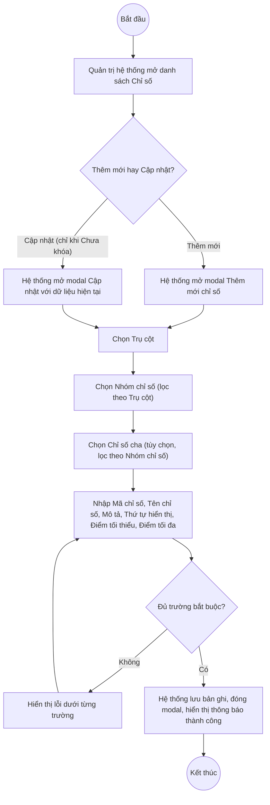

# UC5.3: Quản lý chỉ số

## 1. Thông tin chung

| ID | Use case | Description |
| :---- | :---- | :---- |
| UC5.3 | Quản lý chỉ số | Quản trị hệ thống xem danh sách Chỉ số (dạng danh sách hoặc dạng cây), thêm mới, cập nhật (bao gồm cập nhật Chỉ số cha), khóa/mở khóa và xóa Chỉ số — đơn vị nhỏ nhất của cấu trúc Bộ chỉ số DTI, thuộc một Trụ cột (UC5.1) và một Nhóm chỉ số (UC5.2), có thể có Chỉ số cha để tạo phân cấp. |

> **Actor:** Quản trị hệ thống. **[Cần xác nhận]** UC_1409 (UC-B.I.3) có thể còn áp dụng cho actor "Cán bộ" — chưa xác minh được.
>
> **Trigger:** Quản trị hệ thống chọn "Chỉ số" trong nhóm menu "Bộ chỉ số DTI"
>
> **Điều kiện trước (Pre-condition):** Quản trị hệ thống đã đăng nhập và có quyền quản lý Bộ chỉ số DTI
>
> **Điều kiện sau (Post-condition):** Bản ghi Chỉ số (Trụ cột, Nhóm chỉ số, Chỉ số cha, Mã chỉ số, Tên chỉ số, Mô tả, Thứ tự hiển thị, Điểm tối thiểu, Điểm tối đa, Trạng thái) được thêm mới, cập nhật, khóa/mở khóa hoặc xóa; danh sách hiển thị dữ liệu mới nhất
>
> **Business rule:**
>
> BR-1: Trụ cột, Nhóm chỉ số, Mã chỉ số, Tên chỉ số, Điểm tối thiểu, Điểm tối đa là trường bắt buộc khi thêm mới; Chỉ số cha, Mô tả, Thứ tự hiển thị không bắt buộc. *(Đã kiểm chứng trực tiếp ngày 10/10/2026: dấu `*` trên modal "Thêm mới chỉ số")*.
>
> BR-2: Chọn Trụ cột trước, sau đó chọn Nhóm chỉ số (cascading theo Trụ cột đã chọn); "Chỉ số cha" là dropdown riêng, hiển thị mờ/khóa (disabled) cho tới khi Nhóm chỉ số được chọn. *(Đã kiểm chứng trực tiếp ngày 10/10/2026: quan sát trực tiếp trên modal — tại thời điểm chưa chọn Nhóm chỉ số, trường "Chỉ số cha" hiển thị nền xám, placeholder nhạt màu)*. **[Cần xác nhận]** "Chỉ số cha" có bị giới hạn chỉ trong phạm vi Nhóm chỉ số đã chọn hay không, và hệ thống cho phân cấp tối đa bao nhiêu bậc.
>
> BR-3: Điểm tối thiểu và Điểm tối đa là số thập phân (kiểu Decimal, quan sát dữ liệu mẫu dạng "10.00", "0.00"). **[Cần xác nhận]** ràng buộc Điểm tối thiểu ≤ Điểm tối đa có được kiểm tra khi lưu hay không — chưa thử nhập giá trị vi phạm.
>
> BR-4: Chỉ số "Đã khóa" thì menu thao tác thu hẹp lại (suy luận theo đúng mẫu hình đã kiểm chứng ở Trụ cột/Nhóm chỉ số: chỉ còn "Mở khoá"). **[Cần xác nhận]** lại cụ thể cho Chỉ số — hôm nay chỉ kiểm chứng trực tiếp được menu của dòng "Chưa khóa".
>
> BR-5: Chỉ số "Chưa khóa" thì menu thao tác gồm Khoá, Nhân bản, Cập nhật, Xoá. *(Đã kiểm chứng trực tiếp ngày 10/10/2026, dòng "CS03")*.
>
> BR-6: Tìm kiếm theo tên hoặc mã chỉ số qua ô "Tìm kiếm tên/mã chỉ số". *(Đã kiểm chứng trực tiếp ngày 10/10/2026: ô tìm kiếm hiển thị trên đầu danh sách)*. **[Cần xác nhận]** hành vi tìm gần đúng/phân biệt hoa thường — chưa thử nhập từ khóa thật.
>
> BR-7: Có 2 chế độ xem: "Xem dạng danh sách" (mặc định) và "Xem dạng cây" qua công tắc dạng segmented control ở góc trên bên phải. *(Đã kiểm chứng trực tiếp ngày 10/10/2026: công tắc hiển thị rõ trên UI)*. **[Cần xác nhận]** nội dung và cách trình bày cụ thể của chế độ xem dạng cây — công cụ tự động hóa dùng trong phiên này không bấm được vào công tắc (không phải thẻ `<button>` chuẩn) nên chưa chụp lại được màn hình cây; đây là giới hạn của công cụ, không phải một phát hiện về lỗi hệ thống.
>
> BR-8: Danh sách có phân trang nhiều trang (quan sát "92 bản ghi", nhiều trang được đánh số kèm dấu "…"), 10 bản ghi/trang. *(Đã kiểm chứng trực tiếp ngày 10/10/2026)*.
>
> BR-9: "Nhân bản" tạo một Chỉ số mới sao chép từ Chỉ số gốc, Mã chỉ số được gắn thêm hậu tố "_COPY" và Tên chỉ số được gắn thêm hậu tố " (Bản sao)", giữ nguyên Trụ cột/Nhóm chỉ số/Điểm tối thiểu/Điểm tối đa/Mô tả. *(Theo dữ liệu API ngày 08/10/2026 — xem UC5.5 "Nhân bản chỉ số" để biết chi tiết luồng; **[Cần xác nhận]** lại trực tiếp vì chưa thực hiện lại thao tác Nhân bản trong phiên hôm nay để tránh tạo thêm dữ liệu test phải dọn dẹp)*.

**Ghi nhận QC (10/10/2026):** Nút "Xem chi tiết" trên danh sách Chỉ số **không mở được bất kỳ màn hình/modal nào** — đã bấm trực tiếp, xác nhận URL hash không đổi (`#/vi/indicators`) và không có modal/drawer xuất hiện. Cùng dạng lỗi hồi quy đã ghi nhận ở UC5.1, UC6.1, UC7.1 và ở phân hệ A.

**Truy vết chức năng**

| STT | Chức năng | YC (BCKTKT) | Dòng UC_1409 | Luồng | Màn hình | BR |
| :---- | :---- | :---- | :---- | :---- | :---- | :---- |
| 1 | Xem danh sách chỉ số (dạng danh sách) | **[Cần xác nhận]** | **[Cần xác nhận]** | Basic Flow bước 1–2 | UI-5.3.1 | BR-6, BR-7, BR-8 |
| 2 | Xem danh sách chỉ số (dạng cây) | **[Cần xác nhận]** | **[Cần xác nhận]** | AF1 | UI-5.3.5 | BR-7 |
| 3 | Tìm kiếm chỉ số | **[Cần xác nhận]** | **[Cần xác nhận]** | AF2 | UI-5.3.1 | BR-6 |
| 4 | Thêm mới chỉ số | **[Cần xác nhận]** | **[Cần xác nhận]** | Basic Flow bước 3–7; EF1 | UI-5.3.2 | BR-1, BR-2, BR-3 |
| 5 | Cập nhật chỉ số (bao gồm cập nhật Chỉ số cha) | **[Cần xác nhận]** | **[Cần xác nhận]** | AF3; EF1 | UI-5.3.2 | BR-1, BR-2, BR-5 |
| 6 | Khóa / Mở khóa chỉ số | **[Cần xác nhận]** | **[Cần xác nhận]** | AF4 | UI-5.3.3 | BR-4, BR-5 |
| 7 | Xóa chỉ số | **[Cần xác nhận]** | **[Cần xác nhận]** | AF5 | UI-5.3.4 | BR-5 |
| 8 | Nhân bản chỉ số | **[Cần xác nhận]** | **[Cần xác nhận]** | AF6 (chi tiết tại UC5.5) | UI-5.3.2 | BR-5, BR-9 |

> Cột YC (BCKTKT) và Dòng UC_1409 chưa đối chiếu được với bản gốc Google Sheet "Danh sách công việc_CĐS - BCT". Use case nguồn tương ứng: UC-B.I.3 "Quản lý chỉ số".

## 2. Mô tả luồng nghiệp vụ

*Hình 1. Luồng nghiệp vụ thêm mới / cập nhật Chỉ số*

**Basic Flow** (Thêm mới Chỉ số)

1. Quản trị hệ thống chọn "Chỉ số" trong nhóm menu "Bộ chỉ số DTI".
2. Hệ thống hiển thị màn hình Danh sách Chỉ số (UI-5.3.1) ở chế độ "Xem dạng danh sách" (mặc định): cột STT, Mã chỉ số, Tên chỉ số, Trụ cột, Nhóm chỉ số, Điểm tối thiểu, Điểm tối đa, Trạng thái, Thao tác; có ô tìm kiếm (BR-6) và công tắc chuyển sang dạng cây (BR-7); 10 bản ghi/trang (BR-8).
3. Quản trị hệ thống nhấn "+ Thêm mới chỉ số".
4. Hệ thống hiển thị modal Thêm mới chỉ số (UI-5.3.2).
5. Quản trị hệ thống chọn Trụ cột, chọn Nhóm chỉ số (lọc theo Trụ cột), chọn Chỉ số cha (tùy chọn, lọc theo Nhóm chỉ số, BR-2), nhập Mã chỉ số, Tên chỉ số, Mô tả, Thứ tự hiển thị, Điểm tối thiểu, Điểm tối đa và nhấn "Thêm mới".
6. Hệ thống kiểm tra các trường bắt buộc (BR-1, BR-3).
7. Hệ thống lưu bản ghi với Trạng thái mặc định "Chưa khóa", đóng modal, hiển thị thông báo thành công và tải lại danh sách.

**Alternative Flow**

AF1. Xem dạng cây

Tại màn hình danh sách (bước 2), Quản trị hệ thống bấm "Xem dạng cây" (BR-7). Hệ thống hiển thị cấu trúc Trụ cột > Nhóm chỉ số > Chỉ số (và Chỉ số con nếu có) dạng cây (UI-5.3.5). **[Cần xác nhận]** nội dung chi tiết — chưa xác minh được trong phiên hôm nay (xem BR-7). Use case kết thúc.

AF2. Tìm kiếm chỉ số

Tại màn hình danh sách (bước 2), Quản trị hệ thống nhập từ khóa vào ô "Tìm kiếm tên/mã chỉ số" (BR-6). Hệ thống trả về danh sách thỏa điều kiện. Use case kết thúc.

AF3. Cập nhật chỉ số (bao gồm đổi Chỉ số cha)

Tại màn hình danh sách (bước 2), với dòng đang "Chưa khóa", Quản trị hệ thống mở menu thao tác và chọn "Cập nhật" (BR-5). Hệ thống hiển thị modal Cập nhật (UI-5.3.2) với dữ liệu hiện tại, bao gồm cả trường "Chỉ số cha" đang gán (nếu có). Quản trị hệ thống có thể đổi Chỉ số cha hoặc các trường khác rồi nhấn "Lưu". Hệ thống kiểm tra như bước 6, lưu và hiển thị thông báo thành công. Use case kết thúc.

AF4. Khóa / Mở khóa chỉ số

Tại màn hình danh sách (bước 2), Quản trị hệ thống mở menu thao tác và chọn "Khoá" hoặc "Mở khoá" tùy trạng thái hiện tại. Hệ thống hiển thị popup xác nhận (UI-5.3.3), cập nhật Trạng thái và hiển thị thông báo thành công. Use case kết thúc.

AF5. Xóa chỉ số

Tại màn hình danh sách (bước 2), với dòng đang "Chưa khóa", Quản trị hệ thống mở menu thao tác và chọn "Xoá" (BR-5). Hệ thống hiển thị popup xác nhận (UI-5.3.4). Quản trị hệ thống nhấn "Xoá". Hệ thống xóa bản ghi, hiển thị thông báo thành công. **[Cần xác nhận]** ràng buộc khi Chỉ số đang có Chỉ số con hoặc đang được dùng trong một Bộ chỉ số (UC6.3). Use case kết thúc.

AF6. Nhân bản chỉ số

Tại màn hình danh sách (bước 2), với dòng đang "Chưa khóa", Quản trị hệ thống mở menu thao tác và chọn "Nhân bản" (BR-5, BR-9). Xem chi tiết luồng tại UC5.5 "Nhân bản chỉ số". Use case kết thúc.

AF7. Xem chi tiết chỉ số

Tại màn hình danh sách (bước 2), Quản trị hệ thống nhấn "Xem chi tiết" trên một dòng. Theo thiết kế dự kiến, Hệ thống hiển thị màn hình Chi tiết Chỉ số (UI-5.3.6). **Hiện không hoạt động — xem Ghi nhận QC ở mục 1.** Use case kết thúc.

AF8. Hủy thao tác

Khi đang ở modal hoặc popup, Quản trị hệ thống nhấn "Huỷ" hoặc biểu tượng đóng. Hệ thống đóng modal/popup, không lưu thay đổi. Quay lại bước 2.

**Exception Flow**

EF1. Thiếu trường bắt buộc

Tại bước 6, nếu thiếu Trụ cột, Nhóm chỉ số, Mã chỉ số, Tên chỉ số, Điểm tối thiểu hoặc Điểm tối đa, Hệ thống hiển thị lỗi dưới trường tương ứng. **[Cần xác nhận]** nội dung thông báo chính xác — chưa thử submit rỗng trong phiên hôm nay.

Quay lại bước 5.

EF2. Mã chỉ số đã tồn tại

**[Cần xác nhận]** toàn bộ — chưa thử tạo trùng Mã chỉ số.

EF3. Điểm tối thiểu lớn hơn Điểm tối đa

**[Cần xác nhận]** toàn bộ, bao gồm việc hệ thống có kiểm tra ràng buộc này hay không (xem BR-3).

EF4. Lỗi hệ thống khi lưu, khóa/mở khóa, nhân bản hoặc xóa

Hệ thống hiển thị thông báo lỗi chung, giữ nguyên dữ liệu trước thao tác. **[Cần xác nhận]** nội dung cụ thể.

Use case kết thúc.

## 3. Màn hình

| UI Code | Screen | Mô tả |
| :---- | :---- | :---- |
| UI-5.3.1 | Danh sách Chỉ số — dạng danh sách (Web) | Tìm kiếm, công tắc chuyển dạng cây, bảng danh sách, nút Thêm mới chỉ số, menu thao tác từng dòng |
| UI-5.3.2 | Modal Thêm mới / Cập nhật Chỉ số (Web) | Chọn Trụ cột, Nhóm chỉ số (cascading), Chỉ số cha; nhập Mã chỉ số, Tên chỉ số, Mô tả, Thứ tự hiển thị, Điểm tối thiểu, Điểm tối đa |
| UI-5.3.3 | Popup xác nhận Khóa / Mở khóa (Web) | Xác nhận trước khi khóa hoặc mở khóa chỉ số |
| UI-5.3.4 | Popup xác nhận xóa (Web) | Xác nhận trước khi xóa chỉ số |
| UI-5.3.5 | Danh sách Chỉ số — dạng cây (Web) | **Chưa xác minh được nội dung (xem BR-7)** |
| UI-5.3.6 | Chi tiết Chỉ số (Web) | **Hiện không mở được (QC, 10/10/2026)** — chưa xác minh được nội dung |

## 4. Mô tả Màn hình (Field Specification)

**UI-5.3.1 — Danh sách Chỉ số (dạng danh sách)**

| Field Name | Field type | Data Type | Required | Validation rule/Behaviour |
| :---- | :---- | :---- | :---- | :---- |
| Công tắc "Xem dạng danh sách / Xem dạng cây" | Segmented control | Enum | Yes | **Behaviour:** Chuyển đổi chế độ hiển thị (BR-7) **Validation rule:** Mặc định "Xem dạng danh sách" |
| Nút "+ Thêm mới chỉ số" | Button | Action | Yes | **Behaviour:** Mở modal UI-5.3.2 ở chế độ Thêm mới **Validation rule:** Luôn hiển thị |
| Tìm kiếm | Search box | String | No | **Behaviour:** Placeholder "Tìm kiếm tên/mã chỉ số" (BR-6) **Validation rule:** **[Cần xác nhận]** độ dài tối đa |
| STT | Label | Integer | Yes | **Behaviour:** Số thứ tự liên tục theo trang **Validation rule:** Tự sinh |
| Mã chỉ số | Label | String | Yes | **Behaviour:** — **Validation rule:** — |
| Tên chỉ số | Label | String | Yes | **Behaviour:** — **Validation rule:** — |
| Trụ cột | Label | String | Yes | **Behaviour:** Tên Trụ cột cha (UC5.1) **Validation rule:** — |
| Nhóm chỉ số | Label | String | Yes | **Behaviour:** Tên Nhóm chỉ số cha (UC5.2) **Validation rule:** — |
| Điểm tối thiểu | Label | Decimal | Yes | **Behaviour:** — **Validation rule:** — |
| Điểm tối đa | Label | Decimal | Yes | **Behaviour:** — **Validation rule:** — |
| Trạng thái | Badge/Tag | Enum | Yes | **Behaviour:** "Chưa khóa" / "Đã khóa" **Validation rule:** — |
| Xem chi tiết | Link | Action | Yes | **Behaviour:** Dự kiến mở UI-5.3.6 (AF7). **Hiện không phản hồi khi bấm (QC, 10/10/2026)** **Validation rule:** — |
| Menu thao tác (chevron) | Icon button | Action | Yes | **Behaviour:** "Chưa khóa" → Khoá, Nhân bản, Cập nhật, Xoá (BR-5); "Đã khóa" → **[Cần xác nhận]** **Validation rule:** — |
| Phân trang | Pagination | Integer | Yes | **Behaviour:** Đánh số nhiều trang kèm "…", "10 / trang" (BR-8) **Validation rule:** — |

**UI-5.3.2 — Modal Thêm mới / Cập nhật Chỉ số**

| Field Name | Field type | Data Type | Required | Validation rule/Behaviour |
| :---- | :---- | :---- | :---- | :---- |
| Trụ cột | Dropdown | Enum | Yes | **Behaviour:** Danh mục Trụ cột (UC5.1) (BR-2) **Validation rule:** Bắt buộc |
| Nhóm chỉ số | Dropdown | Enum | Yes | **Behaviour:** Lọc theo Trụ cột đã chọn (BR-2) **Validation rule:** Bắt buộc |
| Chỉ số cha | Dropdown | Enum | No | **Behaviour:** Disabled/mờ cho tới khi chọn Nhóm chỉ số (BR-2) **Validation rule:** Không bắt buộc. **[Cần xác nhận]** phạm vi lọc chính xác |
| Mã chỉ số | Textbox | String | Yes | **Behaviour:** — **Validation rule:** Bắt buộc (BR-1). **[Cần xác nhận]** tính duy nhất |
| Tên chỉ số | Textbox | String | Yes | **Behaviour:** — **Validation rule:** Bắt buộc (BR-1) |
| Mô tả | Textarea | String | No | **Behaviour:** — **Validation rule:** — |
| Thứ tự hiển thị | Number input | Integer | No | **Behaviour:** — **Validation rule:** — |
| Điểm tối thiểu | Number input | Decimal | Yes | **Behaviour:** Xem chi tiết cấu hình điểm tại UC5.4 **Validation rule:** Bắt buộc (BR-1, BR-3) |
| Điểm tối đa | Number input | Decimal | Yes | **Behaviour:** Xem chi tiết cấu hình điểm tại UC5.4 **Validation rule:** Bắt buộc (BR-1); **[Cần xác nhận]** ràng buộc ≥ Điểm tối thiểu (BR-3) |
| Nút Huỷ | Button | Action | Yes | **Behaviour:** Đóng modal, không lưu (AF8) **Validation rule:** — |
| Nút Thêm mới / Lưu | Button | Action | Yes | **Behaviour:** Kiểm tra và lưu bản ghi (bước 6–7, AF3) **Validation rule:** — |

**UI-5.3.3 — Popup xác nhận Khóa / Mở khóa**

| Field Name | Field type | Data Type | Required | Validation rule/Behaviour |
| :---- | :---- | :---- | :---- | :---- |
| Nội dung xác nhận | Label | String | Yes | **Behaviour:** **[Cần xác nhận]** nội dung chính xác **Validation rule:** — |
| Nút Hủy | Button | Action | Yes | **Behaviour:** Đóng popup, không đổi trạng thái (AF8) **Validation rule:** — |
| Nút xác nhận | Button | Action | Yes | **Behaviour:** Thực hiện đổi Trạng thái (AF4) **Validation rule:** — |

**UI-5.3.4 — Popup xác nhận xóa**

| Field Name | Field type | Data Type | Required | Validation rule/Behaviour |
| :---- | :---- | :---- | :---- | :---- |
| Nội dung xác nhận | Label | String | Yes | **Behaviour:** **[Cần xác nhận]** nội dung chính xác **Validation rule:** — |
| Nút Hủy | Button | Action | Yes | **Behaviour:** Đóng popup, không xóa (AF8) **Validation rule:** — |
| Nút Xóa | Button | Action | Yes | **Behaviour:** Xóa bản ghi (AF5) **Validation rule:** — |

**UI-5.3.5 — Danh sách Chỉ số (dạng cây)** *(chưa xác minh được — xem BR-7)*

| Field Name | Field type | Data Type | Required | Validation rule/Behaviour |
| :---- | :---- | :---- | :---- | :---- |
| Toàn bộ nội dung | — | — | — | **[Cần xác nhận]** toàn bộ, chưa chụp được màn hình này trong phiên hôm nay |

**UI-5.3.6 — Chi tiết Chỉ số** *(chưa xác minh được — xem Ghi nhận QC mục 1)*

| Field Name | Field type | Data Type | Required | Validation rule/Behaviour |
| :---- | :---- | :---- | :---- | :---- |
| Toàn bộ nội dung | — | — | — | **[Cần xác nhận]** toàn bộ, chưa mở được màn hình này |

## Điểm cần xác nhận

| STT | Vị trí | Giả định đã dùng | Câu hỏi cần xác nhận |
| :---- | :---- | :---- | :---- |
| 1 | Mục 1 – Ghi nhận QC | "Xem chi tiết" không phản hồi khi bấm | Cần dev xác nhận và khắc phục (cùng lỗi với UC5.1, UC6.1, UC7.1) |
| 2 | BR-7, UI-5.3.5 | Chưa xem được nội dung "Xem dạng cây" do giới hạn công cụ tự động hóa, không phải do UI lỗi | Đề nghị người có thao tác tay (không qua script) xác minh lại nội dung màn hình cây |
| 3 | BR-2 | Chỉ số cha disabled tới khi chọn Nhóm chỉ số, phạm vi lọc theo Nhóm chỉ số | Xác nhận đúng phạm vi lọc và số cấp phân cấp tối đa cho phép |
| 4 | BR-3, EF3 | Chưa rõ hệ thống có chặn Điểm tối thiểu > Điểm tối đa khi lưu hay không | Cần xác nhận và bổ sung thông báo lỗi tương ứng nếu có |
| 5 | BR-9 | Nhân bản gắn hậu tố "_COPY" / " (Bản sao)", dựa theo dữ liệu API ngày 08/10/2026, chưa thử lại hôm nay | Xác nhận hành vi này còn đúng; xem thêm UC5.5 |
| 6 | AF5 | Chưa rõ ràng buộc xóa Chỉ số đang có Chỉ số con hoặc đang dùng trong Bộ chỉ số | Cần xác nhận có chặn xóa hay không |
| 7 | Truy vết chức năng | Chưa có số YC (BCKTKT) và Dòng UC_1409 | Đề nghị đối chiếu với bản gốc Google Sheet |
