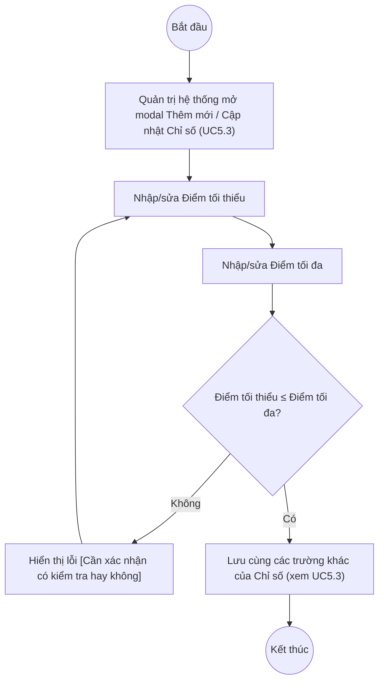

# UC5.4: Quản lý cấu hình điểm của chỉ số

## 1. Thông tin chung

| ID | Use case | Description |
| :---- | :---- | :---- |
| UC5.4 | Quản lý cấu hình điểm của chỉ số | Quản trị hệ thống thiết lập Điểm tối thiểu và Điểm tối đa cho mỗi Chỉ số (UC5.3), làm cơ sở tính điểm khi Chỉ số đó được đưa vào một Bộ chỉ số (UC6.3). |

> **Phát hiện quan trọng (10/10/2026):** UC_1409 (UC-B.I.4) mô tả "Quản lý cấu hình điểm của chỉ số" như một use case/chức năng riêng. Trên hệ thống thật, đây **không phải là một màn hình độc lập** — Điểm tối thiểu và Điểm tối đa là 2 trường **nằm ngay trong modal Thêm mới / Cập nhật Chỉ số** (UI-5.3.2, xem UC5.3), và cũng là 2 cột hiển thị trực tiếp trên bảng Danh sách Chỉ số (UI-5.3.1). *(Đã kiểm chứng trực tiếp ngày 10/10/2026)*. Tài liệu này mô tả lại 2 trường đó theo đúng khuôn mẫu UC để tiện truy vết yêu cầu, nhưng **không có màn hình/luồng thao tác riêng** — mọi thao tác thiết lập điểm thực hiện thông qua UC5.3.
>
> **Actor:** Quản trị hệ thống. **[Cần xác nhận]** actor "Cán bộ" theo UC_1409.
>
> **Trigger:** Quản trị hệ thống mở modal Thêm mới / Cập nhật Chỉ số (UI-5.3.2) từ màn hình Chỉ số (UC5.3)
>
> **Điều kiện trước (Pre-condition):** Quản trị hệ thống đã đăng nhập, có quyền quản lý Bộ chỉ số DTI, và đang ở modal Thêm mới/Cập nhật Chỉ số
>
> **Điều kiện sau (Post-condition):** Điểm tối thiểu, Điểm tối đa của Chỉ số được lưu cùng các trường khác của Chỉ số (xem UC5.3)
>
> **Business rule:**
>
> BR-1: Điểm tối thiểu và Điểm tối đa đều là trường bắt buộc, kiểu số thập phân (Decimal). *(Đã kiểm chứng trực tiếp ngày 10/10/2026: dấu `*` trên 2 trường trong modal; dữ liệu API ngày 08/10/2026 cho giá trị mẫu dạng "0.00", "10.00")*.
>
> BR-2: 2 trường này hiển thị trực tiếp trên bảng Danh sách Chỉ số (cột "Điểm tối thiểu", "Điểm tối đa"), giúp Quản trị hệ thống xem nhanh thang điểm mà không cần mở chi tiết. *(Đã kiểm chứng trực tiếp ngày 10/10/2026)*.
>
> BR-3: **[Cần xác nhận]** hệ thống có kiểm tra Điểm tối thiểu ≤ Điểm tối đa khi lưu hay không — chưa thử nhập giá trị vi phạm trên dữ liệu thật.
>
> BR-4: **[Cần xác nhận]** số chữ số thập phân tối đa được chấp nhận, có cho nhập số âm hay không.
>
> BR-5: **[Cần xác nhận]** mối quan hệ giữa Điểm tối thiểu/tối đa khai báo ở đây (cấp Chỉ số, dùng chung) với cột "Điểm tối thiểu/tối đa" và "Trọng số" xuất hiện riêng khi đưa Chỉ số vào một Bộ chỉ số cụ thể tại UI "Cấu hình bộ chỉ số" (xem UC6.3) — màn hình đó có thêm cột Điểm tối thiểu/Điểm tối đa/Trọng số riêng cho từng Bộ chỉ số, nên có khả năng điểm ở UC5.4 chỉ là giá trị mặc định/tham chiếu ban đầu, còn điểm áp dụng thực tế khi chấm là điểm khai báo lại trong từng Bộ chỉ số. *(Quan sát trực tiếp ngày 10/10/2026 qua màn hình "Cấu hình bộ chỉ số" — xem UC6.3)*.

**Truy vết chức năng**

| STT | Chức năng | YC (BCKTKT) | Dòng UC_1409 | Luồng | Màn hình | BR |
| :---- | :---- | :---- | :---- | :---- | :---- | :---- |
| 1 | Thiết lập Điểm tối thiểu | **[Cần xác nhận]** | **[Cần xác nhận]** | Basic Flow | UI-5.3.2 (dùng chung với UC5.3) | BR-1, BR-3 |
| 2 | Thiết lập Điểm tối đa | **[Cần xác nhận]** | **[Cần xác nhận]** | Basic Flow | UI-5.3.2 (dùng chung với UC5.3) | BR-1, BR-3 |

> Cột YC (BCKTKT) và Dòng UC_1409 chưa đối chiếu được với bản gốc Google Sheet "Danh sách công việc_CĐS - BCT". Use case nguồn tương ứng: UC-B.I.4 "Quản lý cấu hình điểm của chỉ số". Lưu ý: trên hệ thống thật, use case này không có màn hình riêng (xem phần "Phát hiện quan trọng" ở mục 1).

## 2. Mô tả luồng nghiệp vụ

*Hình 1. Luồng nghiệp vụ thiết lập điểm của chỉ số (lồng trong UC5.3)*

**Basic Flow** (Thiết lập điểm khi Thêm mới/Cập nhật Chỉ số)

1. Quản trị hệ thống mở modal Thêm mới hoặc Cập nhật Chỉ số (xem Basic Flow/AF3 của UC5.3).
2. Quản trị hệ thống nhập giá trị vào trường "Điểm tối thiểu".
3. Quản trị hệ thống nhập giá trị vào trường "Điểm tối đa".
4. Quản trị hệ thống nhấn "Thêm mới" / "Lưu".
5. Hệ thống kiểm tra 2 trường là số thập phân hợp lệ và bắt buộc (BR-1); **[Cần xác nhận]** có kiểm tra Điểm tối thiểu ≤ Điểm tối đa hay không (BR-3).
6. Hệ thống lưu Chỉ số cùng toàn bộ các trường khác (xem UC5.3 bước 7), hiển thị thông báo thành công.

**Alternative Flow**

AF1. Xem nhanh điểm trên danh sách

Tại màn hình Danh sách Chỉ số (UI-5.3.1), Quản trị hệ thống xem trực tiếp 2 cột "Điểm tối thiểu", "Điểm tối đa" mà không cần mở modal (BR-2). Use case kết thúc.

**Exception Flow**

EF1. Thiếu Điểm tối thiểu hoặc Điểm tối đa

Tại bước 5, Hệ thống hiển thị lỗi dưới trường tương ứng. **[Cần xác nhận]** nội dung thông báo chính xác.

Quay lại bước 2.

EF2. Điểm tối thiểu lớn hơn Điểm tối đa

**[Cần xác nhận]** toàn bộ, bao gồm việc hệ thống có kiểm tra ràng buộc này hay không (BR-3).

## 3. Màn hình

| UI Code | Screen | Mô tả |
| :---- | :---- | :---- |
| UI-5.3.2 | Modal Thêm mới / Cập nhật Chỉ số (Web) — dùng chung với UC5.3 | Chứa 2 trường Điểm tối thiểu, Điểm tối đa; xem đầy đủ field spec tại UC5.3 mục 4 |
| UI-5.3.1 | Danh sách Chỉ số (Web) — dùng chung với UC5.3 | Hiển thị 2 cột Điểm tối thiểu, Điểm tối đa |

## 4. Mô tả Màn hình (Field Specification)

Toàn bộ field spec của 2 trường thuộc UC5.4 đã được mô tả đầy đủ tại UC5.3 (UI-5.3.2, các dòng "Điểm tối thiểu" và "Điểm tối đa"; UI-5.3.1, các cột cùng tên). Dưới đây nhắc lại để tiện truy vết:

**UI-5.3.2 — Modal Thêm mới / Cập nhật Chỉ số (trích 2 trường liên quan UC5.4)**

| Field Name | Field type | Data Type | Required | Validation rule/Behaviour |
| :---- | :---- | :---- | :---- | :---- |
| Điểm tối thiểu | Number input | Decimal | Yes | **Behaviour:** Giá trị mẫu quan sát được "0.00" (BR-1) **Validation rule:** Bắt buộc. **[Cần xác nhận]** số thập phân tối đa, cho số âm hay không |
| Điểm tối đa | Number input | Decimal | Yes | **Behaviour:** Giá trị mẫu quan sát được "10.00" (BR-1) **Validation rule:** Bắt buộc. **[Cần xác nhận]** ràng buộc ≥ Điểm tối thiểu (BR-3) |

## Điểm cần xác nhận

| STT | Vị trí | Giả định đã dùng | Câu hỏi cần xác nhận |
| :---- | :---- | :---- | :---- |
| 1 | Mục 1 – Phát hiện quan trọng | UC-B.I.4 trong UC_1409 không có màn hình riêng trên hệ thống thật, mà là 2 trường trong modal Chỉ số (UC5.3) | Xác nhận với BA đây có đúng là chủ đích thiết kế (gộp UC5.4 vào UC5.3) hay yêu cầu gốc muốn một màn hình "Cấu hình điểm" riêng biệt (vd để quản lý hàng loạt) chưa được làm |
| 2 | BR-3, BR-5, EF2 | Chưa rõ ràng buộc Điểm tối thiểu ≤ Điểm tối đa có được kiểm tra; chưa rõ quan hệ với điểm khai báo riêng trong từng Bộ chỉ số (UC6.3) | Cần xác nhận với dev/BA về 2 điểm này, vì ảnh hưởng trực tiếp tới cách tính điểm tự đánh giá |
| 3 | Truy vết chức năng | Chưa có số YC (BCKTKT) và Dòng UC_1409 | Đề nghị đối chiếu với bản gốc Google Sheet |
