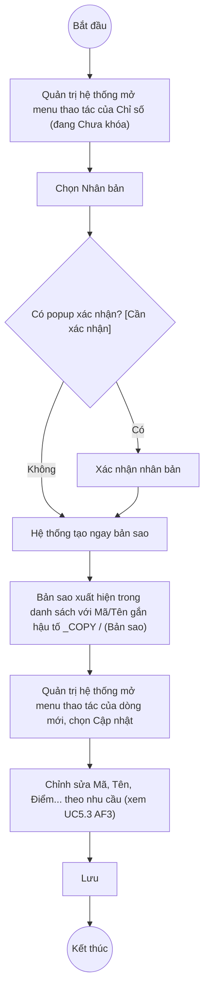

# UC5.5: Nhân bản chỉ số

## 1. Thông tin chung

| ID | Use case | Description |
| :---- | :---- | :---- |
| UC5.5 | Nhân bản chỉ số | Quản trị hệ thống chọn một Chỉ số đã có (UC5.3) để tạo nhanh một bản sao, sau đó xem/chỉnh sửa bản sao vừa tạo cho phù hợp nhu cầu mới, thay vì phải nhập lại từ đầu. |

> **Actor:** Quản trị hệ thống. **[Cần xác nhận]** actor "Cán bộ" theo UC_1409.
>
> **Trigger:** Quản trị hệ thống mở menu thao tác của một dòng Chỉ số trên màn hình Danh sách Chỉ số (UI-5.3.1, xem UC5.3) và chọn "Nhân bản"
>
> **Điều kiện trước (Pre-condition):** Quản trị hệ thống đã đăng nhập, có quyền quản lý Bộ chỉ số DTI, và Chỉ số nguồn đang ở trạng thái "Chưa khóa" (mục "Nhân bản" chỉ xuất hiện trên menu thao tác của dòng chưa khóa — xem BR-5 của UC5.3)
>
> **Điều kiện sau (Post-condition):** Một Chỉ số mới được tạo, sao chép dữ liệu từ Chỉ số nguồn với Mã chỉ số và Tên chỉ số được gắn thêm hậu tố; danh sách Chỉ số hiển thị thêm bản ghi mới
>
> **Business rule:**
>
> BR-1: Mục "Nhân bản" chỉ xuất hiện trên menu thao tác của Chỉ số đang "Chưa khóa". *(Suy luận từ việc menu thao tác của dòng chưa khóa gồm Khoá/Nhân bản/Cập nhật/Xoá — đã kiểm chứng trực tiếp ngày 10/10/2026 tại UC5.3 BR-5)*.
>
> BR-2: Bản sao được tạo với Mã chỉ số = Mã chỉ số gốc + hậu tố "_COPY", Tên chỉ số = Tên chỉ số gốc + hậu tố " (Bản sao)"; các trường còn lại (Trụ cột, Nhóm chỉ số, Mô tả, Điểm tối thiểu, Điểm tối đa, Thứ tự hiển thị) được giữ nguyên như bản gốc; bản sao luôn ở trạng thái "Chưa khóa" dù bản gốc đang khóa hay không. *(Theo dữ liệu API ngày 08/10/2026: ví dụ Mã gốc "uc1409b-ind-196829" → bản sao "uc1409b-ind-196829_COPY", Tên gốc "...EDITED" → bản sao "...EDITED (Bản sao)")*. **[Cần xác nhận]** lại trực tiếp — chưa thực hiện lại thao tác Nhân bản trong phiên hôm nay để tránh phải tạo và dọn dẹp thêm dữ liệu test.
>
> BR-3: Theo quan sát dữ liệu ngày 08/10/2026, thao tác "Nhân bản" gọi thẳng API tạo bản sao ngay khi bấm (không thấy có bước điền form trung gian được ghi log trong kịch bản test trước khi gọi API) — nghĩa là **[Cần xác nhận]** liệu có xuất hiện popup xác nhận trước khi tạo, hay bản sao được tạo ngay lập tức rồi Quản trị hệ thống tự mở "Cập nhật" trên dòng mới để chỉnh sửa tiếp (đúng như mô tả 2 bước của UC-B.I.5: "chọn chỉ số để nhân bản" rồi "xem, chỉnh sửa chỉ số vừa nhân bản"). Đây là điểm quan trọng cần xác nhận lại bằng thao tác tay.
>
> BR-4: Sau khi nhân bản, bản sao là một Chỉ số độc lập — chỉnh sửa sau đó dùng đúng luồng Cập nhật chỉ số (UC5.3 AF3), không có luồng chỉnh sửa riêng cho "chỉ số vừa nhân bản".

**Truy vết chức năng**

| STT | Chức năng | YC (BCKTKT) | Dòng UC_1409 | Luồng | Màn hình | BR |
| :---- | :---- | :---- | :---- | :---- | :---- | :---- |
| 1 | Chọn chỉ số để nhân bản | **[Cần xác nhận]** | **[Cần xác nhận]** | Basic Flow | UI-5.3.1 | BR-1 |
| 2 | Hệ thống tạo bản sao | **[Cần xác nhận]** | **[Cần xác nhận]** | Basic Flow | — (gọi API trực tiếp, không có màn hình trung gian — xem BR-3) | BR-2, BR-3 |
| 3 | Xem, chỉnh sửa chỉ số vừa nhân bản | **[Cần xác nhận]** | **[Cần xác nhận]** | AF1 | UI-5.3.2 (dùng chung với UC5.3) | BR-4 |

> Cột YC (BCKTKT) và Dòng UC_1409 chưa đối chiếu được với bản gốc Google Sheet "Danh sách công việc_CĐS - BCT". Use case nguồn tương ứng: UC-B.I.5 "Nhân bản chỉ số".

## 2. Mô tả luồng nghiệp vụ

*Hình 1. Luồng nghiệp vụ nhân bản chỉ số*

**Basic Flow** (Nhân bản chỉ số)

1. Quản trị hệ thống mở Danh sách Chỉ số (UI-5.3.1, xem UC5.3), tìm Chỉ số nguồn cần nhân bản.
2. Quản trị hệ thống mở menu thao tác của dòng đó (yêu cầu dòng đang "Chưa khóa", BR-1) và chọn "Nhân bản".
3. **[Cần xác nhận]** Hệ thống có thể hiển thị popup xác nhận trước khi tạo bản sao (BR-3) — chưa xác minh được trong phiên hôm nay.
4. Hệ thống tạo một Chỉ số mới sao chép dữ liệu từ Chỉ số nguồn, với Mã chỉ số và Tên chỉ số được gắn hậu tố (BR-2).
5. Hệ thống hiển thị thông báo thành công và thêm bản ghi mới vào danh sách.

**Alternative Flow**

AF1. Xem và chỉnh sửa chỉ số vừa nhân bản

Sau bước 5, Quản trị hệ thống tìm dòng vừa được tạo (Mã/Tên có hậu tố "_COPY" / " (Bản sao)") trong danh sách, mở menu thao tác và chọn "Cập nhật" (xem UC5.3 AF3) để sửa Mã chỉ số, Tên chỉ số, Điểm tối thiểu/tối đa hoặc các trường khác cho phù hợp mục đích sử dụng mới (BR-4). Use case kết thúc.

**Exception Flow**

EF1. Lỗi hệ thống khi nhân bản

Hệ thống hiển thị thông báo lỗi chung, không tạo bản sao. **[Cần xác nhận]** nội dung thông báo cụ thể.

Use case kết thúc.

## 3. Màn hình

| UI Code | Screen | Mô tả |
| :---- | :---- | :---- |
| UI-5.3.1 | Danh sách Chỉ số (Web) — dùng chung với UC5.3 | Nơi chọn Chỉ số nguồn và thấy bản sao mới xuất hiện |
| UI-5.3.2 | Modal Cập nhật Chỉ số (Web) — dùng chung với UC5.3 | Dùng để xem/chỉnh sửa chỉ số vừa nhân bản (AF1) |

## 4. Mô tả Màn hình (Field Specification)

Không có màn hình/trường riêng cho UC5.5 ngoài menu thao tác "Nhân bản" trên UI-5.3.1 và modal Cập nhật dùng chung UI-5.3.2 (field spec đầy đủ xem tại UC5.3 mục 4).

| Field Name | Field type | Data Type | Required | Validation rule/Behaviour |
| :---- | :---- | :---- | :---- | :---- |
| Mục "Nhân bản" trên menu thao tác | Menu item | Action | Yes | **Behaviour:** Chỉ hiển thị khi Chỉ số đang "Chưa khóa" (BR-1); kích hoạt tạo bản sao (BR-2, BR-3) **Validation rule:** — |

## Điểm cần xác nhận

| STT | Vị trí | Giả định đã dùng | Câu hỏi cần xác nhận |
| :---- | :---- | :---- | :---- |
| 1 | BR-3, Basic Flow bước 3 | Chưa rõ có popup xác nhận trước khi nhân bản, hay tạo ngay không cần xác nhận | Đề nghị xác minh lại bằng thao tác tay trực tiếp trên UI (không qua script tự động) |
| 2 | BR-2 | Quy tắc hậu tố "_COPY" / " (Bản sao)" dựa theo dữ liệu API ngày 08/10/2026, chưa thử lại hôm nay | Xác nhận quy tắc này vẫn còn đúng sau các thay đổi UI gần đây |
| 3 | AF1 | Chỉnh sửa chỉ số vừa nhân bản dùng chung luồng Cập nhật của UC5.3, không có luồng riêng | Xác nhận đúng theo thiết kế, không có yêu cầu riêng nào khác cho "chỉ số vừa nhân bản" |
| 4 | Truy vết chức năng | Chưa có số YC (BCKTKT) và Dòng UC_1409 | Đề nghị đối chiếu với bản gốc Google Sheet |
