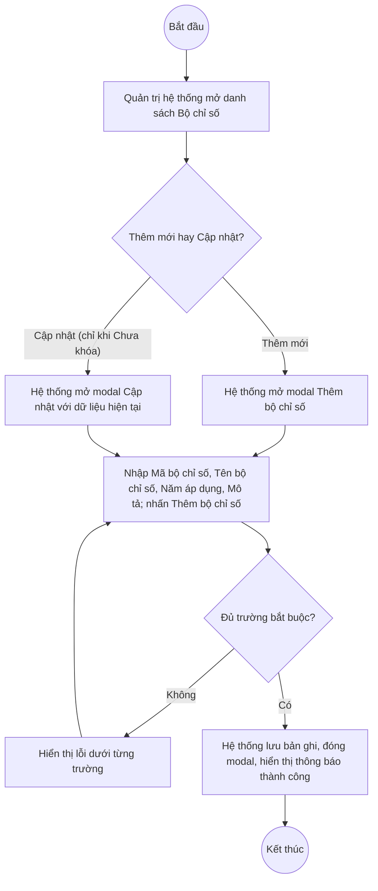

# UC6.1: Danh mục bộ chỉ số

## 1. Thông tin chung

| ID | Use case | Description |
| :---- | :---- | :---- |
| UC6.1 | Danh mục bộ chỉ số | Quản trị hệ thống xem danh mục Bộ chỉ số DTI, thêm mới, cập nhật thông tin/thời gian sử dụng, khóa/mở khóa, xóa và xem chi tiết cấu trúc (Nhóm chỉ số, Chỉ số, điểm…) của từng Bộ chỉ số. |

> **Actor:** Quản trị hệ thống. **[Cần xác nhận]** actor "Cán bộ" theo UC_1409.
>
> **Trigger:** Quản trị hệ thống chọn "Bộ chỉ số" trong nhóm menu "Bộ chỉ số DTI"
>
> **Điều kiện trước (Pre-condition):** Quản trị hệ thống đã đăng nhập và có quyền quản lý Bộ chỉ số DTI
>
> **Điều kiện sau (Post-condition):** Bản ghi Bộ chỉ số (Mã bộ chỉ số, Tên bộ chỉ số, Năm áp dụng, Mô tả, Trạng thái) được thêm mới, cập nhật, khóa/mở khóa hoặc xóa; danh sách hiển thị dữ liệu mới nhất
>
> **Business rule:**
>
> BR-1: Mã bộ chỉ số và Tên bộ chỉ số là trường bắt buộc khi thêm mới; Năm áp dụng và Mô tả không bắt buộc. *(Đã kiểm chứng trực tiếp ngày 10/10/2026: dấu `*` trên modal "Thêm bộ chỉ số"; Năm áp dụng là bộ chọn năm "Chọn năm" không có dấu `*`)*.
>
> BR-2: Mỗi lần "Nhân bản" một Bộ chỉ số sẽ sinh ra một "Phiên bản" mới (cột "Phiên bản" trên danh sách, ví dụ bộ chỉ số "12_V2" đang ở phiên bản 2); xem chi tiết tại UC6.5. *(Quan sát trực tiếp ngày 10/10/2026 trên cột "Phiên bản" của danh sách, kết hợp dữ liệu API ngày 08/10/2026: nhân bản trả về `"version": 2`)*.
>
> BR-3: Khi thêm mới, Trạng thái mặc định "Chưa khóa". *(Theo dữ liệu API ngày 08/10/2026: `"status":"Draft"` tương ứng hiển thị "Chưa khóa" — **[Cần xác nhận]** lại trực tiếp hôm nay)*.
>
> BR-4: Bộ chỉ số "Đã khóa" thì menu thao tác không còn "Cập nhật" và "Xoá", chỉ còn **[Cần xác nhận]** mục khóa/mở khóa và "Cấu hình bộ chỉ số" — chưa kiểm chứng trực tiếp menu của 1 dòng đã khóa trong phiên hôm nay (chỉ kiểm chứng được menu của dòng "Chưa khóa" — xem BR-5). Chi tiết hành vi khóa xem UC6.4.
>
> BR-5: Bộ chỉ số "Chưa khóa" thì menu thao tác gồm: Cấu hình bộ chỉ số, Khoá, Nhân bản, Cập nhật, Xoá. *(Đã kiểm chứng trực tiếp ngày 10/10/2026, dòng "BCS01 — Bộ chỉ số DTI 2025")*.
>
> BR-6: "Cấu hình bộ chỉ số" mở màn hình riêng (xem UC6.2, UC6.3) để thiết lập Nhóm chỉ số và Chỉ số thuộc Bộ chỉ số đó — **đây là nơi thực hiện UC-B.II.2 và UC-B.II.3 của UC_1409** (xem chi tiết tại 2 UC riêng). *(Đã kiểm chứng trực tiếp ngày 10/10/2026)*.
>
> BR-7: Tìm kiếm theo tên Bộ chỉ số qua ô "Tìm kiếm tên bộ chỉ số". *(Đã kiểm chứng trực tiếp ngày 10/10/2026: ô tìm kiếm hiển thị trên đầu danh sách)*. **[Cần xác nhận]** hành vi tìm gần đúng/phân biệt hoa thường, và có tìm theo Mã bộ chỉ số hay không (placeholder chỉ ghi "tên").
>
> BR-8: Phân trang 10 bản ghi/trang, 17 bản ghi/2 trang tại thời điểm khảo sát. *(Đã kiểm chứng trực tiếp ngày 10/10/2026)*.

**Ghi nhận QC (10/10/2026):**

1. Nút "Xem chi tiết" trên danh sách Bộ chỉ số **không mở được bất kỳ màn hình/modal nào** — đã bấm trực tiếp, xác nhận URL hash không đổi (`#/vi/indicator-sets`) và không có modal/drawer xuất hiện. Cùng dạng lỗi hồi quy đã ghi nhận ở UC5.1, UC5.3, UC7.1 và ở phân hệ A. Vì vậy UI-6.1.5 "Xem chi tiết thông tin bộ chỉ số" trong tài liệu này **chưa xác minh được nội dung** — riêng việc xem chi tiết **cấu trúc** (Nhóm chỉ số, Chỉ số, điểm) theo UC_1409 lại khớp với màn hình "Cấu hình bộ chỉ số" (BR-6), **vẫn mở được** qua menu thao tác (không qua nút "Xem chi tiết").
2. **Không tìm thấy nút "Xuất Excel" / "Export" nào trên màn hình Danh sách Bộ chỉ số** cũng như trên màn hình "Cấu hình bộ chỉ số" — đã kiểm tra trực tiếp ngày 10/10/2026 (toolbar chỉ có "+ Thêm bộ chỉ số"), và khớp với khảo sát ngày 08/10/2026 (toolbar ghi nhận được cũng không có nút xuất Excel). Trong khi đó UC_1409 (UC-B.II.1) yêu cầu rõ "export ra excel" (danh mục) và "export dữ liệu bộ chỉ số ra excel" (cấu trúc) — đây là khoảng cách giữa yêu cầu và hệ thống thật, cần báo lại cho BA/Dev.

**Truy vết chức năng**

| STT | Chức năng | YC (BCKTKT) | Dòng UC_1409 | Luồng | Màn hình | BR |
| :---- | :---- | :---- | :---- | :---- | :---- | :---- |
| 1 | Xem danh mục bộ chỉ số | **[Cần xác nhận]** | **[Cần xác nhận]** | Basic Flow bước 1–2 | UI-6.1.1 | BR-7, BR-8 |
| 2 | Export danh mục ra excel | **[Cần xác nhận]** | **[Cần xác nhận]** | — | — (chưa tìm thấy nút — xem Ghi nhận QC #2) | — |
| 3 | Xem chi tiết thông tin bộ chỉ số | **[Cần xác nhận]** | **[Cần xác nhận]** | AF1 | UI-6.1.5 | — |
| 4 | Xem chi tiết cấu trúc bộ chỉ số (nhóm chỉ số, chỉ số, điểm) | **[Cần xác nhận]** | **[Cần xác nhận]** | AF2 (chi tiết tại UC6.2, UC6.3) | UI-6.2.1 | BR-6 |
| 5 | Export dữ liệu bộ chỉ số ra excel | **[Cần xác nhận]** | **[Cần xác nhận]** | — | — (chưa tìm thấy nút — xem Ghi nhận QC #2) | — |
| 6 | Thêm mới bộ chỉ số | **[Cần xác nhận]** | **[Cần xác nhận]** | Basic Flow bước 3–7; EF1 | UI-6.1.2 | BR-1, BR-3 |
| 7 | Xóa bộ chỉ số | **[Cần xác nhận]** | **[Cần xác nhận]** | AF3 | UI-6.1.4 | BR-5 |
| 8 | Cập nhật trạng thái sử dụng/không sử dụng | **[Cần xác nhận]** | **[Cần xác nhận]** | — (xem UC6.4 "Khóa/Mở khóa") | UI-6.1.3 | BR-4, BR-5 |
| 9 | Cập nhật thông tin, thời gian sử dụng bộ chỉ tiêu DTI | **[Cần xác nhận]** | **[Cần xác nhận]** | AF4; EF1 | UI-6.1.2 | BR-1, BR-5 |

> Cột YC (BCKTKT) và Dòng UC_1409 chưa đối chiếu được với bản gốc Google Sheet "Danh sách công việc_CĐS - BCT". Use case nguồn tương ứng: UC-B.II.1 "Danh mục bộ chỉ số". Chức năng "Export ra Excel" theo yêu cầu gốc **chưa tìm thấy trên hệ thống thật** — xem Ghi nhận QC #2.

## 2. Mô tả luồng nghiệp vụ

*Hình 1. Luồng nghiệp vụ thêm mới / cập nhật Bộ chỉ số*

**Basic Flow** (Thêm mới Bộ chỉ số)

1. Quản trị hệ thống chọn "Bộ chỉ số" trong nhóm menu "Bộ chỉ số DTI".
2. Hệ thống hiển thị màn hình Danh mục Bộ chỉ số (UI-6.1.1): cột STT, Mã bộ chỉ số, Tên bộ chỉ số, Phiên bản, Năm áp dụng, Trạng thái, Thao tác; có ô tìm kiếm (BR-7); 10 bản ghi/trang (BR-8).
3. Quản trị hệ thống nhấn "+ Thêm bộ chỉ số".
4. Hệ thống hiển thị modal Thêm bộ chỉ số (UI-6.1.2).
5. Quản trị hệ thống nhập Mã bộ chỉ số, Tên bộ chỉ số, chọn Năm áp dụng (tùy chọn), nhập Mô tả (tùy chọn) và nhấn "Thêm bộ chỉ số".
6. Hệ thống kiểm tra các trường bắt buộc (BR-1).
7. Hệ thống lưu bản ghi với Trạng thái mặc định "Chưa khóa", Phiên bản = 1 (BR-3), đóng modal, hiển thị thông báo thành công và tải lại danh sách.

**Alternative Flow**

AF1. Xem chi tiết thông tin bộ chỉ số

Tại màn hình danh sách (bước 2), Quản trị hệ thống nhấn "Xem chi tiết" trên một dòng. Theo thiết kế dự kiến, Hệ thống hiển thị màn hình Chi tiết thông tin Bộ chỉ số (UI-6.1.5). **Hiện không hoạt động — xem Ghi nhận QC #1 ở mục 1.** Use case kết thúc.

AF2. Xem chi tiết cấu trúc bộ chỉ số

Tại màn hình danh sách (bước 2), Quản trị hệ thống mở menu thao tác của một dòng và chọn "Cấu hình bộ chỉ số" (BR-6). Hệ thống hiển thị màn hình "Cấu hình bộ chỉ số — <Tên bộ chỉ số>" (UI-6.2.1), gồm 2 khối: "Cấu hình bộ chỉ số" (danh sách Nhóm chỉ số đã đưa vào, cờ Tính điểm, thứ tự) và "Nội dung" (chỉ số theo từng Nhóm chỉ số, có Trọng số/Tính điểm/Điểm tối thiểu/Điểm tối đa riêng cho Bộ chỉ số này). Xem chi tiết tại UC6.2 và UC6.3. Use case kết thúc.

AF3. Xóa Bộ chỉ số

Tại màn hình danh sách (bước 2), với dòng đang "Chưa khóa", Quản trị hệ thống mở menu thao tác và chọn "Xoá" (BR-5). Hệ thống hiển thị popup xác nhận (UI-6.1.4). Quản trị hệ thống nhấn "Xoá". Hệ thống xóa bản ghi, hiển thị thông báo thành công. **[Cần xác nhận]** ràng buộc khi Bộ chỉ số đang được một đợt Tự đánh giá (UC7.1) sử dụng. Use case kết thúc.

AF4. Cập nhật thông tin, thời gian sử dụng Bộ chỉ số

Tại màn hình danh sách (bước 2), với dòng đang "Chưa khóa", Quản trị hệ thống mở menu thao tác và chọn "Cập nhật" (BR-5). Hệ thống hiển thị modal Cập nhật (UI-6.1.2) với dữ liệu hiện tại (Tên bộ chỉ số, Năm áp dụng, Mô tả — Mã bộ chỉ số **[Cần xác nhận]** có cho sửa hay chỉ đọc). Quản trị hệ thống sửa thông tin rồi nhấn "Lưu thay đổi". Hệ thống kiểm tra như bước 6, lưu và hiển thị thông báo thành công. Use case kết thúc.

AF5. Hủy thao tác

Khi đang ở modal hoặc popup, Quản trị hệ thống nhấn "Huỷ" hoặc biểu tượng đóng. Hệ thống đóng modal/popup, không lưu thay đổi. Quay lại bước 2.

**Exception Flow**

EF1. Thiếu trường bắt buộc

Tại bước 6, nếu thiếu Mã bộ chỉ số hoặc Tên bộ chỉ số, Hệ thống hiển thị lỗi dưới trường tương ứng. **[Cần xác nhận]** nội dung thông báo chính xác — chưa thử submit rỗng trong phiên hôm nay.

Quay lại bước 5.

EF2. Mã bộ chỉ số đã tồn tại

**[Cần xác nhận]** toàn bộ — chưa thử tạo trùng Mã bộ chỉ số.

EF3. Lỗi hệ thống khi lưu, khóa/mở khóa hoặc xóa

Hệ thống hiển thị thông báo lỗi chung, giữ nguyên dữ liệu trước thao tác. **[Cần xác nhận]** nội dung cụ thể.

Use case kết thúc.

## 3. Màn hình

| UI Code | Screen | Mô tả |
| :---- | :---- | :---- |
| UI-6.1.1 | Danh mục Bộ chỉ số (Web) | Tìm kiếm, bảng danh sách, nút Thêm bộ chỉ số, menu thao tác từng dòng |
| UI-6.1.2 | Modal Thêm mới / Cập nhật Bộ chỉ số (Web) | Nhập Mã bộ chỉ số, Tên bộ chỉ số, Năm áp dụng, Mô tả |
| UI-6.1.3 | Popup xác nhận Khóa / Mở khóa (Web) | Xem chi tiết hành vi tại UC6.4 |
| UI-6.1.4 | Popup xác nhận xóa (Web) | Xác nhận trước khi xóa bộ chỉ số |
| UI-6.1.5 | Chi tiết thông tin Bộ chỉ số (Web) | **Hiện không mở được (QC, 10/10/2026)** — chưa xác minh được nội dung |
| UI-6.2.1 | Cấu hình bộ chỉ số (Web) | Xem chi tiết cấu trúc (nhóm chỉ số, chỉ số, điểm) — mô tả đầy đủ tại UC6.2, UC6.3 |

## 4. Mô tả Màn hình (Field Specification)

**UI-6.1.1 — Danh mục Bộ chỉ số**

| Field Name | Field type | Data Type | Required | Validation rule/Behaviour |
| :---- | :---- | :---- | :---- | :---- |
| Tìm kiếm | Search box | String | No | **Behaviour:** Placeholder "Tìm kiếm tên bộ chỉ số" (BR-7) **Validation rule:** **[Cần xác nhận]** có tìm theo Mã hay không |
| Nút "+ Thêm bộ chỉ số" | Button | Action | Yes | **Behaviour:** Mở modal UI-6.1.2 ở chế độ Thêm mới **Validation rule:** Luôn hiển thị |
| STT | Label | Integer | Yes | **Behaviour:** Số thứ tự liên tục theo trang **Validation rule:** Tự sinh |
| Mã bộ chỉ số | Label | String | Yes | **Behaviour:** — **Validation rule:** — |
| Tên bộ chỉ số | Label | String | Yes | **Behaviour:** — **Validation rule:** — |
| Phiên bản | Label | Integer | Yes | **Behaviour:** Tăng lên sau mỗi lần Nhân bản (BR-2, xem UC6.5) **Validation rule:** — |
| Năm áp dụng | Label | Integer | No | **Behaviour:** Có thể để trống **Validation rule:** — |
| Trạng thái | Badge/Tag | Enum | Yes | **Behaviour:** "Chưa khóa" / "Đã khóa" (xem UC6.4) **Validation rule:** — |
| Xem chi tiết | Link | Action | Yes | **Behaviour:** Dự kiến mở UI-6.1.5 (AF1). **Hiện không phản hồi khi bấm (QC, 10/10/2026)** **Validation rule:** — |
| Menu thao tác (chevron) | Icon button | Action | Yes | **Behaviour:** "Chưa khóa" → Cấu hình bộ chỉ số, Khoá, Nhân bản, Cập nhật, Xoá (BR-5); "Đã khóa" → **[Cần xác nhận]** **Validation rule:** — |
| Phân trang | Pagination | Integer | Yes | **Behaviour:** "10 / trang" (BR-8) **Validation rule:** — |

**UI-6.1.2 — Modal Thêm mới / Cập nhật Bộ chỉ số**

| Field Name | Field type | Data Type | Required | Validation rule/Behaviour |
| :---- | :---- | :---- | :---- | :---- |
| Mã bộ chỉ số | Textbox | String | Yes | **Behaviour:** Placeholder "Vui lòng nhập mã bộ chỉ số" **Validation rule:** Bắt buộc (BR-1). **[Cần xác nhận]** tính duy nhất, có chỉ đọc khi Cập nhật hay không |
| Tên bộ chỉ số | Textbox | String | Yes | **Behaviour:** Placeholder "Vui lòng nhập tên bộ chỉ số" **Validation rule:** Bắt buộc (BR-1) |
| Năm áp dụng | Date/Year picker | Integer | No | **Behaviour:** Placeholder "Chọn năm", biểu tượng lịch **Validation rule:** Không bắt buộc |
| Mô tả | Textarea | String | No | **Behaviour:** — **Validation rule:** — |
| Nút Huỷ | Button | Action | Yes | **Behaviour:** Đóng modal, không lưu (AF5) **Validation rule:** — |
| Nút Thêm bộ chỉ số / Lưu thay đổi | Button | Action | Yes | **Behaviour:** Kiểm tra và lưu bản ghi (bước 6–7, AF4) **Validation rule:** — |

**UI-6.1.3 — Popup xác nhận Khóa / Mở khóa** — xem field spec chi tiết tại UC6.4.

**UI-6.1.4 — Popup xác nhận xóa**

| Field Name | Field type | Data Type | Required | Validation rule/Behaviour |
| :---- | :---- | :---- | :---- | :---- |
| Nội dung xác nhận | Label | String | Yes | **Behaviour:** **[Cần xác nhận]** nội dung chính xác **Validation rule:** — |
| Nút Hủy | Button | Action | Yes | **Behaviour:** Đóng popup, không xóa (AF5) **Validation rule:** — |
| Nút Xóa | Button | Action | Yes | **Behaviour:** Xóa bản ghi (AF3) **Validation rule:** — |

**UI-6.1.5 — Chi tiết thông tin Bộ chỉ số** *(chưa xác minh được — xem Ghi nhận QC #1 mục 1)*

| Field Name | Field type | Data Type | Required | Validation rule/Behaviour |
| :---- | :---- | :---- | :---- | :---- |
| Toàn bộ nội dung | — | — | — | **[Cần xác nhận]** toàn bộ, chưa mở được màn hình này |

## Điểm cần xác nhận

| STT | Vị trí | Giả định đã dùng | Câu hỏi cần xác nhận |
| :---- | :---- | :---- | :---- |
| 1 | Mục 1 – Ghi nhận QC #1 | "Xem chi tiết" không phản hồi khi bấm | Cần dev xác nhận và khắc phục (cùng lỗi với UC5.1, UC5.3, UC7.1) |
| 2 | Mục 1 – Ghi nhận QC #2 | Không tìm thấy nút "Xuất Excel" ở cả 2 ngày khảo sát (08/10 và 10/10), dù UC_1409 yêu cầu rõ | Xác nhận đây là tính năng chưa làm, hay đã bỏ khỏi phạm vi, hay đặt ở vị trí khác chưa tìm ra |
| 3 | BR-4 | Chưa kiểm chứng trực tiếp menu thao tác của 1 dòng Bộ chỉ số đang "Đã khóa" hôm nay | Xác nhận lại bằng thao tác tay |
| 4 | AF3 | Chưa rõ ràng buộc xóa Bộ chỉ số đang được một đợt Tự đánh giá sử dụng | Cần xác nhận có chặn xóa hay không |
| 5 | AF4 | Chưa rõ Mã bộ chỉ số có cho sửa khi Cập nhật hay chỉ đọc | Cần xác nhận |
| 6 | Truy vết chức năng | Chưa có số YC (BCKTKT) và Dòng UC_1409 | Đề nghị đối chiếu với bản gốc Google Sheet |
