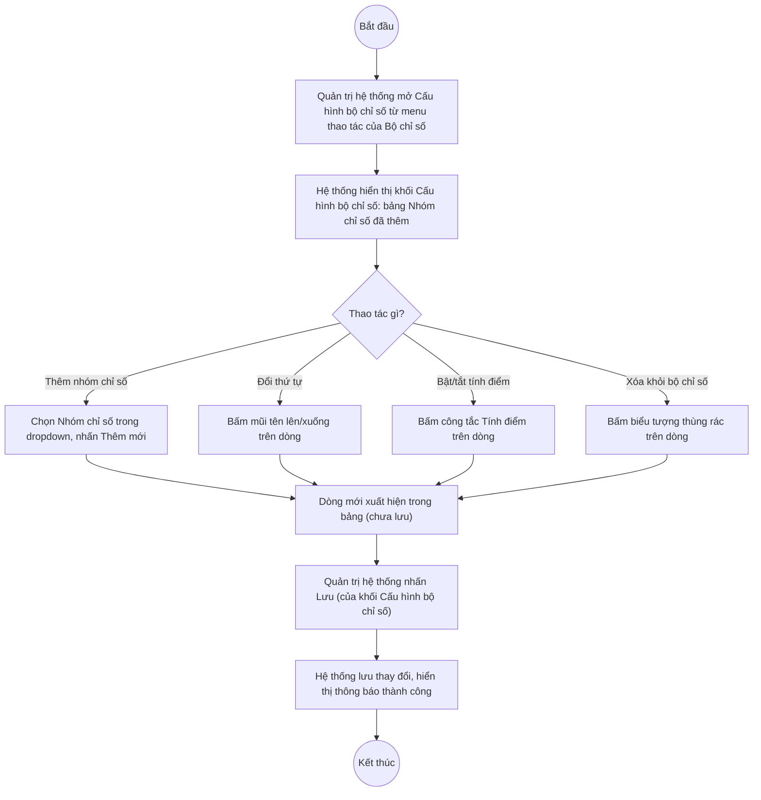

# UC6.2: Tạo cấu trúc (nhóm chỉ số/nhóm tiêu chí) của bộ chỉ số

## 1. Thông tin chung

| ID | Use case | Description |
| :---- | :---- | :---- |
| UC6.2 | Tạo cấu trúc (nhóm chỉ số/nhóm tiêu chí) của bộ chỉ số | Quản trị hệ thống xem danh sách Nhóm chỉ số đã đưa vào một Bộ chỉ số (UC6.1), chọn thêm Nhóm chỉ số từ danh mục (UC5.2), chỉnh sửa (thứ tự, tính điểm), xóa khỏi Bộ chỉ số, và thiết lập tính điểm/không tính điểm cho từng Nhóm chỉ số trong Bộ chỉ số đó. |

> **Phát hiện quan trọng (10/10/2026):** UC6.2 không phải là một màn hình riêng biệt mà là **khối trên cùng ("Cấu hình bộ chỉ số")** của màn hình "Cấu hình bộ chỉ số — <Tên bộ chỉ số>" (UI-6.2.1), mở ra từ mục "Cấu hình bộ chỉ số" trên menu thao tác của một dòng tại Danh mục Bộ chỉ số (UC6.1). Khối dưới của cùng màn hình này ("Nội dung") thuộc về UC6.3 "Tạo nội dung cho bộ chỉ số" — 2 khối nằm chung 1 màn hình, không phải 2 màn hình tách biệt. *(Đã kiểm chứng trực tiếp ngày 10/10/2026, xem ảnh chụp màn hình thực tế)*.
>
> **Actor:** Quản trị hệ thống. **[Cần xác nhận]** actor "Cán bộ" theo UC_1409.
>
> **Trigger:** Quản trị hệ thống mở menu thao tác của một Bộ chỉ số (đang "Chưa khóa") tại UI-6.1.1 và chọn "Cấu hình bộ chỉ số"
>
> **Điều kiện trước (Pre-condition):** Quản trị hệ thống đã đăng nhập, có quyền quản lý Bộ chỉ số DTI, và Bộ chỉ số đang ở trạng thái "Chưa khóa" (mục "Cấu hình bộ chỉ số" chỉ xuất hiện trên menu thao tác của dòng chưa khóa — xem UC6.1 BR-5)
>
> **Điều kiện sau (Post-condition):** Danh sách Nhóm chỉ số thuộc Bộ chỉ số, cờ Tính điểm và Thứ tự hiển thị của từng Nhóm chỉ số trong Bộ chỉ số đó được cập nhật
>
> **Business rule:**
>
> BR-1: Khối "Cấu hình bộ chỉ số" hiển thị bảng các Nhóm chỉ số đã đưa vào Bộ chỉ số, cột: MÃ, NHÓM CHỈ SỐ, TÍNH ĐIỂM (công tắc bật/tắt), THỨ TỰ HIỂN THỊ, THAO TÁC (mũi tên lên/xuống để đổi thứ tự, biểu tượng thùng rác để xóa khỏi Bộ chỉ số). *(Đã kiểm chứng trực tiếp ngày 10/10/2026: ví dụ Bộ chỉ số "DTI 2025" có 5 Nhóm chỉ số NCS01–NCS05, đều đang bật Tính điểm)*.
>
> BR-2: Thêm Nhóm chỉ số vào Bộ chỉ số qua dropdown "Chọn nhóm chỉ số" + nút "Thêm mới" phía trên bảng. *(Đã kiểm chứng trực tiếp ngày 10/10/2026: dropdown và nút hiển thị rõ trên UI)*. **[Cần xác nhận]** dropdown này có lọc loại trừ các Nhóm chỉ số đã được thêm rồi hay không, và có giới hạn chỉ hiển thị Nhóm chỉ số "Chưa khóa" hay không — chưa thử mở dropdown trực tiếp.
>
> BR-3: Mỗi Nhóm chỉ số trong Bộ chỉ số có công tắc "Tính điểm" độc lập — bật nghĩa là điểm của Nhóm chỉ số này được cộng vào tổng điểm của Bộ chỉ số, tắt nghĩa là chỉ tham khảo, không tính vào tổng. *(Đã kiểm chứng trực tiếp ngày 10/10/2026: công tắc hiển thị dạng toggle màu đỏ/bật ở tất cả 5 dòng quan sát được)*. **[Cần xác nhận]** hành vi chính xác khi tắt (có ẩn luôn các Chỉ số con khỏi màn chấm điểm hay chỉ không cộng điểm).
>
> BR-4: Mũi tên lên/xuống ở cột Thao tác dùng để đổi Thứ tự hiển thị giữa các Nhóm chỉ số (dòng đầu không có mũi tên lên, dòng cuối không có mũi tên xuống — nút tương ứng hiển thị mờ/disabled). *(Đã kiểm chứng trực tiếp ngày 10/10/2026: quan sát trên 5 dòng NCS01–NCS04 có đủ 2 mũi tên, dòng cuối NCS04 mũi tên xuống bị mờ)*.
>
> BR-5: Biểu tượng thùng rác xóa Nhóm chỉ số khỏi Bộ chỉ số (không xóa Nhóm chỉ số khỏi danh mục chung UC5.2). **[Cần xác nhận]** có popup xác nhận trước khi xóa hay xóa ngay, và ràng buộc khi Nhóm chỉ số đó đang có Chỉ số được đưa vào Bộ chỉ số (UC6.3) — chưa thử thao tác xóa trên dữ liệu thật.
>
> BR-6: Mọi thay đổi (thêm/xóa/đổi thứ tự/bật-tắt tính điểm) trong khối "Cấu hình bộ chỉ số" chỉ được ghi nhận khi nhấn nút "Lưu" riêng của khối này. *(Đã kiểm chứng trực tiếp ngày 10/10/2026: nút "Lưu" màu đỏ hiển thị ngay dưới bảng, tách biệt với nút "Lưu" của khối "Nội dung" phía dưới — UC6.3)*. **[Cần xác nhận]** hành vi khi rời màn hình/đóng mà chưa lưu.

**Truy vết chức năng**

| STT | Chức năng | YC (BCKTKT) | Dòng UC_1409 | Luồng | Màn hình | BR |
| :---- | :---- | :---- | :---- | :---- | :---- | :---- |
| 1 | Xem danh sách nhóm chỉ số của bộ chỉ số đã chọn | **[Cần xác nhận]** | **[Cần xác nhận]** | Basic Flow bước 1–2 | UI-6.2.1 | BR-1 |
| 2 | Chọn nhóm chỉ số đưa vào bộ chỉ số | **[Cần xác nhận]** | **[Cần xác nhận]** | Basic Flow bước 3–6; EF1 | UI-6.2.1 | BR-2, BR-6 |
| 3 | Chỉnh sửa thông tin nhóm chỉ số trong bộ chỉ số (thứ tự, tính điểm) | **[Cần xác nhận]** | **[Cần xác nhận]** | AF1, AF2 | UI-6.2.1 | BR-3, BR-4, BR-6 |
| 4 | Xóa nhóm chỉ số trong bộ chỉ số | **[Cần xác nhận]** | **[Cần xác nhận]** | AF3 | UI-6.2.1 | BR-5, BR-6 |
| 5 | Thiết lập tính điểm/không tính điểm cho nhóm chỉ số | **[Cần xác nhận]** | **[Cần xác nhận]** | AF2 | UI-6.2.1 | BR-3, BR-6 |

> Cột YC (BCKTKT) và Dòng UC_1409 chưa đối chiếu được với bản gốc Google Sheet "Danh sách công việc_CĐS - BCT". Use case nguồn tương ứng: UC-B.II.2 "Tạo cấu trúc (nhóm chỉ số/nhóm tiêu chí) của bộ chỉ số".

## 2. Mô tả luồng nghiệp vụ

*Hình 1. Luồng nghiệp vụ tạo cấu trúc (nhóm chỉ số) của bộ chỉ số*

**Basic Flow** (Thêm Nhóm chỉ số vào Bộ chỉ số)

1. Quản trị hệ thống mở menu thao tác của một Bộ chỉ số đang "Chưa khóa" tại Danh mục Bộ chỉ số (UI-6.1.1) và chọn "Cấu hình bộ chỉ số".
2. Hệ thống hiển thị màn hình "Cấu hình bộ chỉ số — <Tên bộ chỉ số>" (UI-6.2.1), khối trên cùng là "Cấu hình bộ chỉ số" với bảng Nhóm chỉ số đã thêm (BR-1).
3. Quản trị hệ thống chọn 1 Nhóm chỉ số trong dropdown "Chọn nhóm chỉ số" (BR-2).
4. Quản trị hệ thống nhấn "Thêm mới".
5. Hệ thống thêm dòng mới vào bảng (mặc định Tính điểm bật, Thứ tự hiển thị theo số thứ tự tiếp theo) — thay đổi này **chưa được lưu xuống hệ thống**.
6. Quản trị hệ thống nhấn "Lưu" (BR-6).
7. Hệ thống lưu toàn bộ thay đổi của khối "Cấu hình bộ chỉ số", hiển thị thông báo thành công.

**Alternative Flow**

AF1. Đổi thứ tự hiển thị Nhóm chỉ số

Tại bước 2, Quản trị hệ thống bấm mũi tên lên/xuống (BR-4) trên một dòng để đổi vị trí với dòng liền kề. Tiếp tục từ bước 6.

AF2. Bật/tắt Tính điểm cho Nhóm chỉ số

Tại bước 2, Quản trị hệ thống bấm công tắc "Tính điểm" trên một dòng (BR-3). Tiếp tục từ bước 6.

AF3. Xóa Nhóm chỉ số khỏi Bộ chỉ số

Tại bước 2, Quản trị hệ thống bấm biểu tượng thùng rác trên một dòng (BR-5). **[Cần xác nhận]** có popup xác nhận hay xóa ngay khỏi bảng (chưa lưu). Tiếp tục từ bước 6.

AF4. Chuyển sang khối Nội dung (UC6.3)

Tại bước 2, Quản trị hệ thống cuộn xuống khối "Nội dung" phía dưới để thao tác với Chỉ số — xem UC6.3. Use case kết thúc.

AF5. Quay lại Danh mục Bộ chỉ số

Tại bước 2, Quản trị hệ thống nhấn "Quay lại" ở góc trên bên phải. Hệ thống quay về UI-6.1.1. **[Cần xác nhận]** nếu có thay đổi chưa lưu thì có cảnh báo hay mất thay đổi âm thầm.

**Exception Flow**

EF1. Lưu khi bảng Nhóm chỉ số rỗng

**[Cần xác nhận]** hệ thống có cho lưu một Bộ chỉ số không có Nhóm chỉ số nào hay bắt buộc phải có ít nhất 1 Nhóm chỉ số.

EF2. Lỗi hệ thống khi lưu

Hệ thống hiển thị thông báo lỗi chung, giữ nguyên dữ liệu trước thao tác. **[Cần xác nhận]** nội dung cụ thể.

Use case kết thúc.

## 3. Màn hình

| UI Code | Screen | Mô tả |
| :---- | :---- | :---- |
| UI-6.2.1 | Cấu hình bộ chỉ số (Web) | Khối "Cấu hình bộ chỉ số" (UC6.2, phần trên) và khối "Nội dung" (UC6.3, phần dưới) trên cùng 1 trang |

## 4. Mô tả Màn hình (Field Specification)

**UI-6.2.1 — Cấu hình bộ chỉ số (khối "Cấu hình bộ chỉ số")**

| Field Name | Field type | Data Type | Required | Validation rule/Behaviour |
| :---- | :---- | :---- | :---- | :---- |
| Tiêu đề trang | Label | String | Yes | **Behaviour:** "Cấu hình bộ chỉ số - &lt;Tên bộ chỉ số&gt; &lt;Năm áp dụng&gt;" (vd "Cấu hình bộ chỉ số - Bộ chỉ số DTI 2025") **Validation rule:** — |
| Nút "Quay lại" | Button | Action | Yes | **Behaviour:** Quay về UI-6.1.1 (AF5) **Validation rule:** — |
| Dropdown "Chọn nhóm chỉ số" | Dropdown | Enum | No | **Behaviour:** Chọn Nhóm chỉ số (UC5.2) để thêm vào bảng (BR-2) **Validation rule:** **[Cần xác nhận]** có loại trừ nhóm đã thêm hay không |
| Nút "Thêm mới" (khối Cấu hình bộ chỉ số) | Button | Action | Yes | **Behaviour:** Thêm dòng mới vào bảng theo Nhóm chỉ số đã chọn (Basic Flow bước 4–5) **Validation rule:** — |
| MÃ | Label | String | Yes | **Behaviour:** Mã Nhóm chỉ số **Validation rule:** — |
| NHÓM CHỈ SỐ | Label | String | Yes | **Behaviour:** Tên Nhóm chỉ số **Validation rule:** — |
| TÍNH ĐIỂM | Toggle | Boolean | Yes | **Behaviour:** Bật/tắt tính điểm Nhóm chỉ số trong Bộ chỉ số (BR-3, AF2); mặc định bật khi vừa thêm **Validation rule:** — |
| THỨ TỰ HIỂN THỊ | Label | Integer | Yes | **Behaviour:** Số thứ tự hiện tại, đổi qua mũi tên lên/xuống (BR-4, AF1) **Validation rule:** — |
| Mũi tên lên / xuống | Icon button | Action | Yes | **Behaviour:** Đổi thứ tự với dòng liền kề (AF1); mờ ở dòng đầu/cuối tương ứng **Validation rule:** — |
| Biểu tượng thùng rác | Icon button | Action | Yes | **Behaviour:** Xóa Nhóm chỉ số khỏi Bộ chỉ số (AF3, BR-5) **Validation rule:** **[Cần xác nhận]** có popup xác nhận hay không |
| Nút "Lưu" (khối Cấu hình bộ chỉ số) | Button | Action | Yes | **Behaviour:** Lưu toàn bộ thay đổi của khối này (bước 6–7, BR-6) **Validation rule:** **[Cần xác nhận]** có cho lưu khi bảng rỗng (EF1) |

## Điểm cần xác nhận

| STT | Vị trí | Giả định đã dùng | Câu hỏi cần xác nhận |
| :---- | :---- | :---- | :---- |
| 1 | Mục 1 – Phát hiện quan trọng | UC6.2 và UC6.3 là 2 khối trên cùng 1 màn hình "Cấu hình bộ chỉ số", không phải 2 màn hình riêng như cách UC_1409 liệt kê thành 2 use case | Xác nhận với BA đây là thiết kế chủ đích (gộp 2 UC vào 1 màn hình) |
| 2 | BR-2 | Chưa rõ dropdown "Chọn nhóm chỉ số" có loại trừ nhóm đã thêm, có giới hạn theo trạng thái khóa hay không | Cần thao tác thử trực tiếp để xác nhận |
| 3 | BR-5, AF3 | Chưa rõ xóa Nhóm chỉ số khỏi Bộ chỉ số có popup xác nhận, và ràng buộc khi nhóm đó đang có Chỉ số trong UC6.3 | Cần xác nhận hành vi chính xác |
| 4 | BR-6, AF5 | Chưa rõ hành vi khi rời trang mà chưa bấm Lưu | Có cảnh báo mất dữ liệu không? |
| 5 | EF1 | Chưa rõ có bắt buộc Bộ chỉ số phải có ít nhất 1 Nhóm chỉ số mới lưu được | Cần xác nhận ràng buộc tối thiểu |
| 6 | Truy vết chức năng | Chưa có số YC (BCKTKT) và Dòng UC_1409 | Đề nghị đối chiếu với bản gốc Google Sheet |
