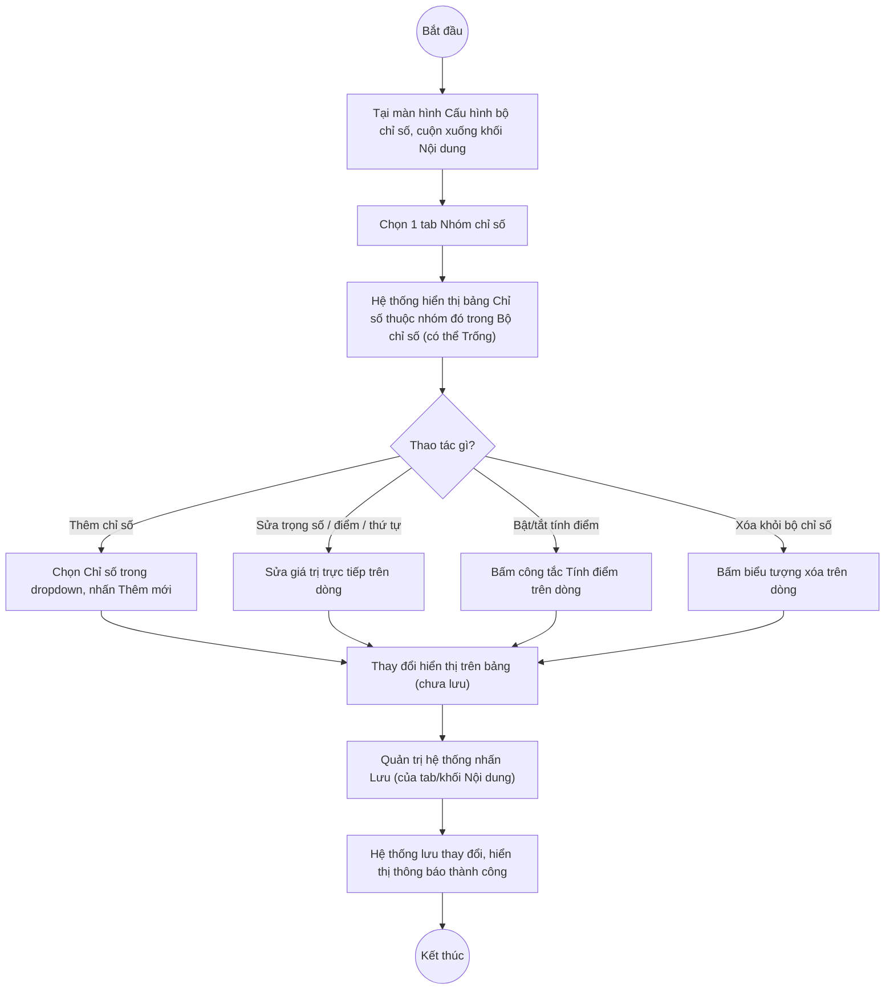

# UC6.3: Tạo nội dung cho bộ chỉ số

## 1. Thông tin chung

| ID | Use case | Description |
| :---- | :---- | :---- |
| UC6.3 | Tạo nội dung cho bộ chỉ số | Quản trị hệ thống xem danh sách Chỉ số đã đưa vào một Bộ chỉ số (UC6.1) theo từng Nhóm chỉ số, chọn thêm Chỉ số từ danh mục (UC5.3), chỉnh sửa thông tin (trọng số, thứ tự), xóa khỏi Bộ chỉ số, thiết lập tính điểm/không tính điểm, và chỉnh sửa điểm (tối thiểu/tối đa) riêng cho Chỉ số đó trong phạm vi Bộ chỉ số. |

> **Phát hiện quan trọng (10/10/2026):** Giống UC6.2, UC6.3 **không phải là một màn hình riêng** mà là **khối dưới ("Nội dung")** của cùng màn hình "Cấu hình bộ chỉ số — <Tên bộ chỉ số>" (UI-6.2.1) đã mô tả tại UC6.1 và UC6.2. Khối này được chia thành các tab, mỗi tab tương ứng với 1 Nhóm chỉ số đã được thêm ở khối "Cấu hình bộ chỉ số" (UC6.2). *(Đã kiểm chứng trực tiếp ngày 10/10/2026, xem ảnh chụp màn hình thực tế: với Bộ chỉ số "DTI 2025", khối Nội dung có 5 tab "Nhận thức số", "Hạ tầng số", "An toàn thông tin mạng", "Thể chế số", "Nhân lực số" — đúng bằng 5 Nhóm chỉ số NCS01–NCS05 ở khối trên)*.
>
> **Actor:** Quản trị hệ thống. **[Cần xác nhận]** actor "Cán bộ" theo UC_1409.
>
> **Trigger:** Tại màn hình "Cấu hình bộ chỉ số" (UI-6.2.1, mở từ UC6.1/UC6.2), Quản trị hệ thống cuộn xuống khối "Nội dung" và chọn 1 tab Nhóm chỉ số
>
> **Điều kiện trước (Pre-condition):** Quản trị hệ thống đã đăng nhập, có quyền quản lý Bộ chỉ số DTI, Bộ chỉ số đang "Chưa khóa", và khối "Cấu hình bộ chỉ số" (UC6.2) đã có ít nhất 1 Nhóm chỉ số (các tab của khối Nội dung sinh ra từ danh sách Nhóm chỉ số đó)
>
> **Điều kiện sau (Post-condition):** Danh sách Chỉ số thuộc từng Nhóm chỉ số trong Bộ chỉ số, cùng Trọng số/Tính điểm/Điểm tối thiểu/Điểm tối đa/Thứ tự hiển thị riêng của Chỉ số đó trong Bộ chỉ số được cập nhật
>
> **Business rule:**
>
> BR-1: Mỗi tab trong khối "Nội dung" hiển thị bảng Chỉ số đã đưa vào Nhóm chỉ số tương ứng (trong phạm vi Bộ chỉ số đang cấu hình), cột: MÃ CHỈ SỐ, CHỈ SỐ, TRỌNG SỐ, TÍNH ĐIỂM, ĐIỂM TỐI THIỂU, ĐIỂM TỐI ĐA, THỨ TỰ HIỂN THỊ, THAO TÁC. *(Đã kiểm chứng trực tiếp ngày 10/10/2026, tab "Nhận thức số" và "Hạ tầng số" của Bộ chỉ số "DTI 2025")*.
>
> BR-2: Tại thời điểm khảo sát, cả 2 tab đã xem ("Nhận thức số", "Hạ tầng số") của Bộ chỉ số "DTI 2025" đều **rỗng** (hiển thị biểu tượng hộp thư trống + chữ "Trống") — tức là Nhóm chỉ số đã có trong Bộ chỉ số nhưng **chưa có Chỉ số nào được thêm vào nội dung**. *(Đã kiểm chứng trực tiếp ngày 10/10/2026)*. Do đó, các trường TRỌNG SỐ/TÍNH ĐIỂM/ĐIỂM TỐI THIỂU/ĐIỂM TỐI ĐA dưới đây được mô tả dựa trên tên cột quan sát được, **chưa xác minh được giá trị/hành vi thực tế vì chưa có dữ liệu mẫu nào trong bảng**.
>
> BR-3: Thêm Chỉ số vào Nhóm chỉ số (trong phạm vi Bộ chỉ số) qua dropdown "Chỉ số" + nút "Thêm mới" phía trên mỗi tab. *(Đã kiểm chứng trực tiếp ngày 10/10/2026: dropdown và nút hiển thị trên mỗi tab)*. **[Cần xác nhận]** dropdown này có giới hạn chỉ hiển thị các Chỉ số (UC5.3) thuộc đúng Nhóm chỉ số của tab đang mở hay không.
>
> BR-4: "TRỌNG SỐ" là cột riêng cho từng Chỉ số trong phạm vi Bộ chỉ số — khác với "Điểm tối thiểu"/"Điểm tối đa" khai báo ở cấp Chỉ số dùng chung (UC5.4). **[Cần xác nhận]** ý nghĩa và công thức tính điểm chính xác của Trọng số, và liệu "Điểm tối thiểu"/"Điểm tối đa" ở đây có phải là bản sao có thể chỉnh sửa riêng cho Bộ chỉ số (ghi đè giá trị mặc định của Chỉ số) hay chỉ hiển thị tham khảo — chưa có dữ liệu mẫu để quan sát (BR-2).
>
> BR-5: "TÍNH ĐIỂM" là công tắc bật/tắt tính điểm cho từng Chỉ số trong phạm vi Bộ chỉ số, tương tự công tắc ở cấp Nhóm chỉ số (UC6.2 BR-3). **[Cần xác nhận]** hành vi chi tiết — chưa có dữ liệu mẫu để quan sát.
>
> BR-6: Mỗi tab có nút "Lưu" riêng ở cuối, tách biệt với nút "Lưu" của khối "Cấu hình bộ chỉ số" (UC6.2). *(Đã kiểm chứng trực tiếp ngày 10/10/2026: nút "Lưu" màu đỏ ở cuối khối Nội dung)*.

**Truy vết chức năng**

| STT | Chức năng | YC (BCKTKT) | Dòng UC_1409 | Luồng | Màn hình | BR |
| :---- | :---- | :---- | :---- | :---- | :---- | :---- |
| 1 | Xem danh sách chỉ số của bộ chỉ số đã chọn (theo từng tab Nhóm chỉ số) | **[Cần xác nhận]** | **[Cần xác nhận]** | Basic Flow bước 1–2 | UI-6.2.1 | BR-1, BR-2 |
| 2 | Chọn chỉ số đưa vào bộ chỉ số | **[Cần xác nhận]** | **[Cần xác nhận]** | Basic Flow bước 3–6; EF1 | UI-6.2.1 | BR-3, BR-6 |
| 3 | Chỉnh sửa thông tin chỉ số trong bộ chỉ số (trọng số, thứ tự) | **[Cần xác nhận]** | **[Cần xác nhận]** | AF1 | UI-6.2.1 | BR-4, BR-6 |
| 4 | Xóa chỉ số trong bộ chỉ số | **[Cần xác nhận]** | **[Cần xác nhận]** | AF2 | UI-6.2.1 | BR-6 |
| 5 | Thiết lập tính điểm/không tính điểm | **[Cần xác nhận]** | **[Cần xác nhận]** | AF3 | UI-6.2.1 | BR-5, BR-6 |
| 6 | Chỉnh sửa điểm đối với chỉ số trong bộ chỉ số | **[Cần xác nhận]** | **[Cần xác nhận]** | AF4 | UI-6.2.1 | BR-4, BR-6 |

> Cột YC (BCKTKT) và Dòng UC_1409 chưa đối chiếu được với bản gốc Google Sheet "Danh sách công việc_CĐS - BCT". Use case nguồn tương ứng: UC-B.II.3 "Tạo nội dung cho bộ chỉ số".

## 2. Mô tả luồng nghiệp vụ

*Hình 1. Luồng nghiệp vụ tạo nội dung (chỉ số) cho bộ chỉ số*

**Basic Flow** (Thêm Chỉ số vào một Nhóm chỉ số trong Bộ chỉ số)

1. Tại màn hình "Cấu hình bộ chỉ số" (UI-6.2.1), Quản trị hệ thống cuộn xuống khối "Nội dung".
2. Quản trị hệ thống chọn 1 tab Nhóm chỉ số (vd "Nhận thức số"). Hệ thống hiển thị bảng Chỉ số thuộc Nhóm chỉ số đó trong phạm vi Bộ chỉ số đang cấu hình (BR-1); nếu chưa có Chỉ số nào thì hiển thị "Trống" (BR-2).
3. Quản trị hệ thống chọn 1 Chỉ số trong dropdown "Chỉ số" (BR-3).
4. Quản trị hệ thống nhấn "Thêm mới".
5. Hệ thống thêm dòng mới vào bảng — thay đổi **chưa được lưu xuống hệ thống**.
6. Quản trị hệ thống nhấn "Lưu" (BR-6).
7. Hệ thống lưu thay đổi của tab đang mở, hiển thị thông báo thành công.

**Alternative Flow**

AF1. Chỉnh sửa Trọng số / Thứ tự hiển thị của Chỉ số trong Bộ chỉ số

Tại bước 2, Quản trị hệ thống sửa giá trị Trọng số và/hoặc Thứ tự hiển thị trên một dòng (BR-4). **[Cần xác nhận]** cách nhập cụ thể (textbox trực tiếp trên bảng hay qua một modal riêng) — chưa quan sát được vì bảng đang rỗng. Tiếp tục từ bước 6.

AF2. Xóa Chỉ số khỏi Bộ chỉ số

Tại bước 2, Quản trị hệ thống bấm biểu tượng xóa trên một dòng. **[Cần xác nhận]** có popup xác nhận hay không. Tiếp tục từ bước 6.

AF3. Bật/tắt Tính điểm cho Chỉ số trong Bộ chỉ số

Tại bước 2, Quản trị hệ thống bấm công tắc "Tính điểm" trên một dòng (BR-5). Tiếp tục từ bước 6.

AF4. Chỉnh sửa điểm (tối thiểu/tối đa) riêng cho Chỉ số trong Bộ chỉ số

Tại bước 2, Quản trị hệ thống sửa giá trị "Điểm tối thiểu"/"Điểm tối đa" trên một dòng (BR-4) — **[Cần xác nhận]** đây có phải là ghi đè riêng cho Bộ chỉ số này, độc lập với Điểm tối thiểu/tối đa mặc định khai báo ở cấp Chỉ số (UC5.4), hay chỉ là hiển thị lại giá trị mặc định không sửa được tại đây. Tiếp tục từ bước 6.

AF5. Chuyển sang tab Nhóm chỉ số khác

Tại bước 2, Quản trị hệ thống chọn tab khác (vd từ "Nhận thức số" sang "Hạ tầng số"). Hệ thống hiển thị lại từ bước 2 cho Nhóm chỉ số mới. **[Cần xác nhận]** nếu tab trước có thay đổi chưa lưu thì có cảnh báo hay mất thay đổi âm thầm.

**Exception Flow**

EF1. Lưu khi bảng Chỉ số rỗng

Tại thời điểm khảo sát, cả 2 tab xem được đều ở trạng thái "Trống" nhưng vẫn hiển thị nút "Lưu" đang bật (không bị vô hiệu hóa). **[Cần xác nhận]** nhấn "Lưu" khi bảng rỗng có hợp lệ hay báo lỗi "phải có ít nhất 1 chỉ số".

EF2. Lỗi hệ thống khi lưu

Hệ thống hiển thị thông báo lỗi chung, giữ nguyên dữ liệu trước thao tác. **[Cần xác nhận]** nội dung cụ thể.

Use case kết thúc.

## 3. Màn hình

| UI Code | Screen | Mô tả |
| :---- | :---- | :---- |
| UI-6.2.1 | Cấu hình bộ chỉ số (Web) — khối "Nội dung" | Tab theo từng Nhóm chỉ số, bảng Chỉ số thuộc nhóm trong phạm vi Bộ chỉ số; dùng chung màn hình với UC6.2 (khối "Cấu hình bộ chỉ số" ở phía trên) |

## 4. Mô tả Màn hình (Field Specification)

**UI-6.2.1 — Cấu hình bộ chỉ số (khối "Nội dung")**

| Field Name | Field type | Data Type | Required | Validation rule/Behaviour |
| :---- | :---- | :---- | :---- | :---- |
| Tiêu đề khối | Label | String | Yes | **Behaviour:** "Nội dung" **Validation rule:** — |
| Tab theo Nhóm chỉ số | Tabs | Enum | Yes | **Behaviour:** Mỗi tab tương ứng 1 Nhóm chỉ số đã thêm ở khối Cấu hình bộ chỉ số (UC6.2); mặc định chọn tab đầu tiên **Validation rule:** — |
| Dropdown "Chỉ số" | Dropdown | Enum | No | **Behaviour:** Chọn Chỉ số (UC5.3) để thêm vào tab đang mở (BR-3) **Validation rule:** **[Cần xác nhận]** có lọc theo đúng Nhóm chỉ số của tab hay không |
| Nút "Thêm mới" (khối Nội dung) | Button | Action | Yes | **Behaviour:** Thêm dòng mới vào bảng theo Chỉ số đã chọn (Basic Flow bước 4–5) **Validation rule:** — |
| MÃ CHỈ SỐ | Label | String | Yes | **Behaviour:** Mã Chỉ số **Validation rule:** — |
| CHỈ SỐ | Label | String | Yes | **Behaviour:** Tên Chỉ số **Validation rule:** — |
| TRỌNG SỐ | **[Cần xác nhận]** | **[Cần xác nhận]** | **[Cần xác nhận]** | **Behaviour:** **[Cần xác nhận]** ý nghĩa, cách nhập, đơn vị (số hay %) — chưa có dữ liệu mẫu để quan sát (BR-2, BR-4) **Validation rule:** **[Cần xác nhận]** |
| TÍNH ĐIỂM | Toggle | Boolean | Yes | **Behaviour:** Bật/tắt tính điểm Chỉ số trong Bộ chỉ số (BR-5, AF3) **Validation rule:** — |
| ĐIỂM TỐI THIỂU | **[Cần xác nhận]** | Decimal | **[Cần xác nhận]** | **Behaviour:** **[Cần xác nhận]** có ghi đè được riêng cho Bộ chỉ số hay chỉ hiển thị (BR-4, AF4) — chưa có dữ liệu mẫu để quan sát **Validation rule:** **[Cần xác nhận]** |
| ĐIỂM TỐI ĐA | **[Cần xác nhận]** | Decimal | **[Cần xác nhận]** | **Behaviour:** **[Cần xác nhận]** tương tự ĐIỂM TỐI THIỂU **Validation rule:** **[Cần xác nhận]** |
| THỨ TỰ HIỂN THỊ | Label | Integer | Yes | **Behaviour:** **[Cần xác nhận]** cách đổi thứ tự (có mũi tên như khối Cấu hình bộ chỉ số — UC6.2 — hay không) — chưa quan sát được vì bảng rỗng **Validation rule:** — |
| Thao tác xóa | Icon button | Action | Yes | **Behaviour:** Xóa Chỉ số khỏi Bộ chỉ số (AF2) **Validation rule:** **[Cần xác nhận]** có popup xác nhận hay không |
| Trạng thái rỗng | Empty state | — | — | **Behaviour:** Biểu tượng hộp thư + chữ "Trống" khi tab chưa có Chỉ số nào (BR-2) *(Đã kiểm chứng trực tiếp ngày 10/10/2026)* **Validation rule:** — |
| Nút "Lưu" (khối Nội dung) | Button | Action | Yes | **Behaviour:** Lưu thay đổi của tab/khối Nội dung (bước 6–7, BR-6) **Validation rule:** **[Cần xác nhận]** có cho lưu khi bảng rỗng (EF1) |

## Điểm cần xác nhận

| STT | Vị trí | Giả định đã dùng | Câu hỏi cần xác nhận |
| :---- | :---- | :---- | :---- |
| 1 | Mục 1 – Phát hiện quan trọng | UC6.3 là khối "Nội dung" nằm chung màn hình với UC6.2, tab hóa theo Nhóm chỉ số | Xác nhận với BA đây là thiết kế chủ đích |
| 2 | BR-2, toàn bộ cột Trọng số/Điểm | Cả 2 tab xem được của Bộ chỉ số mẫu đều rỗng, nên không quan sát được hành vi thực tế của Trọng số/Điểm tối thiểu/tối đa khi có dữ liệu | **Quan trọng**: cần thao tác thêm thử 1 Chỉ số vào 1 tab (trên Bộ chỉ số test, không phải dữ liệu thật) để quan sát đầy đủ cột Trọng số, cách sửa Điểm tối thiểu/tối đa, và cách lưu |
| 3 | BR-4 | Chưa rõ công thức tính điểm tổng của Bộ chỉ số dựa trên Trọng số + Tính điểm ở cả cấp Nhóm chỉ số (UC6.2) lẫn cấp Chỉ số (UC6.3) | Cần tài liệu nghiệp vụ mô tả công thức tính điểm tổng |
| 4 | AF4 | Chưa rõ Điểm tối thiểu/tối đa ở đây có ghi đè được giá trị mặc định của Chỉ số (UC5.4) hay không | Cần xác nhận quan hệ dữ liệu giữa 2 nơi |
| 5 | AF5, EF1 | Chưa rõ hành vi khi chuyển tab có thay đổi chưa lưu, và khi lưu lúc bảng rỗng | Cần xác nhận cả 2 hành vi |
| 6 | Truy vết chức năng | Chưa có số YC (BCKTKT) và Dòng UC_1409 | Đề nghị đối chiếu với bản gốc Google Sheet |
