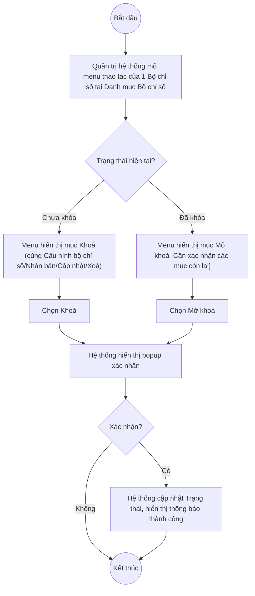

# UC6.4: Khóa/Mở khóa bộ chỉ số

## 1. Thông tin chung

| ID | Use case | Description |
| :---- | :---- | :---- |
| UC6.4 | Khóa/Mở khóa bộ chỉ số | Quản trị hệ thống khóa một Bộ chỉ số (UC6.1) để không cho chỉnh sửa và đưa vào sử dụng (vd cho một đợt tự đánh giá tham chiếu ổn định), hoặc mở khóa để cho phép chỉnh sửa trở lại. |

> **Actor:** Quản trị hệ thống. **[Cần xác nhận]** actor "Cán bộ" theo UC_1409.
>
> **Trigger:** Quản trị hệ thống mở menu thao tác của một dòng Bộ chỉ số tại UI-6.1.1 và chọn "Khoá" hoặc "Mở khoá"
>
> **Điều kiện trước (Pre-condition):** Quản trị hệ thống đã đăng nhập và có quyền quản lý Bộ chỉ số DTI
>
> **Điều kiện sau (Post-condition):** Trạng thái của Bộ chỉ số chuyển từ "Chưa khóa" sang "Đã khóa" hoặc ngược lại
>
> **Business rule:**
>
> BR-1: Mục "Khoá" chỉ xuất hiện trên menu thao tác của Bộ chỉ số đang "Chưa khóa". *(Đã kiểm chứng trực tiếp ngày 10/10/2026: dòng "BCS01" Chưa khóa có menu Cấu hình bộ chỉ số/Khoá/Nhân bản/Cập nhật/Xoá)*.
>
> BR-2: Theo dữ liệu API ngày 08/10/2026, thao tác Khóa/Mở khóa Bộ chỉ số gọi 2 endpoint riêng `POST .../lock` và `POST .../unlock` (khác với Trụ cột dùng chung 1 endpoint PUT để toggle `isActive`), trả về thông báo "Khoá bộ chỉ số thành công" / "Mở khoá bộ chỉ số thành công", và cập nhật trường `status` từ `"Draft"` sang `"Locked"`. **[Cần xác nhận]** lại trực tiếp — chưa thực hiện lại thao tác này trong phiên hôm nay để tránh khóa nhầm một Bộ chỉ số đang được dùng thật.
>
> BR-3: Khi Bộ chỉ số "Đã khóa": **[Cần xác nhận]** menu thao tác còn lại những mục nào — theo suy luận từ mẫu hình chung của các màn hình khác trong phân hệ B (Trụ cột, Nhóm chỉ số: chỉ còn "Mở khoá"), nhiều khả năng Bộ chỉ số đã khóa cũng ẩn "Cập nhật"/"Xoá"/"Cấu hình bộ chỉ số" và chỉ còn "Mở khoá", nhưng **chưa kiểm chứng trực tiếp** được menu của 1 dòng Bộ chỉ số đang khóa trong phiên hôm nay.
>
> BR-4: **[Cần xác nhận]** khóa Bộ chỉ số có đồng thời khóa luôn các Nhóm chỉ số/Chỉ số bên trong cấu trúc của nó (UC6.2, UC6.3) hay chỉ khóa ở cấp Bộ chỉ số, không ảnh hưởng danh mục Nhóm chỉ số/Chỉ số dùng chung (UC5.2, UC5.3).
>
> BR-5: **[Cần xác nhận]** mối quan hệ giữa trạng thái Khóa/Mở khóa (UC6.4) và "Trạng thái sử dụng" (BCKTKT yêu cầu "cập nhật trạng thái sử dụng/không sử dụng" — xem UC6.1 chức năng #8) — có phải là cùng 1 khái niệm (khóa = ngừng sử dụng) hay 2 khái niệm độc lập.

**Truy vết chức năng**

| STT | Chức năng | YC (BCKTKT) | Dòng UC_1409 | Luồng | Màn hình | BR |
| :---- | :---- | :---- | :---- | :---- | :---- | :---- |
| 1 | Khóa bộ chỉ số | **[Cần xác nhận]** | **[Cần xác nhận]** | Basic Flow | UI-6.4.1 | BR-1, BR-2 |
| 2 | Mở khóa bộ chỉ số | **[Cần xác nhận]** | **[Cần xác nhận]** | AF1 | UI-6.4.1 | BR-2, BR-3 |

> Cột YC (BCKTKT) và Dòng UC_1409 chưa đối chiếu được với bản gốc Google Sheet "Danh sách công việc_CĐS - BCT". Use case nguồn tương ứng: UC-B.II.4 "Khóa/Mở khóa bộ chỉ số".

## 2. Mô tả luồng nghiệp vụ

*Hình 1. Luồng nghiệp vụ khóa / mở khóa Bộ chỉ số*

**Basic Flow** (Khóa Bộ chỉ số)

1. Quản trị hệ thống mở Danh mục Bộ chỉ số (UI-6.1.1, xem UC6.1), tìm Bộ chỉ số đang "Chưa khóa" cần khóa.
2. Quản trị hệ thống mở menu thao tác của dòng đó và chọn "Khoá" (BR-1).
3. Hệ thống hiển thị popup xác nhận (UI-6.4.1). **[Cần xác nhận]** nội dung chính xác của popup — chưa mở trực tiếp trong phiên hôm nay.
4. Quản trị hệ thống xác nhận.
5. Hệ thống cập nhật Trạng thái Bộ chỉ số thành "Đã khóa" (BR-2), đóng popup, hiển thị thông báo thành công và tải lại danh sách.

**Alternative Flow**

AF1. Mở khóa Bộ chỉ số

Tại màn hình danh sách (UC6.1, bước 2), với dòng đang "Đã khóa", Quản trị hệ thống mở menu thao tác và chọn "Mở khoá". Hệ thống hiển thị popup xác nhận (UI-6.4.1). Quản trị hệ thống xác nhận. Hệ thống cập nhật Trạng thái thành "Chưa khóa" (BR-2), hiển thị thông báo thành công. Use case kết thúc.

AF2. Hủy thao tác

Tại popup xác nhận (bước 3, AF1), Quản trị hệ thống nhấn "Hủy" hoặc biểu tượng đóng. Hệ thống đóng popup, không đổi trạng thái. Quay lại danh sách Bộ chỉ số.

**Exception Flow**

EF1. Lỗi hệ thống khi khóa/mở khóa

Hệ thống hiển thị thông báo lỗi chung, giữ nguyên Trạng thái trước thao tác. **[Cần xác nhận]** nội dung thông báo cụ thể.

Use case kết thúc.

## 3. Màn hình

| UI Code | Screen | Mô tả |
| :---- | :---- | :---- |
| UI-6.4.1 | Popup xác nhận Khóa / Mở khóa Bộ chỉ số (Web) | Xác nhận trước khi khóa hoặc mở khóa bộ chỉ số |

## 4. Mô tả Màn hình (Field Specification)

**UI-6.4.1 — Popup xác nhận Khóa / Mở khóa**

| Field Name | Field type | Data Type | Required | Validation rule/Behaviour |
| :---- | :---- | :---- | :---- | :---- |
| Nội dung xác nhận | Label | String | Yes | **Behaviour:** **[Cần xác nhận]** nội dung chính xác — có thể bao gồm cảnh báo về việc không cho chỉnh sửa nữa, phù hợp mô tả "khóa bộ chỉ số (không cho chỉnh sửa, đưa vào sử dụng)" của UC_1409 **Validation rule:** — |
| Nút Hủy | Button | Action | Yes | **Behaviour:** Đóng popup, không đổi trạng thái (AF2) **Validation rule:** — |
| Nút xác nhận (Khoá/Mở khoá) | Button | Action | Yes | **Behaviour:** Thực hiện đổi Trạng thái (Basic Flow bước 4–5, AF1) **Validation rule:** — |

## Điểm cần xác nhận

| STT | Vị trí | Giả định đã dùng | Câu hỏi cần xác nhận |
| :---- | :---- | :---- | :---- |
| 1 | BR-3 | Menu thao tác của Bộ chỉ số đã khóa — suy luận theo mẫu hình chung, chưa kiểm chứng trực tiếp | Cần xác nhận còn những mục nào khi đã khóa (chỉ "Mở khoá" hay còn mục khác như "Nhân bản") |
| 2 | BR-4 | Chưa rõ khóa Bộ chỉ số có lan xuống khóa Nhóm chỉ số/Chỉ số bên trong cấu trúc của nó không | Cần xác nhận phạm vi tác động của việc khóa |
| 3 | BR-5 | Chưa rõ quan hệ giữa "Khóa/Mở khóa" và "Trạng thái sử dụng/không sử dụng" theo yêu cầu UC_1409 | Có phải 2 tên gọi khác nhau của cùng 1 cơ chế, hay 2 trường độc lập? |
| 4 | Basic Flow bước 3 | Chưa mở được popup xác nhận trực tiếp trong phiên hôm nay (tránh khóa nhầm dữ liệu thật) | Đề nghị xác minh trên môi trường staging nếu có |
| 5 | Truy vết chức năng | Chưa có số YC (BCKTKT) và Dòng UC_1409 | Đề nghị đối chiếu với bản gốc Google Sheet |
