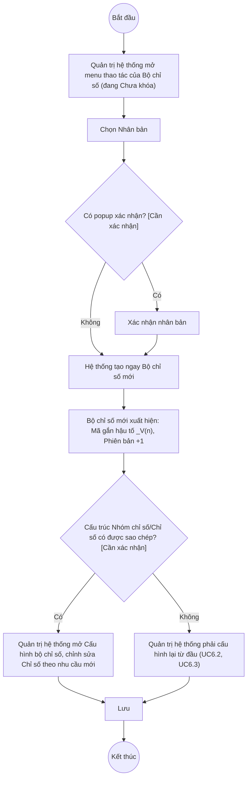

# UC6.5: Nhân bản bộ chỉ số

## 1. Thông tin chung

| ID | Use case | Description |
| :---- | :---- | :---- |
| UC6.5 | Nhân bản bộ chỉ số | Quản trị hệ thống chọn một Bộ chỉ số đã có (UC6.1) để tạo nhanh một phiên bản mới (bản sao toàn bộ cấu trúc Nhóm chỉ số/Chỉ số), sau đó xem/chỉnh sửa các Chỉ số của bản sao cho phù hợp kỳ áp dụng mới. |

> **Actor:** Quản trị hệ thống. **[Cần xác nhận]** actor "Cán bộ" theo UC_1409.
>
> **Trigger:** Quản trị hệ thống mở menu thao tác của một dòng Bộ chỉ số (đang "Chưa khóa") tại UI-6.1.1 và chọn "Nhân bản"
>
> **Điều kiện trước (Pre-condition):** Quản trị hệ thống đã đăng nhập, có quyền quản lý Bộ chỉ số DTI, Bộ chỉ số nguồn đang "Chưa khóa"
>
> **Điều kiện sau (Post-condition):** Một Bộ chỉ số mới được tạo, Phiên bản tăng thêm 1 so với bản gốc, Mã bộ chỉ số được gắn hậu tố phiên bản; danh sách Bộ chỉ số hiển thị thêm bản ghi mới
>
> **Business rule:**
>
> BR-1: Mục "Nhân bản" chỉ xuất hiện trên menu thao tác của Bộ chỉ số đang "Chưa khóa" — *(Đã kiểm chứng trực tiếp ngày 10/10/2026: menu của dòng "BCS01" Chưa khóa có đủ "Nhân bản")*. **[Cần xác nhận]** Bộ chỉ số đang "Đã khóa" có cho phép Nhân bản không — về mặt nghiệp vụ, khóa thường dùng để "chốt" một bộ chỉ số đang dùng ổn định, nên nhiều khả năng vẫn cho phép nhân bản từ bản đã khóa để tạo phiên bản điều chỉnh mới mà không ảnh hưởng bản gốc — nhưng chưa kiểm chứng trực tiếp (menu của dòng đã khóa chưa quan sát được, xem UC6.4 BR-3).
>
> BR-2: Bản sao được tạo với: Mã bộ chỉ số = Mã gốc + hậu tố "_V&lt;n&gt;" (n = Phiên bản mới, ví dụ gốc "uc1409b-set-266607" đã sửa thành "...266607" → bản sao "uc1409b-set-266607_V2"), Tên bộ chỉ số = giữ nguyên Tên gốc, Phiên bản = Phiên bản gốc + 1, Trạng thái luôn là "Chưa khóa" (Draft) dù bản gốc đang khóa hay không, Năm áp dụng/Mô tả giữ nguyên bản gốc. *(Theo dữ liệu API ngày 08/10/2026)*. **[Cần xác nhận]** lại trực tiếp — chưa thực hiện lại thao tác Nhân bản Bộ chỉ số trong phiên hôm nay để tránh phải tạo và dọn dẹp thêm dữ liệu test có cấu trúc phức tạp (Nhóm chỉ số + Chỉ số bên trong).
>
> BR-3: **[Cần xác nhận]** toàn bộ cấu trúc Nhóm chỉ số và Chỉ số (khối "Cấu hình bộ chỉ số" và "Nội dung" — UC6.2, UC6.3) của Bộ chỉ số gốc có được sao chép đầy đủ sang bản sao hay bản sao bắt đầu rỗng và phải cấu hình lại từ đầu — đây là điểm quan trọng nhất cần xác minh vì ảnh hưởng trực tiếp tới giá trị sử dụng của tính năng "Nhân bản" (mục đích chính theo UC_1409 là tránh phải nhập lại từ đầu). Dữ liệu API ngày 08/10/2026 chỉ ghi nhận được bản thân bản ghi Bộ chỉ số được tạo ra (qua `POST .../clone`), không có log về việc cấu trúc con có được sao chép kèm theo hay không.
>
> BR-4: Theo quan sát dữ liệu ngày 08/10/2026, thao tác "Nhân bản" gọi thẳng API tạo bản sao ngay khi bấm, không có bước điền form trung gian được ghi nhận. **[Cần xác nhận]** có popup xác nhận trước khi tạo hay không (tương tự điểm cần xác nhận ở UC5.5 BR-3).
>
> BR-5: Sau khi nhân bản, bản sao là một Bộ chỉ số độc lập — chỉnh sửa cấu trúc/Chỉ số sau đó dùng đúng các luồng Cập nhật/Cấu hình bộ chỉ số thông thường (UC6.1, UC6.2, UC6.3), không có luồng chỉnh sửa riêng cho "bộ chỉ số vừa nhân bản".

**Truy vết chức năng**

| STT | Chức năng | YC (BCKTKT) | Dòng UC_1409 | Luồng | Màn hình | BR |
| :---- | :---- | :---- | :---- | :---- | :---- | :---- |
| 1 | Nhân bản bộ chỉ số đã chọn | **[Cần xác nhận]** | **[Cần xác nhận]** | Basic Flow | UI-6.1.1 | BR-1, BR-2, BR-3, BR-4 |
| 2 | Xem, chỉnh sửa các chỉ số của bộ chỉ số vừa nhân bản | **[Cần xác nhận]** | **[Cần xác nhận]** | AF1 | UI-6.2.1 (UC6.2, UC6.3) | BR-3, BR-5 |

> Cột YC (BCKTKT) và Dòng UC_1409 chưa đối chiếu được với bản gốc Google Sheet "Danh sách công việc_CĐS - BCT". Use case nguồn tương ứng: UC-B.II.5 "Nhân bản bộ chỉ số".

## 2. Mô tả luồng nghiệp vụ

*Hình 1. Luồng nghiệp vụ nhân bản bộ chỉ số*

**Basic Flow** (Nhân bản Bộ chỉ số)

1. Quản trị hệ thống mở Danh mục Bộ chỉ số (UI-6.1.1, xem UC6.1), tìm Bộ chỉ số nguồn cần nhân bản (đang "Chưa khóa").
2. Quản trị hệ thống mở menu thao tác của dòng đó và chọn "Nhân bản" (BR-1).
3. **[Cần xác nhận]** Hệ thống có thể hiển thị popup xác nhận trước khi tạo bản sao (BR-4) — chưa xác minh được trong phiên hôm nay.
4. Hệ thống tạo một Bộ chỉ số mới với Mã gắn hậu tố phiên bản, Phiên bản tăng thêm 1 (BR-2).
5. Hệ thống hiển thị thông báo thành công và thêm bản ghi mới vào danh sách.

**Alternative Flow**

AF1. Xem và chỉnh sửa các Chỉ số của bộ chỉ số vừa nhân bản

Sau bước 5, Quản trị hệ thống mở menu thao tác của dòng vừa tạo và chọn "Cấu hình bộ chỉ số" (xem UC6.2, UC6.3) để xem cấu trúc Nhóm chỉ số/Chỉ số của bản sao (BR-3) và chỉnh sửa cho phù hợp kỳ áp dụng mới (BR-5). Use case kết thúc.

**Exception Flow**

EF1. Lỗi hệ thống khi nhân bản

Hệ thống hiển thị thông báo lỗi chung, không tạo bản sao. **[Cần xác nhận]** nội dung thông báo cụ thể.

Use case kết thúc.

## 3. Màn hình

| UI Code | Screen | Mô tả |
| :---- | :---- | :---- |
| UI-6.1.1 | Danh mục Bộ chỉ số (Web) — dùng chung với UC6.1 | Nơi chọn Bộ chỉ số nguồn và thấy bản sao mới xuất hiện |
| UI-6.2.1 | Cấu hình bộ chỉ số (Web) — dùng chung với UC6.2, UC6.3 | Dùng để xem/chỉnh sửa cấu trúc của bộ chỉ số vừa nhân bản (AF1) |

## 4. Mô tả Màn hình (Field Specification)

Không có màn hình/trường riêng cho UC6.5 ngoài menu thao tác "Nhân bản" trên UI-6.1.1.

| Field Name | Field type | Data Type | Required | Validation rule/Behaviour |
| :---- | :---- | :---- | :---- | :---- |
| Mục "Nhân bản" trên menu thao tác | Menu item | Action | Yes | **Behaviour:** Chỉ hiển thị khi Bộ chỉ số đang "Chưa khóa" (BR-1); kích hoạt tạo bản sao (BR-2, BR-3, BR-4) **Validation rule:** — |

## Điểm cần xác nhận

| STT | Vị trí | Giả định đã dùng | Câu hỏi cần xác nhận |
| :---- | :---- | :---- | :---- |
| 1 | BR-3 | **Quan trọng nhất**: chưa xác minh được liệu cấu trúc Nhóm chỉ số/Chỉ số (UC6.2, UC6.3) của bộ chỉ số gốc có được sao chép đầy đủ sang bản sao hay không | Cần thử nghiệm trực tiếp trên 1 Bộ chỉ số test: tạo bộ chỉ số test có cấu hình Nhóm chỉ số/Chỉ số, nhân bản, rồi so sánh cấu trúc giữa bản gốc và bản sao |
| 2 | BR-1 | Chưa rõ Bộ chỉ số đang "Đã khóa" có cho phép Nhân bản hay không | Cần xác nhận menu của dòng đã khóa |
| 3 | BR-4 | Chưa rõ có popup xác nhận trước khi nhân bản | Đề nghị xác minh lại bằng thao tác tay trực tiếp |
| 4 | BR-2 | Quy tắc hậu tố "_V&lt;n&gt;" dựa theo dữ liệu API ngày 08/10/2026, chưa thử lại hôm nay | Xác nhận quy tắc này vẫn còn đúng |
| 5 | Truy vết chức năng | Chưa có số YC (BCKTKT) và Dòng UC_1409 | Đề nghị đối chiếu với bản gốc Google Sheet |
