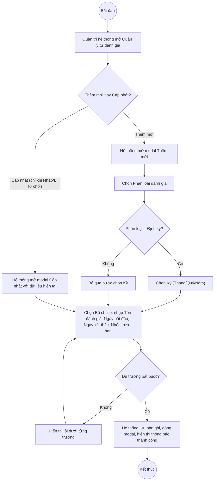

# UC7.1: Danh mục tự đánh giá

## 1. Thông tin chung

| ID | Use case | Description |
| :---- | :---- | :---- |
| UC7.1 | Danh mục tự đánh giá | Quản trị hệ thống xem danh mục các đợt tự đánh giá (định kỳ/đột xuất) mà các cơ quan/đơn vị phải thực hiện, thêm mới một đợt tự đánh giá gắn với 1 Bộ chỉ số (UC6.1), chỉnh sửa, xóa, và truy cập cấu hình chỉ số/chỉ tiêu cũng như phân công đơn vị của đợt đó. |

> **Actor:** Quản trị hệ thống. UC_1409 (UC-B.III.1) còn liệt kê actor "Cán bộ" — **[Cần xác nhận]**, chưa xác minh được.
>
> **Trigger:** Quản trị hệ thống chọn "Quản lý tự đánh giá" trong nhóm menu "Bộ chỉ số DTI"
>
> **Điều kiện trước (Pre-condition):** Quản trị hệ thống đã đăng nhập và có quyền quản lý Bộ chỉ số DTI
>
> **Điều kiện sau (Post-condition):** Bản ghi đợt tự đánh giá (Phân loại, Bộ chỉ số, Tên đánh giá, Ngày bắt đầu, Ngày kết thúc, Nhắc trước hạn, Trạng thái) được thêm mới, cập nhật hoặc xóa; danh sách hiển thị dữ liệu mới nhất
>
> **Business rule:**
>
> BR-1: Danh sách có 2 tab "Định kỳ" / "Đột xuất" ở góc trên bên trái bảng. *(Đã kiểm chứng trực tiếp ngày 10/10/2026)*. **[Cần xác nhận]** nội dung chi tiết tab "Đột xuất" — hôm nay chỉ xác nhận được tab tồn tại, chưa kịp quan sát kỹ dữ liệu bên trong do ưu tiên thời gian cho các UC khác.
>
> BR-2: Phân loại đánh giá, Bộ chỉ số, Tên đánh giá, Ngày bắt đầu, Ngày kết thúc là trường bắt buộc khi thêm mới; Nhắc trước hạn (ngày) không bắt buộc. *(Đã kiểm chứng trực tiếp ngày 10/10/2026: dấu `*` trên modal "Thêm mới")*.
>
> BR-3: Khi chọn Phân loại đánh giá = "Định kỳ", hệ thống hiện thêm trường "Kỳ" để chọn chu kỳ lặp lại (quan sát được giá trị "Kỳ - Tháng" trong dữ liệu khảo sát), đúng với yêu cầu "theo tháng/quý/năm" của UC_1409. *(Theo dữ liệu khảo sát ngày 08/10/2026 — **[Cần xác nhận]** lại trực tiếp hôm nay, vì khi mở modal Thêm mới trong phiên hôm nay chưa chọn Phân loại đánh giá nên trường "Kỳ" chưa xuất hiện để xác nhận lại)*.
>
> BR-4: Trường "Tên đánh giá" trên modal Thêm mới hiển thị placeholder "Tìm kiếm tên đánh giá" thay vì placeholder nhập liệu thông thường. **[Cần xác nhận]** đây có phải ô tự động gợi ý tên (autocomplete) dựa trên các đợt đã có, hay chỉ là placeholder chưa chỉnh sửa đúng ngữ cảnh (vì theo quan sát ngày 08/10/2026, cùng vị trí này nhận giá trị nhập tự do bình thường) — nghi ngờ đây là một thay đổi UI nhỏ giữa 2 lần khảo sát, cần xác nhận với dev.
>
> BR-5: Trạng thái đợt tự đánh giá gồm 4 giá trị quan sát được: "Nháp" (xám), "Chờ phê duyệt" (vàng/cam), "Đã phê duyệt" (xanh lá), "Bị từ chối" (đỏ). *(Đã kiểm chứng trực tiếp ngày 10/10/2026)*. Khi thêm mới, Trạng thái mặc định là "Nháp"/Draft. *(Theo dữ liệu API ngày 08/10/2026: `"status":"Draft"`)*.
>
> BR-6: **Menu thao tác trên mỗi dòng thay đổi theo Trạng thái** — đã kiểm chứng trực tiếp ngày 10/10/2026 trên toàn bộ 10 dòng của trang 1:
>   - Trạng thái "Nháp": Cấu hình bộ chỉ số, Phân công đơn vị, Trình phê duyệt, Cập nhật, Xoá.
>   - Trạng thái "Bị từ chối": Cấu hình bộ chỉ số, Phân công đơn vị, Trình phê duyệt, Cập nhật (không có Xoá).
>   - Trạng thái "Chờ phê duyệt": Phân công đơn vị, Phê duyệt, Từ chối, Cập nhật (không có Cấu hình bộ chỉ số, không có Trình phê duyệt, không có Xoá).
>   - Trạng thái "Đã phê duyệt": chỉ còn Phân công đơn vị, Cập nhật (không có Cấu hình bộ chỉ số, Trình phê duyệt, Phê duyệt/Từ chối, Xoá).
>
>   Nói cách khác: chỉ đợt đang "Nháp" hoặc "Bị từ chối" mới sửa được cấu hình chỉ số/chỉ tiêu và trình phê duyệt lại; chỉ đợt "Chờ phê duyệt" mới phê duyệt/từ chối được; đợt "Đã phê duyệt" gần như chỉ còn xem và phân công đơn vị.
>
> BR-7: Mục "Cấu hình bộ chỉ số" trên menu thao tác của đợt tự đánh giá (khi Nháp/Bị từ chối) **mở đúng màn hình "Cấu hình bộ chỉ số" đã mô tả tại UC6.2/UC6.3**, áp dụng cho Bộ chỉ số gắn với đợt đó — đây chính là cách hệ thống thực hiện yêu cầu "chỉnh sửa chỉ số/chỉ tiêu của tự đánh giá; thêm mới chỉ số/chỉ tiêu; xóa chỉ số/chỉ tiêu" của UC_1409. *(Suy luận hợp lý từ tên gọi trùng khớp và việc mỗi đợt tự đánh giá gắn với đúng 1 Bộ chỉ số; **[Cần xác nhận]** lại bằng cách bấm thử trực tiếp — phiên hôm nay chưa bấm vào mục này để tránh sửa cấu hình của một Bộ chỉ số đang được đợt tự đánh giá thật sử dụng).*
>
> BR-8: Có nút "Xuất Excel" ở góc trên bên phải danh sách. *(Đã kiểm chứng trực tiếp ngày 10/10/2026: nút hiển thị rõ)*. **[Cần xác nhận]** nội dung file xuất ra — dữ liệu khảo sát ngày 08/10/2026 ghi nhận thử bấm nút này nhưng "không bắt được sự kiện tải file" (`no download event`), nên chưa rõ tính năng có hoạt động đúng hay không.
>
> BR-9: Phân trang 10 bản ghi/trang, 19 bản ghi/2 trang (tab Định kỳ) tại thời điểm khảo sát. *(Đã kiểm chứng trực tiếp ngày 10/10/2026)*.

**Ghi nhận QC (10/10/2026):** Nút "Xem chi tiết" trên danh sách Quản lý tự đánh giá **không mở được bất kỳ màn hình/modal nào** — đã bấm trực tiếp, xác nhận URL hash không đổi (`#/vi/self-assessment-campaigns`) và không có modal/drawer xuất hiện. Cùng dạng lỗi hồi quy đã ghi nhận ở UC5.1, UC5.3, UC6.1.

**Truy vết chức năng**

| STT | Chức năng | YC (BCKTKT) | Dòng UC_1409 | Luồng | Màn hình | BR |
| :---- | :---- | :---- | :---- | :---- | :---- | :---- |
| 1 | Xem danh mục tự đánh giá (Định kỳ/Đột xuất) | **[Cần xác nhận]** | **[Cần xác nhận]** | Basic Flow bước 1–2 | UI-7.1.1 | BR-1, BR-9 |
| 2 | Lựa chọn bộ chỉ số để thêm mới tự đánh giá (theo tháng/quý/năm) | **[Cần xác nhận]** | **[Cần xác nhận]** | Basic Flow bước 3–7; EF1 | UI-7.1.2 | BR-2, BR-3, BR-5 |
| 3 | Chỉnh sửa tự đánh giá (chọn loại định kỳ/đột xuất) | **[Cần xác nhận]** | **[Cần xác nhận]** | AF1; EF1 | UI-7.1.2 | BR-2, BR-6 |
| 4 | Chỉnh sửa / thêm mới / xóa chỉ số, chỉ tiêu của tự đánh giá | **[Cần xác nhận]** | **[Cần xác nhận]** | AF2 (chi tiết tại UC6.2, UC6.3) | UI-6.2.1 | BR-6, BR-7 |
| 5 | Xóa tự đánh giá | **[Cần xác nhận]** | **[Cần xác nhận]** | AF3 | UI-7.1.3 | BR-6 |
| 6 | Thiết lập thời gian cảnh báo đến hạn tự đánh giá | **[Cần xác nhận]** | **[Cần xác nhận]** | Basic Flow bước 5 (trường "Nhắc trước hạn") | UI-7.1.2 | BR-2 |
| 7 | Export danh mục ra excel | **[Cần xác nhận]** | **[Cần xác nhận]** | AF4 | UI-7.1.1 | BR-8 |

> Cột YC (BCKTKT) và Dòng UC_1409 chưa đối chiếu được với bản gốc Google Sheet "Danh sách công việc_CĐS - BCT". Use case nguồn tương ứng: UC-B.III.1 "Danh mục tự đánh giá".

## 2. Mô tả luồng nghiệp vụ

*Hình 1. Luồng nghiệp vụ thêm mới / cập nhật đợt tự đánh giá*

**Basic Flow** (Thêm mới đợt tự đánh giá)

1. Quản trị hệ thống chọn "Quản lý tự đánh giá" trong nhóm menu "Bộ chỉ số DTI".
2. Hệ thống hiển thị màn hình Quản lý tự đánh giá (UI-7.1.1), mặc định tab "Định kỳ" (BR-1): cột STT, Tên đánh giá, Bộ chỉ số, Loại, Trạng thái, Thao tác; có ô tìm kiếm, nút "Xuất Excel", nút "Thêm mới"; 10 bản ghi/trang (BR-9).
3. Quản trị hệ thống nhấn "Thêm mới".
4. Hệ thống hiển thị modal "Thêm mới" (UI-7.1.2).
5. Quản trị hệ thống chọn Phân loại đánh giá (Định kỳ/Đột xuất); nếu Định kỳ thì chọn thêm Kỳ (BR-3); chọn Bộ chỉ số (UC6.1); nhập Tên đánh giá, Ngày bắt đầu, Ngày kết thúc; nhập Nhắc trước hạn (ngày, tùy chọn — chức năng "thiết lập thời gian cảnh báo đến hạn"); nhấn "Thêm mới".
6. Hệ thống kiểm tra các trường bắt buộc (BR-2).
7. Hệ thống lưu bản ghi với Trạng thái mặc định "Nháp" (BR-5), đóng modal, hiển thị thông báo thành công và tải lại danh sách.

**Alternative Flow**

AF1. Cập nhật đợt tự đánh giá

Tại màn hình danh sách (bước 2), với dòng đang "Nháp" hoặc "Bị từ chối" (BR-6), Quản trị hệ thống mở menu thao tác và chọn "Cập nhật". Hệ thống hiển thị modal Cập nhật (UI-7.1.2) với dữ liệu hiện tại. Quản trị hệ thống sửa thông tin rồi nhấn "Lưu". Hệ thống kiểm tra như bước 6, lưu và hiển thị thông báo thành công. Use case kết thúc.

AF2. Chỉnh sửa chỉ số/chỉ tiêu của đợt tự đánh giá

Tại màn hình danh sách (bước 2), với dòng đang "Nháp" hoặc "Bị từ chối" (BR-6), Quản trị hệ thống mở menu thao tác và chọn "Cấu hình bộ chỉ số" (BR-7). Hệ thống mở màn hình Cấu hình bộ chỉ số của Bộ chỉ số gắn với đợt tự đánh giá đó (xem UC6.2, UC6.3) để thêm/sửa/xóa Nhóm chỉ số, Chỉ số và điểm. Use case kết thúc.

AF3. Xóa đợt tự đánh giá

Tại màn hình danh sách (bước 2), với dòng đang "Nháp" (BR-6 — riêng "Bị từ chối" không thấy mục Xoá), Quản trị hệ thống mở menu thao tác và chọn "Xoá". Hệ thống hiển thị popup xác nhận (UI-7.1.3). Quản trị hệ thống nhấn "Xoá". Hệ thống xóa bản ghi, hiển thị thông báo thành công. Use case kết thúc.

AF4. Xuất Excel danh mục

Tại màn hình danh sách (bước 2), Quản trị hệ thống nhấn "Xuất Excel" (BR-8). **[Cần xác nhận]** file có tải về thành công hay không — dữ liệu khảo sát ngày 08/10/2026 không bắt được sự kiện tải file khi thử. Use case kết thúc.

AF5. Chuyển tab Đột xuất

Tại màn hình danh sách (bước 2), Quản trị hệ thống bấm tab "Đột xuất" (BR-1). Hệ thống hiển thị danh sách các đợt tự đánh giá đột xuất. **[Cần xác nhận]** nội dung chi tiết — chưa quan sát kỹ trong phiên hôm nay. Use case kết thúc.

AF6. Xem chi tiết đợt tự đánh giá

Tại màn hình danh sách (bước 2), Quản trị hệ thống nhấn "Xem chi tiết" trên một dòng. Theo thiết kế dự kiến, Hệ thống hiển thị màn hình Chi tiết đợt tự đánh giá (UI-7.1.4). **Hiện không hoạt động — xem Ghi nhận QC ở mục 1.** Use case kết thúc.

AF7. Hủy thao tác

Khi đang ở modal hoặc popup, Quản trị hệ thống nhấn "Huỷ" hoặc biểu tượng đóng. Hệ thống đóng modal/popup, không lưu thay đổi. Quay lại bước 2.

**Exception Flow**

EF1. Thiếu trường bắt buộc

Tại bước 6, nếu thiếu Phân loại đánh giá, Bộ chỉ số, Tên đánh giá, Ngày bắt đầu hoặc Ngày kết thúc, Hệ thống hiển thị lỗi dưới trường tương ứng. **[Cần xác nhận]** nội dung thông báo chính xác — chưa thử submit rỗng trong phiên hôm nay.

Quay lại bước 5.

EF2. Ngày kết thúc trước Ngày bắt đầu

**[Cần xác nhận]** hệ thống có kiểm tra ràng buộc này hay không.

EF3. Lỗi hệ thống khi lưu hoặc xóa

Hệ thống hiển thị thông báo lỗi chung, giữ nguyên dữ liệu trước thao tác. **[Cần xác nhận]** nội dung cụ thể.

Use case kết thúc.

## 3. Màn hình

| UI Code | Screen | Mô tả |
| :---- | :---- | :---- |
| UI-7.1.1 | Quản lý tự đánh giá (Web) | Tab Định kỳ/Đột xuất, tìm kiếm, bảng danh sách, nút Xuất Excel, Thêm mới, menu thao tác từng dòng (thay đổi theo Trạng thái — BR-6) |
| UI-7.1.2 | Modal Thêm mới / Cập nhật đợt tự đánh giá (Web) | Chọn Phân loại đánh giá, Kỳ (nếu Định kỳ), Bộ chỉ số; nhập Tên đánh giá, Ngày bắt đầu, Ngày kết thúc, Nhắc trước hạn |
| UI-7.1.3 | Popup xác nhận xóa (Web) | Xác nhận trước khi xóa đợt tự đánh giá |
| UI-7.1.4 | Chi tiết đợt tự đánh giá (Web) | **Hiện không mở được (QC, 10/10/2026)** — chưa xác minh được nội dung |
| UI-6.2.1 | Cấu hình bộ chỉ số (Web) — dùng chung với UC6.2, UC6.3 | Chỉnh sửa chỉ số/chỉ tiêu của đợt tự đánh giá (AF2, BR-7) |

## 4. Mô tả Màn hình (Field Specification)

**UI-7.1.1 — Quản lý tự đánh giá**

| Field Name | Field type | Data Type | Required | Validation rule/Behaviour |
| :---- | :---- | :---- | :---- | :---- |
| Tab "Định kỳ" / "Đột xuất" | Segmented control | Enum | Yes | **Behaviour:** Chuyển đổi danh sách hiển thị (BR-1, AF5) **Validation rule:** Mặc định "Định kỳ" |
| Tìm kiếm | Search box | String | No | **Behaviour:** Placeholder "Tìm kiếm tên đánh giá" **Validation rule:** **[Cần xác nhận]** độ dài tối đa |
| Nút "Xuất Excel" | Button | Action | Yes | **Behaviour:** Xuất danh sách (BR-8, AF4) **Validation rule:** **[Cần xác nhận]** có hoạt động đúng hay không |
| Nút "+ Thêm mới" | Button | Action | Yes | **Behaviour:** Mở modal UI-7.1.2 ở chế độ Thêm mới **Validation rule:** Luôn hiển thị |
| STT | Label | Integer | Yes | **Behaviour:** Số thứ tự liên tục theo trang **Validation rule:** Tự sinh |
| Tên đánh giá | Label | String | Yes | **Behaviour:** — **Validation rule:** — |
| Bộ chỉ số | Label | String | Yes | **Behaviour:** Tên Bộ chỉ số gắn với đợt (UC6.1) **Validation rule:** — |
| Loại | Badge/Tag | Enum | Yes | **Behaviour:** "Định kỳ" / "Đột xuất" **Validation rule:** — |
| Trạng thái | Badge/Tag | Enum | Yes | **Behaviour:** "Nháp" (xám) / "Chờ phê duyệt" (vàng) / "Đã phê duyệt" (xanh) / "Bị từ chối" (đỏ) (BR-5) **Validation rule:** — |
| Xem chi tiết | Link | Action | Yes | **Behaviour:** Dự kiến mở UI-7.1.4 (AF6). **Hiện không phản hồi khi bấm (QC, 10/10/2026)** **Validation rule:** — |
| Menu thao tác (chevron) | Icon button | Action | Yes | **Behaviour:** Thay đổi theo Trạng thái (BR-6): Nháp → Cấu hình bộ chỉ số/Phân công đơn vị/Trình phê duyệt/Cập nhật/Xoá; Bị từ chối → như Nháp trừ Xoá; Chờ phê duyệt → Phân công đơn vị/Phê duyệt/Từ chối/Cập nhật; Đã phê duyệt → Phân công đơn vị/Cập nhật **Validation rule:** — |
| Phân trang | Pagination | Integer | Yes | **Behaviour:** "10 / trang" (BR-9) **Validation rule:** — |

**UI-7.1.2 — Modal Thêm mới / Cập nhật đợt tự đánh giá**

| Field Name | Field type | Data Type | Required | Validation rule/Behaviour |
| :---- | :---- | :---- | :---- | :---- |
| Phân loại đánh giá | Dropdown | Enum | Yes | **Behaviour:** "Định kỳ" / "Đột xuất"; chọn Định kỳ sẽ hiện thêm trường "Kỳ" (BR-3) **Validation rule:** Bắt buộc (BR-2) |
| Kỳ | Dropdown | Enum | **[Cần xác nhận]** | **Behaviour:** Chỉ hiện khi Phân loại = Định kỳ; giá trị quan sát được "Kỳ - Tháng" (có thể còn Quý/Năm theo yêu cầu) (BR-3) **Validation rule:** **[Cần xác nhận]** — chưa tái xác nhận trực tiếp hôm nay |
| Bộ chỉ số | Dropdown | Enum | Yes | **Behaviour:** Danh mục Bộ chỉ số (UC6.1) **Validation rule:** Bắt buộc (BR-2) |
| Tên đánh giá | Textbox | String | Yes | **Behaviour:** Placeholder quan sát được hôm nay là "Tìm kiếm tên đánh giá" (BR-4 — **[Cần xác nhận]** có phải autocomplete) **Validation rule:** Bắt buộc (BR-2) |
| Ngày bắt đầu | Date picker | Date | Yes | **Behaviour:** Placeholder "Chọn thời điểm" **Validation rule:** Bắt buộc (BR-2) |
| Ngày kết thúc | Date picker | Date | Yes | **Behaviour:** Placeholder "Chọn thời điểm" **Validation rule:** Bắt buộc (BR-2). **[Cần xác nhận]** ràng buộc sau Ngày bắt đầu (EF2) |
| Nhắc trước hạn (ngày) | Number input | Integer | No | **Behaviour:** Placeholder "VD: 7"; có biểu tượng tooltip giải thích — đây là chức năng "thiết lập thời gian cảnh báo đến hạn tự đánh giá" của UC_1409 **Validation rule:** Không bắt buộc |
| Nút Huỷ | Button | Action | Yes | **Behaviour:** Đóng modal, không lưu (AF7) **Validation rule:** — |
| Nút Thêm mới / Lưu | Button | Action | Yes | **Behaviour:** Kiểm tra và lưu bản ghi (bước 6–7, AF1) **Validation rule:** — |

**UI-7.1.3 — Popup xác nhận xóa**

| Field Name | Field type | Data Type | Required | Validation rule/Behaviour |
| :---- | :---- | :---- | :---- | :---- |
| Nội dung xác nhận | Label | String | Yes | **Behaviour:** **[Cần xác nhận]** nội dung chính xác **Validation rule:** — |
| Nút Hủy | Button | Action | Yes | **Behaviour:** Đóng popup, không xóa (AF7) **Validation rule:** — |
| Nút Xóa | Button | Action | Yes | **Behaviour:** Xóa bản ghi (AF3) **Validation rule:** — |

**UI-7.1.4 — Chi tiết đợt tự đánh giá** *(chưa xác minh được — xem Ghi nhận QC mục 1)*

| Field Name | Field type | Data Type | Required | Validation rule/Behaviour |
| :---- | :---- | :---- | :---- | :---- |
| Toàn bộ nội dung | — | — | — | **[Cần xác nhận]** toàn bộ, chưa mở được màn hình này |

## Điểm cần xác nhận

| STT | Vị trí | Giả định đã dùng | Câu hỏi cần xác nhận |
| :---- | :---- | :---- | :---- |
| 1 | BR-7, AF2 | "Cấu hình bộ chỉ số" trên menu của đợt tự đánh giá mở đúng màn hình UC6.2/UC6.3 của Bộ chỉ số gắn với đợt đó — suy luận hợp lý nhưng chưa bấm thử trực tiếp | Xác nhận bằng thao tác tay trên 1 đợt tự đánh giá test (không phải dữ liệu thật) |
| 2 | BR-4 | Trường "Tên đánh giá" hiển thị placeholder "Tìm kiếm tên đánh giá" khác với khảo sát 08/10/2026 | Xác nhận đây có phải thay đổi chủ đích (autocomplete) hay lỗi hiển thị placeholder |
| 3 | BR-3 | Trường "Kỳ" (Tháng/Quý/Năm) xuất hiện khi chọn Định kỳ, dựa theo dữ liệu 08/10/2026 | Xác nhận lại trực tiếp đầy đủ các giá trị Kỳ cho phép |
| 4 | BR-8, AF4 | Nút "Xuất Excel" hiển thị nhưng lần thử 08/10/2026 không bắt được sự kiện tải file | Xác nhận tính năng này có hoạt động đúng hay không |
| 5 | BR-1, AF5 | Tab "Đột xuất" tồn tại nhưng chưa khảo sát nội dung chi tiết | Đề nghị khảo sát bổ sung do giới hạn thời gian của phiên làm việc này |
| 6 | Truy vết chức năng | Chưa có số YC (BCKTKT) và Dòng UC_1409 | Đề nghị đối chiếu với bản gốc Google Sheet |
