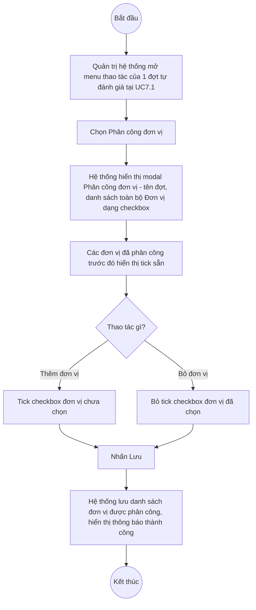

# UC7.2: Phân công đơn vị thực hiện tự đánh giá

## 1. Thông tin chung

| ID | Use case | Description |
| :---- | :---- | :---- |
| UC7.2 | Phân công đơn vị thực hiện tự đánh giá | Quản trị hệ thống chọn danh sách các đơn vị (trực thuộc Bộ; Sở/Ban/Ngành địa phương) phải thực hiện một đợt tự đánh giá cụ thể (UC7.1), qua một popup danh sách chọn (checkbox). |

> **Actor:** Quản trị hệ thống. **[Cần xác nhận]** actor "Cán bộ" theo UC_1409.
>
> **Trigger:** Quản trị hệ thống mở menu thao tác của một đợt tự đánh giá tại UI-7.1.1 và chọn "Phân công đơn vị"
>
> **Điều kiện trước (Pre-condition):** Quản trị hệ thống đã đăng nhập và có quyền quản lý Bộ chỉ số DTI; đợt tự đánh giá đã tồn tại
>
> **Điều kiện sau (Post-condition):** Danh sách Đơn vị (UC4.3) phải thực hiện đợt tự đánh giá được cập nhật
>
> **Business rule:**
>
> BR-1: Mục "Phân công đơn vị" xuất hiện trên menu thao tác **ở mọi trạng thái** của đợt tự đánh giá (Nháp, Bị từ chối, Chờ phê duyệt, Đã phê duyệt) — khác với "Cấu hình bộ chỉ số"/"Cập nhật"/"Xoá" vốn chỉ xuất hiện ở một số trạng thái (xem UC7.1 BR-6). *(Đã kiểm chứng trực tiếp ngày 10/10/2026, quét toàn bộ 10 dòng trang 1)*.
>
> BR-2: Bấm "Phân công đơn vị" mở modal "Phân công đơn vị - &lt;Tên đánh giá&gt;", hiển thị **danh sách phẳng (không phân trang, không chia tab Khối Bộ/Khối địa phương) toàn bộ Đơn vị trong hệ thống** (UC4.3), mỗi đơn vị là 1 dòng checkbox dạng "&lt;Mã đơn vị&gt; - &lt;Tên đơn vị&gt;"; các đơn vị đã được phân công từ trước hiển thị checkbox đã tick sẵn. *(Đã kiểm chứng trực tiếp ngày 10/10/2026: modal "Phân công đơn vị - Ngọc test" liệt kê 11 đơn vị, trong đó 3 đơn vị — BDT-QA01, BDT-QA03, VHTQT-QA01 — đã được tick sẵn)*.
>
> BR-3: Modal **không có ô tìm kiếm** trong danh sách đơn vị (tại thời điểm khảo sát chỉ có 11 đơn vị nên có thể chưa cần). **[Cần xác nhận]** hành vi khi số lượng đơn vị lớn hơn (có phân trang/tìm kiếm hay cuộn danh sách dài).
>
> BR-4: Tick/bỏ tick checkbox để thêm/bớt đơn vị cần thực hiện; nhấn "Lưu" để ghi nhận; nhấn "Quay lại" để đóng modal không lưu. *(Đã kiểm chứng trực tiếp ngày 10/10/2026: 2 nút "Quay lại"/"Lưu" ở cuối modal)*. **[Cần xác nhận]** nội dung thông báo thành công khi lưu — chưa thực hiện lưu thật trong phiên hôm nay để tránh thay đổi phân công của dữ liệu thật.
>
> BR-5: UC_1409 (UC-B.III.2) mô tả yêu cầu riêng biệt "xem danh sách đơn vị phải thực hiện định kỳ" và "xem danh sách đơn vị phải thực hiện đột xuất", cùng "export danh sách ra excel". Trên hệ thống thật, modal "Phân công đơn vị" là **chung cho mọi đợt** (đợt đó tự nó đã thuộc tab Định kỳ hoặc Đột xuất từ UC7.1), và **không có nút xuất Excel riêng bên trong modal này** — nút "Xuất Excel" duy nhất quan sát được nằm ở màn hình danh sách đợt tự đánh giá (UI-7.1.1, xem UC7.1 BR-8), xuất danh sách **đợt tự đánh giá**, không rõ có bao gồm danh sách đơn vị được phân công hay không. *(Đã kiểm chứng trực tiếp ngày 10/10/2026: không thấy nút xuất Excel trong modal Phân công đơn vị)*.

**Truy vết chức năng**

| STT | Chức năng | YC (BCKTKT) | Dòng UC_1409 | Luồng | Màn hình | BR |
| :---- | :---- | :---- | :---- | :---- | :---- | :---- |
| 1 | Xem danh sách đơn vị phải thực hiện (định kỳ) | **[Cần xác nhận]** | **[Cần xác nhận]** | Basic Flow bước 1–3 | UI-7.2.1 | BR-1, BR-2 |
| 2 | Xem danh sách đơn vị phải thực hiện (đột xuất) | **[Cần xác nhận]** | **[Cần xác nhận]** | Basic Flow (từ tab Đột xuất của UC7.1) | UI-7.2.1 | BR-1, BR-2 |
| 3 | Export danh sách ra excel | **[Cần xác nhận]** | **[Cần xác nhận]** | — (chưa tìm thấy trong modal — xem BR-5) | — | BR-5 |
| 4 | Thêm đơn vị cần thực hiện | **[Cần xác nhận]** | **[Cần xác nhận]** | AF1 | UI-7.2.1 | BR-4 |
| 5 | Xóa đơn vị cần thực hiện | **[Cần xác nhận]** | **[Cần xác nhận]** | AF2 | UI-7.2.1 | BR-4 |

> Cột YC (BCKTKT) và Dòng UC_1409 chưa đối chiếu được với bản gốc Google Sheet "Danh sách công việc_CĐS - BCT". Use case nguồn tương ứng: UC-B.III.2 "Phân công đơn vị thực hiện tự đánh giá". Chức năng "Export ra Excel" riêng cho danh sách đơn vị phân công theo yêu cầu gốc **chưa tìm thấy trên hệ thống thật** (xem BR-5).

## 2. Mô tả luồng nghiệp vụ

*Hình 1. Luồng nghiệp vụ phân công đơn vị thực hiện tự đánh giá*

**Basic Flow** (Phân công đơn vị cho một đợt tự đánh giá)

1. Quản trị hệ thống mở màn hình Quản lý tự đánh giá (UI-7.1.1, xem UC7.1) và tìm đợt tự đánh giá cần phân công.
2. Quản trị hệ thống mở menu thao tác của dòng đó và chọn "Phân công đơn vị" (BR-1).
3. Hệ thống hiển thị modal "Phân công đơn vị - &lt;Tên đánh giá&gt;" (UI-7.2.1) với danh sách toàn bộ Đơn vị, các đơn vị đã phân công từ trước được tick sẵn (BR-2).
4. Quản trị hệ thống tick/bỏ tick các đơn vị cần thêm/bớt.
5. Quản trị hệ thống nhấn "Lưu" (BR-4).
6. Hệ thống lưu danh sách đơn vị được phân công cho đợt tự đánh giá, đóng modal, hiển thị thông báo thành công.

**Alternative Flow**

AF1. Thêm đơn vị cần thực hiện

Tại bước 4, Quản trị hệ thống tick checkbox của 1 hoặc nhiều đơn vị chưa được chọn. Tiếp tục từ bước 5.

AF2. Xóa đơn vị cần thực hiện

Tại bước 4, Quản trị hệ thống bỏ tick checkbox của 1 hoặc nhiều đơn vị đã được chọn trước đó. Tiếp tục từ bước 5.

AF3. Hủy thao tác

Tại bước 3–4, Quản trị hệ thống nhấn "Quay lại". Hệ thống đóng modal, không lưu thay đổi tick/bỏ tick. Quay lại UI-7.1.1.

**Exception Flow**

EF1. Lỗi hệ thống khi lưu

Hệ thống hiển thị thông báo lỗi chung, giữ nguyên danh sách phân công trước đó. **[Cần xác nhận]** nội dung thông báo cụ thể.

Use case kết thúc.

## 3. Màn hình

| UI Code | Screen | Mô tả |
| :---- | :---- | :---- |
| UI-7.2.1 | Modal "Phân công đơn vị - &lt;Tên đánh giá&gt;" (Web) | Danh sách Đơn vị dạng checkbox, nút Quay lại / Lưu |

## 4. Mô tả Màn hình (Field Specification)

**UI-7.2.1 — Modal Phân công đơn vị**

| Field Name | Field type | Data Type | Required | Validation rule/Behaviour |
| :---- | :---- | :---- | :---- | :---- |
| Tiêu đề modal | Label | String | Yes | **Behaviour:** "Phân công đơn vị - &lt;Tên đánh giá&gt;" (vd "Phân công đơn vị - Ngọc test") **Validation rule:** — |
| Danh sách Đơn vị (checkbox) | Checkbox list | Boolean[] | No | **Behaviour:** Mỗi dòng "&lt;Mã đơn vị&gt; - &lt;Tên đơn vị&gt;" (UC4.3); đơn vị đã phân công trước đó được tick sẵn (BR-2, AF1, AF2) **Validation rule:** **[Cần xác nhận]** có bắt buộc chọn tối thiểu 1 đơn vị hay không |
| Nút "Quay lại" | Button | Action | Yes | **Behaviour:** Đóng modal, không lưu (AF3) **Validation rule:** — |
| Nút "Lưu" | Button | Action | Yes | **Behaviour:** Lưu danh sách đơn vị được phân công (bước 5–6) **Validation rule:** **[Cần xác nhận]** nội dung thông báo thành công |

## Điểm cần xác nhận

| STT | Vị trí | Giả định đã dùng | Câu hỏi cần xác nhận |
| :---- | :---- | :---- | :---- |
| 1 | BR-5 | Không tìm thấy nút xuất Excel riêng cho danh sách đơn vị phân công, dù UC_1409 yêu cầu rõ | Xác nhận tính năng này có ở nơi khác (vd trong nút "Xuất Excel" chung của UC7.1) hay chưa được làm |
| 2 | BR-3 | Modal không có tìm kiếm/phân trang vì chỉ có 11 đơn vị tại thời điểm khảo sát | Khi số đơn vị tăng lên (toàn quốc có nhiều Sở/Ban/Ngành), modal này có còn dùng được tốt không, hay cần bổ sung tìm kiếm? |
| 3 | BR-4 | Chưa lưu thật để xem nội dung thông báo thành công, tránh ảnh hưởng dữ liệu phân công thật | Đề nghị xác minh trên môi trường staging nếu có |
| 4 | Mục 1 | Chưa phân biệt được rõ cách hệ thống thể hiện khái niệm "đơn vị trực thuộc Bộ" khác với "Sở/Ban/Ngành địa phương" trong cùng 1 danh sách phẳng — có vẻ không phân nhóm trực quan trên UI | Xác nhận có cần phân nhóm hiển thị 2 loại đơn vị này không |
| 5 | Truy vết chức năng | Chưa có số YC (BCKTKT) và Dòng UC_1409 | Đề nghị đối chiếu với bản gốc Google Sheet |
