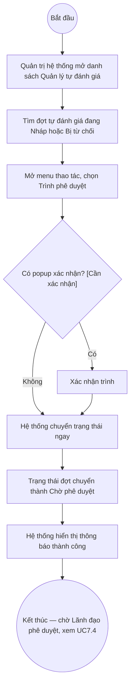

# UC7.3: Trình phê duyệt yêu cầu tự đánh giá

## 1. Thông tin chung

| ID | Use case | Description |
| :---- | :---- | :---- |
| UC7.3 | Trình phê duyệt yêu cầu tự đánh giá | Quản trị hệ thống trình lãnh đạo yêu cầu tự đánh giá (định kỳ hoặc đột xuất) đối với đơn vị, chuyển đợt tự đánh giá từ trạng thái "Nháp"/"Bị từ chối" sang "Chờ phê duyệt" để chờ Lãnh đạo phê duyệt (UC7.4). |

> **Lưu ý về đánh số:** Theo UC_1409, nhóm B.III đánh số UC-B.III.1, .2, .3, rồi nhảy thẳng sang .5 (không có UC-B.III.4) — đây là đúng theo tài liệu gốc đã được xác nhận trước, không phải lỗi phát sinh trong quá trình viết tài liệu này. UC7.3 trong bộ tài liệu này tương ứng UC-B.III.3 "Trình phê duyệt yêu cầu tự đánh giá"; UC7.4 tương ứng UC-B.III.5 "Phê duyệt yêu cầu tự đánh giá". **[Cần xác nhận]** với BA liệu UC-B.III.4 có tồn tại trong bản gốc Google Sheet (bị bỏ sót khi trích xuất) hay thực sự không có.
>
> **Actor:** Quản trị hệ thống. **[Cần xác nhận]** actor "Cán bộ" theo UC_1409.
>
> **Trigger:** Quản trị hệ thống mở menu thao tác của một đợt tự đánh giá đang "Nháp" hoặc "Bị từ chối" tại UI-7.1.1 và chọn "Trình phê duyệt"
>
> **Điều kiện trước (Pre-condition):** Quản trị hệ thống đã đăng nhập, có quyền quản lý Bộ chỉ số DTI; đợt tự đánh giá đang ở trạng thái "Nháp" hoặc "Bị từ chối"
>
> **Điều kiện sau (Post-condition):** Trạng thái đợt tự đánh giá chuyển thành "Chờ phê duyệt"
>
> **Business rule:**
>
> BR-1: Mục "Trình phê duyệt" trên menu thao tác chỉ xuất hiện khi đợt tự đánh giá đang ở trạng thái "Nháp" hoặc "Bị từ chối" — biến mất ở trạng thái "Chờ phê duyệt" và "Đã phê duyệt". *(Đã kiểm chứng trực tiếp ngày 10/10/2026, quét toàn bộ 10 dòng trang 1 — xem UC7.1 BR-6)*. Điều này cho thấy một đợt bị Lãnh đạo từ chối (UC7.4) có thể được Quản trị hệ thống sửa lại (mục "Cập nhật"/"Cấu hình bộ chỉ số" cũng xuất hiện cùng trạng thái "Bị từ chối") rồi trình lại.
>
> BR-2: **[Cần xác nhận]** sau khi bấm "Trình phê duyệt" có popup xác nhận (vd nhập lý do/ghi chú trình) hay chuyển trạng thái ngay lập tức — chưa bấm thử trực tiếp trong phiên hôm nay để tránh làm thay đổi trạng thái của một đợt tự đánh giá thật đang ở "Nháp" (ví dụ "Ngọc test"), vì thao tác này khó đảo ngược qua giao diện (không có mục "Hủy trình" quan sát được).
>
> BR-3: **[Cần xác nhận]** việc trình phê duyệt có yêu cầu đợt tự đánh giá phải có đầy đủ cấu hình (Nhóm chỉ số/Chỉ số — UC6.2, UC6.3) và danh sách đơn vị phân công (UC7.2) trước khi trình hay không, hay cho phép trình với cấu hình rỗng.
>
> BR-4: **[Cần xác nhận]** actor "Lãnh đạo" trong UC_1409 nhận được thông báo/nhắc việc như thế nào khi có đợt mới được trình — chưa xác minh được do phiên làm việc chỉ có tài khoản Quản trị hệ thống.

**Truy vết chức năng**

| STT | Chức năng | YC (BCKTKT) | Dòng UC_1409 | Luồng | Màn hình | BR |
| :---- | :---- | :---- | :---- | :---- | :---- | :---- |
| 1 | Trình lãnh đạo yêu cầu tự đánh giá định kỳ đối với đơn vị | **[Cần xác nhận]** | **[Cần xác nhận]** | Basic Flow | UI-7.1.1 | BR-1, BR-2 |
| 2 | Trình yêu cầu đột xuất | **[Cần xác nhận]** | **[Cần xác nhận]** | Basic Flow (từ tab Đột xuất của UC7.1) | UI-7.1.1 | BR-1, BR-2 |
| 3 | Xem danh sách trình định kỳ | **[Cần xác nhận]** | **[Cần xác nhận]** | AF1 | UI-7.1.1 | BR-1 |
| 4 | Xem danh sách trình đột xuất | **[Cần xác nhận]** | **[Cần xác nhận]** | AF1 | UI-7.1.1 | BR-1 |

> Cột YC (BCKTKT) và Dòng UC_1409 chưa đối chiếu được với bản gốc Google Sheet "Danh sách công việc_CĐS - BCT". Use case nguồn tương ứng: UC-B.III.3 "Trình phê duyệt yêu cầu tự đánh giá". Không có màn hình "danh sách trình" riêng biệt được tìm thấy — trạng thái "Chờ phê duyệt" được thể hiện ngay trên cùng danh sách Quản lý tự đánh giá (UI-7.1.1, xem UC7.1), lọc được gián tiếp qua quan sát cột Trạng thái, không có bộ lọc "đã trình/chưa trình" riêng.

## 2. Mô tả luồng nghiệp vụ

*Hình 1. Luồng nghiệp vụ trình phê duyệt yêu cầu tự đánh giá*

**Basic Flow** (Trình phê duyệt một đợt tự đánh giá)

1. Quản trị hệ thống mở màn hình Quản lý tự đánh giá (UI-7.1.1, xem UC7.1), chọn tab "Định kỳ" hoặc "Đột xuất" tùy loại cần trình.
2. Quản trị hệ thống tìm đợt tự đánh giá đang ở trạng thái "Nháp" hoặc "Bị từ chối" (BR-1).
3. Quản trị hệ thống mở menu thao tác của dòng đó và chọn "Trình phê duyệt".
4. **[Cần xác nhận]** Hệ thống có thể hiển thị popup xác nhận (BR-2) — chưa xác minh được trong phiên hôm nay.
5. Hệ thống chuyển Trạng thái đợt tự đánh giá thành "Chờ phê duyệt", hiển thị thông báo thành công.
6. Đợt tự đánh giá chờ Lãnh đạo phê duyệt hoặc từ chối (xem UC7.4).

**Alternative Flow**

AF1. Xem danh sách đã trình (định kỳ/đột xuất)

Tại màn hình danh sách (bước 1), Quản trị hệ thống quan sát cột "Trạng thái" để nhận biết các đợt đang "Chờ phê duyệt" (đã trình, chưa được Lãnh đạo xử lý). **[Cần xác nhận]** có bộ lọc riêng theo trạng thái "Chờ phê duyệt" hay phải tự rà soát bằng mắt trên toàn bộ danh sách — chưa thấy bộ lọc Trạng thái trên UI-7.1.1 trong phiên hôm nay. Use case kết thúc.

**Exception Flow**

EF1. Trình phê duyệt khi cấu hình chưa đầy đủ

**[Cần xác nhận]** hệ thống có chặn trình phê duyệt khi đợt tự đánh giá chưa có Nhóm chỉ số/Chỉ số hoặc chưa phân công đơn vị nào hay không (BR-3).

EF2. Lỗi hệ thống khi trình phê duyệt

Hệ thống hiển thị thông báo lỗi chung, giữ nguyên Trạng thái trước thao tác. **[Cần xác nhận]** nội dung thông báo cụ thể.

Use case kết thúc.

## 3. Màn hình

| UI Code | Screen | Mô tả |
| :---- | :---- | :---- |
| UI-7.1.1 | Quản lý tự đánh giá (Web) — dùng chung với UC7.1 | Nơi thực hiện "Trình phê duyệt" qua menu thao tác, và quan sát trạng thái "Chờ phê duyệt" sau khi trình |

## 4. Mô tả Màn hình (Field Specification)

Không có màn hình/trường riêng cho UC7.3 ngoài menu thao tác "Trình phê duyệt" trên UI-7.1.1 (field spec đầy đủ của màn hình này xem tại UC7.1 mục 4).

| Field Name | Field type | Data Type | Required | Validation rule/Behaviour |
| :---- | :---- | :---- | :---- | :---- |
| Mục "Trình phê duyệt" trên menu thao tác | Menu item | Action | Yes | **Behaviour:** Chỉ hiển thị khi đợt tự đánh giá đang "Nháp" hoặc "Bị từ chối" (BR-1); chuyển Trạng thái thành "Chờ phê duyệt" (BR-2) **Validation rule:** **[Cần xác nhận]** có kiểm tra cấu hình tối thiểu trước khi cho trình (EF1) |

## Điểm cần xác nhận

| STT | Vị trí | Giả định đã dùng | Câu hỏi cần xác nhận |
| :---- | :---- | :---- | :---- |
| 1 | Mục 1 – Lưu ý về đánh số | UC_1409 nhảy từ UC-B.III.3 sang UC-B.III.5, không có .4 | Xác nhận với BA đây có đúng theo bản gốc Google Sheet hay bị sót khi trích xuất |
| 2 | BR-2, Basic Flow bước 4 | Chưa rõ có popup xác nhận trước khi trình phê duyệt | Đề nghị xác minh bằng thao tác tay trên 1 đợt test (không phải "Ngọc test" hay dữ liệu thật khác) |
| 3 | BR-3, EF1 | Chưa rõ hệ thống có bắt buộc cấu hình tối thiểu (có Nhóm chỉ số/Chỉ số, có đơn vị phân công) trước khi cho trình phê duyệt | Cần xác nhận ràng buộc nghiệp vụ này |
| 4 | AF1 | Chưa thấy bộ lọc riêng theo Trạng thái trên danh sách Quản lý tự đánh giá | Có cần bổ sung bộ lọc "Chờ phê duyệt" để dễ theo dõi các đợt đã trình? |
| 5 | Truy vết chức năng | Chưa có số YC (BCKTKT) và Dòng UC_1409 | Đề nghị đối chiếu với bản gốc Google Sheet |
