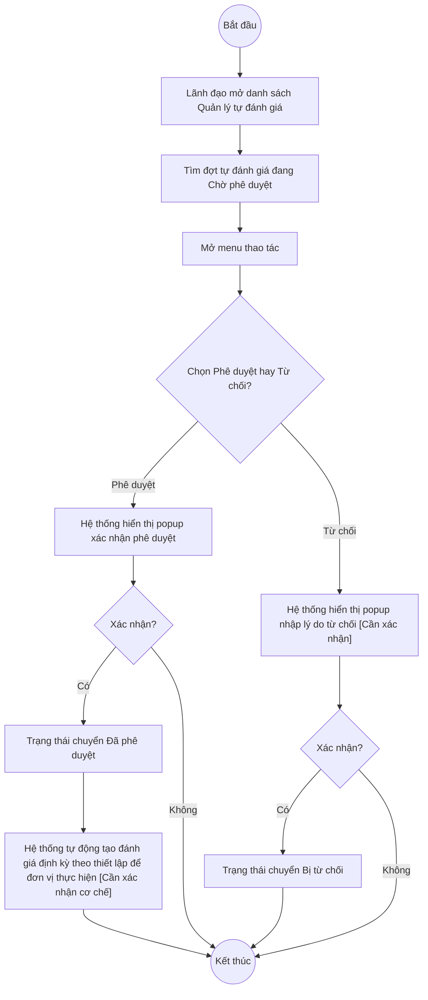

# UC7.4: Phê duyệt yêu cầu tự đánh giá

## 1. Thông tin chung

| ID | Use case | Description |
| :---- | :---- | :---- |
| UC7.4 | Phê duyệt yêu cầu tự đánh giá | Lãnh đạo xem danh sách các đợt tự đánh giá đã được trình (UC7.3, trạng thái "Chờ phê duyệt") và phê duyệt hoặc từ chối. Phê duyệt chuyển đợt sang trạng thái "Đã phê duyệt" để các đơn vị được phân công (UC7.2) bắt đầu thực hiện; từ chối chuyển về "Bị từ chối" để Quản trị hệ thống chỉnh sửa và trình lại (UC7.3). |

> **Lưu ý về đánh số:** UC7.4 trong bộ tài liệu này tương ứng UC-B.III.5 của UC_1409 (không có UC-B.III.4 trong bản gốc — xem giải thích tại UC7.3 mục 1).
>
> **Actor:** Lãnh đạo (theo UC_1409). **[Cần xác nhận]** toàn bộ actor này — phiên làm việc chỉ có tài khoản "QA Super Admin" (vai trò Quản trị hệ thống), và trên thực tế các mục "Phê duyệt"/"Từ chối" lại hiển thị ngay trên menu thao tác mà tài khoản Quản trị hệ thống đang đăng nhập cũng nhìn thấy được (xem BR-1) — do đó **chưa xác minh được** liệu hệ thống có phân quyền riêng để chỉ actor "Lãnh đạo" mới bấm được 2 mục này, hay Quản trị hệ thống cũng thực hiện được (gộp vai trò).
>
> **Trigger:** (Lãnh đạo hoặc Quản trị hệ thống — xem lưu ý trên) mở menu thao tác của một đợt tự đánh giá đang "Chờ phê duyệt" tại UI-7.1.1 và chọn "Phê duyệt" hoặc "Từ chối"
>
> **Điều kiện trước (Pre-condition):** Đã đăng nhập, có quyền phê duyệt đợt tự đánh giá; đợt tự đánh giá đang ở trạng thái "Chờ phê duyệt" (đã được trình qua UC7.3)
>
> **Điều kiện sau (Post-condition):** Trạng thái đợt tự đánh giá chuyển thành "Đã phê duyệt" hoặc "Bị từ chối"
>
> **Business rule:**
>
> BR-1: Mục "Phê duyệt" và "Từ chối" trên menu thao tác chỉ xuất hiện khi đợt tự đánh giá đang ở trạng thái "Chờ phê duyệt" (cùng với "Phân công đơn vị", "Cập nhật") — không xuất hiện ở "Nháp", "Bị từ chối" hay "Đã phê duyệt". *(Đã kiểm chứng trực tiếp ngày 10/10/2026, quét toàn bộ 10 dòng trang 1 — ví dụ dòng "TEST MỚI" đang "Chờ phê duyệt" có đủ 2 mục này — xem UC7.1 BR-6)*.
>
> BR-2: UC_1409 (UC-B.III.5) mô tả rõ: "phê duyệt yêu cầu (hệ thống tự động tạo đánh giá định kỳ theo thiết lập để đơn vị thực hiện)". **[Cần xác nhận]** toàn bộ cơ chế này — chưa thử bấm "Phê duyệt" trong phiên hôm nay (tránh làm thay đổi trạng thái không đảo ngược được của dữ liệu thật như "TEST MỚI"), nên chưa quan sát được việc hệ thống có thực sự "tự động tạo đánh giá định kỳ" cho từng đơn vị đã phân công (UC7.2) sau khi phê duyệt hay không, và các bản ghi đó xuất hiện ở đâu trên UI (có thể là màn hình "Đến hạn tự đánh giá" / "Kết quả tự đánh giá" trong menu "Đánh giá CĐS", quan sát được trên sidebar nhưng chưa thuộc phạm vi khảo sát của phân hệ B).
>
> BR-3: **[Cần xác nhận]** khi "Từ chối" có yêu cầu nhập lý do từ chối hay không — dữ liệu khảo sát ngày 08/10/2026 cho thấy bản ghi đợt tự đánh giá có trường `rejectReason` (hiện đang `null` ở các bản ghi quan sát được), gợi ý có khả năng tồn tại một ô nhập lý do khi từ chối, nhưng chưa xác minh trực tiếp được trên UI.
>
> BR-4: Sau khi "Từ chối", đợt tự đánh giá chuyển sang trạng thái "Bị từ chối" và menu thao tác đổi lại thành Cấu hình bộ chỉ số/Phân công đơn vị/Trình phê duyệt/Cập nhật (không có Xoá) — cho phép Quản trị hệ thống sửa và trình lại (xem UC7.3). *(Đã kiểm chứng trực tiếp ngày 10/10/2026 qua quan sát dòng "T001" đang ở trạng thái "Bị từ chối")*.

**Truy vết chức năng**

| STT | Chức năng | YC (BCKTKT) | Dòng UC_1409 | Luồng | Màn hình | BR |
| :---- | :---- | :---- | :---- | :---- | :---- | :---- |
| 1 | Xem danh sách trình yêu cầu tự đánh giá đột xuất đối với đơn vị | **[Cần xác nhận]** | **[Cần xác nhận]** | AF1 | UI-7.1.1 | BR-1 |
| 2 | Phê duyệt yêu cầu | **[Cần xác nhận]** | **[Cần xác nhận]** | Basic Flow | UI-7.4.1 | BR-1, BR-2 |
| 3 | Từ chối phê duyệt | **[Cần xác nhận]** | **[Cần xác nhận]** | AF2 | UI-7.4.2 | BR-1, BR-3, BR-4 |

> Cột YC (BCKTKT) và Dòng UC_1409 chưa đối chiếu được với bản gốc Google Sheet "Danh sách công việc_CĐS - BCT". Use case nguồn tương ứng: UC-B.III.5 "Phê duyệt yêu cầu tự đánh giá". Lưu ý: UC_1409 mô tả chức năng #1 là riêng cho "đột xuất", nhưng trên hệ thống thật, menu "Phê duyệt"/"Từ chối" xuất hiện đồng nhất cho mọi đợt đang "Chờ phê duyệt" dù Định kỳ hay Đột xuất (BR-1) — không có luồng tách riêng theo loại.

## 2. Mô tả luồng nghiệp vụ

*Hình 1. Luồng nghiệp vụ phê duyệt / từ chối yêu cầu tự đánh giá*

**Basic Flow** (Phê duyệt đợt tự đánh giá)

1. Lãnh đạo (hoặc Quản trị hệ thống — xem lưu ý ở mục 1) mở màn hình Quản lý tự đánh giá (UI-7.1.1, xem UC7.1), tìm đợt tự đánh giá đang "Chờ phê duyệt".
2. Mở menu thao tác của dòng đó và chọn "Phê duyệt" (BR-1).
3. Hệ thống hiển thị popup xác nhận (UI-7.4.1). **[Cần xác nhận]** nội dung chính xác.
4. Người dùng xác nhận.
5. Hệ thống cập nhật Trạng thái đợt tự đánh giá thành "Đã phê duyệt", và theo UC_1409 "tự động tạo đánh giá định kỳ theo thiết lập để đơn vị thực hiện" cho các đơn vị đã được phân công (UC7.2) (BR-2 — **[Cần xác nhận]** toàn bộ cơ chế này), hiển thị thông báo thành công.

**Alternative Flow**

AF1. Xem danh sách trình đột xuất chờ phê duyệt

Tại màn hình danh sách (bước 1), chọn tab "Đột xuất" (xem UC7.1 BR-1), tìm các đợt đang "Chờ phê duyệt" trong tab này. **[Cần xác nhận]** nội dung chi tiết, vì phiên hôm nay chưa khảo sát sâu tab Đột xuất. Use case kết thúc.

AF2. Từ chối phê duyệt

Tại màn hình danh sách (bước 1), với đợt đang "Chờ phê duyệt", mở menu thao tác và chọn "Từ chối" (BR-1). Hệ thống hiển thị popup (UI-7.4.2), **[Cần xác nhận]** có yêu cầu nhập lý do từ chối hay không (BR-3). Người dùng xác nhận. Hệ thống cập nhật Trạng thái đợt tự đánh giá thành "Bị từ chối" (BR-4), hiển thị thông báo thành công. Use case kết thúc.

AF3. Hủy thao tác

Tại popup xác nhận (bước 3, AF2), người dùng nhấn "Hủy" hoặc biểu tượng đóng. Hệ thống đóng popup, không đổi trạng thái. Quay lại danh sách.

**Exception Flow**

EF1. Lỗi hệ thống khi phê duyệt/từ chối

Hệ thống hiển thị thông báo lỗi chung, giữ nguyên Trạng thái "Chờ phê duyệt". **[Cần xác nhận]** nội dung thông báo cụ thể.

Use case kết thúc.

## 3. Màn hình

| UI Code | Screen | Mô tả |
| :---- | :---- | :---- |
| UI-7.1.1 | Quản lý tự đánh giá (Web) — dùng chung với UC7.1 | Nơi thực hiện "Phê duyệt"/"Từ chối" qua menu thao tác |
| UI-7.4.1 | Popup xác nhận Phê duyệt (Web) | **[Cần xác nhận]** nội dung — chưa mở trực tiếp trong phiên hôm nay |
| UI-7.4.2 | Popup Từ chối (Web) | **[Cần xác nhận]** nội dung, có ô nhập lý do hay không (BR-3) — chưa mở trực tiếp trong phiên hôm nay |

## 4. Mô tả Màn hình (Field Specification)

**UI-7.4.1 — Popup xác nhận Phê duyệt**

| Field Name | Field type | Data Type | Required | Validation rule/Behaviour |
| :---- | :---- | :---- | :---- | :---- |
| Nội dung xác nhận | Label | String | Yes | **Behaviour:** **[Cần xác nhận]** nội dung chính xác **Validation rule:** — |
| Nút Hủy | Button | Action | Yes | **Behaviour:** Đóng popup, không đổi trạng thái (AF3) **Validation rule:** — |
| Nút xác nhận (Phê duyệt) | Button | Action | Yes | **Behaviour:** Chuyển Trạng thái thành "Đã phê duyệt" (Basic Flow bước 4–5) **Validation rule:** — |

**UI-7.4.2 — Popup Từ chối**

| Field Name | Field type | Data Type | Required | Validation rule/Behaviour |
| :---- | :---- | :---- | :---- | :---- |
| Lý do từ chối | Textarea | String | **[Cần xác nhận]** | **Behaviour:** **[Cần xác nhận]** có trường này hay không — suy luận từ trường `rejectReason` quan sát được trong dữ liệu API ngày 08/10/2026 (BR-3) **Validation rule:** **[Cần xác nhận]** |
| Nút Hủy | Button | Action | Yes | **Behaviour:** Đóng popup, không đổi trạng thái (AF3) **Validation rule:** — |
| Nút xác nhận (Từ chối) | Button | Action | Yes | **Behaviour:** Chuyển Trạng thái thành "Bị từ chối" (AF2, BR-4) **Validation rule:** — |

## Điểm cần xác nhận

| STT | Vị trí | Giả định đã dùng | Câu hỏi cần xác nhận |
| :---- | :---- | :---- | :---- |
| 1 | Mục 1 – Actor | Chưa xác minh được việc phân quyền actor "Lãnh đạo" có tách biệt khỏi "Quản trị hệ thống" hay không (tài khoản test chỉ có vai trò Quản trị hệ thống nhưng vẫn thấy mục Phê duyệt/Từ chối) | **Quan trọng**: cần xác nhận với đội phân quyền (UC2.3 Ma trận phân quyền) xem 2 mục này có bị giới hạn theo vai trò Lãnh đạo trong thực tế hay bất kỳ Quản trị hệ thống nào cũng phê duyệt được |
| 2 | BR-2 | Chưa xác minh được cơ chế "tự động tạo đánh giá định kỳ theo thiết lập để đơn vị thực hiện" sau khi phê duyệt — tính năng cốt lõi nhất của UC này | **Quan trọng nhất**: cần thực hiện phê duyệt thử trên 1 đợt tự đánh giá test (không phải "TEST MỚI" hay dữ liệu thật khác) và quan sát xem bản ghi đánh giá nào được tạo ra cho từng đơn vị, ở màn hình nào |
| 3 | BR-3, UI-7.4.2 | Chưa xác minh trực tiếp có ô nhập lý do khi Từ chối, chỉ suy luận từ tên trường API `rejectReason` | Xác nhận bằng thao tác tay |
| 4 | AF1 | Chưa khảo sát sâu tab "Đột xuất" của Quản lý tự đánh giá do giới hạn thời gian | Đề nghị khảo sát bổ sung |
| 5 | Truy vết chức năng | Chưa có số YC (BCKTKT) và Dòng UC_1409 | Đề nghị đối chiếu với bản gốc Google Sheet |
