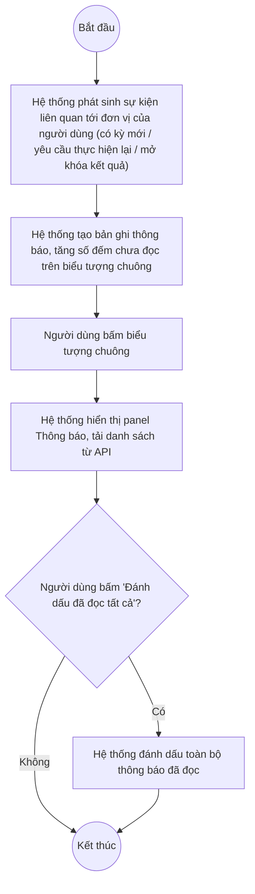

# UC8.1: Thông báo yêu cầu tự đánh giá

## 1. Thông tin chung

| ID | Use case | Description |
| :---- | :---- | :---- |
| UC8.1 | Thông báo yêu cầu tự đánh giá | Lãnh đạo đơn vị, Cán bộ, Lãnh đạo địa phương, Cán bộ địa phương nhận thông báo liên quan tới việc thực hiện tự đánh giá của đơn vị mình (yêu cầu tự đánh giá định kỳ/đột xuất, yêu cầu thực hiện lại, mở khóa kết quả) qua Trung tâm thông báo dùng chung của hệ thống. |

> **Actor:** Lãnh đạo đơn vị, Cán bộ, Lãnh đạo địa phương, Cán bộ địa phương
>
> **Trigger:** Người dùng bấm biểu tượng chuông thông báo ở góc phải thanh topbar
>
> **Điều kiện trước (Pre-condition):** Người dùng đã đăng nhập
>
> **Điều kiện sau (Post-condition):** Danh sách thông báo được hiển thị; các thông báo có thể được đánh dấu là đã đọc
>
> **Lưu ý về phạm vi kiểm chứng:** Tài khoản kiểm thử là "QA Super Admin" (có cờ SYSTEM_ROLE_BYPASS), không phải tài khoản Cán bộ/Lãnh đạo thật gắn với một đơn vị cụ thể. Trung tâm thông báo quan sát được là **một thành phần dùng chung cho toàn hệ thống** (không tách màn hình riêng theo từng UC trong tài liệu yêu cầu) — cùng một panel này cũng phục vụ UC8.2 và UC9.1, chỉ khác nhau ở loại/nội dung thông báo xuất hiện bên trong. Mục 10 thông báo gần nhất lấy được trong phiên khảo sát 10/10/2026 toàn bộ đều thuộc loại "Yêu cầu phê duyệt..." (UC8.2) hoặc "Đã có kết quả..."/"Yêu cầu mở khóa..." (UC9.1) — xem Ghi nhận QC bên dưới.
>
> **Business rule:**
>
> BR-1: Có một Trung tâm thông báo dùng chung cho toàn hệ thống, mở bằng cách bấm biểu tượng chuông; biểu tượng hiển thị số lượng thông báo chưa đọc dạng badge đỏ (quan sát giá trị "8" trong phiên khảo sát). *(Đã kiểm chứng trực tiếp ngày 10/10/2026)*
>
> BR-2: Mỗi thông báo gồm: tiêu đề loại thông báo (vd "Yêu cầu mở khóa kết quả tự đánh giá"), nội dung chi tiết (có chèn tên kỳ tự đánh giá), thời gian phát sinh (định dạng giờ:phút:giây ngày/tháng/năm). *(Đã kiểm chứng trực tiếp ngày 10/10/2026)*
>
> BR-3: Danh sách thông báo sắp xếp mới nhất lên đầu. *(Đã kiểm chứng trực tiếp ngày 10/10/2026, dựa trên thời gian giảm dần của 10 thông báo lấy mẫu)*
>
> BR-4: Có nút "Đánh dấu đã đọc tất cả" ở đầu panel. **[Cần xác nhận]** hành vi khi bấm (có đổi trạng thái hiển thị từng thông báo không, có gọi API không) — chưa thử bấm trong phiên này để tránh làm thay đổi trạng thái đọc/chưa đọc của dữ liệu thông báo thật đang tồn tại.
>
> BR-5: Loại thông báo thuộc phạm vi UC8.1 (gửi cho Cán bộ/Lãnh đạo đơn vị thực hiện khi có yêu cầu tự đánh giá mới, yêu cầu thực hiện lại, hoặc khi kết quả được mở khóa): dựa trên mô tả yêu cầu nghiệp vụ gồm 6 trường hợp (tự đánh giá định kỳ mới, đột xuất mới, yêu cầu thực hiện lại định kỳ, thực hiện lại đột xuất, mở khóa định kỳ, mở khóa đột xuất). **[Cần xác nhận]** — trong 10 thông báo gần nhất lấy mẫu chỉ quan sát được 1 mẫu khớp rõ với nhóm này: "Yêu cầu mở khóa kết quả tự đánh giá — Đơn vị đã gửi yêu cầu mở khóa kết quả tự đánh giá kỳ "..."". Nội dung này thực chất mô tả hành động "đơn vị đã gửi yêu cầu" (hướng tới người duyệt), gần với ngữ nghĩa UC9.1/UC8.2 hơn là một thông báo "yêu cầu đơn vị thực hiện tự đánh giá" đúng nghĩa UC8.1. Chưa quan sát được mẫu thông báo dạng "Bạn có kỳ tự đánh giá mới cần thực hiện" hoặc "Yêu cầu thực hiện lại tự đánh giá" trong phiên khảo sát.
>
> BR-6: **[Cần xác nhận]** việc bấm vào một thông báo có điều hướng tới màn hình Thực hiện tự đánh giá (UC8.3) tương ứng hay không — chưa thử bấm trực tiếp vào từng thông báo.

**Ghi nhận QC (10/10/2026):** Không tìm thấy mẫu thông báo thực tế nào khớp rõ ràng với các kịch bản "yêu cầu tự đánh giá định kỳ/đột xuất mới" hoặc "yêu cầu thực hiện lại" mô tả trong UC-C.I.1 của tài liệu yêu cầu, dù đã kiểm tra 10 thông báo gần nhất của tài khoản QA Super Admin. Có thể do: (a) dữ liệu thử nghiệm trên môi trường hiện tại chưa phát sinh đúng loại thông báo này gần đây, (b) các thông báo này tồn tại nhưng nằm ở trang sau (chưa thử phân trang panel thông báo), hoặc (c) nội dung thực tế khác với suy luận trong mục này. Đề nghị xác nhận lại khi có tài khoản Cán bộ thật hoặc có thể tạo một kỳ tự đánh giá mới để quan sát trực tiếp thông báo phát sinh.

**Truy vết chức năng**

| STT | Chức năng | YC (BCKTKT) | Dòng UC_1409 | Luồng | Màn hình | BR |
| :---- | :---- | :---- | :---- | :---- | :---- | :---- |
| 1 | Nhận/xem thông báo yêu cầu tự đánh giá định kỳ | **[Cần xác nhận]** | **[Cần xác nhận]** | Basic Flow | UI-8.1.1 | BR-1, BR-2, BR-5 |
| 2 | Nhận/xem thông báo yêu cầu tự đánh giá đột xuất | **[Cần xác nhận]** | **[Cần xác nhận]** | Basic Flow | UI-8.1.1 | BR-1, BR-2, BR-5 |
| 3 | Nhận/xem thông báo yêu cầu thực hiện lại định kỳ/đột xuất | **[Cần xác nhận]** | **[Cần xác nhận]** | Basic Flow | UI-8.1.1 | BR-1, BR-2, BR-5 |
| 4 | Nhận/xem thông báo mở khóa kết quả định kỳ/đột xuất | **[Cần xác nhận]** | **[Cần xác nhận]** | Basic Flow | UI-8.1.1 | BR-1, BR-2, BR-5 |
| 5 | Đánh dấu đã đọc tất cả | **[Cần xác nhận]** | **[Cần xác nhận]** | AF1 | UI-8.1.1 | BR-4 |

> Cột YC (BCKTKT) và Dòng UC_1409 chưa đối chiếu được với bản gốc Google Sheet "Danh sách công việc_CĐS - BCT". Use case nguồn tương ứng: UC-C.I.1 "Thông báo yêu cầu tự đánh giá".

## 2. Mô tả luồng nghiệp vụ

*Hình 1. Luồng nghiệp vụ nhận và xem thông báo yêu cầu tự đánh giá*

**Basic Flow**

1. Hệ thống phát sinh một trong các sự kiện thuộc phạm vi UC8.1 (có kỳ tự đánh giá mới, yêu cầu thực hiện lại, mở khóa kết quả) liên quan tới đơn vị của người dùng.
2. Hệ thống tạo một bản ghi thông báo và tăng số đếm chưa đọc trên biểu tượng chuông (BR-1).
3. Người dùng bấm biểu tượng chuông.
4. Hệ thống hiển thị panel Thông báo (UI-8.1.1) với danh sách thông báo, mới nhất lên đầu (BR-3).
5. Người dùng đọc nội dung thông báo (BR-2).

**Alternative Flow**

AF1. Đánh dấu đã đọc tất cả

Tại panel Thông báo (bước 4), người dùng bấm "Đánh dấu đã đọc tất cả". **[Cần xác nhận]** hành vi chi tiết (BR-4). Use case kết thúc.

**Exception Flow**

EF1. Lỗi khi tải danh sách thông báo

**[Cần xác nhận]** hành vi và thông báo lỗi khi API thông báo lỗi — chưa quan sát được trường hợp này trong phiên khảo sát.

## 3. Màn hình

| UI Code | Screen | Mô tả |
| :---- | :---- | :---- |
| UI-8.1.1 | Panel Thông báo (Web) | Panel dạng dropdown mở từ biểu tượng chuông trên topbar, liệt kê các thông báo, dùng chung cho UC8.1, UC8.2, UC9.1 |

## 4. Mô tả Màn hình (Field Specification)

**UI-8.1.1 — Panel Thông báo**

| Field Name | Field type | Data Type | Required | Validation rule/Behaviour |
| :---- | :---- | :---- | :---- | :---- |
| Biểu tượng chuông + badge số lượng | Icon button | Integer | Yes | **Behaviour:** Mở/đóng panel; badge hiển thị số thông báo chưa đọc (BR-1) **Validation rule:** — |
| Tiêu đề panel | Label | String | Yes | **Behaviour:** "Thông báo" **Validation rule:** — |
| Nút "Đánh dấu đã đọc tất cả" | Button | Action | Yes | **Behaviour:** AF1 (BR-4) **Validation rule:** **[Cần xác nhận]** có disable khi không còn thông báo chưa đọc không |
| Mỗi dòng thông báo — Tiêu đề loại | Label | String | Yes | **Behaviour:** Vd "Yêu cầu mở khóa kết quả tự đánh giá" (BR-2, BR-5) **Validation rule:** — |
| Mỗi dòng thông báo — Nội dung | Label | String | Yes | **Behaviour:** Câu mô tả có chèn tên kỳ tự đánh giá, vd "Đơn vị đã gửi yêu cầu mở khóa kết quả tự đánh giá kỳ "Tự đánh giá CĐS định kỳ Quý III/2026 - Khối địa phương"" **Validation rule:** — |
| Mỗi dòng thông báo — Thời gian | Label | DateTime | Yes | **Behaviour:** Định dạng "HH:mm:ss d/M/yyyy", vd "16:32:10 7/10/2026" **Validation rule:** — |
| Mỗi dòng thông báo — Click | Action | Action | — | **Behaviour:** **[Cần xác nhận]** điều hướng tới bản ghi liên quan (BR-6) **Validation rule:** — |

## Điểm cần xác nhận

| STT | Vị trí | Giả định đã dùng | Câu hỏi cần xác nhận |
| :---- | :---- | :---- | :---- |
| 1 | BR-5, Ghi nhận QC | Chưa quan sát được mẫu thông báo đúng nghĩa UC8.1 ("yêu cầu thực hiện tự đánh giá mới/lại") trong 10 thông báo gần nhất của tài khoản QA | Đề nghị tạo một kỳ tự đánh giá mới hoặc dùng tài khoản Cán bộ thật để xác nhận nội dung/tiêu đề chính xác |
| 2 | BR-4 | Chưa thử bấm "Đánh dấu đã đọc tất cả" để tránh ảnh hưởng dữ liệu đã đọc/chưa đọc thật | Cần xác nhận hành vi và có hoàn tác được không |
| 3 | BR-6 | Chưa thử bấm vào một dòng thông báo cụ thể | Bấm vào thông báo có điều hướng sang màn hình chi tiết tương ứng (UC8.3/UC8.7) không? |
| 4 | Truy vết chức năng | Chưa có số YC (BCKTKT) và Dòng UC_1409 | Đề nghị đối chiếu với bản gốc Google Sheet |
