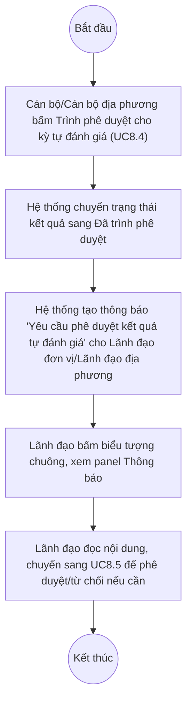

# UC8.2: Thông báo yêu cầu phê duyệt kết quả tự đánh giá

## 1. Thông tin chung

| ID | Use case | Description |
| :---- | :---- | :---- |
| UC8.2 | Thông báo yêu cầu phê duyệt kết quả tự đánh giá | Lãnh đạo đơn vị, Lãnh đạo địa phương nhận thông báo khi đơn vị mình đã trình phê duyệt kết quả tự đánh giá (định kỳ hoặc đột xuất), qua Trung tâm thông báo dùng chung của hệ thống. |

> **Actor:** Lãnh đạo đơn vị, Lãnh đạo địa phương
>
> **Trigger:** Cán bộ/Cán bộ địa phương của đơn vị bấm "Trình phê duyệt" (UC8.4) cho một kỳ tự đánh giá; sau đó Lãnh đạo bấm biểu tượng chuông thông báo để xem
>
> **Điều kiện trước (Pre-condition):** Người dùng đã đăng nhập với vai trò Lãnh đạo đơn vị/Lãnh đạo địa phương
>
> **Điều kiện sau (Post-condition):** Danh sách thông báo hiển thị các mục "Yêu cầu phê duyệt kết quả tự đánh giá" liên quan tới đơn vị
>
> **Lưu ý về phạm vi kiểm chứng:** Màn hình là **cùng một Trung tâm thông báo dùng chung** đã mô tả tại UC8.1 (biểu tượng chuông trên topbar) — không phải màn hình riêng. Khác với UC8.1, loại thông báo của UC8.2 **đã quan sát được nhiều mẫu thực tế rõ ràng** trong phiên khảo sát 10/10/2026 (7/10 thông báo gần nhất thuộc loại này).
>
> **Business rule:**
>
> BR-1: Cơ chế hiển thị, sắp xếp, đánh dấu đã đọc dùng chung với UC8.1 (xem BR-1 đến BR-4 của UC8.1).
>
> BR-2: Thông báo loại "Yêu cầu phê duyệt kết quả tự đánh giá" có nội dung theo mẫu cố định: "Đơn vị đã trình phê duyệt kết quả tự đánh giá cho kỳ "&lt;tên kỳ tự đánh giá&gt;"". *(Đã kiểm chứng trực tiếp ngày 10/10/2026, quan sát 7 mẫu riêng biệt, cùng một khuôn mẫu câu)*
>
> BR-3: Thông báo này phát sinh khi Cán bộ/Cán bộ địa phương của đơn vị bấm "Trình phê duyệt" (UC8.4), đưa kết quả tự đánh giá sang trạng thái "Đã trình phê duyệt". **[Cần xác nhận]** cơ chế kích hoạt chính xác — suy luận hợp lý từ tên loại thông báo và từ việc trạng thái "status"/"approvalStatus" trong dữ liệu API tương ứng (PendingApproval) khớp với các kỳ có thông báo loại này, nhưng chưa tự tạo một luồng Trình phê duyệt thật trong phiên này để quan sát thông báo phát sinh trực tiếp (nhằm tránh thay đổi trạng thái của dữ liệu tự đánh giá thật đang tồn tại).
>
> BR-4: Có nhiều thông báo loại này phát sinh liên tiếp cho cùng một kỳ/đơn vị (quan sát 5 thông báo cùng nội dung "...cho kỳ "Tự đánh giá CĐS định kỳ Quý I/2027 - Khối Bộ"" với các mốc thời gian khác nhau trong ngày 07/10/2026). **[Cần xác nhận]** đây là hành vi dự kiến (mỗi lần Trình phê duyệt — kể cả sau khi bị Từ chối rồi trình lại — đều tạo 1 thông báo mới) hay là lỗi phát thông báo trùng lặp.

**Truy vết chức năng**

| STT | Chức năng | YC (BCKTKT) | Dòng UC_1409 | Luồng | Màn hình | BR |
| :---- | :---- | :---- | :---- | :---- | :---- | :---- |
| 1 | Nhận/xem thông báo yêu cầu phê duyệt kết quả tự đánh giá định kỳ | **[Cần xác nhận]** | **[Cần xác nhận]** | Basic Flow | UI-8.2.1 | BR-1, BR-2 |
| 2 | Nhận/xem thông báo yêu cầu phê duyệt kết quả tự đánh giá đột xuất | **[Cần xác nhận]** | **[Cần xác nhận]** | Basic Flow | UI-8.2.1 | BR-1, BR-2 |

> Cột YC (BCKTKT) và Dòng UC_1409 chưa đối chiếu được với bản gốc. Use case nguồn tương ứng: UC-C.I.2 "Thông báo yêu cầu phê duyệt kết quả tự đánh giá". Tài liệu yêu cầu không phân biệt rõ nội dung thông báo giữa kỳ định kỳ và đột xuất trên UI thực tế — cả hai cùng dùng một mẫu câu (BR-2), chỉ khác tên kỳ.

## 2. Mô tả luồng nghiệp vụ

*Hình 1. Luồng nghiệp vụ thông báo yêu cầu phê duyệt kết quả tự đánh giá*

**Basic Flow**

1. Cán bộ/Cán bộ địa phương của đơn vị bấm "Trình phê duyệt" cho một kỳ tự đánh giá (xem UC8.4).
2. Hệ thống tạo một thông báo loại "Yêu cầu phê duyệt kết quả tự đánh giá" cho Lãnh đạo đơn vị/Lãnh đạo địa phương phụ trách (BR-2, BR-3).
3. Lãnh đạo bấm biểu tượng chuông, hệ thống hiển thị panel Thông báo (UI-8.2.1) gồm mục thông báo vừa phát sinh.
4. Lãnh đạo đọc nội dung thông báo, biết được đơn vị nào vừa trình phê duyệt kỳ nào.

**Alternative Flow**

AF1. Chuyển sang màn hình phê duyệt

Từ thông báo (bước 4), Lãnh đạo có thể chuyển sang danh sách "Kết quả tự đánh giá" (UC8.5/UC8.7) để thực hiện phê duyệt hoặc từ chối. **[Cần xác nhận]** việc bấm trực tiếp vào thông báo có tự động điều hướng tới đúng bản ghi hay không.

**Exception Flow**

EF1. Không có thông báo nào

Nếu đơn vị chưa trình phê duyệt kỳ nào, panel Thông báo không có mục thuộc loại này. Use case kết thúc.

## 3. Màn hình

| UI Code | Screen | Mô tả |
| :---- | :---- | :---- |
| UI-8.2.1 | Panel Thông báo (Web) | Dùng chung với UI-8.1.1/UI-9.1.1, lọc theo loại thông báo "Yêu cầu phê duyệt kết quả tự đánh giá" |

## 4. Mô tả Màn hình (Field Specification)

**UI-8.2.1 — Panel Thông báo (mục loại "Yêu cầu phê duyệt kết quả tự đánh giá")**

| Field Name | Field type | Data Type | Required | Validation rule/Behaviour |
| :---- | :---- | :---- | :---- | :---- |
| Tiêu đề loại | Label | String | Yes | **Behaviour:** Cố định "Yêu cầu phê duyệt kết quả tự đánh giá" (BR-2) **Validation rule:** — |
| Nội dung | Label | String | Yes | **Behaviour:** Mẫu câu "Đơn vị đã trình phê duyệt kết quả tự đánh giá cho kỳ "&lt;tên kỳ&gt;"" (BR-2), đã kiểm chứng trực tiếp với 7 mẫu thực tế **Validation rule:** — |
| Thời gian | Label | DateTime | Yes | **Behaviour:** Định dạng "HH:mm:ss d/M/yyyy" **Validation rule:** — |

Các field chung khác của panel (biểu tượng chuông, badge, nút "Đánh dấu đã đọc tất cả") xem UI-8.1.1 tại UC8.1 — không lặp lại ở đây.

## Điểm cần xác nhận

| STT | Vị trí | Giả định đã dùng | Câu hỏi cần xác nhận |
| :---- | :---- | :---- | :---- |
| 1 | BR-3 | Suy luận cơ chế kích hoạt thông báo (khi bấm Trình phê duyệt) dựa trên tên loại thông báo, chưa test trực tiếp | Cần dev xác nhận đúng sự kiện kích hoạt |
| 2 | BR-4 | 5 thông báo cùng nội dung cho cùng 1 kỳ "Tự đánh giá CĐS định kỳ Quý I/2027 - Khối Bộ" trong cùng ngày | Có phải lỗi tạo thông báo trùng lặp mỗi khi bấm lại Trình phê duyệt, hay là hành vi dự kiến? |
| 3 | AF1 | Chưa thử bấm vào thông báo cụ thể | Bấm vào thông báo có điều hướng đúng bản ghi kết quả tự đánh giá tương ứng không? |
| 4 | Truy vết chức năng | Chưa có số YC (BCKTKT) và Dòng UC_1409 | Đề nghị đối chiếu với bản gốc Google Sheet |
