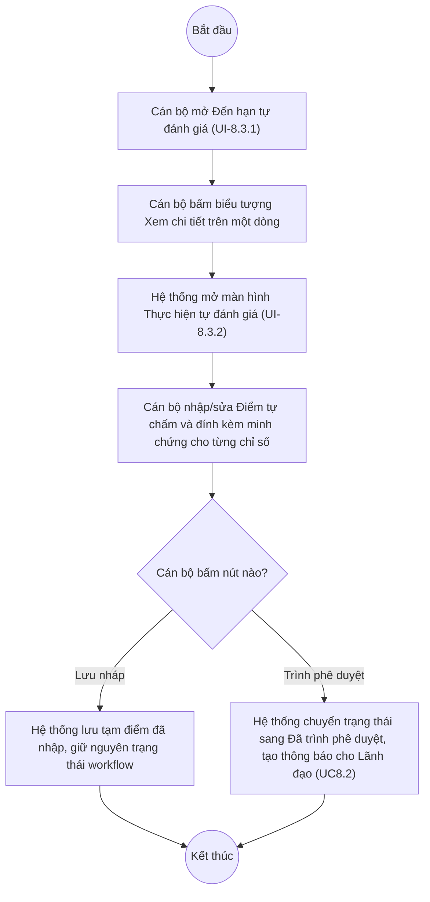

# UC8.3: Thực hiện tự đánh giá

## 1. Thông tin chung

| ID | Use case | Description |
| :---- | :---- | :---- |
| UC8.3 | Thực hiện tự đánh giá | Cán bộ, Cán bộ địa phương xem danh sách yêu cầu tự đánh giá đến hạn của đơn vị mình, xuất Excel, mở chi tiết một kỳ để nhập/sửa điểm và đính kèm minh chứng cho từng chỉ số. |

> **Actor:** Cán bộ, Cán bộ địa phương
>
> **Trigger:** Cán bộ chọn menu "Đánh giá CĐS" > "Đến hạn tự đánh giá", sau đó bấm biểu tượng xem chi tiết (hình con mắt) trên một dòng
>
> **Điều kiện trước (Pre-condition):** Cán bộ đã đăng nhập, thuộc một đơn vị đang có kỳ tự đánh giá (định kỳ hoặc đột xuất) cần thực hiện
>
> **Điều kiện sau (Post-condition):** Điểm tự chấm và minh chứng cho các chỉ số được lưu nháp; hoặc kết quả được chuyển sang trạng thái "Đã trình phê duyệt" nếu bấm Trình phê duyệt (xem UC8.4)
>
> **Lưu ý về phạm vi kiểm chứng:** Tài khoản "QA Super Admin" (SYSTEM_ROLE_BYPASS) xem/thao tác được đầy đủ 2 màn hình mô tả dưới đây trên dữ liệu thật đang tồn tại. Theo đúng nguyên tắc an toàn dữ liệu của dự án, mọi thao tác Lưu nháp/Trình phê duyệt/nhập điểm **chỉ được quan sát qua giao diện (mở màn hình, đọc field, đọc nút)**, **không bấm Lưu nháp/Trình phê duyệt thật** trên các bản ghi có sẵn để tránh làm thay đổi vĩnh viễn dữ liệu tự đánh giá thật đang chạy.
>
> **Business rule:**
>
> BR-1: Danh sách "Đến hạn tự đánh giá" (UI-8.3.1) hiển thị các kỳ tự đánh giá của đơn vị, cột: Kỳ tự đánh giá, Đơn vị, Loại (Định kỳ/Đột xuất), Trạng thái, Số ngày còn lại. *(Đã kiểm chứng trực tiếp ngày 10/10/2026)*
>
> BR-2: Trạng thái của một kỳ gồm các giá trị quan sát được: "Chưa thực hiện", "Đang chấm điểm", "Đã trình phê duyệt", "Đã phê duyệt", "Đã gửi" (lấy từ dropdown lọc Trạng thái). *(Đã kiểm chứng trực tiếp ngày 10/10/2026)*
>
> BR-3: Cột "Số ngày còn lại" hiển thị "Quá hạn" khi kỳ đã hết hạn nộp; **[Cần xác nhận]** cách hiển thị khi còn hạn (số ngày cụ thể) — toàn bộ 37 bản ghi quan sát được trong phiên khảo sát đều đã quá hạn.
>
> BR-4: Có thể lọc theo Loại (segmented: Tất cả trạng thái/Định kỳ/Đột xuất — tên mặc định "Tất cả trạng thái" của segment này gây nhầm lẫn với dropdown Trạng thái bên dưới, xem Ghi nhận QC), lọc theo Trạng thái (dropdown, 5 giá trị ở BR-2), lọc theo "Số ngày còn lại" (dropdown), và tìm theo tên đơn vị (search box). *(Đã kiểm chứng trực tiếp ngày 10/10/2026 — đã thử mở từng dropdown, chưa thử nhập tìm kiếm vì không cần sửa dữ liệu)*
>
> BR-5: Bấm biểu tượng xem chi tiết (hình con mắt) ở cuối mỗi dòng mở màn hình "Thực hiện tự đánh giá" (UI-8.3.2) tại route `/assessment-results-due/{id}`, với tiêu đề phụ "&lt;tên kỳ&gt; • &lt;tên đơn vị&gt; • Hạn nộp &lt;ngày&gt;". *(Đã kiểm chứng trực tiếp ngày 10/10/2026, cả với dòng trạng thái "Chưa thực hiện" và "Đã trình phê duyệt")*
>
> BR-6: Màn hình Thực hiện tự đánh giá có 3 khối tóm tắt: "Tiến độ hoàn thành" (%, kèm "x/38 chỉ số đã nhập"), "Điểm tạm tính" (x/y trên thang điểm bộ chỉ số), "Minh chứng đính kèm" (số tệp tài liệu). *(Đã kiểm chứng trực tiếp ngày 10/10/2026)*
>
> BR-7: Bảng chấm điểm chỉ số gồm cột: Mã, Chỉ số, Điểm tối đa, Điểm tự chấm (ô nhập số), Tài liệu (đính kèm minh chứng). *(Đã kiểm chứng trực tiếp ngày 10/10/2026)* **[Cần xác nhận]** ràng buộc giá trị nhập cho "Điểm tự chấm" (có giới hạn trong khoảng [0, Điểm tối đa của chỉ số] hay không) — chưa thử nhập giá trị âm/vượt ngưỡng để tránh ảnh hưởng dữ liệu thật.
>
> BR-8: Có 2 nút hành động ở đầu màn hình: "Lưu nháp" (lưu tạm, không đổi trạng thái workflow) và "Trình phê duyệt" (chuyển kết quả sang trạng thái "Đã trình phê duyệt", tạo thông báo cho Lãnh đạo — xem UC8.2, UC8.4). **[Cần xác nhận]** hành vi chi tiết và nội dung dialog xác nhận của từng nút — chưa bấm thật để tránh thay đổi dữ liệu.
>
> BR-9: Có thể tiếp tục nhập/sửa điểm cho một kỳ đang ở trạng thái "Đang chấm điểm" từ một đường dẫn khác: màn hình "Kết quả tự đánh giá" (UC8.7) > "Xem chi tiết" > màn hình "Xem/Chấm điểm" tại route `/assessment-results/{id}`, có nút "Lưu điểm" riêng và nút "Tải lên tài liệu" cho từng chỉ số. *(Đã kiểm chứng trực tiếp ngày 10/10/2026 — xem UC8.7 để biết chi tiết đầy đủ màn hình này)*

**Ghi nhận QC (10/10/2026):**
- Cột "Điểm tối đa" trên bảng chấm điểm của màn hình **Thực hiện tự đánh giá** (UI-8.3.2, truy cập từ Đến hạn tự đánh giá) hiển thị "--" cho **mọi** dòng chỉ số thay vì giá trị thực (vd 20, 30) — trong khi màn hình **Xem/Chấm điểm** (truy cập từ Kết quả tự đánh giá, UC8.7) hiển thị đúng khoảng điểm dạng "0-20", "0-30" cho cùng các chỉ số. Hai màn hình có vẻ dùng chung dữ liệu chỉ số nhưng tải/hiển thị cột điểm tối đa khác nhau — khả năng cao là lỗi ở UI-8.3.2.
- Màn hình Thực hiện tự đánh giá hiển thị **cùng một bộ nút** "Lưu nháp"/"Trình phê duyệt" bất kể trạng thái bản ghi hiện tại — đã quan sát giống hệt nhau ở cả dòng "Chưa thực hiện" (chưa nhập gì) và dòng "Đã trình phê duyệt" (đã trình, đang chờ Lãnh đạo duyệt). Thông thường một bản ghi đã trình phê duyệt không nên còn cho sửa/trình lại tự do — cần dev xác nhận đây có phải lỗi chưa khóa form theo trạng thái hay không.
- Tên "Nhóm chỉ số"/tab nhóm hiển thị dữ liệu bất thường "test" và "24" (thay vì tên nhóm hợp lệ, vd "Nhóm chỉ số nền tảng chung", "Nhóm chỉ số hoạt động" quan sát được trong cache khảo sát 08/10/2026) ở cả 2 màn hình chấm điểm. Đây nhiều khả năng là dữ liệu danh mục "Nhóm chỉ số"/"Trụ cột" bị sửa thành dữ liệu test ở phân hệ B (Bộ chỉ số DTI), không thuộc phạm vi phân hệ C, nhưng ảnh hưởng trực tiếp tới hiển thị các màn hình mô tả trong use case này.
- Nút "Xuất Excel" và "Gửi nhắc nhở" trên màn hình Đến hạn tự đánh giá được bấm thử: không phát sinh file tải về, không có lời gọi API ghi nhận tương ứng, không có dialog/toast xác nhận — có dấu hiệu là nút chưa gắn chức năng thực sự (stub). Hiện tượng giống ghi nhận trong cache khảo sát ngày 08/10/2026, xác nhận vẫn còn tồn tại ngày 10/10/2026.

**Truy vết chức năng**

| STT | Chức năng | YC (BCKTKT) | Dòng UC_1409 | Luồng | Màn hình | BR |
| :---- | :---- | :---- | :---- | :---- | :---- | :---- |
| 1 | Xem danh sách yêu cầu tự đánh giá định kỳ | **[Cần xác nhận]** | **[Cần xác nhận]** | Basic Flow bước 1–2 | UI-8.3.1 | BR-1, BR-2, BR-4 |
| 2 | Xem danh sách yêu cầu tự đánh giá đột xuất | **[Cần xác nhận]** | **[Cần xác nhận]** | AF1 | UI-8.3.1 | BR-1, BR-2, BR-4 |
| 3 | Export danh sách yêu cầu ra Excel | **[Cần xác nhận]** | **[Cần xác nhận]** | AF2 | UI-8.3.1 | BR-4 |
| 4 | Xem thông tin chi tiết các chỉ số của yêu cầu tự đánh giá | **[Cần xác nhận]** | **[Cần xác nhận]** | Basic Flow bước 3–5 | UI-8.3.2 | BR-5, BR-6, BR-7 |
| 5 | Export yêu cầu tự đánh giá ra Excel | **[Cần xác nhận]** | **[Cần xác nhận]** | — | UI-8.3.2 | — |
| 6 | Nhập thông tin/điểm cho chỉ số | **[Cần xác nhận]** | **[Cần xác nhận]** | AF3 | UI-8.3.2 | BR-7, BR-8 |
| 7 | Sửa thông tin/điểm cho chỉ số | **[Cần xác nhận]** | **[Cần xác nhận]** | AF3, AF4 | UI-8.3.2 / UI-8.7.2 | BR-7, BR-8, BR-9 |
| 8 | Đính kèm file mô tả/dẫn chứng cho chỉ số | **[Cần xác nhận]** | **[Cần xác nhận]** | AF3 | UI-8.3.2 | BR-6, BR-7 |
| 9 | Xóa file đính kèm | **[Cần xác nhận]** | **[Cần xác nhận]** | — | UI-8.3.2 | — |

> Cột YC (BCKTKT) và Dòng UC_1409 chưa đối chiếu được với bản gốc Google Sheet "Danh sách công việc_CĐS - BCT". Use case nguồn tương ứng: UC-C.I.3 "Thực hiện tự đánh giá". Riêng mục "Export yêu cầu tự đánh giá ra excel" (từ màn hình chi tiết) và "Xóa file đính kèm" **chưa tìm thấy nút tương ứng rõ ràng** trên UI-8.3.2 trong phiên khảo sát — chỉ thấy nút "Tải lên tài liệu" (đính kèm) cho từng dòng chỉ số ở màn hình Xem/Chấm điểm, chưa quan sát được thao tác xóa minh chứng đã đính kèm.

## 2. Mô tả luồng nghiệp vụ

*Hình 1. Luồng nghiệp vụ Thực hiện tự đánh giá*

**Basic Flow**

1. Cán bộ/Cán bộ địa phương chọn menu "Đánh giá CĐS" > "Đến hạn tự đánh giá".
2. Hệ thống hiển thị màn hình Đến hạn tự đánh giá (UI-8.3.1), 10 bản ghi/trang, cột theo BR-1.
3. Cán bộ bấm biểu tượng xem chi tiết (hình con mắt) trên dòng cần thực hiện.
4. Hệ thống mở màn hình Thực hiện tự đánh giá (UI-8.3.2) với bảng chấm điểm chỉ số (BR-7) và 3 khối tóm tắt (BR-6).
5. Cán bộ nhập Điểm tự chấm cho từng chỉ số, có thể đính kèm tài liệu minh chứng.

**Alternative Flow**

AF1. Lọc theo Loại / Trạng thái / Số ngày còn lại / tìm theo đơn vị

Tại màn hình danh sách (bước 2), Cán bộ chọn segment Định kỳ/Đột xuất, và/hoặc chọn giá trị dropdown Trạng thái, Số ngày còn lại, và/hoặc nhập tên đơn vị vào ô tìm kiếm (BR-4). Hệ thống lọc lại danh sách. Use case kết thúc.

AF2. Export Excel (danh sách)

Tại màn hình danh sách (bước 2), Cán bộ bấm "Xuất Excel". **Ghi nhận QC:** không phát sinh file tải về trong phiên kiểm thử (xem mục Ghi nhận QC). Use case kết thúc.

AF3. Nhập/sửa điểm và đính kèm minh chứng

Tại màn hình Thực hiện tự đánh giá (bước 4), Cán bộ nhập giá trị vào ô "Điểm tự chấm" của từng chỉ số (BR-7), bấm nút đính kèm tại cột Tài liệu để tải lên file minh chứng. Cán bộ bấm "Lưu nháp" để lưu tạm (BR-8). Use case kết thúc.

AF4. Trình phê duyệt

Tại màn hình Thực hiện tự đánh giá (bước 4), sau khi nhập đủ điểm, Cán bộ bấm "Trình phê duyệt". Hệ thống chuyển trạng thái kết quả sang "Đã trình phê duyệt" và tạo thông báo cho Lãnh đạo đơn vị/Lãnh đạo địa phương (BR-8, xem UC8.2, UC8.4). Use case kết thúc.

AF5. Tiếp tục chấm điểm từ danh sách Kết quả tự đánh giá

Thay vì vào từ Đến hạn tự đánh giá, Cán bộ có thể mở danh sách "Kết quả tự đánh giá" (UC8.7), bấm "Xem chi tiết" một dòng đang ở trạng thái "Đang chấm điểm", màn hình "Xem/Chấm điểm" (UI-8.7.2) hiển thị với các ô Điểm có thể sửa và nút "Lưu điểm" (BR-9). Use case kết thúc.

**Exception Flow**

EF1. Giá trị điểm nhập không hợp lệ

**[Cần xác nhận]** thông báo lỗi khi nhập điểm âm hoặc vượt Điểm tối đa của chỉ số — chưa thử để tránh ảnh hưởng dữ liệu thật (BR-7).

EF2. Lỗi hệ thống khi lưu/trình phê duyệt/tải minh chứng

**[Cần xác nhận]** nội dung thông báo lỗi cụ thể — chưa quan sát được trường hợp này.

## 3. Màn hình

| UI Code | Screen | Mô tả |
| :---- | :---- | :---- |
| UI-8.3.1 | Danh sách Đến hạn tự đánh giá (Web) | Tìm kiếm, lọc Loại/Trạng thái/Số ngày còn lại, bảng danh sách kỳ tự đánh giá, Xuất Excel, Gửi nhắc nhở, biểu tượng Xem chi tiết từng dòng |
| UI-8.3.2 | Thực hiện tự đánh giá (chấm điểm) (Web) | Chi tiết một kỳ: 3 khối tóm tắt tiến độ/điểm/minh chứng, bảng chấm điểm chỉ số, nút Lưu nháp, Trình phê duyệt |

## 4. Mô tả Màn hình (Field Specification)

**UI-8.3.1 — Danh sách Đến hạn tự đánh giá**

| Field Name | Field type | Data Type | Required | Validation rule/Behaviour |
| :---- | :---- | :---- | :---- | :---- |
| Tìm kiếm | Search box | String | No | **Behaviour:** Placeholder "Tìm kiếm tên đơn vị…" (BR-4) **Validation rule:** **[Cần xác nhận]** độ dài tối đa |
| Số ngày còn lại | Dropdown | Enum | No | **Behaviour:** Lọc theo số ngày còn lại tới hạn nộp (BR-4) **Validation rule:** **[Cần xác nhận]** danh sách giá trị cụ thể |
| Trạng thái | Dropdown | Enum | No | **Behaviour:** Giá trị: Tất cả trạng thái (mặc định), Chưa thực hiện, Đang chấm điểm, Đã trình phê duyệt, Đã phê duyệt, Đã gửi (BR-2) — đã kiểm chứng trực tiếp **Validation rule:** Chọn 1 giá trị |
| Segment Loại | Segmented control | Enum | No | **Behaviour:** Tất cả trạng thái (mặc định, nhãn gây nhầm với dropdown Trạng thái — xem Ghi nhận QC) / Định kỳ / Đột xuất (BR-4) **Validation rule:** — |
| Nút Xuất Excel | Button | Action | Yes | **Behaviour:** Dự kiến xuất danh sách (AF2) — **Ghi nhận QC:** không phát sinh file khi bấm thử **Validation rule:** — |
| Nút Gửi nhắc nhở | Button | Action | Yes | **Behaviour:** **[Cần xác nhận]** mục đích chính xác (nhắc đơn vị đến hạn, hoặc gửi yêu cầu cho đơn vị chưa thực hiện — liên quan UC9.2) — **Ghi nhận QC:** không có dialog/toast/API khi bấm thử, có dấu hiệu là stub **Validation rule:** — |
| Kỳ tự đánh giá | Label | String | Yes | **Behaviour:** Tên kỳ (BR-1) **Validation rule:** — |
| Đơn vị | Label | String | Yes | **Behaviour:** Tên đơn vị thực hiện **Validation rule:** — |
| Loại | Badge/Tag | Enum | Yes | **Behaviour:** Định kỳ / Đột xuất **Validation rule:** — |
| Trạng thái | Badge/Tag | Enum | Yes | **Behaviour:** Theo BR-2, mỗi trạng thái 1 màu riêng (vd Chưa thực hiện: đỏ, Đã trình phê duyệt: cam, Đã phê duyệt: xanh lá) **Validation rule:** — |
| Số ngày còn lại | Label | String | Yes | **Behaviour:** "Quá hạn" (màu đỏ) hoặc số ngày còn lại (BR-3) **Validation rule:** — |
| Biểu tượng Xem chi tiết | Icon button | Action | Yes | **Behaviour:** Mở UI-8.3.2 (BR-5) **Validation rule:** — |
| Phân trang | Pagination | Integer | Yes | **Behaviour:** "10 / trang", nhiều trang (quan sát 37 bản ghi / 4 trang) **Validation rule:** — |

**UI-8.3.2 — Thực hiện tự đánh giá (chấm điểm)**

| Field Name | Field type | Data Type | Required | Validation rule/Behaviour |
| :---- | :---- | :---- | :---- | :---- |
| Breadcrumb | Label | String | Yes | **Behaviour:** "Đánh giá CĐS > Đến hạn tự đánh giá > Chi tiết" **Validation rule:** — |
| Tiêu đề | Label | String | Yes | **Behaviour:** "Thực hiện tự đánh giá"; dòng phụ "&lt;tên kỳ&gt; • &lt;đơn vị&gt; • Hạn nộp &lt;dd/mm/yyyy&gt;" **Validation rule:** — |
| Badge trạng thái | Badge/Tag | Enum | Yes | **Behaviour:** Theo BR-2 **Validation rule:** — |
| Khối Tiến độ hoàn thành | Card | Percent | Yes | **Behaviour:** "x%" + "y/38 chỉ số đã nhập" (BR-6) **Validation rule:** Tự tính theo số chỉ số đã nhập điểm |
| Khối Điểm tạm tính | Card | Decimal | Yes | **Behaviour:** "x/y" trên thang điểm bộ chỉ số (BR-6) **Validation rule:** Tự tính |
| Khối Minh chứng đính kèm | Card | Integer | Yes | **Behaviour:** Số tệp tài liệu đã đính kèm (BR-6) **Validation rule:** Tự tính |
| Bảng chấm điểm chỉ số — Mã | Label | String | Yes | **Behaviour:** Mã chỉ số (vd NT-1.1, TC-2.1) **Validation rule:** — |
| Bảng chấm điểm chỉ số — Chỉ số | Label | String | Yes | **Behaviour:** Tên/nội dung chỉ số **Validation rule:** — |
| Bảng chấm điểm chỉ số — Điểm tối đa | Label | Integer | Yes | **Behaviour:** Giá trị điểm tối đa của chỉ số — **Ghi nhận QC:** hiển thị "--" cho mọi dòng thay vì giá trị thực **Validation rule:** — |
| Bảng chấm điểm chỉ số — Điểm tự chấm | Number input | Decimal | No | **Behaviour:** Cán bộ nhập điểm (BR-7, AF3) **Validation rule:** **[Cần xác nhận]** khoảng giá trị hợp lệ, có bắt buộc nhập đủ 38 chỉ số trước khi Trình phê duyệt không |
| Bảng chấm điểm chỉ số — Tài liệu | Button/Upload | Action | No | **Behaviour:** Đính kèm minh chứng cho chỉ số, trạng thái mặc định "Chưa đính kèm" (AF3) **Validation rule:** **[Cần xác nhận]** định dạng/dung lượng cho phép (liên quan cấu hình UC3.2) |
| Nút Quay lại danh sách | Button | Action | Yes | **Behaviour:** Quay về UI-8.3.1 **Validation rule:** — |
| Nút Lưu nháp | Button | Action | Yes | **Behaviour:** Lưu tạm điểm đã nhập, không đổi trạng thái (AF3, BR-8) **Validation rule:** — |
| Nút Trình phê duyệt | Button | Action | Yes | **Behaviour:** Chuyển trạng thái sang Đã trình phê duyệt (AF4, BR-8) — **Ghi nhận QC:** hiển thị kể cả khi bản ghi đã ở trạng thái Đã trình phê duyệt **Validation rule:** **[Cần xác nhận]** có validate đã nhập đủ điểm trước khi cho trình không |

## Điểm cần xác nhận

| STT | Vị trí | Giả định đã dùng | Câu hỏi cần xác nhận |
| :---- | :---- | :---- | :---- |
| 1 | Ghi nhận QC | Cột "Điểm tối đa" ở UI-8.3.2 luôn hiển thị "--" | Xác nhận đây là lỗi tải dữ liệu, so với UI-8.7.2 hiển thị đúng "0-20"/"0-30" |
| 2 | Ghi nhận QC | Nút Lưu nháp/Trình phê duyệt hiển thị giống nhau bất kể trạng thái bản ghi | Có nên khóa/ẩn 2 nút này khi bản ghi đã Đã trình phê duyệt/Đã phê duyệt/Đã gửi không? |
| 3 | Ghi nhận QC | Tên nhóm chỉ số hiển thị "test"/"24" | Xác nhận là dữ liệu test từ phân hệ B cần dọn dẹp, không phải lỗi của phân hệ C |
| 4 | BR-7 | Chưa thử nhập điểm âm/vượt ngưỡng để tránh ảnh hưởng dữ liệu thật | Cần xác nhận validate khoảng giá trị điểm tự chấm |
| 5 | BR-8 | Chưa bấm thật Lưu nháp/Trình phê duyệt | Cần xác nhận nội dung dialog xác nhận (nếu có) và thông báo thành công |
| 6 | Truy vết chức năng | "Export yêu cầu tự đánh giá ra excel" (từ màn hình chi tiết) và "Xóa file đính kèm" chưa tìm thấy nút tương ứng | Các chức năng này nằm ở đâu trên UI, hay chưa triển khai? |
| 7 | Truy vết chức năng | Chưa có số YC (BCKTKT) và Dòng UC_1409 | Đề nghị đối chiếu với bản gốc Google Sheet |
