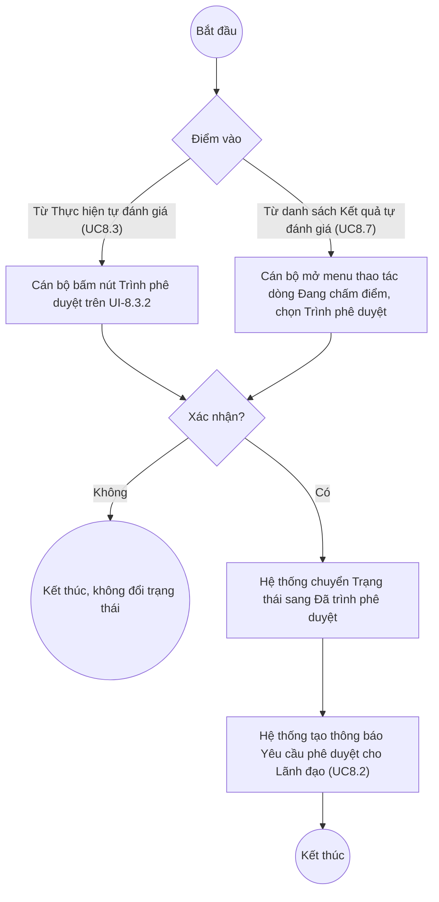

# UC8.4: Trình phê duyệt kết quả tự đánh giá

## 1. Thông tin chung

| ID | Use case | Description |
| :---- | :---- | :---- |
| UC8.4 | Trình phê duyệt kết quả tự đánh giá | Cán bộ, Cán bộ địa phương trình phê duyệt kết quả tự đánh giá (định kỳ/đột xuất) của đơn vị mình sau khi đã nhập điểm, từ màn hình Thực hiện tự đánh giá hoặc trực tiếp từ danh sách Kết quả tự đánh giá; đồng thời xem được danh sách các kỳ đã/đang trình phê duyệt. |

> **Actor:** Cán bộ, Cán bộ địa phương
>
> **Trigger:** Cán bộ bấm nút "Trình phê duyệt" trên màn hình Thực hiện tự đánh giá (UC8.3), hoặc bấm mục "Trình phê duyệt" trong menu thao tác của một dòng ở danh sách Kết quả tự đánh giá (UC8.7)
>
> **Điều kiện trước (Pre-condition):** Kết quả tự đánh giá của đơn vị đang ở trạng thái "Đang chấm điểm" (đã hoặc chưa nhập đủ điểm)
>
> **Điều kiện sau (Post-condition):** Trạng thái kết quả chuyển sang "Đã trình phê duyệt"; hệ thống tạo thông báo "Yêu cầu phê duyệt kết quả tự đánh giá" cho Lãnh đạo đơn vị/Lãnh đạo địa phương (UC8.2)
>
> **Lưu ý về phạm vi kiểm chứng:** Nút/mục "Trình phê duyệt" **đã xác nhận có tồn tại** ở 2 vị trí (xem Trigger), nhưng **chưa bấm xác nhận thật** ở cả 2 nơi để tránh làm chuyển trạng thái của dữ liệu tự đánh giá thật đang tồn tại. Nội dung dialog xác nhận (nếu có) của riêng hành động Trình phê duyệt **chưa được mở để xem trực tiếp** trong phiên khảo sát (phiên này chỉ mở xem dialog của Phê duyệt/Từ chối/Mở khoá/Yêu cầu đánh giá lại/Gửi kết quả — xem UC8.5, UC8.6, UC9.2, UC9.3).
>
> **Business rule:**
>
> BR-1: Có 2 điểm vào cho hành động Trình phê duyệt: (a) nút "Trình phê duyệt" ở đầu màn hình Thực hiện tự đánh giá (UI-8.3.2, truy cập từ Đến hạn tự đánh giá — xem UC8.3); (b) mục "Trình phê duyệt" trong menu thao tác (chevron) của một dòng có Trạng thái = "Đang chấm điểm" trên danh sách Kết quả tự đánh giá (UI-8.7.1 — xem UC8.7). *(Đã kiểm chứng trực tiếp ngày 10/10/2026 cho cả 2 vị trí)*
>
> BR-2: Mục "Trình phê duyệt" xuất hiện trong menu thao tác bất kể Trạng thái phê duyệt của dòng là "Chưa phê duyệt" (lần đầu trình) hay "Từ chối" (bị từ chối, trình lại) — miễn Trạng thái (status) = "Đang chấm điểm". *(Đã kiểm chứng trực tiếp với cả 2 tổ hợp)*
>
> BR-3: **[Cần xác nhận]** nội dung dialog xác nhận khi bấm Trình phê duyệt — dựa trên khuôn mẫu quan sát được ở các hành động khác trên cùng màn hình (Phê duyệt dùng popconfirm "Bạn có chắc chắn muốn thực hiện thao tác này? / Không / Có"), suy đoán hợp lý là Trình phê duyệt cũng dùng cùng khuôn mẫu popconfirm đơn giản, nhưng **chưa kiểm chứng trực tiếp**.
>
> BR-4: **[Cần xác nhận]** hệ thống có validate đã nhập đủ điểm cho toàn bộ chỉ số trước khi cho phép Trình phê duyệt hay không (vd màn hình Thực hiện tự đánh giá hiển thị "Tiến độ hoàn thành 0%" nhưng nút Trình phê duyệt vẫn hiển thị ở trạng thái bấm được, không thấy bị disable).
>
> BR-5: Sau khi trình phê duyệt thành công, kết quả chuyển sang Trạng thái "Đã trình phê duyệt", Trạng thái phê duyệt "Chờ phê duyệt", và hệ thống tạo thông báo cho Lãnh đạo đơn vị/Lãnh đạo địa phương (UC8.2). **[Cần xác nhận]** — suy luận hợp lý từ cơ chế trạng thái quan sát được qua API và từ nội dung thông báo UC8.2, nhưng chưa trực tiếp bấm Trình phê duyệt để quan sát chuyển trạng thái/thông báo phát sinh ngay sau đó.
>
> BR-6: Tài liệu yêu cầu nghiệp vụ còn mô tả "xem danh sách trình phê duyệt kết quả tự đánh giá định kỳ/đột xuất của đơn vị mình" như 2 mục riêng — qua khảo sát UI, **không tìm thấy một màn hình "Danh sách trình phê duyệt" tách biệt**. Chức năng này nhiều khả năng được đáp ứng bằng cách lọc danh sách Kết quả tự đánh giá dùng chung (UI-8.7.1) theo Trạng thái = "Đã trình phê duyệt" (kết hợp tab Định kỳ/Đột xuất). **[Cần xác nhận]**.

**Truy vết chức năng**

| STT | Chức năng | YC (BCKTKT) | Dòng UC_1409 | Luồng | Màn hình | BR |
| :---- | :---- | :---- | :---- | :---- | :---- | :---- |
| 1 | Trình phê duyệt kết quả tự đánh giá định kỳ của đơn vị mình | **[Cần xác nhận]** | **[Cần xác nhận]** | Basic Flow | UI-8.3.2 / UI-8.7.1 | BR-1, BR-2, BR-5 |
| 2 | Trình phê duyệt kết quả tự đánh giá đột xuất của đơn vị mình | **[Cần xác nhận]** | **[Cần xác nhận]** | Basic Flow | UI-8.3.2 / UI-8.7.1 | BR-1, BR-2, BR-5 |
| 3 | Xem danh sách trình phê duyệt định kỳ | **[Cần xác nhận]** | **[Cần xác nhận]** | AF1 | UI-8.7.1 | BR-6 |
| 4 | Xem danh sách trình phê duyệt đột xuất | **[Cần xác nhận]** | **[Cần xác nhận]** | AF1 | UI-8.7.1 | BR-6 |

> Cột YC (BCKTKT) và Dòng UC_1409 chưa đối chiếu được với bản gốc. Use case nguồn tương ứng: UC-C.I.4 "Trình phê duyệt kết quả tự đánh giá".

## 2. Mô tả luồng nghiệp vụ

*Hình 1. Luồng nghiệp vụ Trình phê duyệt kết quả tự đánh giá*

**Basic Flow** (từ màn hình Thực hiện tự đánh giá)

1. Cán bộ/Cán bộ địa phương mở màn hình Thực hiện tự đánh giá (UI-8.3.2) của kỳ cần trình (xem UC8.3).
2. Cán bộ bấm nút "Trình phê duyệt".
3. Hệ thống hiển thị xác nhận (BR-3, **[Cần xác nhận]** nội dung chính xác).
4. Cán bộ xác nhận.
5. Hệ thống chuyển Trạng thái kết quả sang "Đã trình phê duyệt", tạo thông báo cho Lãnh đạo (BR-5, UC8.2).

**Alternative Flow**

AF1. Trình phê duyệt trực tiếp từ danh sách Kết quả tự đánh giá

Tại danh sách Kết quả tự đánh giá (UI-8.7.1), Cán bộ mở menu thao tác (chevron) của một dòng đang ở Trạng thái "Đang chấm điểm", chọn "Trình phê duyệt" (BR-1, BR-2). Các bước tiếp theo tương tự Basic Flow bước 3–5. Use case kết thúc.

AF2. Xem danh sách đã trình phê duyệt

Tại UI-8.7.1, Cán bộ lọc Trạng thái = "Đã trình phê duyệt" kết hợp tab Định kỳ/Đột xuất để xem các kỳ đơn vị mình đã trình (BR-6). **[Cần xác nhận]** màn hình này có tự động giới hạn chỉ hiển thị đơn vị của Cán bộ đang đăng nhập hay không (không kiểm chứng được với tài khoản bypass). Use case kết thúc.

AF3. Hủy xác nhận

Tại bước 3, Cán bộ bấm "Không"/"Hủy". Hệ thống đóng dialog, không đổi trạng thái. Quay lại màn hình trước đó.

**Exception Flow**

EF1. Chưa nhập đủ điểm các chỉ số

**[Cần xác nhận]** hệ thống có chặn Trình phê duyệt khi chưa nhập đủ điểm không, và thông báo tương ứng (BR-4) — chưa thử để tránh ảnh hưởng dữ liệu thật.

EF2. Lỗi hệ thống khi trình phê duyệt

**[Cần xác nhận]** nội dung thông báo lỗi cụ thể.

## 3. Màn hình

| UI Code | Screen | Mô tả |
| :---- | :---- | :---- |
| UI-8.3.2 | Thực hiện tự đánh giá (chấm điểm) (Web) | Xem chi tiết tại UC8.3 — chứa nút "Trình phê duyệt" |
| UI-8.7.1 | Danh sách Kết quả tự đánh giá (Web) | Xem chi tiết tại UC8.7 — chứa mục "Trình phê duyệt" trong menu thao tác theo trạng thái, và dùng để lọc xem danh sách đã trình (AF2) |
| UI-8.4.1 | Dialog xác nhận Trình phê duyệt (Web) | **[Cần xác nhận]** nội dung — chưa mở được trực tiếp trong phiên khảo sát |

## 4. Mô tả Màn hình (Field Specification)

Các field của UI-8.3.2 và UI-8.7.1 đã mô tả đầy đủ tại UC8.3 và UC8.7 — không lặp lại ở đây, chỉ bổ sung riêng dialog xác nhận.

**UI-8.4.1 — Dialog xác nhận Trình phê duyệt** *(chưa xác minh được nội dung — xem Lưu ý phạm vi kiểm chứng)*

| Field Name | Field type | Data Type | Required | Validation rule/Behaviour |
| :---- | :---- | :---- | :---- | :---- |
| Toàn bộ nội dung | — | — | — | **[Cần xác nhận]** toàn bộ — suy đoán theo khuôn mẫu popconfirm "Bạn có chắc chắn muốn thực hiện thao tác này? / Không / Có" quan sát được ở hành động Phê duyệt cùng màn hình (UC8.5), nhưng chưa mở trực tiếp dialog của riêng Trình phê duyệt để xác nhận |

## Điểm cần xác nhận

| STT | Vị trí | Giả định đã dùng | Câu hỏi cần xác nhận |
| :---- | :---- | :---- | :---- |
| 1 | BR-3, UI-8.4.1 | Suy đoán dialog xác nhận theo khuôn mẫu các hành động khác, chưa mở trực tiếp | Cần mở và xác nhận nội dung thật của dialog Trình phê duyệt |
| 2 | BR-4, EF1 | Chưa rõ có validate bắt buộc nhập đủ điểm trước khi trình không | Cần xác nhận với dev |
| 3 | BR-6, AF2 | Không có màn hình "Danh sách trình phê duyệt" riêng, suy đoán dùng chung UI-8.7.1 lọc theo trạng thái | Xác nhận đây là thiết kế chủ đích (gộp màn hình) hay còn thiếu tính năng lọc "của đơn vị mình" |
| 4 | Truy vết chức năng | Chưa có số YC (BCKTKT) và Dòng UC_1409 | Đề nghị đối chiếu với bản gốc Google Sheet |
