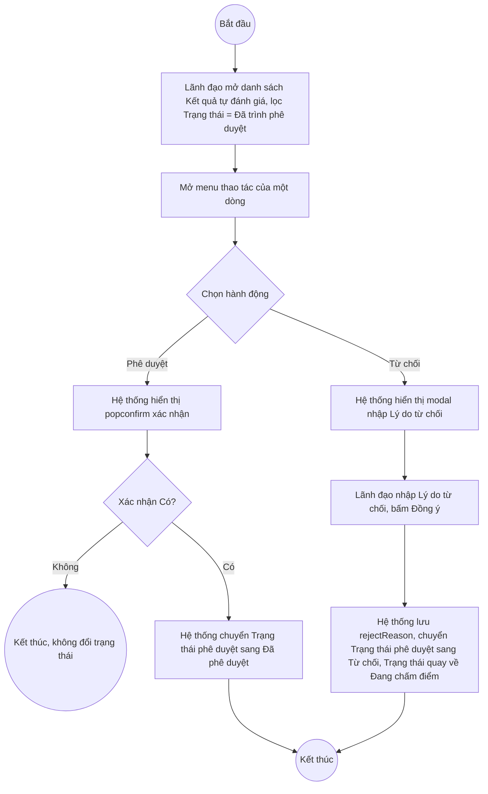

# UC8.5: Phê duyệt tự đánh giá

## 1. Thông tin chung

| ID | Use case | Description |
| :---- | :---- | :---- |
| UC8.5 | Phê duyệt tự đánh giá | Lãnh đạo đơn vị, Lãnh đạo địa phương xem danh sách kết quả tự đánh giá cần phê duyệt của đơn vị mình và thực hiện Phê duyệt hoặc Từ chối, trực tiếp trên danh sách Kết quả tự đánh giá. |

> **Actor:** Lãnh đạo đơn vị, Lãnh đạo địa phương
>
> **Trigger:** Lãnh đạo mở menu thao tác (chevron) của một dòng có Trạng thái = "Đã trình phê duyệt" trên danh sách Kết quả tự đánh giá, chọn "Phê duyệt" hoặc "Từ chối"
>
> **Điều kiện trước (Pre-condition):** Có ít nhất một kết quả tự đánh giá của đơn vị đang ở Trạng thái "Đã trình phê duyệt" / Trạng thái phê duyệt "Chờ phê duyệt" (đã được Cán bộ trình — xem UC8.4)
>
> **Điều kiện sau (Post-condition):** Trạng thái phê duyệt chuyển sang "Đã phê duyệt" (kèm lý do nếu có) hoặc "Từ chối" (kèm lý do từ chối bắt buộc); Cán bộ có thể xem kết quả ở trạng thái tương ứng
>
> **Lưu ý về phạm vi kiểm chứng:** Đã mở trực tiếp cả 2 dialog "Phê duyệt" và "Từ chối" trên dữ liệu thật ngày 10/10/2026 để đọc nội dung field, **sau đó chủ động đóng (Escape) chứ không bấm nút xác nhận cuối cùng**, nhằm tuân thủ nguyên tắc an toàn dữ liệu (không được phê duyệt/từ chối dữ liệu tự đánh giá thật có sẵn vì có thể ảnh hưởng vĩnh viễn tới quy trình nghiệp vụ thật đang chạy). Do đó nội dung 2 dialog dưới đây là xác thực, nhưng **kết quả sau khi xác nhận thật** (thông báo thành công, trạng thái cập nhật, v.v.) chưa được quan sát trực tiếp.
>
> **Business rule:**
>
> BR-1: Hành động Phê duyệt/Từ chối chỉ xuất hiện trong menu thao tác của dòng có Trạng thái = "Đã trình phê duyệt" (Trạng thái phê duyệt = "Chờ phê duyệt") trên danh sách Kết quả tự đánh giá (UI-8.7.1 tại UC8.7). *(Đã kiểm chứng trực tiếp ngày 10/10/2026)*
>
> BR-2: Dialog "Phê duyệt" là một popconfirm đơn giản với nội dung cố định: "Bạn có chắc chắn muốn thực hiện thao tác này? / Không / Có" — không có trường nhập liệu bổ sung. *(Đã kiểm chứng trực tiếp ngày 10/10/2026, đã mở dialog và đọc nội dung, không bấm "Có")*
>
> BR-3: Dialog "Từ chối" là một modal có trường bắt buộc "Lý do từ chối" (textarea) và 2 nút "Hủy"/"Đồng ý". *(Đã kiểm chứng trực tiếp ngày 10/10/2026, đã mở dialog và đọc nội dung, không bấm "Đồng ý")* **[Cần xác nhận]** Lý do từ chối có thực sự bắt buộc (validate khi để trống) hay không — chưa thử bấm Đồng ý để tránh submit thật.
>
> BR-4: Lý do từ chối được lưu vào trường `rejectReason` trong dữ liệu kết quả tự đánh giá (quan sát field `rejectReason` trong response API GET assessment-results, hiện đang `null` ở các bản ghi chưa bị từ chối). *(Đã kiểm chứng trực tiếp qua cấu trúc dữ liệu API)*
>
> BR-5: Sau khi Phê duyệt thành công, **[Cần xác nhận]** Trạng thái phê duyệt chuyển sang "Đã phê duyệt", mở ra hành động "Gửi kết quả" (UC8.6) cho Cán bộ — suy luận hợp lý từ bảng trạng thái quan sát được ở UC8.7 (dòng Đã phê duyệt có hành động Gửi kết quả trong menu), nhưng chưa tự tạo và đi hết một vòng đời bản ghi thật trong phiên này để xác nhận trực tiếp việc chuyển trạng thái diễn ra đúng như vậy.
>
> BR-6: Sau khi Từ chối thành công, **[Cần xác nhận]** Trạng thái quay về "Đang chấm điểm" để Cán bộ sửa và trình lại — suy luận từ việc quan sát được 1 bản ghi thật có Trạng thái = "Đang chấm điểm" + Trạng thái phê duyệt = "Từ chối" đồng thời có hành động "Trình phê duyệt" trong menu (khớp với luồng "bị từ chối → quay lại chấm điểm → trình lại"), nhưng chưa tự thực hiện để kiểm chứng trực tiếp quan hệ nhân-quả.
>
> BR-7: Tài liệu yêu cầu nghiệp vụ mô tả "xem danh sách cần phê duyệt kết quả tự đánh giá định kỳ/đột xuất của đơn vị mình" như 2 mục riêng. Qua khảo sát UI, không có màn hình "Danh sách cần phê duyệt" tách biệt — tương tự UC8.4, chức năng này được đáp ứng bằng cách lọc danh sách Kết quả tự đánh giá dùng chung (UI-8.7.1) theo Trạng thái phê duyệt = "Chờ phê duyệt", kết hợp tab Định kỳ/Đột xuất. **[Cần xác nhận]**.

**Truy vết chức năng**

| STT | Chức năng | YC (BCKTKT) | Dòng UC_1409 | Luồng | Màn hình | BR |
| :---- | :---- | :---- | :---- | :---- | :---- | :---- |
| 1 | Xem danh sách cần phê duyệt kết quả tự đánh giá định kỳ của đơn vị mình | **[Cần xác nhận]** | **[Cần xác nhận]** | AF1 | UI-8.7.1 | BR-1, BR-7 |
| 2 | Xem danh sách cần phê duyệt kết quả tự đánh giá đột xuất của đơn vị mình | **[Cần xác nhận]** | **[Cần xác nhận]** | AF1 | UI-8.7.1 | BR-1, BR-7 |
| 3 | Phê duyệt kết quả tự đánh giá của đơn vị mình | **[Cần xác nhận]** | **[Cần xác nhận]** | Basic Flow | UI-8.5.1 | BR-2, BR-5 |
| 4 | Từ chối phê duyệt kết quả tự đánh giá của đơn vị mình | **[Cần xác nhận]** | **[Cần xác nhận]** | AF2 | UI-8.5.2 | BR-3, BR-4, BR-6 |

> Cột YC (BCKTKT) và Dòng UC_1409 chưa đối chiếu được với bản gốc. Use case nguồn tương ứng: UC-C.I.5 "Phê duyệt tự đánh giá".

## 2. Mô tả luồng nghiệp vụ

*Hình 1. Luồng nghiệp vụ Phê duyệt / Từ chối tự đánh giá*

**Basic Flow** (Phê duyệt)

1. Lãnh đạo đơn vị/Lãnh đạo địa phương mở danh sách Kết quả tự đánh giá (UI-8.7.1), lọc Trạng thái phê duyệt = "Chờ phê duyệt" (AF1).
2. Lãnh đạo mở menu thao tác (chevron) của dòng cần duyệt, chọn "Phê duyệt".
3. Hệ thống hiển thị popconfirm "Bạn có chắc chắn muốn thực hiện thao tác này?" (UI-8.5.1, BR-2).
4. Lãnh đạo bấm "Có".
5. Hệ thống chuyển Trạng thái phê duyệt sang "Đã phê duyệt" (BR-5).

**Alternative Flow**

AF1. Xem danh sách cần phê duyệt

Tại UI-8.7.1, Lãnh đạo lọc Trạng thái phê duyệt = "Chờ phê duyệt" kết hợp tab Định kỳ/Đột xuất để xem các kỳ cần phê duyệt (BR-7). **[Cần xác nhận]** màn hình có tự giới hạn theo đơn vị của Lãnh đạo đang đăng nhập hay không. Use case kết thúc.

AF2. Từ chối phê duyệt

Tại bước 2, Lãnh đạo chọn "Từ chối" thay vì "Phê duyệt". Hệ thống hiển thị modal "Từ chối" (UI-8.5.2, BR-3) với trường bắt buộc "Lý do từ chối". Lãnh đạo nhập lý do, bấm "Đồng ý". Hệ thống lưu lý do vào `rejectReason` (BR-4), chuyển Trạng thái phê duyệt sang "Từ chối" và Trạng thái quay về "Đang chấm điểm" (BR-6). Use case kết thúc.

AF3. Hủy thao tác

Tại bước 3 hoặc trong modal Từ chối, Lãnh đạo bấm "Không"/"Hủy". Hệ thống đóng dialog, không đổi trạng thái. Quay lại bước 1.

**Exception Flow**

EF1. Để trống Lý do từ chối

**[Cần xác nhận]** hệ thống có validate bắt buộc nhập Lý do từ chối trước khi cho bấm "Đồng ý" không, và thông báo lỗi tương ứng — chưa thử để tránh submit ngoài ý muốn.

EF2. Lỗi hệ thống khi phê duyệt/từ chối

**[Cần xác nhận]** nội dung thông báo lỗi cụ thể.

## 3. Màn hình

| UI Code | Screen | Mô tả |
| :---- | :---- | :---- |
| UI-8.7.1 | Danh sách Kết quả tự đánh giá (Web) | Xem chi tiết tại UC8.7 — dùng để lọc xem danh sách cần phê duyệt (AF1) và mở menu thao tác Phê duyệt/Từ chối |
| UI-8.5.1 | Popconfirm xác nhận Phê duyệt (Web) | Xác nhận trước khi phê duyệt |
| UI-8.5.2 | Modal Từ chối phê duyệt (Web) | Nhập Lý do từ chối trước khi từ chối |

## 4. Mô tả Màn hình (Field Specification)

**UI-8.5.1 — Popconfirm xác nhận Phê duyệt**

| Field Name | Field type | Data Type | Required | Validation rule/Behaviour |
| :---- | :---- | :---- | :---- | :---- |
| Nội dung xác nhận | Label | String | Yes | **Behaviour:** "Bạn có chắc chắn muốn thực hiện thao tác này?" (BR-2) **Validation rule:** — |
| Nút Không | Button | Action | Yes | **Behaviour:** Đóng popconfirm, không đổi trạng thái (AF3) **Validation rule:** — |
| Nút Có | Button | Action | Yes | **Behaviour:** Thực hiện phê duyệt (bước 4–5) **Validation rule:** — |

**UI-8.5.2 — Modal Từ chối phê duyệt**

| Field Name | Field type | Data Type | Required | Validation rule/Behaviour |
| :---- | :---- | :---- | :---- | :---- |
| Tiêu đề modal | Label | String | Yes | **Behaviour:** "Lý do từ chối" **Validation rule:** — |
| Lý do từ chối | Textarea | String | Có vẻ bắt buộc (nhãn trùng tiêu đề, chưa test validate) | **Behaviour:** Lưu vào field `rejectReason` (BR-4) **Validation rule:** **[Cần xác nhận]** bắt buộc nhập, độ dài tối đa — chưa thử để trống rồi bấm Đồng ý |
| Nút Hủy | Button | Action | Yes | **Behaviour:** Đóng modal, không đổi trạng thái (AF3) **Validation rule:** — |
| Nút Đồng ý | Button | Action | Yes | **Behaviour:** Lưu lý do, chuyển Trạng thái phê duyệt sang Từ chối (AF2, BR-6) **Validation rule:** — |

## Điểm cần xác nhận

| STT | Vị trí | Giả định đã dùng | Câu hỏi cần xác nhận |
| :---- | :---- | :---- | :---- |
| 1 | BR-3, UI-8.5.2 | Chưa thử để trống Lý do từ chối rồi bấm Đồng ý | Trường này có thực sự bắt buộc không? |
| 2 | BR-5, BR-6 | Suy luận hướng chuyển trạng thái sau Phê duyệt/Từ chối từ dữ liệu quan sát gián tiếp, chưa tự thực hiện trọn vòng đời | Cần dev xác nhận chính xác state machine của trạng thái kết quả tự đánh giá |
| 3 | BR-7, AF1 | Không có màn hình "Danh sách cần phê duyệt" riêng, dùng chung UI-8.7.1 lọc theo trạng thái | Xác nhận đây là thiết kế chủ đích |
| 4 | Truy vết chức năng | Chưa có số YC (BCKTKT) và Dòng UC_1409 | Đề nghị đối chiếu với bản gốc Google Sheet |
