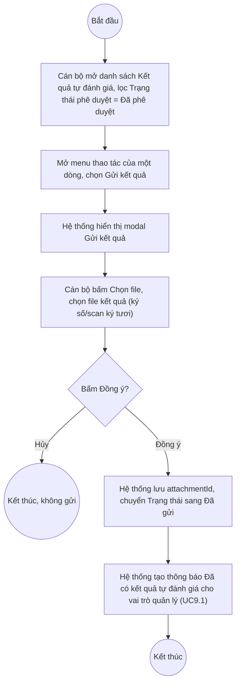

# UC8.6: Gửi kết quả tự đánh giá

## 1. Thông tin chung

| ID | Use case | Description |
| :---- | :---- | :---- |
| UC8.6 | Gửi kết quả tự đánh giá | Cán bộ, Cán bộ địa phương xem danh sách kết quả tự đánh giá đã được Lãnh đạo phê duyệt, đính kèm file kết quả chính thức (ký số hoặc scan ký tươi) và gửi kết quả tự đánh giá của đơn vị, trực tiếp trên danh sách Kết quả tự đánh giá. |

> **Actor:** Cán bộ, Cán bộ địa phương
>
> **Trigger:** Cán bộ mở menu thao tác (chevron) của một dòng có Trạng thái = "Đã phê duyệt" trên danh sách Kết quả tự đánh giá, chọn "Gửi kết quả"
>
> **Điều kiện trước (Pre-condition):** Kết quả tự đánh giá của đơn vị đã được Lãnh đạo phê duyệt (Trạng thái phê duyệt = "Đã phê duyệt" — xem UC8.5)
>
> **Điều kiện sau (Post-condition):** Kết quả chuyển sang Trạng thái "Đã gửi" (khóa, không sửa điểm được nữa); hệ thống tạo thông báo "Đã có kết quả tự đánh giá" cho vai trò quản lý (UC9.1)
>
> **Lưu ý về phạm vi kiểm chứng:** Đã mở trực tiếp dialog "Gửi kết quả" trên dữ liệu thật ngày 10/10/2026 để đọc nội dung field, **chủ động đóng (Hủy) chứ không bấm "Đồng ý"**, theo đúng nguyên tắc an toàn dữ liệu (gửi kết quả là thao tác khóa dữ liệu, không thể hoàn tác dễ dàng). Nội dung dialog dưới đây là xác thực, kết quả sau khi gửi thật chưa được quan sát trực tiếp.
>
> **Business rule:**
>
> BR-1: Hành động "Gửi kết quả" chỉ xuất hiện trong menu thao tác của dòng có Trạng thái phê duyệt = "Đã phê duyệt" trên danh sách Kết quả tự đánh giá (UI-8.7.1 tại UC8.7). *(Đã kiểm chứng trực tiếp ngày 10/10/2026)*
>
> BR-2: Dialog "Gửi kết quả" là một modal có tiêu đề "Gửi kết quả", trường "File đính kèm" với nút "Chọn file", và 2 nút "Hủy"/"Đồng ý". *(Đã kiểm chứng trực tiếp ngày 10/10/2026, đã mở và đọc nội dung, không bấm "Đồng ý")*
>
> BR-3: Theo mô tả yêu cầu nghiệp vụ (UC-C.I.6), file đính kèm có thể là "file ký số" hoặc "file scan ký tươi". **[Cần xác nhận]** UI có phân biệt 2 loại file này (vd 2 ô chọn file riêng, hay chọn loại trước khi upload) hay chỉ có một ô "Chọn file" chung chung như quan sát được — dialog thực tế chỉ hiện đúng 1 nút "Chọn file" duy nhất.
>
> BR-4: Trường File đính kèm lưu vào field `attachmentId` trong dữ liệu kết quả tự đánh giá (quan sát field này đã có giá trị khác null ở các bản ghi đã từng gửi trước đó). Ngoài ra dữ liệu còn có các field `verificationAttachmentId`/`verificationAttachmentFileName`/`verificationAttachmentFileUrl` riêng biệt (hiện null ở mọi bản ghi quan sát được) — **[Cần xác nhận]** mục đích chính xác của bộ field này, có thể dùng cho một loại minh chứng/xác thực khác (vd chữ ký số xác thực) không nằm trong dialog Gửi kết quả đã quan sát được. *(Field quan sát trực tiếp qua cấu trúc API, ý nghĩa nghiệp vụ suy luận)*
>
> BR-5: **[Cần xác nhận]** trường File đính kèm có bắt buộc trước khi bấm "Đồng ý" không — chưa thử bấm Đồng ý khi chưa chọn file để tránh submit ngoài ý muốn.
>
> BR-6: Sau khi gửi thành công, **[Cần xác nhận]** Trạng thái chuyển sang "Đã gửi", khóa toàn bộ chỉnh sửa điểm (dựa trên quan sát các bản ghi thật có Trạng thái "Đã gửi" đều ở chế độ chỉ đọc hoàn toàn trên màn hình Xem/Chấm điểm — xem BR-12 của UC8.7), đồng thời field `sentDate` được ghi nhận thời điểm gửi. *(Field `sentDate` quan sát trực tiếp qua API; quan hệ nhân-quả với hành động Gửi kết quả là suy luận hợp lý, chưa tự thực hiện để xác nhận trực tiếp)*
>
> BR-7: Tài liệu yêu cầu nghiệp vụ mô tả "xem danh sách kết quả tự đánh giá định kỳ/đột xuất đã được lãnh đạo phê duyệt" như 2 mục riêng — tương tự UC8.4/UC8.5, không có màn hình danh sách tách biệt; dùng chung UI-8.7.1 lọc theo Trạng thái phê duyệt = "Đã phê duyệt". **[Cần xác nhận]**.

**Truy vết chức năng**

| STT | Chức năng | YC (BCKTKT) | Dòng UC_1409 | Luồng | Màn hình | BR |
| :---- | :---- | :---- | :---- | :---- | :---- | :---- |
| 1 | Xem danh sách kết quả tự đánh giá định kỳ đã được phê duyệt | **[Cần xác nhận]** | **[Cần xác nhận]** | AF1 | UI-8.7.1 | BR-1, BR-7 |
| 2 | Xem danh sách kết quả tự đánh giá đột xuất đã được phê duyệt | **[Cần xác nhận]** | **[Cần xác nhận]** | AF1 | UI-8.7.1 | BR-1, BR-7 |
| 3 | Đính kèm file kết quả tự đánh giá (ký số, scan ký tươi) | **[Cần xác nhận]** | **[Cần xác nhận]** | Basic Flow bước 3 | UI-8.6.1 | BR-2, BR-3, BR-4 |
| 4 | Gửi kết quả tự đánh giá của đơn vị | **[Cần xác nhận]** | **[Cần xác nhận]** | Basic Flow bước 4–5 | UI-8.6.1 | BR-5, BR-6 |

> Cột YC (BCKTKT) và Dòng UC_1409 chưa đối chiếu được với bản gốc. Use case nguồn tương ứng: UC-C.I.6 "Gửi kết quả tự đánh giá".

## 2. Mô tả luồng nghiệp vụ

*Hình 1. Luồng nghiệp vụ Gửi kết quả tự đánh giá*

**Basic Flow**

1. Cán bộ/Cán bộ địa phương mở danh sách Kết quả tự đánh giá (UI-8.7.1), lọc Trạng thái phê duyệt = "Đã phê duyệt" (AF1).
2. Cán bộ mở menu thao tác của dòng cần gửi, chọn "Gửi kết quả".
3. Hệ thống hiển thị modal "Gửi kết quả" (UI-8.6.1, BR-2). Cán bộ bấm "Chọn file" và chọn file kết quả (BR-3, BR-4).
4. Cán bộ bấm "Đồng ý".
5. Hệ thống lưu file đính kèm, chuyển Trạng thái sang "Đã gửi" (BR-6), tạo thông báo cho vai trò quản lý (UC9.1).

**Alternative Flow**

AF1. Xem danh sách đã phê duyệt chờ gửi

Tại UI-8.7.1, Cán bộ lọc Trạng thái phê duyệt = "Đã phê duyệt" kết hợp tab Định kỳ/Đột xuất (BR-7). **[Cần xác nhận]** màn hình có tự giới hạn theo đơn vị của Cán bộ đang đăng nhập hay không. Use case kết thúc.

AF2. Hủy thao tác

Tại bước 3, Cán bộ bấm "Hủy". Hệ thống đóng modal, không gửi. Quay lại bước 1.

**Exception Flow**

EF1. Chưa chọn file

**[Cần xác nhận]** hệ thống có chặn bấm "Đồng ý" khi chưa chọn file không, và thông báo lỗi tương ứng (BR-5) — chưa thử để tránh submit ngoài ý muốn.

EF2. File không đúng định dạng/dung lượng

**[Cần xác nhận]** ràng buộc định dạng/dung lượng file — có thể liên quan cấu hình "Dung lượng file tối đa" và "Bắt buộc ký số file minh chứng" tại Tham số hệ thống (UC3.2, tab Minh chứng).

EF3. Lỗi hệ thống khi gửi kết quả

**[Cần xác nhận]** nội dung thông báo lỗi cụ thể.

## 3. Màn hình

| UI Code | Screen | Mô tả |
| :---- | :---- | :---- |
| UI-8.7.1 | Danh sách Kết quả tự đánh giá (Web) | Xem chi tiết tại UC8.7 — dùng để lọc xem danh sách đã phê duyệt (AF1) và mở menu thao tác Gửi kết quả |
| UI-8.6.1 | Modal Gửi kết quả (Web) | Đính kèm file kết quả và gửi |

## 4. Mô tả Màn hình (Field Specification)

**UI-8.6.1 — Modal Gửi kết quả**

| Field Name | Field type | Data Type | Required | Validation rule/Behaviour |
| :---- | :---- | :---- | :---- | :---- |
| Tiêu đề modal | Label | String | Yes | **Behaviour:** "Gửi kết quả" **Validation rule:** — |
| File đính kèm | Upload | File | **[Cần xác nhận]** | **Behaviour:** Nút "Chọn file" duy nhất; theo yêu cầu nghiệp vụ dùng cho file ký số hoặc file scan ký tươi (BR-3, BR-4) **Validation rule:** **[Cần xác nhận]** bắt buộc, định dạng, dung lượng tối đa (liên quan UC3.2) |
| Nút Hủy | Button | Action | Yes | **Behaviour:** Đóng modal, không gửi (AF2) **Validation rule:** — |
| Nút Đồng ý | Button | Action | Yes | **Behaviour:** Lưu file, chuyển Trạng thái sang Đã gửi (bước 4–5) **Validation rule:** **[Cần xác nhận]** có disable khi chưa chọn file không |

## Điểm cần xác nhận

| STT | Vị trí | Giả định đã dùng | Câu hỏi cần xác nhận |
| :---- | :---- | :---- | :---- |
| 1 | BR-3 | Dialog chỉ có 1 ô "Chọn file" chung, trong khi yêu cầu nghiệp vụ mô tả 2 loại file (ký số, scan ký tươi) | UI có phân biệt 2 loại file này không, hay gộp chung 1 trường? |
| 2 | BR-4 | Có bộ field `verificationAttachmentId`/FileName/FileUrl riêng trong API, hiện luôn null | Bộ field này dùng cho mục đích gì, có liên quan màn hình/luồng nào khác chưa khảo sát? |
| 3 | BR-5, EF1 | Chưa thử bấm Đồng ý khi chưa chọn file | File đính kèm có bắt buộc không? |
| 4 | BR-6 | Suy luận quan hệ nhân-quả giữa Gửi kết quả và chuyển Trạng thái "Đã gửi" + khóa sửa điểm, chưa tự thực hiện để xác nhận trực tiếp | Cần dev xác nhận state machine chính xác |
| 5 | Truy vết chức năng | Chưa có số YC (BCKTKT) và Dòng UC_1409 | Đề nghị đối chiếu với bản gốc Google Sheet |
