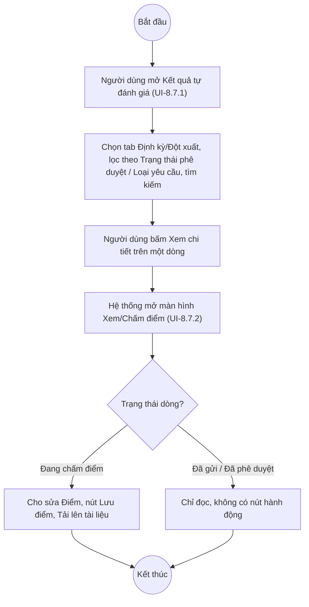

# UC8.7: Quản lý danh sách kết quả tự đánh giá

## 1. Thông tin chung

| ID | Use case | Description |
| :---- | :---- | :---- |
| UC8.7 | Quản lý danh sách kết quả tự đánh giá | Lãnh đạo đơn vị, Cán bộ, Lãnh đạo địa phương, Cán bộ địa phương tìm kiếm, lọc, xem chi tiết và xuất Excel danh sách kết quả tự đánh giá (định kỳ/đột xuất) của các đơn vị trên màn hình "Kết quả tự đánh giá". Đây là màn hình trung tâm của Phân hệ C: từ danh sách này, tùy trạng thái từng dòng, người dùng còn thực hiện được Trình phê duyệt (UC8.4), Phê duyệt/Từ chối (UC8.5), Gửi kết quả (UC8.6), Mở khóa (UC9.3), Yêu cầu đánh giá lại (UC9.2). |

> **Actor:** Lãnh đạo đơn vị, Cán bộ, Lãnh đạo địa phương, Cán bộ địa phương
>
> **Trigger:** Người dùng chọn menu "Đánh giá CĐS" > "Kết quả tự đánh giá"
>
> **Điều kiện trước (Pre-condition):** Người dùng đã đăng nhập
>
> **Điều kiện sau (Post-condition):** Danh sách/chi tiết kết quả tự đánh giá được hiển thị theo điều kiện tìm kiếm/lọc
>
> **Lưu ý về phạm vi kiểm chứng:** Đây là màn hình được khảo sát kỹ nhất trong Phân hệ C với tài khoản QA Super Admin (SYSTEM_ROLE_BYPASS). Toàn bộ nội dung mục này **đã kiểm chứng trực tiếp ngày 10/10/2026** trừ khi có ghi chú khác. Danh sách này đóng vai trò là màn hình dùng chung cho rất nhiều use case khác (UC8.4, UC8.5, UC8.6, UC9.2, UC9.3, UC9.4) — các UC đó sẽ tham chiếu lại UI-8.7.1/UI-8.7.2 mô tả tại đây thay vì lặp lại.
>
> **Business rule:**
>
> BR-1: Danh sách (UI-8.7.1) có 2 tab/segment "Định kỳ" và "Đột xuất" ở góc trên phải. *(Đã kiểm chứng trực tiếp)*
>
> BR-2: Cột hiển thị: checkbox chọn dòng, Kỳ tự đánh giá, Đơn vị, Tổng điểm, Trạng thái, Trạng thái phê duyệt, Tình trạng tuân thủ, Thao tác. *(Đã kiểm chứng trực tiếp)*
>
> BR-3: "Trạng thái" (field API `status`) là trạng thái quy trình nhập liệu, các giá trị quan sát được: Đang chấm điểm, Đã gửi, Đã trình phê duyệt, Đã phê duyệt. "Trạng thái phê duyệt" (field API `approvalStatus`) là trạng thái phê duyệt riêng, các giá trị quan sát được: Chưa phê duyệt, Chờ phê duyệt, Đã phê duyệt, Từ chối. Hai cột này **độc lập về mặt dữ liệu** (API trả về 2 field `status` và `approvalStatus` riêng) nhưng có thể trùng nhãn hiển thị ở một số trạng thái (vd cùng hiển thị "Đã phê duyệt"). *(Đã kiểm chứng trực tiếp qua dữ liệu API GET /api/v1/dti/assessment-results)*
>
> BR-4: "Tình trạng tuân thủ" (field API `complianceStatus`) nhận giá trị: Đúng hạn (OnTime), Trễ hạn, Chưa hoàn thành — quan sát được cả 3 giá trị trên dữ liệu thật. *(Đã kiểm chứng trực tiếp)*
>
> BR-5: Bộ lọc gồm: ô tìm kiếm "Tìm kiếm tên đánh giá", dropdown "Trạng thái phê duyệt" (giá trị: Chưa phê duyệt, Chờ phê duyệt, Đã phê duyệt, Từ chối), dropdown "Loại yêu cầu" (giá trị: Yêu cầu thực hiện, Yêu cầu mở khóa, Yêu cầu đánh giá lại). *(Đã kiểm chứng trực tiếp — mở từng dropdown và đọc option)*
>
> BR-6: Chọn "Loại yêu cầu" = "Yêu cầu mở khóa" gửi tham số `specialFilter=unlock_request` lên API và trả về danh sách lọc theo đúng ngữ cảnh (quan sát 1 bản ghi khớp). *(Đã kiểm chứng trực tiếp qua lời gọi API thực tế ngày 10/10/2026)*
>
> BR-7: Chọn "Loại yêu cầu" = "Yêu cầu đánh giá lại" **không phát sinh lời gọi API mới** và danh sách hiển thị không đổi so với lựa chọn liền trước đó (Yêu cầu mở khóa) trong phiên kiểm thử — xem Ghi nhận QC.
>
> BR-8: Nút "Xuất Excel" ở toolbar được bấm thử: không có sự kiện tải file, không có lời gọi API ghi nhận — có dấu hiệu là stub, giống hiện tượng ghi nhận ở UI-8.3.1 (UC8.3) và trong cache khảo sát 08/10/2026.
>
> BR-9: Mỗi dòng có liên kết "Xem chi tiết" mở màn hình Xem/Chấm điểm (UI-8.7.2) và một menu thao tác dạng mũi tên (chevron) mà **nội dung thay đổi theo Trạng thái của dòng** — đây là cơ chế chính triển khai các UC8.4/8.5/8.6/9.2/9.3 (xem bảng dưới). *(Đã kiểm chứng trực tiếp với 4 tổ hợp trạng thái khác nhau)*

| Trạng thái dòng (status) | Trạng thái phê duyệt | Mục trong menu thao tác (chevron) | UC liên quan |
| :---- | :---- | :---- | :---- |
| Đang chấm điểm | Chưa phê duyệt hoặc Từ chối | Trình phê duyệt, Xuất Excel | UC8.4 |
| Đã trình phê duyệt | Chờ phê duyệt | Phê duyệt, Từ chối, Xuất Excel | UC8.5 |
| Đã gửi | Chưa phê duyệt | Mở khoá, Yêu cầu đánh giá lại, Xuất Excel | UC9.3, UC9.2 |
| Đã phê duyệt | Đã phê duyệt | Gửi kết quả, Xuất Excel | UC8.6 |

> BR-10: Checkbox chọn dòng ở đầu bảng không làm xuất hiện thêm nút hành động hàng loạt nào trên toolbar trong lần thử nghiệm (chỉ chọn 1 dòng). **[Cần xác nhận]** mục đích của checkbox này — có thể dùng cho thao tác hàng loạt chưa được kiểm thử hết, hoặc dùng để xuất Excel chỉ các dòng đã chọn.
>
> BR-11: Màn hình chi tiết "Xem/Chấm điểm" (UI-8.7.2) hiển thị: tiêu đề "Xem/Chấm điểm - &lt;tên kỳ&gt;", tên đơn vị, Tổng điểm (x.xx (đã nhập/tổng số chỉ số)), các tab theo nhóm chỉ số lớn, trong mỗi tab có các khối theo nhóm chỉ số con (vd "Nhận thức số 3/3 Điểm: 22") chứa bảng: Mã chỉ số, Chỉ số, Trọng số, Điểm tối thiểu/Điểm tối đa, Điểm, Ghi chú, Tài liệu kiểm chứng. *(Đã kiểm chứng trực tiếp)*
>
> BR-12: Khả năng sửa của màn hình Xem/Chấm điểm phụ thuộc Trạng thái: khi "Đang chấm điểm" các ô Điểm có thể sửa và có nút "Lưu điểm" + nút "Tải lên tài liệu" cho từng chỉ số; khi "Đã gửi" hoặc "Đã phê duyệt" toàn bộ ở chế độ chỉ đọc, không có nút hành động nào trong nội dung trang (ngoài một nút "Đánh dấu đã đọc tất cả" không liên quan, thuộc thanh điều hướng chung). *(Đã kiểm chứng trực tiếp với 3 trạng thái khác nhau)*

**Ghi nhận QC (10/10/2026):**
- Bộ lọc "Loại yêu cầu" = "Yêu cầu đánh giá lại" dường như không hoạt động: không phát sinh lời gọi API mới khi chọn, danh sách giữ nguyên kết quả của lựa chọn trước đó (BR-7). Cần dev xác nhận lại, không loại trừ khả năng do công cụ kiểm thử thao tác chưa đúng (vd dropdown chưa đóng hẳn trước khi mở lại).
- Theo cache khảo sát ngày 08/10/2026 (chưa re-test trực tiếp ngày 10/10 để tránh rủi ro gửi filter sai lên dữ liệu thật nhiều lần), bộ lọc "Trạng thái phê duyệt" có dấu hiệu gửi **đồng thời cả 2 tham số** `status` và `approvalStatus` lên cùng một giá trị được chọn (vd chọn "Chưa phê duyệt" → API nhận `{"approvalStatus":"Unapproved","status":"Unapproved"}`), trong khi về bản chất đây là 2 field độc lập (BR-3). Nếu đúng, đây là lỗi lọc dữ liệu (kết quả trả về có thể thiếu các dòng có `status` ≠ `approvalStatus` dù đúng điều kiện `approvalStatus` người dùng chọn).
- Toàn bộ nội dung bảng chấm điểm trong màn hình Xem/Chấm điểm bị ảnh hưởng bởi tên "Nhóm chỉ số" hiển thị dữ liệu test ("test", "24") — xem Ghi nhận QC tại UC8.3.

**Truy vết chức năng**

| STT | Chức năng | YC (BCKTKT) | Dòng UC_1409 | Luồng | Màn hình | BR |
| :---- | :---- | :---- | :---- | :---- | :---- | :---- |
| 1 | Tìm kiếm kết quả tự đánh giá định kỳ | **[Cần xác nhận]** | **[Cần xác nhận]** | Basic Flow | UI-8.7.1 | BR-1, BR-5 |
| 2 | Tìm kiếm kết quả tự đánh giá đột xuất | **[Cần xác nhận]** | **[Cần xác nhận]** | AF1 | UI-8.7.1 | BR-1, BR-5 |
| 3 | Xem kết quả tự đánh giá | **[Cần xác nhận]** | **[Cần xác nhận]** | AF2 | UI-8.7.2 | BR-11, BR-12 |
| 4 | Export kết quả tự đánh giá ra Excel | **[Cần xác nhận]** | **[Cần xác nhận]** | AF3 | UI-8.7.1 | BR-8 |
| 5 | Yêu cầu mở khóa kết quả tự đánh giá để cập nhật lại | **[Cần xác nhận]** | **[Cần xác nhận]** | — | UI-8.7.1 | BR-9 |

> Cột YC (BCKTKT) và Dòng UC_1409 chưa đối chiếu được với bản gốc. Use case nguồn tương ứng: UC-C.I.7 "Quản lý danh sách kết quả tự đánh giá". Mục "Yêu cầu mở khóa kết quả tự đánh giá để cập nhật lại thông tin, điểm" mô tả trong tài liệu yêu cầu là hành động của Lãnh đạo đơn vị/Lãnh đạo địa phương (chủ thể **gửi yêu cầu**), khác với thao tác "Mở khoá" trực tiếp quan sát được trên dòng trạng thái "Đã gửi" trong bảng ở BR-9 (thao tác **thực hiện mở khóa ngay**, xem UC9.3) — **[Cần xác nhận]** liệu đây là cùng 1 nút nhìn từ 2 góc actor khác nhau, hay là 2 cơ chế khác nhau (xem thêm Điểm cần xác nhận của UC9.1, UC9.3).

## 2. Mô tả luồng nghiệp vụ

*Hình 1. Luồng nghiệp vụ tìm kiếm và xem kết quả tự đánh giá*

**Basic Flow**

1. Người dùng chọn menu "Đánh giá CĐS" > "Kết quả tự đánh giá".
2. Hệ thống hiển thị màn hình Kết quả tự đánh giá (UI-8.7.1), tab mặc định "Định kỳ", 10 bản ghi/trang, cột theo BR-2.
3. Người dùng nhập từ khóa tìm kiếm và/hoặc chọn bộ lọc Trạng thái phê duyệt, Loại yêu cầu (BR-5).
4. Hệ thống trả về danh sách thỏa điều kiện.

**Alternative Flow**

AF1. Chuyển tab Đột xuất

Tại bước 2, người dùng bấm tab "Đột xuất". Hệ thống tải lại danh sách các kỳ tự đánh giá đột xuất (BR-1). Use case kết thúc.

AF2. Xem chi tiết kết quả tự đánh giá

Tại bước 2/4, người dùng bấm "Xem chi tiết" trên một dòng. Hệ thống mở màn hình Xem/Chấm điểm (UI-8.7.2) với nội dung theo BR-11; khả năng chỉnh sửa tùy Trạng thái (BR-12). Use case kết thúc.

AF3. Xuất Excel

Tại bước 2, người dùng bấm "Xuất Excel". **Ghi nhận QC:** không phát sinh file khi bấm thử trong phiên kiểm thử (BR-8). Use case kết thúc.

AF4. Mở menu thao tác theo trạng thái

Tại bước 2/4, người dùng bấm chevron ở cột Thao tác của một dòng. Hệ thống hiển thị menu gồm các mục tùy theo Trạng thái của dòng đó (bảng ở BR-9): Trình phê duyệt (UC8.4) / Phê duyệt, Từ chối (UC8.5) / Mở khoá, Yêu cầu đánh giá lại (UC9.3, UC9.2) / Gửi kết quả (UC8.6), cùng mục "Xuất Excel" luôn có mặt. Use case kết thúc — xem chi tiết từng hành động tại UC tương ứng.

**Exception Flow**

EF1. Không có kết quả tìm kiếm

Tại bước 4, nếu không có bản ghi thỏa điều kiện, bảng hiển thị trống. **[Cần xác nhận]** thông báo cụ thể ("Không có dữ liệu" hay dạng khác).

EF2. Lỗi hệ thống khi tải danh sách/chi tiết/xuất Excel

**[Cần xác nhận]** nội dung thông báo lỗi — chưa quan sát được trường hợp này.

## 3. Màn hình

| UI Code | Screen | Mô tả |
| :---- | :---- | :---- |
| UI-8.7.1 | Danh sách Kết quả tự đánh giá (Web) | Tab Định kỳ/Đột xuất, tìm kiếm, lọc Trạng thái phê duyệt/Loại yêu cầu, bảng danh sách, Xuất Excel, menu thao tác theo trạng thái từng dòng |
| UI-8.7.2 | Xem/Chấm điểm (chi tiết kết quả) (Web) | Chi tiết một kết quả tự đánh giá: tổng điểm, các tab/nhóm chỉ số, bảng điểm từng chỉ số, chỉ đọc hoặc cho sửa tùy trạng thái |

## 4. Mô tả Màn hình (Field Specification)

**UI-8.7.1 — Danh sách Kết quả tự đánh giá**

| Field Name | Field type | Data Type | Required | Validation rule/Behaviour |
| :---- | :---- | :---- | :---- | :---- |
| Tab Định kỳ / Đột xuất | Segmented/Tab | Enum | Yes | **Behaviour:** Chuyển loại campaign hiển thị (BR-1, AF1) **Validation rule:** — |
| Tìm kiếm | Search box | String | No | **Behaviour:** Placeholder "Tìm kiếm tên đánh giá…" **Validation rule:** **[Cần xác nhận]** độ dài tối đa |
| Trạng thái phê duyệt | Dropdown | Enum | No | **Behaviour:** Chưa phê duyệt / Chờ phê duyệt / Đã phê duyệt / Từ chối (BR-5) — **Ghi nhận QC:** nghi vấn gửi trùng tham số với field status (xem mục Ghi nhận QC) **Validation rule:** — |
| Loại yêu cầu | Dropdown | Enum | No | **Behaviour:** Yêu cầu thực hiện / Yêu cầu mở khóa / Yêu cầu đánh giá lại (BR-5, BR-6) — mục "Yêu cầu đánh giá lại" nghi vấn không lọc đúng (BR-7) **Validation rule:** — |
| Nút Xuất Excel | Button | Action | Yes | **Behaviour:** Dự kiến xuất danh sách — **Ghi nhận QC:** không phát sinh file khi bấm thử (BR-8) **Validation rule:** — |
| Checkbox đầu dòng | Checkbox | Boolean | No | **Behaviour:** **[Cần xác nhận]** mục đích (BR-10) **Validation rule:** — |
| Kỳ tự đánh giá | Label | String | Yes | **Behaviour:** Tên kỳ **Validation rule:** — |
| Đơn vị | Label | String | Yes | **Behaviour:** Tên đơn vị **Validation rule:** — |
| Tổng điểm | Label | Decimal | Yes | **Behaviour:** Tổng điểm đã chấm (field API `totalScore`) **Validation rule:** — |
| Trạng thái | Badge/Tag | Enum | Yes | **Behaviour:** Theo BR-3 (field `status`) **Validation rule:** — |
| Trạng thái phê duyệt | Badge/Tag | Enum | Yes | **Behaviour:** Theo BR-3 (field `approvalStatus`) **Validation rule:** — |
| Tình trạng tuân thủ | Badge/Tag | Enum | Yes | **Behaviour:** Đúng hạn / Trễ hạn / Chưa hoàn thành (BR-4, field `complianceStatus`) **Validation rule:** — |
| Thao tác — Xem chi tiết | Link | Action | Yes | **Behaviour:** Mở UI-8.7.2 (AF2) **Validation rule:** — |
| Thao tác — Menu chevron | Icon button | Action | Yes | **Behaviour:** Menu động theo trạng thái (BR-9, AF4) **Validation rule:** — |
| Phân trang | Pagination | Integer | Yes | **Behaviour:** "10 / trang", nhiều trang (quan sát 43 bản ghi / 5 trang ở tab Định kỳ) **Validation rule:** — |

**UI-8.7.2 — Xem/Chấm điểm (chi tiết kết quả)**

| Field Name | Field type | Data Type | Required | Validation rule/Behaviour |
| :---- | :---- | :---- | :---- | :---- |
| Breadcrumb | Label | String | Yes | **Behaviour:** "Đánh giá CĐS > Kết quả tự đánh giá > Chi tiết" **Validation rule:** — |
| Tiêu đề | Label | String | Yes | **Behaviour:** "Xem/Chấm điểm - &lt;tên kỳ&gt;", dòng phụ tên đơn vị **Validation rule:** — |
| Tổng điểm | Label | String | Yes | **Behaviour:** "x.xx (đã nhập/tổng số chỉ số)", vd "22.00 (3/38)" **Validation rule:** — |
| Tab nhóm chỉ số lớn | Tab | String | Yes | **Behaviour:** **Ghi nhận QC:** nhãn tab hiện là "test"/"24" thay vì tên hợp lệ (dữ liệu danh mục lỗi, không phải lỗi màn hình này) **Validation rule:** — |
| Khối nhóm chỉ số con | Section (collapsible) | — | — | **Behaviour:** Vd "Nhận thức số 3/3 Điểm: 22" — tiêu đề, số chỉ số đã nhập/tổng, điểm nhóm **Validation rule:** — |
| Bảng — Mã chỉ số / Chỉ số / Trọng số | Label | String/Integer | Yes | **Behaviour:** Thông tin chỉ số **Validation rule:** — |
| Bảng — Điểm tối thiểu/Điểm tối đa | Label | String | Yes | **Behaviour:** Dạng "0-20", "0-30" (hiển thị đúng ở màn hình này, khác UI-8.3.2) **Validation rule:** — |
| Bảng — Điểm | Number input / Label | Decimal | No | **Behaviour:** Có thể sửa khi Trạng thái = Đang chấm điểm, chỉ đọc khi Đã gửi/Đã phê duyệt (BR-12) **Validation rule:** **[Cần xác nhận]** khoảng giá trị hợp lệ |
| Bảng — Ghi chú | Text input | String | No | **Behaviour:** Ghi chú cho chỉ số **Validation rule:** — |
| Bảng — Tài liệu kiểm chứng | Button | Action | No | **Behaviour:** "Tải lên tài liệu" khi đang chấm điểm (BR-12) **Validation rule:** **[Cần xác nhận]** định dạng/dung lượng |
| Nút Lưu điểm | Button | Action | Yes (khi Đang chấm điểm) | **Behaviour:** Lưu các điểm vừa sửa (BR-12) **Validation rule:** Chỉ hiện khi Trạng thái = Đang chấm điểm |
| Nút quay lại (mũi tên) | Icon button | Action | Yes | **Behaviour:** Quay về UI-8.7.1 **Validation rule:** — |

## Điểm cần xác nhận

| STT | Vị trí | Giả định đã dùng | Câu hỏi cần xác nhận |
| :---- | :---- | :---- | :---- |
| 1 | BR-7, Ghi nhận QC | Lọc "Yêu cầu đánh giá lại" không đổi API/kết quả trong phiên thử | Xác nhận lại có phải lỗi thật hay do thao tác kiểm thử |
| 2 | Ghi nhận QC (kế thừa cache 08/10) | Lọc Trạng thái phê duyệt nghi gửi trùng cả status và approvalStatus | Đề nghị re-test trực tiếp và xác nhận với dev liệu có đúng là lỗi lọc dữ liệu |
| 3 | BR-8 | Xuất Excel không phát sinh file | Cần dev xác nhận nút đã gắn chức năng chưa |
| 4 | BR-10 | Mục đích checkbox đầu dòng chưa rõ | Dùng cho thao tác gì (xuất Excel theo lựa chọn, thao tác hàng loạt...)? |
| 5 | Truy vết chức năng | Chưa phân biệt rõ "yêu cầu mở khóa" (gửi yêu cầu, góc nhìn UC8.7) và "Mở khoá" (hành động trực tiếp, góc nhìn UC9.3) có phải cùng 1 cơ chế | Cần dev xác nhận có 2 bước (yêu cầu → duyệt mở khóa) hay chỉ 1 bước mở khóa trực tiếp |
| 6 | Truy vết chức năng | Chưa có số YC (BCKTKT) và Dòng UC_1409 | Đề nghị đối chiếu với bản gốc Google Sheet |
