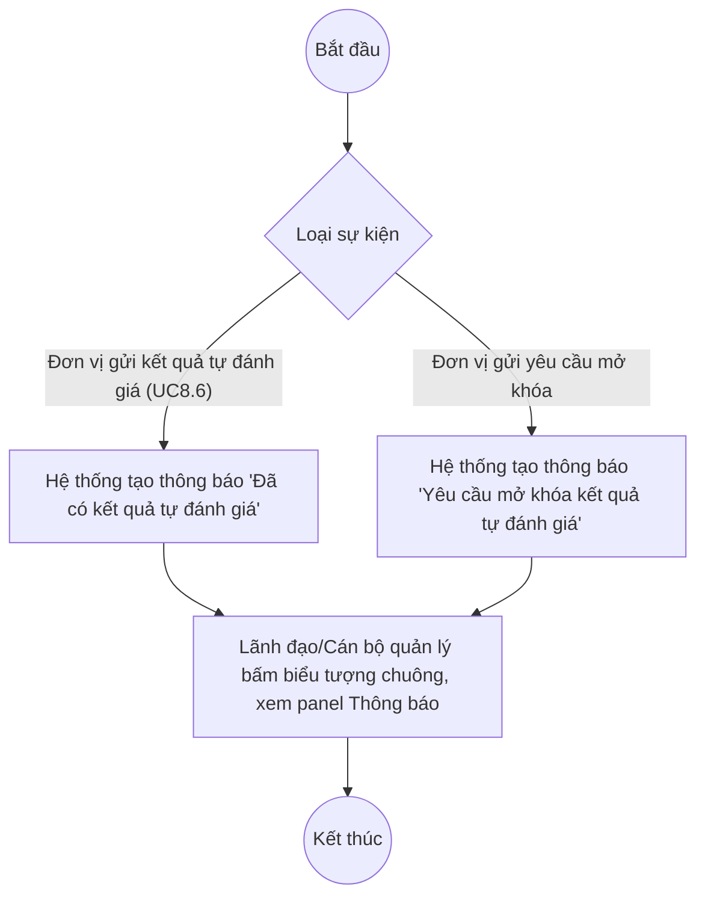

# UC9.1: Thông báo

## 1. Thông tin chung

| ID | Use case | Description |
| :---- | :---- | :---- |
| UC9.1 | Thông báo | Lãnh đạo, Lãnh đạo đơn vị, Cán bộ (vai trò quản lý/giám sát ở cấp Bộ hoặc đơn vị) nhận thông báo khi có kết quả tự đánh giá mới được gửi, hoặc khi có yêu cầu mở khóa kết quả tự đánh giá của đơn vị, qua Trung tâm thông báo dùng chung của hệ thống. |

> **Actor:** Lãnh đạo, Lãnh đạo đơn vị, Cán bộ
>
> **Trigger:** Có đơn vị gửi kết quả tự đánh giá (UC8.6) hoặc gửi yêu cầu mở khóa kết quả tự đánh giá; sau đó người dùng bấm biểu tượng chuông thông báo
>
> **Điều kiện trước (Pre-condition):** Người dùng đã đăng nhập
>
> **Điều kiện sau (Post-condition):** Danh sách thông báo hiển thị các mục "Đã có kết quả tự đánh giá" và "Yêu cầu mở khóa kết quả tự đánh giá"
>
> **Lưu ý về phạm vi kiểm chứng:** Cùng một Trung tâm thông báo dùng chung đã mô tả tại UC8.1/UC8.2 (biểu tượng chuông trên topbar), không phải màn hình riêng. Cả 2 loại thông báo thuộc phạm vi UC9.1 đều **đã quan sát được mẫu thực tế trực tiếp** trong phiên khảo sát 10/10/2026.
>
> **Business rule:**
>
> BR-1: Cơ chế hiển thị, sắp xếp mới nhất lên đầu, đánh dấu đã đọc dùng chung với UC8.1 (xem BR-1 đến BR-4 của UC8.1).
>
> BR-2: Thông báo loại "Đã có kết quả tự đánh giá" có nội dung theo mẫu: "Đơn vị đã gửi kết quả tự đánh giá cho kỳ "&lt;tên kỳ tự đánh giá&gt;"". *(Đã kiểm chứng trực tiếp ngày 10/10/2026)*. Đây là thông báo tương ứng hành động "Gửi kết quả tự đánh giá" của UC8.6.
>
> BR-3: Thông báo loại "Yêu cầu mở khóa kết quả tự đánh giá" có nội dung theo mẫu: "Đơn vị đã gửi yêu cầu mở khóa kết quả tự đánh giá kỳ "&lt;tên kỳ tự đánh giá&gt;"". *(Đã kiểm chứng trực tiếp ngày 10/10/2026)*. **[Cần xác nhận]** mối liên hệ giữa thông báo này và nút thao tác "Mở khoá" quan sát được trực tiếp trên danh sách Kết quả tự đánh giá (UC9.3) — trong phiên khảo sát, nút "Mở khoá" thực hiện mở khóa ngay (không qua bước "yêu cầu" riêng), trong khi thông báo này lại mô tả hành động "đơn vị đã **gửi yêu cầu**". Có thể tồn tại một luồng "yêu cầu mở khóa" riêng do Cán bộ khởi tạo (ví dụ từ màn hình Xem/Chấm điểm khi kết quả đã khóa) mà tài khoản QA Super Admin không nhìn thấy nút tương ứng — xem thêm Ghi nhận QC ở UC9.3.
>
> BR-4: Cả 2 vai trò Lãnh đạo (cấp Bộ, giám sát toàn hệ thống) và Lãnh đạo đơn vị/Cán bộ (phụ trách đơn vị cụ thể) đều có thể nhận các thông báo này. **[Cần xác nhận]** phạm vi chính xác — thông báo có giới hạn theo đơn vị người dùng phụ trách hay hiển thị toàn bộ cho mọi vai trò quản lý; tài khoản kiểm thử có quyền bypass nên không thể phân biệt được 2 khả năng này qua kiểm thử UI đơn thuần.

**Truy vết chức năng**

| STT | Chức năng | YC (BCKTKT) | Dòng UC_1409 | Luồng | Màn hình | BR |
| :---- | :---- | :---- | :---- | :---- | :---- | :---- |
| 1 | Nhận/xem thông báo khi có kết quả tự đánh giá của đơn vị | **[Cần xác nhận]** | **[Cần xác nhận]** | Basic Flow | UI-9.1.1 | BR-1, BR-2 |
| 2 | Nhận/xem thông báo khi có yêu cầu mở khóa kết quả tự đánh giá của đơn vị | **[Cần xác nhận]** | **[Cần xác nhận]** | AF1 | UI-9.1.1 | BR-1, BR-3 |

> Cột YC (BCKTKT) và Dòng UC_1409 chưa đối chiếu được với bản gốc. Use case nguồn tương ứng: UC-C.II.1 "Thông báo".

## 2. Mô tả luồng nghiệp vụ

*Hình 1. Luồng nghiệp vụ thông báo kết quả tự đánh giá / yêu cầu mở khóa*

**Basic Flow** (Thông báo khi có kết quả tự đánh giá)

1. Một đơn vị thực hiện "Gửi kết quả tự đánh giá" (UC8.6).
2. Hệ thống tạo thông báo loại "Đã có kết quả tự đánh giá" (BR-2).
3. Lãnh đạo/Lãnh đạo đơn vị/Cán bộ quản lý bấm biểu tượng chuông, hệ thống hiển thị panel Thông báo (UI-9.1.1).
4. Người dùng đọc nội dung, biết đơn vị nào vừa gửi kết quả cho kỳ nào.

**Alternative Flow**

AF1. Thông báo yêu cầu mở khóa kết quả tự đánh giá

Khi một đơn vị gửi yêu cầu mở khóa kết quả, Hệ thống tạo thông báo loại "Yêu cầu mở khóa kết quả tự đánh giá" (BR-3) thay cho bước 2. Các bước còn lại tương tự Basic Flow. Use case kết thúc.

**Exception Flow**

EF1. Không có thông báo nào

Nếu chưa có đơn vị nào gửi kết quả hoặc gửi yêu cầu mở khóa, panel Thông báo không có mục thuộc loại này. Use case kết thúc.

## 3. Màn hình

| UI Code | Screen | Mô tả |
| :---- | :---- | :---- |
| UI-9.1.1 | Panel Thông báo (Web) | Dùng chung với UI-8.1.1/UI-8.2.1, lọc theo loại thông báo "Đã có kết quả tự đánh giá" và "Yêu cầu mở khóa kết quả tự đánh giá" |

## 4. Mô tả Màn hình (Field Specification)

**UI-9.1.1 — Panel Thông báo (mục loại "Đã có kết quả tự đánh giá" / "Yêu cầu mở khóa kết quả tự đánh giá")**

| Field Name | Field type | Data Type | Required | Validation rule/Behaviour |
| :---- | :---- | :---- | :---- | :---- |
| Tiêu đề loại | Label | String | Yes | **Behaviour:** "Đã có kết quả tự đánh giá" hoặc "Yêu cầu mở khóa kết quả tự đánh giá" (BR-2, BR-3) **Validation rule:** — |
| Nội dung | Label | String | Yes | **Behaviour:** Mẫu câu tương ứng theo loại, có chèn tên kỳ tự đánh giá — đã kiểm chứng trực tiếp với mẫu thực tế **Validation rule:** — |
| Thời gian | Label | DateTime | Yes | **Behaviour:** Định dạng "HH:mm:ss d/M/yyyy" **Validation rule:** — |

Các field chung khác của panel (biểu tượng chuông, badge, nút "Đánh dấu đã đọc tất cả") xem UI-8.1.1 tại UC8.1 — không lặp lại ở đây.

## Điểm cần xác nhận

| STT | Vị trí | Giả định đã dùng | Câu hỏi cần xác nhận |
| :---- | :---- | :---- | :---- |
| 1 | BR-3 | Thông báo "Yêu cầu mở khóa..." mô tả hành động "đơn vị đã gửi yêu cầu", nhưng UI chỉ quan sát được nút "Mở khoá" trực tiếp (không qua bước yêu cầu riêng) | Có luồng "yêu cầu mở khóa" riêng do Cán bộ khởi tạo không? Nút tương ứng nằm ở đâu? (liên quan UC8.7, UC9.3) |
| 2 | BR-4 | Chưa phân biệt được phạm vi hiển thị thông báo theo vai trò/đơn vị do tài khoản test có quyền bypass | Thông báo có giới hạn theo đơn vị người dùng phụ trách không? |
| 3 | Truy vết chức năng | Chưa có số YC (BCKTKT) và Dòng UC_1409 | Đề nghị đối chiếu với bản gốc Google Sheet |
