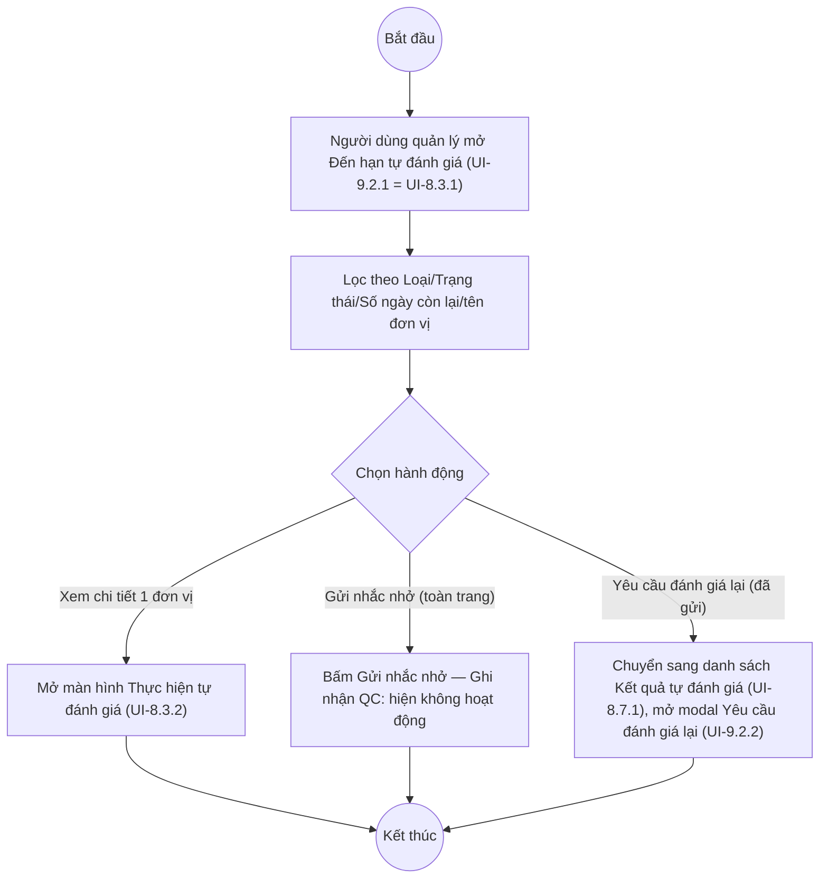

# UC9.2: Danh sách yêu cầu tự đánh giá đến hạn

## 1. Thông tin chung

| ID | Use case | Description |
| :---- | :---- | :---- |
| UC9.2 | Danh sách yêu cầu tự đánh giá đến hạn | Lãnh đạo, Lãnh đạo đơn vị, Cán bộ (vai trò quản lý/giám sát) xem danh sách các kỳ tự đánh giá đến hạn của toàn bộ đơn vị, xuất Excel, xem chi tiết tiến độ từng đơn vị, gửi nhắc nhở/yêu cầu thực hiện, và yêu cầu đơn vị thực hiện tự đánh giá lại — trên màn hình "Đến hạn tự đánh giá" (cùng màn hình vật lý với UC8.3, khác ở góc nhìn actor). |

> **Actor:** Lãnh đạo, Lãnh đạo đơn vị, Cán bộ
>
> **Trigger:** Người dùng chọn menu "Đánh giá CĐS" > "Đến hạn tự đánh giá"
>
> **Điều kiện trước (Pre-condition):** Người dùng đã đăng nhập với vai trò quản lý/giám sát
>
> **Điều kiện sau (Post-condition):** Danh sách các kỳ tự đánh giá đến hạn của các đơn vị được hiển thị theo điều kiện lọc
>
> **Lưu ý về phạm vi kiểm chứng:** Màn hình "Đến hạn tự đánh giá" (UI-8.3.1 tại UC8.3) là **một màn hình dùng chung** cho cả Cán bộ thực hiện (UC8.3) lẫn vai trò quản lý xem tiến độ toàn đơn vị (UC9.2) — tài liệu yêu cầu mô tả 2 use case riêng nhưng UI thực tế không tách 2 màn hình. Với tài khoản QA Super Admin, toàn bộ 37 bản ghi hiển thị đều thuộc nhiều đơn vị khác nhau (không giới hạn theo 1 đơn vị cụ thể) — phù hợp với góc nhìn "quản lý toàn hệ thống" của UC9.2 hơn là góc nhìn "của đơn vị mình" thường gắn với UC8.3; tuy nhiên **không thể kết luận chắc chắn** màn hình có tự lọc theo phạm vi phụ trách của từng vai trò hay không vì tài khoản test có quyền bypass.
>
> **Business rule:**
>
> BR-1: Cấu trúc màn hình, cột hiển thị, bộ lọc (Loại, Trạng thái, Số ngày còn lại, tìm theo tên đơn vị), nút Xuất Excel và Gửi nhắc nhở: xem đầy đủ tại UC8.3 (UI-8.3.1) — không lặp lại ở đây.
>
> BR-2: Trạng thái "Chưa thực hiện" dùng để xác định "các đơn vị chưa thực hiện tự đánh giá CĐS" (lọc dropdown Trạng thái = "Chưa thực hiện"); các trạng thái còn lại (Đang chấm điểm, Đã trình phê duyệt, Đã phê duyệt, Đã gửi) dùng để xác định "các đơn vị đã thực hiện tự đánh giá" (bất kỳ trạng thái khác "Chưa thực hiện"). *(Đã kiểm chứng trực tiếp ngày 10/10/2026 — xác nhận giá trị "Chưa thực hiện" tồn tại trong dropdown và trên dữ liệu thật, suy luận cách phân nhóm 2 nhóm "đã/chưa thực hiện" từ chính các giá trị trạng thái này)*
>
> BR-3: Bấm biểu tượng xem chi tiết (hình con mắt) trên một dòng mở màn hình "Thực hiện tự đánh giá" (UI-8.3.2) — **đây là cùng màn hình chấm điểm** mô tả tại UC8.3, không phải một màn hình "xem kết quả" riêng cho vai trò quản lý. *(Đã kiểm chứng trực tiếp ngày 10/10/2026 — mở thử với dòng "Chưa thực hiện" dẫn tới đúng màn hình Thực hiện tự đánh giá có nút Lưu nháp/Trình phê duyệt)* — **Ghi nhận QC:** việc tài khoản quản lý (Lãnh đạo/Cán bộ giám sát) mở ra một màn hình có nút "Lưu nháp"/"Trình phê duyệt" (vốn là hành động của Cán bộ thực hiện) thay vì một màn hình chỉ-xem là điểm bất thường đáng chú ý — không rõ đây là thiết kế chủ đích (quản lý cũng có quyền sửa hộ) hay là thiếu phân tách màn hình theo vai trò.
>
> BR-4: Nút "Gửi nhắc nhở" (toolbar) được bấm thử: không có dialog xác nhận, không toast, chỉ phát sinh 1 lời gọi GET /api/v1/notifications (có vẻ không liên quan trực tiếp tới hành động) — có dấu hiệu là stub. *(Đã kiểm chứng trực tiếp ngày 10/10/2026, cùng hiện tượng với cache khảo sát 08/10/2026)*. **[Cần xác nhận]** đây có phải là nút dự kiến dùng cho cả 2 mục đích "nhắc nhở đơn vị đến hạn" và "gửi yêu cầu thực hiện đánh giá CĐS đối với đơn vị chưa thực hiện" (2 bullet riêng trong UC-C.II.2) hay không — do nút không hoạt động nên không kiểm chứng được phạm vi thực sự.
>
> BR-5: Không tìm thấy nút hành động nào trên UI-8.3.1 có tên/ý nghĩa rõ ràng là "yêu cầu đơn vị thực hiện tự đánh giá lại" (riêng biệt với "Gửi nhắc nhở"). Hành động "Yêu cầu đánh giá lại" **chỉ tìm thấy trên màn hình khác** — danh sách Kết quả tự đánh giá (UI-8.7.1 tại UC8.7), trong menu thao tác của dòng có Trạng thái = "Đã gửi" — xem UI-9.2.2 bên dưới. **[Cần xác nhận]** liệu đây có phải đúng chức năng "yêu cầu đơn vị thực hiện tự đánh giá lại" mô tả trong UC-C.II.2, hay là một chức năng khác dành riêng cho kết quả đã gửi (gần nghĩa "yêu cầu làm lại" hơn là "nhắc đến hạn").

**Ghi nhận QC (10/10/2026):** Xem Ghi nhận QC đầy đủ tại UC8.3 (cột Điểm tối đa hiển thị "--", nút Lưu nháp/Trình phê duyệt không khóa theo trạng thái, tên nhóm chỉ số dữ liệu test, nút Xuất Excel/Gửi nhắc nhở không hoạt động) — các ghi nhận này áp dụng tương tự cho góc nhìn quản lý UC9.2 vì dùng chung 1 màn hình vật lý.

**Truy vết chức năng**

| STT | Chức năng | YC (BCKTKT) | Dòng UC_1409 | Luồng | Màn hình | BR |
| :---- | :---- | :---- | :---- | :---- | :---- | :---- |
| 1 | Xem danh sách yêu cầu tự đánh giá định kỳ đến hạn | **[Cần xác nhận]** | **[Cần xác nhận]** | Basic Flow | UI-9.2.1 | BR-1 |
| 2 | Xem danh sách yêu cầu tự đánh giá đột xuất đến hạn | **[Cần xác nhận]** | **[Cần xác nhận]** | AF1 | UI-9.2.1 | BR-1 |
| 3 | Xem các đơn vị đã thực hiện tự đánh giá | **[Cần xác nhận]** | **[Cần xác nhận]** | AF2 | UI-9.2.1 | BR-2 |
| 4 | Export danh sách đơn vị đã thực hiện ra Excel | **[Cần xác nhận]** | **[Cần xác nhận]** | AF3 | UI-9.2.1 | BR-1 |
| 5 | Xem chi tiết kết quả thực hiện tự đánh giá của đơn vị | **[Cần xác nhận]** | **[Cần xác nhận]** | AF4 | UI-8.3.2 | BR-3 |
| 6 | Yêu cầu đơn vị thực hiện tự đánh giá lại | **[Cần xác nhận]** | **[Cần xác nhận]** | AF5 | UI-9.2.2 | BR-5 |
| 7 | Xem các đơn vị chưa thực hiện tự đánh giá CĐS | **[Cần xác nhận]** | **[Cần xác nhận]** | AF2 | UI-9.2.1 | BR-2 |
| 8 | Export danh sách đơn vị chưa thực hiện ra Excel | **[Cần xác nhận]** | **[Cần xác nhận]** | AF3 | UI-9.2.1 | BR-1 |
| 9 | Gửi yêu cầu thực hiện đánh giá CĐS đối với đơn vị chưa thực hiện | **[Cần xác nhận]** | **[Cần xác nhận]** | AF6 | UI-9.2.1 | BR-4 |

> Cột YC (BCKTKT) và Dòng UC_1409 chưa đối chiếu được với bản gốc. Use case nguồn tương ứng: UC-C.II.2 "Danh sách yêu cầu tự đánh giá đến hạn". Mục 5 ("xem chi tiết kết quả thực hiện tự đánh giá của đơn vị") thực tế dẫn tới màn hình Thực hiện tự đánh giá (UI-8.3.2) có đầy đủ chức năng chỉnh sửa chứ không phải màn hình chỉ-xem — xem Ghi nhận QC ở BR-3.

## 2. Mô tả luồng nghiệp vụ

*Hình 1. Luồng nghiệp vụ Danh sách yêu cầu tự đánh giá đến hạn*

**Basic Flow**

1. Lãnh đạo/Lãnh đạo đơn vị/Cán bộ (vai trò quản lý) chọn menu "Đánh giá CĐS" > "Đến hạn tự đánh giá".
2. Hệ thống hiển thị màn hình Đến hạn tự đánh giá (UI-9.2.1, dùng chung UI-8.3.1), 10 bản ghi/trang.
3. Người dùng quan sát các kỳ tự đánh giá của toàn bộ đơn vị, cùng trạng thái tiến độ.

**Alternative Flow**

AF1. Lọc theo Loại định kỳ/đột xuất

Tại bước 2, người dùng chọn segment "Định kỳ" hoặc "Đột xuất". Use case kết thúc.

AF2. Lọc đơn vị đã/chưa thực hiện

Tại bước 2, người dùng chọn dropdown Trạng thái = "Chưa thực hiện" để xem đơn vị chưa thực hiện, hoặc bất kỳ giá trị khác để xem đơn vị đã thực hiện ở mức độ tương ứng (BR-2). Use case kết thúc.

AF3. Xuất Excel

Tại bước 2, người dùng bấm "Xuất Excel". **Ghi nhận QC:** không phát sinh file khi bấm thử (xem UC8.3). Use case kết thúc.

AF4. Xem chi tiết kết quả của một đơn vị

Tại bước 2, người dùng bấm biểu tượng xem chi tiết trên một dòng. Hệ thống mở màn hình Thực hiện tự đánh giá (UI-8.3.2, BR-3). Use case kết thúc — xem thêm UC8.3.

AF5. Yêu cầu đơn vị thực hiện tự đánh giá lại

Người dùng chuyển sang danh sách Kết quả tự đánh giá (UI-8.7.1 tại UC8.7), mở menu thao tác của dòng có Trạng thái = "Đã gửi", chọn "Yêu cầu đánh giá lại". Hệ thống hiển thị modal UI-9.2.2 (BR-5). Use case kết thúc — xem chi tiết dialog tại mục 4.

AF6. Gửi yêu cầu thực hiện đối với đơn vị chưa thực hiện

Tại bước 2 sau khi lọc Trạng thái = "Chưa thực hiện" (AF2), người dùng bấm "Gửi nhắc nhở". **[Cần xác nhận]** đây có đúng là chức năng "gửi yêu cầu thực hiện đánh giá CĐS đối với đơn vị chưa thực hiện" hay không — nút hiện không phản hồi (BR-4). Use case kết thúc.

**Exception Flow**

EF1. Không có đơn vị thỏa điều kiện lọc

**[Cần xác nhận]** thông báo cụ thể khi danh sách trống.

## 3. Màn hình

| UI Code | Screen | Mô tả |
| :---- | :---- | :---- |
| UI-9.2.1 | Danh sách Đến hạn tự đánh giá (Web) | Dùng chung UI-8.3.1 (xem UC8.3) — ở đây hiển thị dữ liệu nhiều đơn vị cho góc nhìn quản lý |
| UI-9.2.2 | Modal "Yêu cầu đánh giá lại" (Web) | Mở từ danh sách Kết quả tự đánh giá (UI-8.7.1), dòng Trạng thái = Đã gửi |

## 4. Mô tả Màn hình (Field Specification)

Field của UI-9.2.1 đã mô tả đầy đủ tại UC8.3 (UI-8.3.1) — không lặp lại.

**UI-9.2.2 — Modal "Yêu cầu đánh giá lại"**

| Field Name | Field type | Data Type | Required | Validation rule/Behaviour |
| :---- | :---- | :---- | :---- | :---- |
| Tiêu đề modal | Label | String | Yes | **Behaviour:** "Yêu cầu đánh giá lại" **Validation rule:** — |
| Nội dung mô tả | Label | String | Yes | **Behaviour:** Mẫu câu "Đặt lại kết quả &lt;tên kỳ&gt; của đơn vị &lt;tên đơn vị&gt; về trạng thái Chấm điểm." *(Đã kiểm chứng trực tiếp ngày 10/10/2026)* **Validation rule:** — |
| Lý do (tùy chọn) | Textarea | String | No | **Behaviour:** Nhập lý do yêu cầu đánh giá lại *(Đã kiểm chứng trực tiếp ngày 10/10/2026 — nhãn ghi rõ "tùy chọn")* **Validation rule:** Không bắt buộc |
| Nút Hủy | Button | Action | Yes | **Behaviour:** Đóng modal, không thực hiện **Validation rule:** — |
| Nút Xác nhận | Button | Action | Yes | **Behaviour:** Đặt lại Trạng thái kết quả về "Đang chấm điểm" **[Cần xác nhận]** có xóa điểm đã chấm trước đó hay giữ nguyên để sửa tiếp — chưa bấm xác nhận thật để tránh ảnh hưởng dữ liệu thật **Validation rule:** — |

## Điểm cần xác nhận

| STT | Vị trí | Giả định đã dùng | Câu hỏi cần xác nhận |
| :---- | :---- | :---- | :---- |
| 1 | Lưu ý phạm vi kiểm chứng, BR-3 | Màn hình Đến hạn tự đánh giá dùng chung cho cả Cán bộ thực hiện (UC8.3) và vai trò quản lý (UC9.2), kể cả màn hình chi tiết (có nút Lưu nháp/Trình phê duyệt) | Đây có phải thiết kế chủ đích (quản lý cũng sửa được hộ đơn vị) hay cần tách màn hình chỉ-xem riêng cho vai trò quản lý? |
| 2 | BR-4, AF6 | Suy đoán "Gửi nhắc nhở" dùng chung cho cả nhắc đến hạn và gửi yêu cầu cho đơn vị chưa thực hiện, nhưng nút không hoạt động nên không kiểm chứng được | Xác nhận phạm vi chức năng thực sự của nút này sau khi dev khắc phục |
| 3 | BR-5, AF5 | "Yêu cầu đánh giá lại" tìm thấy ở màn hình Kết quả tự đánh giá (không phải Đến hạn tự đánh giá), áp dụng cho dòng Trạng thái = Đã gửi | Đây có đúng là chức năng "yêu cầu đơn vị thực hiện tự đánh giá lại" trong UC-C.II.2, hay là chức năng khác? |
| 4 | UI-9.2.2 | Chưa bấm Xác nhận thật | Đặt lại về Đang chấm điểm có giữ nguyên điểm/minh chứng cũ không? |
| 5 | Truy vết chức năng | Chưa có số YC (BCKTKT) và Dòng UC_1409 | Đề nghị đối chiếu với bản gốc Google Sheet |
