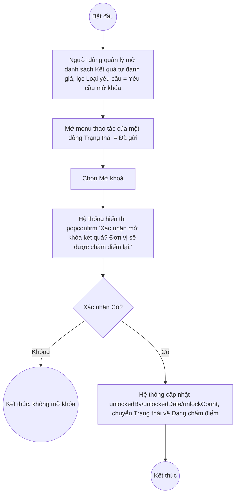

# UC9.3: Mở khóa kết quả tự đánh giá

## 1. Thông tin chung

| ID | Use case | Description |
| :---- | :---- | :---- |
| UC9.3 | Mở khóa kết quả tự đánh giá | Lãnh đạo, Lãnh đạo đơn vị, Cán bộ (vai trò quản lý) xem danh sách yêu cầu/kết quả đã gửi (khóa) và thực hiện mở khóa để đơn vị được chấm điểm lại, trực tiếp trên danh sách Kết quả tự đánh giá. |

> **Actor:** Lãnh đạo, Lãnh đạo đơn vị, Cán bộ
>
> **Trigger:** Người dùng mở menu thao tác (chevron) của một dòng có Trạng thái = "Đã gửi" trên danh sách Kết quả tự đánh giá, chọn "Mở khoá"
>
> **Điều kiện trước (Pre-condition):** Kết quả tự đánh giá của đơn vị đã ở Trạng thái "Đã gửi" (đã khóa, không sửa điểm được — xem UC8.6)
>
> **Điều kiện sau (Post-condition):** Kết quả chuyển trở lại trạng thái cho chấm điểm; field `unlockedBy`/`unlockedDate`/`unlockCount` được cập nhật
>
> **Lưu ý về phạm vi kiểm chứng:** Đã mở trực tiếp dialog "Mở khoá" trên dữ liệu thật ngày 10/10/2026 để đọc nội dung, **chủ động không bấm "Có"** để tránh mở khóa một kết quả thật đã chốt (có thể ảnh hưởng vĩnh viễn tới quy trình nghiệp vụ thật đang chạy, đúng như cảnh báo rủi ro cao được nêu cho luồng này). Nội dung dialog dưới đây là xác thực; kết quả sau khi mở khóa thật chưa được quan sát trực tiếp.
>
> **Business rule:**
>
> BR-1: Hành động "Mở khoá" xuất hiện trong menu thao tác của dòng có Trạng thái = "Đã gửi" trên danh sách Kết quả tự đánh giá (UI-8.7.1 tại UC8.7), cùng nhóm với mục "Yêu cầu đánh giá lại" (xem UC9.2). *(Đã kiểm chứng trực tiếp ngày 10/10/2026)*
>
> BR-2: Dialog "Mở khoá" là một popconfirm với nội dung cố định: "Xác nhận mở khóa kết quả? Đơn vị sẽ được chấm điểm lại. / Không / Có" — không có trường nhập lý do. *(Đã kiểm chứng trực tiếp ngày 10/10/2026, đã mở dialog và đọc nội dung, không bấm "Có")*
>
> BR-3: Dữ liệu kết quả tự đánh giá có các field liên quan mở khóa: `unlockedBy` (người mở khóa), `unlockedDate` (thời điểm mở khóa gần nhất), `unlockCount` (số lần đã mở khóa) — quan sát được các bản ghi đã từng mở khóa trước đây có `unlockCount` = 1 và `unlockedDate` khác null. *(Đã kiểm chứng trực tiếp qua cấu trúc dữ liệu API GET assessment-results)*
>
> BR-4: Có thể lọc riêng các kết quả thuộc diện "yêu cầu mở khóa" bằng dropdown "Loại yêu cầu" = "Yêu cầu mở khóa" trên danh sách Kết quả tự đánh giá, gửi tham số `specialFilter=unlock_request` lên API. *(Đã kiểm chứng trực tiếp ngày 10/10/2026 — xem BR-6 của UC8.7)*
>
> BR-5: Dữ liệu còn có cặp field riêng `unlockRequestedByUserId`/`unlockRequestedAt` (khác với `unlockedBy`/`unlockedDate` ở BR-3), hiện `null` ở mọi bản ghi quan sát được trong phiên khảo sát. **[Cần xác nhận]** ý nghĩa chính xác của cặp field này — nhiều khả năng dùng để ghi nhận một bước "Cán bộ **gửi yêu cầu** mở khóa" riêng biệt (khớp với thông báo "Yêu cầu mở khóa kết quả tự đánh giá — Đơn vị đã gửi yêu cầu..." quan sát được ở UC9.1), xảy ra **trước** khi Lãnh đạo/Cán bộ quản lý thực sự bấm nút "Mở khoá" (ghi vào `unlockedBy`/`unlockedDate`). Tuy nhiên **không tìm thấy nút "yêu cầu mở khóa"** (dành cho Cán bộ thực hiện) trên bất kỳ màn hình nào đã khảo sát (kể cả màn hình Xem/Chấm điểm ở trạng thái Đã gửi — buttons rỗng, xem UC8.7 BR-12) — xem Ghi nhận QC.
>
> BR-6: Sau khi mở khóa, **[Cần xác nhận]** kết quả quay về Trạng thái "Đang chấm điểm" để đơn vị chấm điểm lại (đúng như nội dung dialog "Đơn vị sẽ được chấm điểm lại") — chưa tự thực hiện để xác nhận trực tiếp trạng thái và dữ liệu điểm cũ có bị xóa hay giữ nguyên.
>
> BR-7: Tài liệu yêu cầu nghiệp vụ mô tả "xem danh sách yêu cầu mở khóa kết quả tự đánh giá định kỳ/đột xuất của đơn vị" — đáp ứng bằng cách lọc danh sách Kết quả tự đánh giá (UI-8.7.1) theo Loại yêu cầu = "Yêu cầu mở khóa" (BR-4), kết hợp tab Định kỳ/Đột xuất. Không có màn hình "Danh sách yêu cầu mở khóa" tách biệt.

**Ghi nhận QC (10/10/2026):** Không tìm thấy trên UI một nút/chức năng cho phép Cán bộ (chủ sở hữu kết quả) **chủ động gửi yêu cầu mở khóa** — hành động "Mở khoá" quan sát được trên danh sách Kết quả tự đánh giá thực hiện mở khóa **ngay lập tức** (một bước, không qua phê duyệt), có vẻ dành cho vai trò quản lý/duyệt chứ không phải một yêu cầu chờ duyệt. Trong khi đó, nội dung thông báo "Yêu cầu mở khóa kết quả tự đánh giá" (UC9.1) lại mô tả rõ hành động "đơn vị đã **gửi yêu cầu**" — ngụ ý một luồng 2 bước (Cán bộ gửi yêu cầu → Lãnh đạo/quản lý duyệt mở khóa) có tồn tại ở đâu đó trong hệ thống nhưng chưa tìm thấy nút tương ứng trong phiên khảo sát này. Có 2 khả năng: (a) nút "yêu cầu mở khóa" chỉ hiển thị cho đúng user thuộc đúng đơn vị sở hữu bản ghi dựa trên **so khớp nghiệp vụ** (organizationId của user với organizationId của bản ghi) chứ không phải kiểm tra phân quyền hệ thống — nên cờ SYSTEM_ROLE_BYPASS của tài khoản QA Super Admin không giúp hiện nút này; hoặc (b) tính năng "yêu cầu mở khóa" (2 bước) hiện mới chỉ có phần phát thông báo, còn màn hình/nút bấm thực tế chưa được triển khai đầy đủ, và nút "Mở khoá" một-bước hiện có là giải pháp tạm/duy nhất đang hoạt động. Đề nghị xác nhận với đội phát triển.

**Truy vết chức năng**

| STT | Chức năng | YC (BCKTKT) | Dòng UC_1409 | Luồng | Màn hình | BR |
| :---- | :---- | :---- | :---- | :---- | :---- | :---- |
| 1 | Xem danh sách yêu cầu mở khóa kết quả tự đánh giá định kỳ của đơn vị | **[Cần xác nhận]** | **[Cần xác nhận]** | AF1 | UI-8.7.1 | BR-4, BR-7 |
| 2 | Xem danh sách yêu cầu mở khóa kết quả tự đánh giá đột xuất của đơn vị | **[Cần xác nhận]** | **[Cần xác nhận]** | AF1 | UI-8.7.1 | BR-4, BR-7 |
| 3 | Mở khóa kết quả tự đánh giá | **[Cần xác nhận]** | **[Cần xác nhận]** | Basic Flow | UI-9.3.1 | BR-2, BR-3, BR-6 |

> Cột YC (BCKTKT) và Dòng UC_1409 chưa đối chiếu được với bản gốc. Use case nguồn tương ứng: UC-C.II.3 "Mở khóa kết quả tự đánh giá".

## 2. Mô tả luồng nghiệp vụ

*Hình 1. Luồng nghiệp vụ Mở khóa kết quả tự đánh giá*

**Basic Flow**

1. Lãnh đạo/Lãnh đạo đơn vị/Cán bộ (vai trò quản lý) mở danh sách Kết quả tự đánh giá (UI-8.7.1), lọc Loại yêu cầu = "Yêu cầu mở khóa" hoặc tìm trực tiếp dòng Trạng thái = "Đã gửi" (AF1).
2. Người dùng mở menu thao tác của dòng cần mở khóa, chọn "Mở khoá".
3. Hệ thống hiển thị popconfirm xác nhận (UI-9.3.1, BR-2).
4. Người dùng bấm "Có".
5. Hệ thống cập nhật `unlockedBy`/`unlockedDate`/`unlockCount` (BR-3), chuyển Trạng thái kết quả về "Đang chấm điểm" (BR-6).

**Alternative Flow**

AF1. Xem danh sách yêu cầu mở khóa

Tại UI-8.7.1, người dùng chọn dropdown "Loại yêu cầu" = "Yêu cầu mở khóa" (BR-4, BR-7), kết hợp tab Định kỳ/Đột xuất. Use case kết thúc.

AF2. Hủy thao tác

Tại bước 3, người dùng bấm "Không". Hệ thống đóng popconfirm, không thay đổi. Quay lại bước 1.

**Exception Flow**

EF1. Lỗi hệ thống khi mở khóa

**[Cần xác nhận]** nội dung thông báo lỗi cụ thể — chưa quan sát được trường hợp này.

## 3. Màn hình

| UI Code | Screen | Mô tả |
| :---- | :---- | :---- |
| UI-8.7.1 | Danh sách Kết quả tự đánh giá (Web) | Xem chi tiết tại UC8.7 — dùng để lọc xem danh sách yêu cầu mở khóa (AF1) và mở menu thao tác Mở khoá |
| UI-9.3.1 | Popconfirm xác nhận Mở khóa (Web) | Xác nhận trước khi mở khóa kết quả |

## 4. Mô tả Màn hình (Field Specification)

**UI-9.3.1 — Popconfirm xác nhận Mở khóa**

| Field Name | Field type | Data Type | Required | Validation rule/Behaviour |
| :---- | :---- | :---- | :---- | :---- |
| Nội dung xác nhận | Label | String | Yes | **Behaviour:** "Xác nhận mở khóa kết quả? Đơn vị sẽ được chấm điểm lại." (BR-2) — đã kiểm chứng trực tiếp **Validation rule:** — |
| Nút Không | Button | Action | Yes | **Behaviour:** Đóng popconfirm, không mở khóa (AF2) **Validation rule:** — |
| Nút Có | Button | Action | Yes | **Behaviour:** Thực hiện mở khóa (bước 4–5) **Validation rule:** — |

## Điểm cần xác nhận

| STT | Vị trí | Giả định đã dùng | Câu hỏi cần xác nhận |
| :---- | :---- | :---- | :---- |
| 1 | BR-5, Ghi nhận QC | Không tìm thấy nút "yêu cầu mở khóa" dành cho Cán bộ, dù field API `unlockRequestedByUserId`/`unlockRequestedAt` tồn tại và thông báo UC9.1 mô tả rõ hành động "gửi yêu cầu" | Luồng "yêu cầu mở khóa" 2 bước (Cán bộ yêu cầu → Lãnh đạo duyệt) có thực sự tồn tại trên UI không, nằm ở đâu? Hay hệ thống hiện chỉ có "Mở khoá" 1 bước? |
| 2 | BR-6 | Suy luận kết quả quay về "Đang chấm điểm" sau mở khóa, dựa theo nội dung popconfirm, chưa tự thực hiện | Cần xác nhận điểm/minh chứng đã chấm trước đó có bị xóa hay giữ nguyên sau khi mở khóa |
| 3 | Truy vết chức năng | Chưa có số YC (BCKTKT) và Dòng UC_1409 | Đề nghị đối chiếu với bản gốc Google Sheet |
