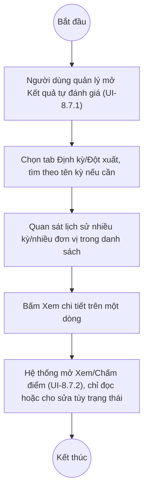

# UC9.4: Quản lý kết quả tự đánh giá

## 1. Thông tin chung

| ID | Use case | Description |
| :---- | :---- | :---- |
| UC9.4 | Quản lý kết quả tự đánh giá | Lãnh đạo, Lãnh đạo đơn vị, Cán bộ (vai trò quản lý) xem lịch sử các kỳ tự đánh giá (định kỳ/đột xuất) của toàn bộ đơn vị và xem thông tin chi tiết từng kết quả, trên cùng màn hình "Kết quả tự đánh giá" dùng chung với UC8.7. |

> **Actor:** Lãnh đạo, Lãnh đạo đơn vị, Cán bộ
>
> **Trigger:** Người dùng chọn menu "Đánh giá CĐS" > "Kết quả tự đánh giá"
>
> **Điều kiện trước (Pre-condition):** Người dùng đã đăng nhập với vai trò quản lý/giám sát
>
> **Điều kiện sau (Post-condition):** Lịch sử/chi tiết kết quả tự đánh giá được hiển thị
>
> **Lưu ý về phạm vi kiểm chứng:** UC9.4 và UC8.7 mô tả **cùng một màn hình vật lý** (danh sách Kết quả tự đánh giá, UI-8.7.1/UI-8.7.2 đã mô tả đầy đủ tại UC8.7) nhưng từ 2 góc nhìn actor khác nhau: UC8.7 là góc nhìn "quản lý danh sách kết quả của chính đơn vị mình" (4 actor bao gồm cả Cán bộ thực hiện), còn UC9.4 là góc nhìn "xem lịch sử tổng hợp nhiều đơn vị" của vai trò quản lý cấp trên (Lãnh đạo, Lãnh đạo đơn vị, Cán bộ giám sát). Với tài khoản QA Super Admin, dữ liệu hiển thị bao gồm nhiều đơn vị khác nhau qua nhiều kỳ (Quý I/2026 đến Quý II/2028), phù hợp để đóng vai trò "lịch sử" tổng hợp — nhưng **không kiểm chứng được** liệu màn hình có tự giới hạn phạm vi theo đơn vị/thời gian phụ trách của từng vai trò hay không (do tài khoản test có quyền bypass).
>
> **Business rule:**
>
> BR-1: Toàn bộ cấu trúc màn hình, cột, bộ lọc, chi tiết (UI-8.7.1, UI-8.7.2) đã mô tả đầy đủ tại UC8.7 — không lặp lại ở đây. UC9.4 chỉ bổ sung góc nhìn sử dụng: xem tổng hợp "lịch sử" nhiều kỳ/nhiều đơn vị thay vì chỉ của 1 kỳ cụ thể.
>
> BR-2: Mỗi đơn vị có thể có nhiều bản ghi kết quả tự đánh giá qua các kỳ khác nhau (vd đơn vị "Sở Dân tộc và Tôn giáo tỉnh" xuất hiện ở nhiều dòng với các "Kỳ tự đánh giá" khác nhau: "test định kỳ 9:21", "TEST CNMH", "Tự đánh giá CĐS định kỳ Quý I/2027 - Khối Bộ"...) — danh sách này tự nhiên đóng vai trò "lịch sử" theo chiều thời gian khi lọc theo 1 đơn vị. *(Đã kiểm chứng trực tiếp ngày 10/10/2026 qua dữ liệu thật, 43 bản ghi ở tab Định kỳ)*
>
> BR-3: Ô tìm kiếm trên danh sách có placeholder "Tìm kiếm tên đánh giá" — tìm theo tên kỳ, **không phải** tìm theo tên đơn vị. **[Cần xác nhận]** có cách nào lọc riêng theo 1 đơn vị cụ thể để xem đúng "lịch sử của đơn vị đó" hay không — không quan sát thấy bộ lọc theo Đơn vị trên UI-8.7.1 (khác với UI-8.3.1 ở UC8.3/UC9.2 vốn tìm theo tên đơn vị).
>
> BR-4: Xem thông tin chi tiết một kết quả tự đánh giá dùng chung màn hình Xem/Chấm điểm (UI-8.7.2) — ở chế độ chỉ đọc khi Trạng thái là Đã gửi/Đã phê duyệt, cho sửa khi Đang chấm điểm (xem BR-12 của UC8.7).

**Ghi nhận QC (10/10/2026):** Không tìm thấy bộ lọc theo "Đơn vị" trên danh sách Kết quả tự đánh giá (chỉ có ô tìm theo tên kỳ, dropdown Trạng thái phê duyệt, dropdown Loại yêu cầu) — với một đơn vị có nhiều kỳ tự đánh giá nằm rải rác trên nhiều trang, người dùng khó tra cứu nhanh "lịch sử của riêng 1 đơn vị" nếu không biết chính xác tên kỳ cần tìm. Đây là một khoảng trống UX tiềm ẩn đáng lưu ý cho UC9.4, không hẳn là lỗi.

**Truy vết chức năng**

| STT | Chức năng | YC (BCKTKT) | Dòng UC_1409 | Luồng | Màn hình | BR |
| :---- | :---- | :---- | :---- | :---- | :---- | :---- |
| 1 | Xem lịch sử kết quả tự đánh giá định kỳ | **[Cần xác nhận]** | **[Cần xác nhận]** | Basic Flow | UI-8.7.1 | BR-1, BR-2 |
| 2 | Xem lịch sử kết quả tự đánh giá đột xuất | **[Cần xác nhận]** | **[Cần xác nhận]** | AF1 | UI-8.7.1 | BR-1, BR-2 |
| 3 | Xem thông tin chi tiết kết quả tự đánh giá | **[Cần xác nhận]** | **[Cần xác nhận]** | AF2 | UI-8.7.2 | BR-4 |

> Cột YC (BCKTKT) và Dòng UC_1409 chưa đối chiếu được với bản gốc. Use case nguồn tương ứng: UC-C.II.4 "Quản lý kết quả tự đánh giá".

## 2. Mô tả luồng nghiệp vụ

*Hình 1. Luồng nghiệp vụ Quản lý kết quả tự đánh giá (xem lịch sử)*

**Basic Flow**

1. Lãnh đạo/Lãnh đạo đơn vị/Cán bộ (vai trò quản lý) chọn menu "Đánh giá CĐS" > "Kết quả tự đánh giá".
2. Hệ thống hiển thị màn hình Kết quả tự đánh giá (UI-8.7.1), tab mặc định "Định kỳ", liệt kê các kỳ của nhiều đơn vị theo thời gian tạo giảm dần (BR-2).
3. Người dùng quan sát lịch sử các kỳ tự đánh giá.

**Alternative Flow**

AF1. Xem lịch sử đột xuất

Tại bước 2, người dùng bấm tab "Đột xuất". Use case kết thúc.

AF2. Xem chi tiết một kết quả

Tại bước 2, người dùng bấm "Xem chi tiết" trên một dòng. Hệ thống mở màn hình Xem/Chấm điểm (UI-8.7.2, BR-4). Use case kết thúc — xem chi tiết tại UC8.7.

**Exception Flow**

EF1. Không tìm được lịch sử của 1 đơn vị cụ thể

Do không có bộ lọc theo Đơn vị (xem Ghi nhận QC), người dùng phải dò qua nhiều trang hoặc nhớ đúng tên kỳ để tìm kiếm. **[Cần xác nhận]** có cơ chế khác (vd lọc trên URL, hoặc màn hình riêng) chưa được phát hiện trong phiên khảo sát.

## 3. Màn hình

| UI Code | Screen | Mô tả |
| :---- | :---- | :---- |
| UI-8.7.1 | Danh sách Kết quả tự đánh giá (Web) | Xem chi tiết tại UC8.7 — đóng vai trò danh sách lịch sử tổng hợp nhiều đơn vị cho UC9.4 |
| UI-8.7.2 | Xem/Chấm điểm (chi tiết kết quả) (Web) | Xem chi tiết tại UC8.7 — đóng vai trò màn hình xem chi tiết lịch sử cho UC9.4 |

## 4. Mô tả Màn hình (Field Specification)

Toàn bộ field của UI-8.7.1 và UI-8.7.2 đã mô tả đầy đủ tại UC8.7 — không lặp lại ở đây.

## Điểm cần xác nhận

| STT | Vị trí | Giả định đã dùng | Câu hỏi cần xác nhận |
| :---- | :---- | :---- | :---- |
| 1 | BR-3, Ghi nhận QC | Không có bộ lọc theo Đơn vị trên danh sách Kết quả tự đánh giá | Có cần bổ sung bộ lọc/tìm theo Đơn vị để phục vụ đúng nhu cầu "xem lịch sử của 1 đơn vị" của UC9.4 không? |
| 2 | Lưu ý phạm vi kiểm chứng | Không kiểm chứng được phạm vi dữ liệu hiển thị có tự giới hạn theo đơn vị/cấp quản lý của người dùng hay không | Cần xác nhận với tài khoản vai trò thật (không bypass) |
| 3 | Truy vết chức năng | Chưa có số YC (BCKTKT) và Dòng UC_1409 | Đề nghị đối chiếu với bản gốc Google Sheet |
